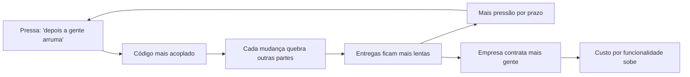
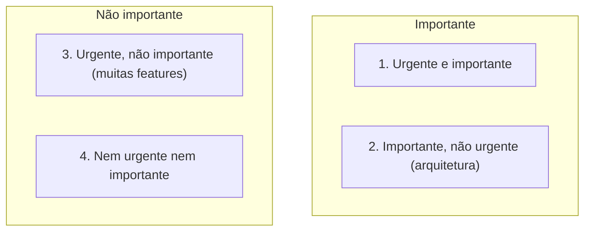

# 1. Introdução: o que é design e arquitetura

> [!NOTE] Em uma frase
> Uma boa arquitetura é a que deixa o software barato de mudar ao longo da vida inteira dele; se cada nova funcionalidade custa mais caro que a anterior, a arquitetura está falhando, por mais que o sistema funcione hoje.

## Por que isso importa

Imagine uma startup que lança um aplicativo de delivery em três meses com cinco desenvolvedores. No primeiro ano, cada pedido do time de produto vira código em poucos dias. No terceiro ano, o time tem cinquenta pessoas, e adicionar um campo "observação para o entregador" leva duas semanas: mexer nele quebra o cálculo de frete, o teste de cupom falha por motivo misterioso e ninguém tem coragem de tocar no módulo de pagamento. A empresa contratou dez vezes mais gente e entrega menos. Esse é o cenário que abre o livro, e o autor, Robert C. Martin (o "Uncle Bob"), mostra que ele é a regra, não a exceção.

A Parte I (capítulos 1 e 2) é curta, mas é a base de tudo: ela define o que o livro quer dizer com "arquitetura", diz como saber se uma arquitetura é boa e argumenta por que cuidar dela é responsabilidade de quem programa, mesmo quando ninguém pede.

## O que você precisa saber antes

Nada além de já ter trabalhado (ou estudado) em algum projeto de software com mais de alguns meses de vida. Se você nunca viu um código "apodrecer", os exemplos abaixo descrevem o fenômeno.

## As ideias centrais

### Design e arquitetura são a mesma coisa

Muita gente separa "arquitetura" (as decisões grandes: microsserviços ou monólito, qual banco) de "design" (as decisões pequenas: como uma classe se organiza). O livro recusa essa separação. Pense na planta de uma casa: ela mostra a forma dos cômodos, mas também onde fica cada tomada e cada interruptor. Os detalhes de baixo nível sustentam as decisões de alto nível, e um não faz sentido sem o outro. No software é igual: não existe uma linha clara onde a "arquitetura" termina e o "design" começa. É um contínuo de decisões, da forma geral do sistema até o nome de uma função.

Na prática, isso significa que você não está "só implementando" quando escolhe onde colocar uma regra de negócio. Essa escolha é arquitetural.

### A medida de uma boa arquitetura

Se arquitetura é tudo isso, como saber se ela é boa? O livro dá um critério objetivo: **o objetivo da arquitetura é minimizar o esforço humano necessário para construir e manter o sistema**. Não é elegância, não é seguir um padrão da moda. É custo.

A consequência é que dá para medir. Se o esforço para entregar cada funcionalidade é baixo e se mantém baixo ao longo dos anos, a arquitetura é boa. Se o esforço cresce a cada release, ela é ruim. O livro mostra um caso (com números de uma empresa real, não identificada) em que o time cresceu muitas vezes, a quantidade de código produzida por release praticamente estagnou e o custo por linha de código explodiu. Os desenvolvedores não ficaram preguiçosos: eles trabalhavam tanto quanto antes, mas passavam a maior parte do tempo lidando com a bagunça acumulada em vez de criar coisas novas.

O ciclo acima é o que o livro descreve: a bagunça não acelera nada, nem no curto prazo. A frase que resume o argumento é que **a única forma de ir rápido é ir bem**. A ideia de que dá para "ir rápido agora e limpar depois" é, segundo o autor, uma mentira que desenvolvedores contam a si mesmos. O "depois" nunca chega, porque a pressão do mercado não diminui.

O livro usa a fábula da lebre e da tartaruga: a lebre (o time apressado e confiante) dispara na frente e para; a tartaruga (o time disciplinado) parece lenta, mas chega. Ele cita ainda um experimento informal em que programar com testes escritos antes do código, de forma disciplinada, foi mais rápido do que programar sem eles. Trate esse dado como ilustração e não como estudo científico: é um exemplo pessoal do autor.

### Dois valores: comportamento e estrutura

O capítulo 2 diz que todo software entrega dois tipos de valor a quem paga por ele.

1. **Comportamento**: o que o sistema faz. Calcular o frete, emitir a nota, mandar o e-mail. É o que o cliente vê e pede.
2. **Estrutura** (ou arquitetura): o quão fácil é mudar o que o sistema faz.

A palavra "software" carrega a segunda ideia: "soft" quer dizer macio, maleável. Se fosse para ser difícil de mudar, seria "hardware". Então um software só cumpre a promessa do próprio nome se for fácil de alterar. E o custo de uma mudança deveria ser proporcional ao tamanho da mudança, não ao formato dela. Quando o time diz "essa mudança é pequena, mas não encaixa no jeito que o sistema foi feito", é a estrutura falhando.

O livro faz então uma provocação deliberadamente exagerada: compare um programa que funciona perfeitamente mas é impossível de mudar com um programa que não funciona, mas é fácil de mudar. Qual vale mais? O primeiro fica inútil assim que os requisitos mudarem (e eles sempre mudam). O segundo você conserta e continua consertando. Logo, a estrutura vale mais.

> [!IMPORTANT]
> O argumento não é "comportamento não importa". É que o comportamento de hoje é temporário; a capacidade de mudar o comportamento é o que garante valor amanhã.

### A matriz de Eisenhower e a luta pela arquitetura

Para explicar por que a estrutura é sempre deixada para depois, o livro usa a matriz de Eisenhower, uma ferramenta de priorização que separa tarefas em urgente ou não e importante ou não. O comportamento costuma ser urgente, mas nem sempre importante (a feature pedida para sexta-feira). A arquitetura é importante, mas quase nunca urgente. O erro clássico é tratar tudo o que é urgente como importante, e com isso sacrificar a estrutura, que nunca grita.

Quem vê a diferença? O pessoal de negócio, em geral, não tem como avaliar a estrutura do código. Por isso o livro diz que **é responsabilidade do time de desenvolvimento defender a arquitetura**, inclusive brigando por ela com gerentes e produto, do mesmo jeito que o financeiro briga pelo orçamento e o marketing briga pela marca. O autor descreve isso como uma luta legítima entre partes interessadas, não como rebeldia.

## Onde isso aparece no mundo real

- **Reescritas completas.** Muitas empresas chegam ao ponto em que o sistema é tão caro de mudar que a decisão vira "reescrever do zero". O livro alerta que, sem mudar a disciplina, a reescrita chega ao mesmo estado: o time novo sofre a mesma pressão e repete os mesmos atalhos.
- **Velocidade medida em pontos por sprint caindo.** Times ágeis que acompanham a velocidade ao longo de trimestres frequentemente veem ela cair mesmo com o time crescendo. Esse é o sintoma que o capítulo 1 descreve com números.
- **O "não dá para mexer nisso".** Todo dev conhece um módulo intocável, que só uma pessoa entende. Esse módulo é a estrutura falhando em entregar o segundo valor: ele ainda funciona, mas não pode mais mudar.

## Erros comuns de quem está aprendendo

- **Achar que arquitetura é só desenho de caixas no quadro.** Para o livro, onde você coloca uma regra de negócio dentro de uma função também é arquitetura. Decisões pequenas acumuladas viram a forma do sistema.
- **Achar que "ir rápido e arrumar depois" economiza tempo.** O livro argumenta que a bagunça desacelera já no curto prazo; o "depois" não chega porque a pressão não acaba.
- **Ler "estrutura vale mais que comportamento" como permissão para não entregar.** O ponto é equilíbrio: entregar o urgente sem destruir a capacidade de entregar o próximo.
- **Esperar que o gestor peça qualidade de código.** Ele quase nunca vai pedir, porque não enxerga. Defender a estrutura é parte do trabalho de quem programa.

## Verifique se entendeu

1. Por que o livro diz que não há fronteira clara entre design e arquitetura? (veja "Design e arquitetura são a mesma coisa")
2. Qual é o critério objetivo para dizer se uma arquitetura é boa, e como você mediria isso no seu time? (veja "A medida de uma boa arquitetura")
3. Explique com suas palavras por que um programa fácil de mudar, mesmo com bugs, pode valer mais que um perfeito e rígido. (veja "Dois valores: comportamento e estrutura")
4. Em qual quadrante da matriz de Eisenhower fica a arquitetura, e por que isso faz ela ser negligenciada? (veja "A matriz de Eisenhower e a luta pela arquitetura")

## Para ir além

- [serodriguez68/clean-architecture](https://github.com/serodriguez68/clean-architecture): o arquivo da Parte I resume os dois capítulos e o caso da empresa cujo custo por linha disparou.
- [preslavmihaylov/booknotes — Clean Architecture](https://github.com/preslavmihaylov/booknotes/tree/master/architecture/clean-architecture): o README da Parte 1 traz as notas dos capítulos 1 e 2 com os gráficos de produtividade.
- [Book Review: Clean Architecture — reflectoring.io](https://reflectoring.io/book-review-clean-architecture/): mostra como um leitor experiente avaliou essa introdução dentro do livro todo.

---
Próximo: [2. Paradigmas de programação](02-paradigmas-de-programacao.md) · Voltar ao livro: [Guia de leitura](index.md)
