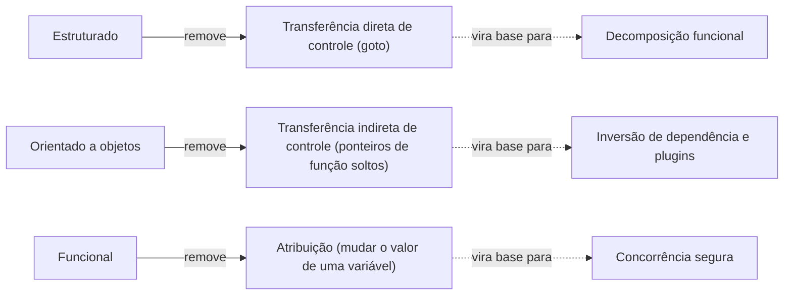

# 2. Paradigmas de programação

> [!NOTE] Em uma frase
> Cada paradigma de programação não deu algo novo ao programador, e sim tirou algo dele (o `goto`, o ponteiro de função solto, a atribuição de variável), e são justamente essas proibições que tornam possível organizar sistemas grandes.

## Por que isso importa

Pergunte a dez devs o que é orientação a objetos e você vai ouvir "encapsulamento, herança e polimorfismo", "modelar o mundo real" ou "classes". Nenhuma dessas respostas explica por que OO importa para arquitetura. A Parte II (capítulos 3 a 6) responde isso: de tudo que a OO trouxe, uma peça só, o polimorfismo seguro, é o que permite que a regra de negócio não dependa do banco de dados. E da programação funcional sai outra peça, a imutabilidade, que resolve uma classe inteira de bugs de concorrência.

Sem essa parte, os princípios SOLID e a regra da dependência das partes seguintes parecem regras arbitrárias. Com ela, você vê de onde vêm.

## O que você precisa saber antes

- [1. Introdução: o que é design e arquitetura](01-introducao-o-que-e-design-e-arquitetura.md): o objetivo da arquitetura é baratear a mudança.
- Ter visto, em qualquer linguagem, um `if`, um laço e uma função. Os exemplos usam Python.

## As ideias centrais

### Paradigmas como disciplina, não como poder

Um paradigma de programação é um estilo de organizar código que diz quais estruturas usar e quais evitar. O livro conta três: estruturado (1968), orientado a objetos (1966) e funcional (com raízes em 1936, no cálculo lambda, e na linguagem LISP de 1958). A ordem de descoberta não é a ordem em que foram adotados.

A tese do capítulo 3 é que cada um **remove** uma capacidade:



O autor ainda arrisca que provavelmente não haverá um quarto paradigma, porque não sobrou muita coisa para tirar. Isso é opinião dele, não consenso.

As três peças se encaixam com as três preocupações da arquitetura: função (estruturado), separação de componentes (OO) e gerenciamento de dados (funcional).

### Programação estruturada: provar é difícil, testar é o que sobra

Nos anos 1960, Edsger Dijkstra percebeu que alguns usos do `goto` (pular para qualquer linha do programa) impediam dividir o código em pedaços que pudessem ser raciocinados isoladamente. Ele mostrou que tudo pode ser escrito com três estruturas: sequência, seleção (`if`) e repetição (`while`). Com isso, um programa grande vira uma árvore de funções pequenas, cada uma verificável sozinha. Isso é a **decomposição funcional**.

O sonho de Dijkstra era provar matematicamente que programas estavam corretos. Isso não pegou na prática. O que pegou foi o método científico: você não prova que uma teoria está certa, só tenta refutá-la. Um teste faz isso com o código: ele pode mostrar que há um bug, nunca que não há nenhum. A arquitetura entra aqui porque, para testar, você precisa de unidades pequenas e isoladas. Um sistema em que tudo depende de tudo é um sistema que não dá para refutar por partes.

### Orientação a objetos: o que importa é o polimorfismo

O capítulo 5 desmonta as três respostas clássicas:

- **Encapsulamento** (esconder dados atrás de métodos): a linguagem C já fazia isso com arquivos de cabeçalho; C++ e Java até enfraqueceram, porque os campos privados aparecem na declaração da classe.
- **Herança** (uma classe reaproveitar outra): já dava para simular em C com truques de layout de memória. OO deixou mais conveniente, não inventou.
- **Polimorfismo** (o mesmo código chamar comportamentos diferentes conforme o objeto): também existia em C, via ponteiros de função. Mas ponteiros de função são perigosos; um erro de convenção derruba o sistema. OO tornou o polimorfismo **seguro e automático**.

Um exemplo de polimorfismo anterior à OO: no sistema operacional UNIX, um programa lê da "entrada padrão" sem saber se ela é teclado, arquivo ou outro programa. Essa independência de dispositivo vem de uma tabela de funções que cada driver preenche.

E por que isso importa para arquitetura? Por causa da **direção da dependência**. Quando o módulo A chama, importa ou conhece o módulo B, A [depende](../../glossario.md#dependência-direção-da) de B: mudanças em B podem quebrar A. Sem polimorfismo, a dependência no código-fonte sempre segue o fluxo de execução: se a regra de negócio chama o banco, ela importa o banco. Com polimorfismo, você coloca uma interface no meio e inverte isso.

```python
class RepositorioPedidos:          # interface, mora junto da regra
    def salvar(self, pedido): ...

def fechar_pedido(pedido, repo: RepositorioPedidos):
    pedido.status = "fechado"
    repo.salvar(pedido)            # chama "para fora", mas sem importar o banco

class RepositorioPostgres(RepositorioPedidos):   # mora em outro módulo
    def salvar(self, pedido):
        ...  # SQL aqui
```

O fluxo de execução vai da regra para o Postgres. A dependência no código vai do Postgres para a regra (é ele que importa a interface). Isso é a **inversão de dependência**, e é o que permite que o banco, a interface web e o framework sejam *plugins*: peças que se encaixam na regra de negócio, e não o contrário. Para o livro, é essa a definição de OO que interessa a quem arquiteta: a capacidade de controlar, via polimorfismo, a direção de cada dependência do sistema.

Uma consequência prática: com as dependências invertidas, cada lado pode ser compilado, implantado e desenvolvido separadamente. O time do banco não trava o time da regra.

### Programação funcional: o problema é a variável que muda

Na programação funcional, uma variável recebe um valor e nunca mais muda. Isso é **imutabilidade**. O exemplo do livro é imprimir os quadrados dos 25 primeiros inteiros: em Java, com um contador que vai de 0 a 24; em Clojure (um dialeto de LISP), compondo funções sem nenhuma variável mudando.

O argumento arquitetural é este: condições de corrida (duas threads lendo e escrevendo o mesmo valor ao mesmo tempo, com resultado dependendo de quem chega primeiro), deadlocks (duas threads esperando uma pela outra para sempre) e atualizações concorrentes perdidas só acontecem porque variáveis mudam. Sem mutação, esses problemas não existem.

Imutabilidade total é cara, então o livro propõe duas táticas:

1. **Segregar a mutabilidade.** Divida o sistema em componentes imutáveis, que só calculam, e alguns poucos componentes mutáveis, que guardam estado e são protegidos por mecanismos como memória transacional. Coloque o máximo de lógica possível nos imutáveis.
2. **Event sourcing.** Em vez de guardar o saldo atual de uma conta (que muda), guarde todas as transações (que nunca mudam) e calcule o saldo quando precisar. O estado vira uma soma de fatos. Com armazenamento e processamento baratos, isso fica viável em muitos casos. Sistemas de controle de versão como o Git funcionam assim: guardam a história e derivam o estado atual.

```python
transacoes = [("deposito", 100), ("saque", 30), ("deposito", 50)]

def saldo(eventos):
    return sum(v if tipo == "deposito" else -v for tipo, v in eventos)

assert saldo(transacoes) == 120
```

## Onde isso aparece no mundo real

- **Drivers e sistemas de plugins.** O próprio UNIX, os drivers de impressora do Windows e as extensões do VS Code seguem a mesma ideia: o núcleo define uma interface e não sabe quem vai implementá-la.
- **Bancos e contabilidade.** O extrato bancário é event sourcing antes de o nome existir: o saldo é derivado do histórico de lançamentos, que nunca é apagado, só corrigido com novos lançamentos.
- **Frameworks de interface com estado imutável.** Bibliotecas de front-end populares recomendam não mutar o estado e sim criar um novo, justamente para fugir de bugs de atualização simultânea.

## Erros comuns de quem está aprendendo

- **Achar que OO é "modelar o mundo real".** Para o livro, isso é uma explicação vaga. O ganho concreto é controlar a direção das dependências com polimorfismo.
- **Achar que os paradigmas competem.** O livro trata os três como complementares: você usa estruturado dentro de funções, OO para separar componentes e funcional para gerenciar dados, tudo no mesmo sistema.
- **Ver herança como o centro da OO.** Herança é a parte mais fraca do argumento; muita coisa boa de OO funciona só com interfaces e composição.
- **Ler "imutabilidade" como "nunca guardar estado".** O livro propõe isolar o estado, não eliminá-lo.

## Verifique se entendeu

1. O que cada paradigma remove, e por que remover algo ajuda? (veja "Paradigmas como disciplina, não como poder")
2. Por que um teste nunca prova que o código está correto, e o que isso implica para o tamanho das unidades do sistema? (veja "Programação estruturada")
3. No exemplo do repositório de pedidos, para que lado vai o fluxo de execução e para que lado vai a dependência no código? (veja "Orientação a objetos")
4. Como o event sourcing evita mutação, e qual o custo dessa escolha? (veja "Programação funcional")

## Para ir além

- [serodriguez68/clean-architecture](https://github.com/serodriguez68/clean-architecture): o arquivo da Parte II detalha os três paradigmas e o argumento sobre polimorfismo.
- [preslavmihaylov/booknotes — Clean Architecture](https://github.com/preslavmihaylov/booknotes/tree/master/architecture/clean-architecture): o README da Parte 2 traz os diagramas de inversão de dependência do capítulo 5.
- [Clean architecture book summary — Alex Manrique](https://alexmanrique.com/blog/books/2020/11/15/clean-architecture-book-summary.html): resumo em bullets dos capítulos 3 a 6 para revisão rápida.

---
Anterior: [1. Introdução: o que é design e arquitetura](01-introducao-o-que-e-design-e-arquitetura.md) · Próximo: [3. Princípios SOLID](03-principios-solid.md) · Voltar ao livro: [Guia de leitura](index.md)
