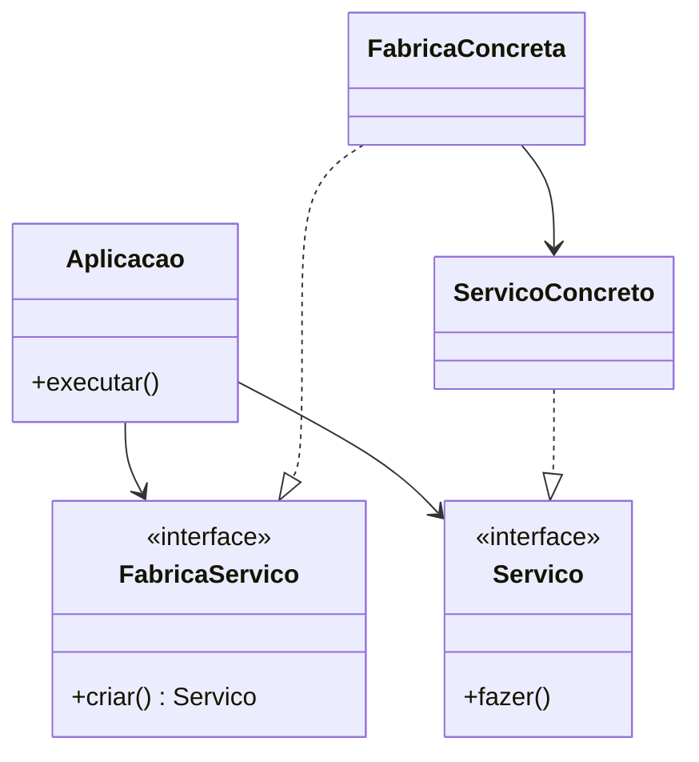

# 3. Princípios SOLID

> [!NOTE] Em uma frase
> SOLID são cinco regras para agrupar funções e dados em módulos de forma que cada mudança fique contida em um lugar só, e que as partes estáveis do sistema nunca dependam das partes que mudam muito.

## Por que isso importa

Uma classe `Funcionario` tem três métodos: `calcular_pagamento()`, usado pelo financeiro; `relatorio_horas()`, usado pelo RH; e `salvar()`, mantido pelo time de infraestrutura. Os dois primeiros usam a mesma função auxiliar de cálculo de horas regulares. O financeiro pede para mudar a regra de horas, um dev altera a função auxiliar, os testes do pagamento passam, e o relatório do RH começa a sair errado sem que ninguém perceba por semanas. Ninguém errou de propósito: o código juntou coisas que mudam por motivos diferentes.

A Parte III (capítulos 7 a 11) trata desse tipo de problema no nível médio do sistema, o dos módulos e classes. Os princípios não são novos (Martin os reuniu e o acrônimo SOLID foi cunhado por volta de 2004), mas aqui eles são reapresentados com foco em arquitetura.

## O que você precisa saber antes

- [2. Paradigmas de programação](02-paradigmas-de-programacao.md): principalmente a ideia de que polimorfismo permite inverter a direção de uma dependência.
- Módulo, aqui, é um arquivo de código-fonte ou um conjunto coeso de funções e dados. Não precisa ser uma classe.

## As ideias centrais

### S: princípio da responsabilidade única (SRP)

O nome engana: o princípio **não** diz que uma função deve fazer uma coisa só (isso é outra regra, sobre funções). Ele diz que **um módulo deve responder a um, e apenas um, ator**. Ator é um grupo de pessoas que pede mudanças pelo mesmo motivo: o financeiro, o RH, o time de operações.

O exemplo do `Funcionario` acima viola o SRP porque serve a três atores. Os sintomas são dois: duplicação acidental (a função de horas parecia a mesma coisa para os dois, mas não era) e conflitos de merge (dois times mexendo no mesmo arquivo pelos motivos deles).

A correção é separar os dados das funções e dar a cada ator a sua classe:

```python
from dataclasses import dataclass

@dataclass
class DadosFuncionario:
    nome: str
    horas: list

class CalculadoraPagamento:       # muda quando o financeiro pede
    def calcular(self, f: DadosFuncionario): ...

class RelatorioHoras:             # muda quando o RH pede
    def gerar(self, f: DadosFuncionario): ...
```

Se ficar incômodo ter três classes, uma *facade* (fachada, uma classe fina que só repassa chamadas) pode oferecer um ponto de entrada único sem juntar a lógica.

### O: princípio aberto/fechado (OCP)

Um módulo deve estar **aberto para extensão e fechado para modificação**: dá para adicionar comportamento sem editar o que já funciona. O exemplo do livro é um sistema que mostra um relatório financeiro na tela e, depois, precisa imprimi-lo em PDF. Se a regra de cálculo estiver separada da apresentação, o PDF é só um novo "apresentador", e nada do cálculo é tocado.

O OCP é, no fundo, um princípio de arquitetura: organize os componentes em uma hierarquia em que os mais importantes (as regras de negócio) ficam protegidos de mudanças nos menos importantes (tela, banco, formato de arquivo). A proteção vem de fazer as dependências apontarem para o que é mais importante.

### L: princípio da substituição de Liskov (LSP)

Formulado por Barbara Liskov em 1988, diz que, se `S` é um subtipo de `T`, qualquer código que usa `T` deve funcionar com `S` sem saber a diferença. O exemplo clássico é o quadrado e o retângulo: matematicamente todo quadrado é um retângulo, mas se `Quadrado` herda de `Retangulo`, um código que faz `r.largura = 5; r.altura = 2` e espera área 10 quebra com um quadrado.

O livro estende o LSP para além de herança: vale para qualquer contrato, incluindo APIs REST. O exemplo é um agregador de táxis que manda pedidos para várias empresas pelo mesmo formato de URL. Se uma empresa abrevia um campo de um jeito diferente das outras, o agregador ganha um `if empresa == "X"` e, depois, outro, e outro. Cada violação do contrato vira uma exceção espalhada pelo sistema.

### I: princípio da segregação de interfaces (ISP)

Não force ninguém a depender do que não usa. Se três usuários chamam, cada um, um método diferente de uma classe grande, os três ficam acoplados às mudanças dos outros dois métodos. Em linguagens com tipagem estática, isso pode significar recompilar e reimplantar sem necessidade. Em Python o efeito de compilação some, mas o problema conceitual continua.

No nível de arquitetura, o livro dá a versão mais importante: se o seu sistema depende de um framework que depende de um banco específico, você depende daquele banco, mesmo sem usar nada dele. Uma falha ou mudança no banco chega até você. Depender de algo que traz bagagem desnecessária é arriscado.

### D: princípio da inversão de dependência (DIP)

Os módulos de alto nível (as regras) não devem depender dos de baixo nível (detalhes técnicos); ambos devem depender de abstrações. Uma abstração é uma interface que descreve o que fazer sem dizer como.

O livro torna isso prático com uma distinção: o problema não é depender de qualquer coisa concreta. Depender da biblioteca padrão da linguagem, que quase nunca muda, é seguro. O problema é depender de coisas **concretas e voláteis**, que mudam com frequência e que você ainda está desenvolvendo. Daí as regras:

- não referencie classes concretas voláteis; referencie interfaces;
- não herde de classes concretas voláteis;
- não sobrescreva funções concretas;
- crie objetos voláteis através de uma fábrica (uma função ou objeto cuja única tarefa é construir outros objetos), para não precisar importar a classe concreta.



No diagrama, uma linha imaginária separa o lado de cima (aplicação e interfaces) do lado de baixo (implementações). Todas as setas que cruzam essa linha apontam para cima, para as abstrações. O fluxo de execução vai para baixo, mas as dependências no código vão para cima. Essa linha, segundo o livro, vai virar a fronteira entre as camadas da Clean Architecture. Alguma classe concreta sempre vai ter que criar as implementações; o livro chama esse lugar de `main` e o trata como o ponto mais "sujo" do sistema, tema da [Parte V](05b-detalhes-e-humble-objects.md).

## Onde isso aparece no mundo real

- **Injeção de dependência em frameworks.** Spring (Java), ASP.NET e FastAPI (com `Depends`) existem para resolver exatamente o "quem cria a implementação concreta" do DIP, sem que a regra importe a classe concreta.
- **APIs públicas versionadas.** Quando uma API muda o significado de um campo sem mudar a versão, todos os clientes viram o agregador de táxis do LSP, cheio de casos especiais.
- **Monorepos com donos por pasta.** Ferramentas que exigem aprovação do time dono de cada pasta (como o CODEOWNERS do GitHub) são, na prática, uma forma de aplicar o SRP: arquivos separados por ator.

## Erros comuns de quem está aprendendo

- **Ler SRP como "cada classe faz uma coisa".** O critério é o ator, a pessoa que pede a mudança. Uma classe com dez métodos pode respeitar o SRP se todos mudam pelo mesmo motivo.
- **Achar que LSP é só sobre herança.** Vale para qualquer contrato: interfaces, protocolos, APIs HTTP.
- **Criar uma interface para cada classe.** O DIP fala de dependências **voláteis**. Envolver a biblioteca padrão ou uma classe estável em interface só adiciona indireção.
- **Achar que SOLID resolve arquitetura sozinho.** O livro deixa claro que SOLID é o nível médio. Os componentes e as fronteiras vêm nas próximas partes.

## Verifique se entendeu

1. No exemplo do `Funcionario`, quem são os atores, e qual bug acontece por eles compartilharem código? (veja "S: princípio da responsabilidade única")
2. Como o exemplo do relatório em PDF mostra o OCP funcionando? (veja "O: princípio aberto/fechado")
3. Por que o agregador de táxis é uma violação do LSP mesmo sem nenhuma herança? (veja "L: princípio da substituição de Liskov")
4. Quando depender de algo concreto é aceitável segundo o DIP? (veja "D: princípio da inversão de dependência")

## Para ir além

- [serodriguez68/clean-architecture](https://github.com/serodriguez68/clean-architecture): o arquivo da Parte III traz cada princípio com o exemplo original do livro.
- [preslavmihaylov/booknotes — Clean Architecture](https://github.com/preslavmihaylov/booknotes/tree/master/architecture/clean-architecture): o README da Parte 3 reproduz em diagrama próprio o caso do agregador de táxis e a fábrica abstrata.
- [Book Review: Clean Architecture — reflectoring.io](https://reflectoring.io/book-review-clean-architecture/): comenta como os capítulos de SOLID se relacionam com o resto do livro.

---
Anterior: [2. Paradigmas de programação](02-paradigmas-de-programacao.md) · Próximo: [4. Princípios de componentes](04-principios-de-componentes.md) · Voltar ao livro: [Guia de leitura](index.md)
