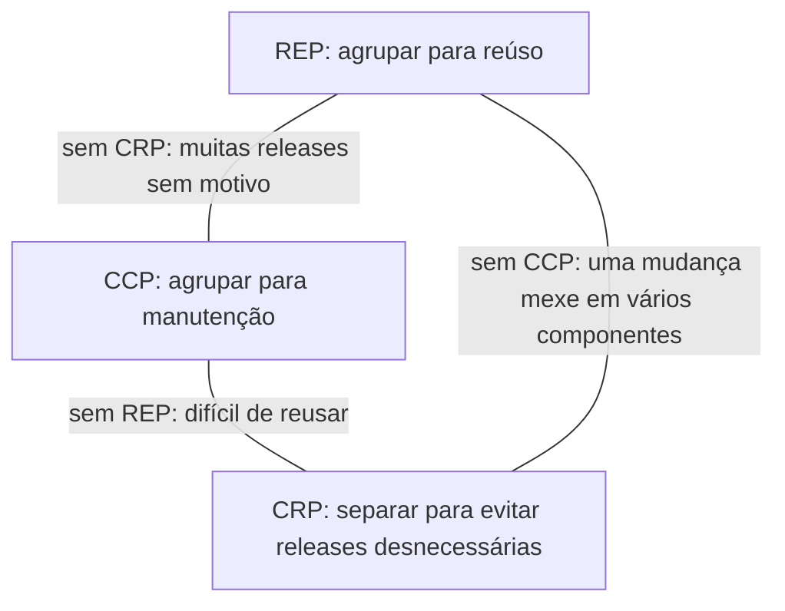

# 4. Princípios de componentes

> [!NOTE] Em uma frase
> Componentes devem agrupar o que muda junto, depender uns dos outros sem ciclos e sempre na direção do mais estável, e o mais estável deve ser também o mais abstrato.

## Por que isso importa

Num monorepo de uma empresa média, o pacote `utils` começou com três funções de data. Hoje tem duzentas, é importado por quarenta serviços e depende do cliente do banco, do SDK de pagamentos e da biblioteca de logs. Qualquer mudança nele força testar e reimplantar quase tudo. Pior: o `utils` importa o pacote `pedidos`, que importa o `utils`. Ninguém consegue liberar uma versão de um sem liberar a do outro.

SOLID organiza classes. A Parte IV (capítulos 12 a 14) sobe um nível e organiza **componentes**: as unidades que você empacota, versiona e implanta. Os erros acima violam, respectivamente, princípios de coesão e de acoplamento entre componentes, e o livro dá métricas numéricas para detectá-los.

## O que você precisa saber antes

- [3. Princípios SOLID](03-principios-solid.md): os princípios de componentes são, em boa parte, SRP, ISP e DIP aplicados um nível acima.
- [Acoplamento e coesão](../../glossario.md#acoplamento-e-coesão): acoplamento é quanto uma parte depende de outra; coesão é quanto as coisas dentro de uma parte pertencem juntas.

## As ideias centrais

### O que é um componente

Componente é a menor unidade que pode ser implantada como parte de um sistema: um `.jar` em Java, uma DLL em .NET, uma *gem* em Ruby, um pacote publicado no PyPI. O capítulo 12 conta a história de como chegamos aqui: dos programas que eram carregados em endereços fixos de memória, passando pelos *linkers* (programas que juntam pedaços compilados num executável) que ficaram lentos demais, até a situação atual em que juntar componentes em tempo de execução é barato. A conclusão é que hoje é viável ter uma arquitetura de *plugins*: componentes independentes que se encaixam em tempo de carga.

### Coesão: o que vai junto

Três princípios dizem o que colocar dentro de um componente:

- **REP (equivalência entre reúso e release).** O que é reusado junto é liberado junto. Se as classes de um pacote não têm um tema comum e não são versionadas juntas, quem as reutiliza não consegue acompanhar as mudanças. Um componente precisa de número de versão e notas de release que façam sentido para todas as suas partes.
- **CCP (fechamento comum).** Junte o que muda pelos mesmos motivos e ao mesmo tempo; separe o que muda por motivos diferentes. É o SRP aplicado a componentes. Para a maioria dos sistemas, ser fácil de manter importa mais que ser reusável, e o CCP é o que garante que uma mudança de requisito mexa em um componente só.
- **CRP (reúso comum).** Não force quem usa um componente a depender de coisas que ele não usa. É o ISP aplicado a componentes. Se você importa um pacote por causa de uma classe, toda mudança nas outras classes dele te obriga a revalidar.

Os três puxam em direções diferentes. REP e CCP tendem a aumentar os componentes (juntar coisas); CRP tende a diminuí-los (separar). O livro representa isso como um triângulo de tensão:



Cada aresta diz o que dá errado quando você abandona o princípio do vértice oposto. Não existe ponto perfeito. O livro observa que projetos novos tendem a priorizar o CCP (facilidade de desenvolver), e que, conforme amadurecem e outros projetos passam a reusá-los, o equilíbrio se desloca para REP e CRP. **A divisão em componentes muda com o tempo**, e isso é normal.

### Acoplamento: sem ciclos (ADP)

O **princípio das dependências acíclicas** diz que o grafo de dependências entre componentes não pode ter ciclos. O sintoma de ciclo é o que o livro chama de "síndrome da manhã seguinte": você deixa seu código funcionando à noite e, de manhã, está quebrado porque alguém mudou algo de que você depende, que depende de você.

Sem ciclos, cada componente pode ser liberado e testado na ordem do grafo, de baixo para cima. Com um ciclo, os componentes envolvidos viram, na prática, um componente só, e precisam ser liberados juntos.

Para quebrar um ciclo há duas saídas: aplicar o DIP (criar uma interface no componente que está "embaixo" e fazer o outro implementá-la) ou extrair a parte compartilhada para um novo componente do qual os dois dependem.

O livro tira daí uma consequência importante: **a estrutura de componentes não pode ser desenhada de cima para baixo no primeiro dia**. Ela não reflete as funções do sistema; reflete como ele é construído e mantido. Ela nasce e cresce junto com o código, conforme aparecem os pontos de mudança e de reúso.

### Acoplamento: na direção da estabilidade (SDP)

Estável, aqui, quer dizer difícil de mudar, porque muita coisa depende dele. O livro dá uma métrica de **instabilidade**:

- *Fan-in*: quantas classes de fora dependem do componente.
- *Fan-out*: de quantas classes de fora o componente depende.
- **I = fan-out / (fan-in + fan-out)**, entre 0 (máximo de estabilidade) e 1 (máximo de instabilidade).

O **princípio das dependências estáveis** diz que um componente deve depender só de componentes mais estáveis que ele, ou seja, o valor de I deve diminuir no sentido das setas. Um componente que você quer mudar com frequência (a tela, por exemplo) deve ter I alto. Se um componente estável depender dele, ele fica preso.

### Estabilidade e abstração andam juntas (SAP)

Se o núcleo estável não pode mudar, como estendê-lo? Com abstrações (interfaces e classes abstratas), que permitem acrescentar comportamento sem editar (o OCP). O **princípio das abstrações estáveis** diz que um componente deve ser tão abstrato quanto é estável. Outra métrica:

- **A = classes abstratas e interfaces / total de classes**, entre 0 (só concreto) e 1 (só abstrato).

Plotando A contra I, o livro define:

- **Zona de dor** (I perto de 0, A perto de 0): concreto e todo mundo depende dele. Um esquema de banco de dados costuma estar aqui, e é por isso que mexer em esquema dói. Bibliotecas utilitárias estáveis também estão, mas como quase não mudam, não incomodam.
- **Zona de inutilidade** (I perto de 1, A perto de 1): só abstrações que ninguém usa. Código morto.
- **Sequência principal**: a diagonal entre (0,1) e (1,0). A distância até ela, **D = |A + I − 1|**, indica quanto o componente está fora do equilíbrio.

```python
def instabilidade(fan_in, fan_out):
    return fan_out / (fan_in + fan_out)

def distancia(abstracao, instab):
    return abs(abstracao + instab - 1)

i = instabilidade(fan_in=12, fan_out=1)        # muito usado, depende de pouco
assert round(i, 2) == 0.08
assert round(distancia(0.0, i), 2) == 0.92     # concreto e estável: zona de dor
```

## Onde isso aparece no mundo real

- **Gerenciadores de pacotes.** npm, pip e Maven reclamam ou se perdem com dependências circulares. Ferramentas de monorepo, como Bazel e Nx, proíbem ciclos e liberam pacotes na ordem do grafo, exatamente como o ADP descreve.
- **Esquemas de banco compartilhados.** Quando dez serviços leem a mesma tabela, ela está na zona de dor: concreta e muito usada. Toda migração vira projeto.
- **Ferramentas de análise estática.** Algumas ferramentas de métricas de código calculam instabilidade e abstração por pacote, derivadas desses mesmos princípios.

## Erros comuns de quem está aprendendo

- **Tentar desenhar os componentes no começo do projeto.** O livro diz explicitamente que essa estrutura emerge do código. Desenhar cedo demais costuma gerar ciclos e componentes errados.
- **Achar que todo componente deve ser estável.** Um sistema só com componentes estáveis não muda. Você quer componentes instáveis onde a mudança é frequente.
- **Ler as métricas como meta absoluta.** Elas são sinais para investigar, não notas para otimizar. Uma biblioteca utilitária na zona de dor pode ser perfeitamente aceitável.
- **Confundir componente com microsserviço.** Componente é unidade de implantação ou empacotamento. Pode ser uma biblioteca carregada no mesmo processo.

## Verifique se entendeu

1. Por que REP e CCP puxam numa direção e CRP puxa na outra? (veja "Coesão: o que vai junto")
2. Quais são as duas formas de quebrar um ciclo de dependências? (veja "Acoplamento: sem ciclos")
3. Calcule a instabilidade de um componente com fan-in 2 e fan-out 6. Ele deveria ser abstrato ou concreto? (veja "Acoplamento: na direção da estabilidade" e "Estabilidade e abstração andam juntas")
4. Por que um esquema de banco de dados costuma cair na zona de dor? (veja "Estabilidade e abstração andam juntas")

## Para ir além

- [serodriguez68/clean-architecture](https://github.com/serodriguez68/clean-architecture): o arquivo da Parte IV tem as fórmulas e o triângulo de tensão com exemplos.
- [preslavmihaylov/booknotes — Clean Architecture](https://github.com/preslavmihaylov/booknotes/tree/master/architecture/clean-architecture): o README da Parte 4 traz o gráfico da sequência principal e as zonas de dor e de inutilidade.
- [Clean architecture book summary — Alex Manrique](https://alexmanrique.com/blog/books/2020/11/15/clean-architecture-book-summary.html): lista compacta dos seis princípios para consulta rápida.

---
Anterior: [3. Princípios SOLID](03-principios-solid.md) · Próximo: [5a. Fronteiras e a regra da dependência](05a-fronteiras-e-a-regra-da-dependencia.md) · Voltar ao livro: [Guia de leitura](index.md)
