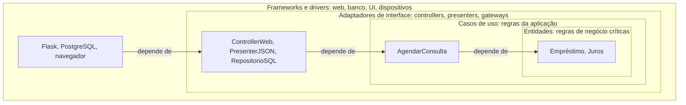

# 5a. Fronteiras e a regra da dependência

> [!NOTE] Em uma frase
> Separe o que é regra de negócio do que é detalhe técnico com fronteiras, e faça todas as dependências do código cruzarem essas fronteiras apontando para dentro, para as regras, nunca para fora.

## Por que isso importa

Um sistema de agendamento de consultas nasceu acoplado ao framework web: a regra "um paciente não pode ter duas consultas no mesmo horário" está dentro de um controller, que lê direto do ORM (uma biblioteca que traduz objetos em tabelas do banco). Agora a clínica quer agendar também pelo WhatsApp. A regra precisa ser copiada para o bot, e as duas cópias começam a divergir. Testar a regra exige subir o servidor web e um banco.

A Parte V é o coração do livro. Esta página cobre os capítulos 15 a 22: o que é arquitetura, como manter o sistema independente, onde traçar fronteiras, o que são regras de negócio e, no fim, o diagrama dos círculos concêntricos que dá nome ao livro.

## O que você precisa saber antes

- [3. Princípios SOLID](03-principios-solid.md): o DIP mostra como inverter uma dependência com uma interface.
- [4. Princípios de componentes](04-principios-de-componentes.md): componentes estáveis devem ser abstratos; os instáveis ficam na ponta.
- [Dependência (direção da)](../../glossario.md#dependência-direção-da): se A importa B, A depende de B.

## As ideias centrais

### Arquitetura é a forma que mantém as opções abertas

O capítulo 15 define arquitetura como a forma dada ao sistema para facilitar quatro coisas: desenvolvimento, implantação, operação e manutenção. A manutenção é a mais cara, então é a que mais pesa.

Todo sistema tem duas partes: a **política** (as regras de negócio, o que dá valor) e os **detalhes** (banco, servidor web, framework, protocolo de comunicação). O objetivo da arquitetura é que a política não dependa dos detalhes, para que as decisões sobre eles possam ser **adiadas**. Quanto mais tarde você escolhe o banco, mais informação tem para escolher bem.

O livro conta a história do FitNesse, uma ferramenta de testes que o autor desenvolveu: o time adiou a escolha do banco escrevendo uma interface de persistência e, por um tempo, guardando tudo em memória e depois em arquivos simples. A decisão de usar MySQL nunca precisou ser tomada; os arquivos bastaram. (Um usuário depois escreveu um adaptador para MySQL em pouco tempo, porque a fronteira já existia.)

### Independência e fronteiras

O capítulo 16 pede que o sistema seja organizado em fatias horizontais (as [camadas](../../glossario.md#camada): interface, regras da aplicação, regras de domínio, banco) e verticais (os casos de uso: "agendar consulta", "cancelar consulta"). Assim, adicionar um caso de uso não mexe nos outros, e trocar o banco não mexe em nenhum.

Um alerta sobre duplicação: duas telas que hoje mostram os mesmos campos parecem duplicadas, mas mudam por motivos diferentes. Juntá-las é criar duplicação acidental (a mesma do SRP). Só elimine duplicação **verdadeira**, em que uma mudança numa cópia exigiria a mesma mudança na outra.

O livro descreve três modos de desacoplar: no código-fonte (módulos no mesmo executável), na implantação (bibliotecas separadas, carregadas no mesmo processo) e em serviços (processos que se falam pela rede). A recomendação é começar pelo mais barato e só subir quando necessário, mantendo a opção aberta.

Uma [fronteira arquitetural](../../glossario.md#fronteira-arquitetural) é uma linha que separa partes que mudam por motivos ou em ritmos diferentes. O capítulo 17 contrasta casos de empresas que separaram o sistema em servidores e camadas cedo demais (gastando muito tempo para atravessar fronteiras que não precisavam existir) com o FitNesse, que traçou só a fronteira certa. Onde traçar? Entre o que importa e o que não importa: a interface gráfica não importa para as regras de negócio, então há uma fronteira ali; o banco também. O resultado é uma arquitetura de plugins: o núcleo não conhece a tela nem o banco; eles se encaixam nele.

### Anatomia de uma fronteira e nível de uma política

O capítulo 18 lista as formas físicas que uma fronteira pode ter, da mais barata à mais cara: chamada de função entre módulos do mesmo programa (monólito), componentes implantados separadamente, threads, processos locais e serviços remotos. A regra da direção vale em todas; o que muda é o custo de atravessar.

O capítulo 19 define **nível**: a distância de uma política até as entradas e saídas do sistema. Quanto mais longe de teclado, tela, rede e disco, mais alto o nível. Exemplo: num programa de criptografia, o algoritmo de cifrar é de nível alto; ler do teclado e escrever no arquivo são de nível baixo. As dependências devem apontar dos níveis baixos para os altos.

### Regras de negócio: entidades e casos de uso

O capítulo 20 separa dois tipos de regra:

- **Regras de negócio críticas**: existiriam mesmo sem computador. Um banco cobra juros de empréstimo mesmo se o cálculo for feito à mão. Elas operam sobre dados críticos (saldo, taxa, prazo). O conjunto de regras e dados críticos forma uma **[entidade](../../glossario.md#entidade)**. Atenção: no livro, "entidade" quer dizer objeto de regra de negócio crítica; não é a "entidade do ORM" nem exatamente a entidade do DDD.
- **Regras da aplicação**: só fazem sentido porque há um sistema automatizado. "Só conceder o empréstimo depois de validar o cadastro" é um fluxo do sistema. Isso é um **[caso de uso](../../glossario.md#caso-de-uso)**: uma operação descrita do ponto de vista de quem a usa, sem saber se vem da web, do terminal ou de uma fila.

Casos de uso recebem e devolvem estruturas de dados simples (modelos de requisição e resposta), que **não** devem ser as entidades, porque as duas coisas mudam por motivos diferentes.

```python
from dataclasses import dataclass

@dataclass
class PedidoAgendamento:     # modelo de requisição, dado puro
    paciente_id: int
    horario: str

class AgendarConsulta:       # caso de uso
    def __init__(self, agenda):          # agenda: interface definida aqui dentro
        self.agenda = agenda

    def executar(self, req: PedidoAgendamento):
        if self.agenda.tem_consulta(req.paciente_id, req.horario):
            return {"ok": False, "erro": "horário ocupado"}
        self.agenda.marcar(req.paciente_id, req.horario)
        return {"ok": True}
```

O mesmo caso de uso serve o controller web e o bot do WhatsApp do exemplo inicial.

### A arquitetura deve "gritar" o domínio

O capítulo 21 compara com a planta de uma biblioteca ou de uma casa: olhando a planta, você sabe o que o prédio é. Ao abrir a estrutura de pastas de um sistema de saúde, você deveria ver `pacientes/`, `consultas/`, `prescricoes/`, e não `controllers/`, `models/`, `views/`. Se a primeira coisa que salta aos olhos é o framework, a arquitetura está gritando o framework, não o negócio.

### A Clean Architecture e a regra da dependência

O capítulo 22 junta tudo. Ele reconhece que arquiteturas anteriores (hexagonal, ou *ports and adapters*; DCI; BCE) já diziam o mesmo: separar o sistema em camadas com as regras de negócio no centro e tudo independente de framework, interface, banco e agentes externos. A síntese é um diagrama de círculos:



A **regra da dependência**: no código-fonte, as dependências só podem apontar para dentro. Nada de um círculo interno pode citar o nome de algo de um círculo externo: nem função, nem classe, nem variável, nem formato de dados.

- **Entidades**: regras críticas, as que menos mudam.
- **Casos de uso**: orquestram as entidades. Não mudam se o banco ou a tela mudam.
- **Adaptadores de interface**: convertem dados do formato conveniente para os casos de uso para o formato conveniente para o mundo externo (HTML, SQL, JSON). Toda a lógica de MVC e todo o SQL ficam aqui.
- **Frameworks e drivers**: a borda, onde há pouco código seu, só cola.

O número de círculos não é fixo; quatro é um exemplo. A regra é que vale sempre.

**Como atravessar uma fronteira se o caso de uso precisa chamar o presenter, que está fora?** Com o DIP: o caso de uso define uma interface (chamada de *output port*) e o presenter a implementa. O fluxo de execução vai para fora; a dependência no código continua para dentro.

**Que dados cruzam?** Estruturas simples, isoladas: objetos de dados, dicionários, argumentos de função. Nunca a linha do banco ou o objeto de requisição do framework, porque isso faria o círculo interno conhecer o externo.

## Onde isso aparece no mundo real

- **Arquitetura hexagonal em times de backend.** Muitos projetos em Java, Kotlin e Go organizam o código em `domain/`, `application/` e `adapters/`, que é a mesma regra com outros nomes.
- **Troca de framework web.** Times que migraram de um framework para outro (por exemplo, de Flask para FastAPI) sem tocar nas regras de negócio só conseguiram porque o framework estava no círculo externo.
- **Aplicativos com vários canais.** Um banco que atende por app, internet banking e caixa eletrônico precisa que "transferir" seja um caso de uso único, chamado por três adaptadores.

## Erros comuns de quem está aprendendo

- **Achar que são exatamente quatro camadas obrigatórias.** O livro diz que o número de círculos varia; o que não varia é a direção das dependências.
- **Passar entidades ou objetos do ORM pela fronteira.** Isso acopla o centro ao formato externo. Use estruturas de dados próprias da fronteira.
- **Confundir fluxo de execução com dependência.** O caso de uso chama o presenter (execução para fora), mas não o importa (dependência para dentro).
- **Traçar fronteiras em todo lugar desde o início.** Fronteira custa caro. O livro discute quando vale a pena na [próxima página](05b-detalhes-e-humble-objects.md).

## Verifique se entendeu

1. Por que adiar a escolha do banco é uma vantagem, e como o FitNesse fez isso? (veja "Arquitetura é a forma que mantém as opções abertas")
2. Qual a diferença entre duplicação verdadeira e acidental? Dê um exemplo de cada. (veja "Independência e fronteiras")
3. "Calcular juros" e "só liberar o empréstimo após validar o cadastro" ficam em quais círculos, e por quê? (veja "Regras de negócio: entidades e casos de uso")
4. Como um caso de uso consegue mandar dados para o presenter sem depender dele? (veja "A Clean Architecture e a regra da dependência")
5. O que a estrutura de pastas do seu projeto atual "grita"? (veja "A arquitetura deve gritar o domínio")

## Para ir além

- [The Clean Architecture — The Clean Code Blog](https://blog.cleancoder.com/uncle-bob/2012/08/13/the-clean-architecture.html): o post original de 2012 com o diagrama dos círculos e a regra da dependência, base do capítulo 22.
- [serodriguez68/clean-architecture](https://github.com/serodriguez68/clean-architecture): o arquivo da Parte V detalha capítulo a capítulo, incluindo anatomia de fronteiras e nível de políticas.
- [preslavmihaylov/booknotes — Clean Architecture](https://github.com/preslavmihaylov/booknotes/tree/master/architecture/clean-architecture): o README da Parte 5a cobre os capítulos 15 a 22 com diagramas.

---
Anterior: [4. Princípios de componentes](04-principios-de-componentes.md) · Próximo: [5b. Detalhes de fronteira e humble objects](05b-detalhes-e-humble-objects.md) · Voltar ao livro: [Guia de leitura](index.md)
