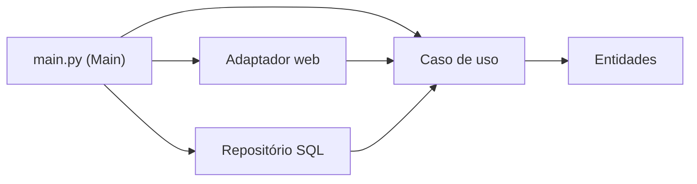

# 5b. Detalhes de fronteira e humble objects

> [!NOTE] Em uma frase
> Na prática, a fronteira se constrói isolando o código difícil de testar numa casca fina e burra, escolhendo quanto pagar por cada fronteira, e lembrando que serviços, testes e hardware são só mais lugares onde a mesma regra da dependência vale.

## Por que isso importa

Um time adota a Clean Architecture e, três meses depois, tem um projeto de cadastro de clientes com dezessete arquivos para salvar um nome: interface de repositório, implementação, DTO de entrada, DTO de saída, mapper, presenter, view model, fábrica. Outro time faz o contrário: divide o monólito em doze microsserviços acreditando que isso, sozinho, desacopla o sistema, e descobre que toda feature nova exige mudar seis deles.

Os capítulos 23 a 29 (o final da Parte V) respondem a essas duas situações. Eles mostram como implementar fronteiras de verdade, quanto cada uma custa, quando uma versão mais barata basta, e por que dividir em serviços não é o mesmo que ter arquitetura.

## O que você precisa saber antes

- [5a. Fronteiras e a regra da dependência](05a-fronteiras-e-a-regra-da-dependencia.md): os círculos concêntricos, entidades, casos de uso e como dados cruzam uma fronteira.
- [Fronteira arquitetural](../../glossario.md#fronteira-arquitetural): linha que separa partes que mudam por motivos diferentes; atravessá-la tem custo.

## As ideias centrais

### Humble objects: separar o difícil do fácil de testar

O padrão **humble object** (objeto humilde) vem da literatura de testes: quando um comportamento é difícil de testar (desenhar na tela, falar com o banco), divida-o em dois. Uma parte "humilde", tão simples que não precisa de teste, fica com o contato com o mundo externo. A outra, com toda a lógica, fica testável.

O exemplo principal do capítulo 23 é **presenter e view**:

- O **presenter** recebe os dados do caso de uso e prepara um *view model*: uma estrutura em que tudo já está pronto para exibir. Datas já formatadas como texto, valores já com "R$", e até um booleano dizendo se um campo fica vermelho.
- A **view** só copia o view model para a tela. Não decide nada.

```python
def apresentar_saldo(saldo_centavos: int) -> dict:      # presenter, testável
    negativo = saldo_centavos < 0
    texto = f"R$ {abs(saldo_centavos) / 100:.2f}".replace(".", ",")
    return {"texto": ("-" if negativo else "") + texto, "vermelho": negativo}

assert apresentar_saldo(-1250) == {"texto": "-R$ 12,50", "vermelho": True}

def view(vm, tela):                                       # humilde, sem teste
    tela.escrever(vm["texto"], cor="red" if vm["vermelho"] else "black")
```

O mesmo padrão aparece em outras fronteiras:

- **Gateways de banco**: o caso de uso conhece uma interface (`buscar_clientes_ativos()`); a implementação com SQL é a parte humilde. Nos testes, você troca por uma versão em memória.
- **ORMs**: o livro prefere chamá-los de *data mappers*, porque não existem "objetos relacionais"; um objeto tem comportamento, uma linha de tabela só tem dados. O ORM fica na camada de gateways, do lado de fora.
- **Listeners de serviços**: quem recebe uma mensagem de outro sistema converte o formato externo numa estrutura simples e a passa para dentro.

Em toda fronteira provavelmente haverá um humble object. É assim que a arquitetura fica testável.

### Fronteiras parciais: pagar menos quando dá

Uma fronteira completa tem interfaces dos dois lados, estruturas de dados próprias e componentes separados. É caro. O capítulo 24 mostra três versões mais baratas, para quando você suspeita que vai precisar da separação, mas ainda não tem certeza:

1. **Pular o último passo**: escrever as interfaces e estruturas de dados, mas manter tudo no mesmo componente. Barato de separar depois, mas com o tempo a separação se degrada.
2. **Fronteira unidimensional**: usar o padrão Strategy (um objeto recebe outro por uma interface e o chama sem saber qual é) só num sentido. Menos código, mas nada impede que alguém crie uma dependência pelo caminho de volta.
3. **Facade**: uma classe que expõe os serviços e repassa as chamadas, sem interface nenhuma. É a mais barata e a mais frágil: quem chama ainda depende, transitivamente, de tudo atrás da facade.

### Camadas e fronteiras: decidir onde vale a pena

O capítulo 25 usa um jogo de texto antigo (Hunt the Wumpus) para mostrar que mesmo um programa pequeno tem eixos de mudança inesperados: o idioma dos textos, o meio de entrega (terminal, SMS, chat), o armazenamento do estado. Cada um poderia ser uma fronteira. O dilema é real: fronteira cedo demais é custo desnecessário (o argumento YAGNI, "você não vai precisar disso"); fronteira tarde demais é caro de retrofitar.

A resposta do livro não é uma regra, é uma postura: o arquiteto **observa** o sistema, pesa o custo, e implementa a fronteira (completa ou parcial) no ponto em que ignorá-la passaria a custar mais que construí-la. Não é decisão única; é vigilância contínua.

### Main: o detalhe mais sujo

Alguém precisa criar o banco concreto, o presenter concreto e o caso de uso, e ligá-los. O capítulo 26 chama esse lugar de **Main**: o componente de nível mais baixo, o ponto de entrada, que depende de tudo e de que ninguém depende.



Pense no Main como um plugin da aplicação. Dá para ter um Main de desenvolvimento, um de teste e um de produção, ou um por país, cada um montando o sistema com peças diferentes. As regras não mudam.

### Serviços, grandes e pequenos

O capítulo 27 é provavelmente o mais polêmico. A tese: **serviços não são, por si só, uma arquitetura**. Arquitetura são as fronteiras que separam política de detalhe e seguem a regra da dependência. Um serviço é só uma fronteira física cara (processo e rede). Ele pode respeitar a arquitetura ou não.

O livro ataca duas promessas comuns:

- **"Serviços são desacoplados."** Eles separam variáveis, mas continuam acoplados pelos dados que trocam. Se um campo novo precisa passar por toda a cadeia, todos mudam.
- **"Serviços permitem desenvolvimento e implantação independentes."** Só se a divisão seguir os eixos de mudança. Se não seguir, a coordenação é a mesma, só mais lenta.

O exemplo é um sistema de táxis com serviços separados por função (localizar carros, calcular rota, despachar). A empresa decide entregar gatinhos para escritórios (uma brincadeira do livro, apelidada de "problema do gatinho"). Como a feature atravessa todas as funções, todos os serviços mudam. A correção é organizar cada serviço internamente com componentes polimórficos (seguindo SOLID e o DIP), de modo que "entrega de gatinhos" seja um novo componente plugável, não uma alteração em todos.

### Testes e software embarcado também são círculos

O capítulo 28 coloca os **testes** no círculo mais externo: eles dependem de tudo e nada depende deles. O problema dos testes frágeis (que quebram a cada mudança de tela ou de detalhe) é tratado como problema de acoplamento. A recomendação é criar uma **API de testes**: uma interface que os testes usam para chegar direto aos casos de uso, sem passar pela interface gráfica, e que pode até contornar segurança e banco nos ambientes de teste.

O capítulo 29 leva a regra para **software embarcado** (o que roda dentro de dispositivos, como placas e controladores). O autor distingue *firmware*, código preso ao hardware, de software, que deveria sobreviver à troca de hardware. O gargalo comum é só conseguir testar no hardware final. A solução é a mesma de sempre: uma camada de abstração de hardware (HAL) e, se preciso, uma do sistema operacional (OSAL), para que a lógica de negócio do dispositivo rode e seja testada num computador comum.

## Onde isso aparece no mundo real

- **Padrão MVVM em apps móveis.** Android e iOS popularizaram o *ViewModel*, que é a aplicação direta do humble object: a tela só observa e exibe; a lógica fica testável fora dela.
- **Migrações de microsserviços para monólito.** Algumas empresas conhecidas voltaram de dezenas de serviços para um monólito modular, relatando ganho de custo e de velocidade. É a crítica do capítulo 27 na prática: o desacoplamento estava nas fronteiras lógicas, não na rede.
- **Testes de ponta a ponta frágeis.** Suítes que clicam na interface quebram a cada mudança de layout; times que migram para testes que chamam os casos de uso diretamente sofrem bem menos.

## Erros comuns de quem está aprendendo

- **Construir fronteira completa em tudo.** O livro oferece fronteiras parciais justamente para isso. Fronteira tem custo; pague só onde a separação se paga.
- **Colocar lógica na view.** Se a view decide cor, formato ou visibilidade, ela deixou de ser humilde e ficou sem teste.
- **Achar que microsserviço resolve acoplamento.** Sem fronteiras internas certas, você tem um monólito distribuído: as mesmas dependências, mais latência.
- **Espalhar a criação de objetos concretos.** Isso é trabalho do Main; espalhado, cada módulo passa a depender de detalhes.

## Verifique se entendeu

1. Num view model, por que guardar "vermelho: True" em vez de deixar a view comparar o saldo com zero? (veja "Humble objects")
2. Qual das três fronteiras parciais é a mais frágil, e por quê? (veja "Fronteiras parciais")
3. Qual é a postura que o livro recomenda diante do dilema YAGNI versus fronteira tardia? (veja "Camadas e fronteiras")
4. Explique o "problema do gatinho" e como componentes polimórficos o resolvem. (veja "Serviços, grandes e pequenos")
5. Onde os testes ficam nos círculos, e o que é a API de testes? (veja "Testes e software embarcado também são círculos")

## Para ir além

- [preslavmihaylov/booknotes — Clean Architecture](https://github.com/preslavmihaylov/booknotes/tree/master/architecture/clean-architecture): o README da Parte 5b tem seções para presenters e humble objects, fronteiras parciais e camadas e fronteiras.
- [serodriguez68/clean-architecture](https://github.com/serodriguez68/clean-architecture): o arquivo da Parte V detalha o "problema do gatinho" e a API de testes.
- [Book Review: Clean Architecture — reflectoring.io](https://reflectoring.io/book-review-clean-architecture/): destaca a Parte V como a mais valiosa e comenta seus limites.

---
Anterior: [5a. Fronteiras e a regra da dependência](05a-fronteiras-e-a-regra-da-dependencia.md) · Próximo: [6. Detalhes e estudo de caso](06-detalhes-e-estudo-de-caso.md) · Voltar ao livro: [Guia de leitura](index.md)
