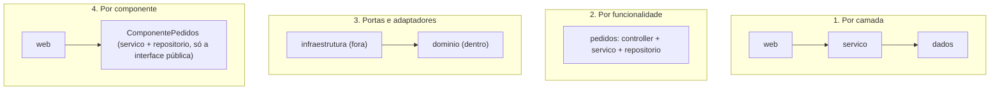

# 6. Detalhes e estudo de caso

> [!NOTE] Em uma frase
> Banco, web e framework são ferramentas que se plugam nas regras de negócio, não a fundação delas; e uma arquitetura bem desenhada no papel só sobrevive se a organização do código e a visibilidade das classes impedirem atalhos.

## Por que isso importa

Num projeto típico de Django ou Rails, a primeira coisa que se escreve são os modelos do ORM, e as regras de negócio nascem como métodos desses modelos. Cinco anos depois, a empresa quer extrair parte do sistema para um serviço em outra linguagem e descobre que não existe "regra de negócio" separável: ela está misturada com o mapeamento de tabelas, com o ciclo de vida das requisições e com os callbacks do framework.

A Parte VI (capítulos 30 a 34) e o apêndice tratam disso. Os três primeiros capítulos rebaixam banco, web e frameworks a "detalhes". O capítulo 33 aplica o livro a um caso concreto. O 34, escrito por Simon Brown, admite que a teoria se perde na implementação e mostra como evitar isso. O apêndice conta a história profissional do autor como origem das ideias.

## O que você precisa saber antes

- [5a. Fronteiras e a regra da dependência](05a-fronteiras-e-a-regra-da-dependencia.md): os círculos e a regra de que dependências apontam para dentro.
- [5b. Detalhes de fronteira e humble objects](05b-detalhes-e-humble-objects.md): gateways, data mappers e o componente Main.

## As ideias centrais

### O banco de dados é um detalhe

O capítulo 30 separa duas coisas que costumam ser confundidas: o **modelo de dados** (quais informações existem e como se relacionam) e o **banco de dados** (o software e a tecnologia que guardam isso). O modelo de dados é importante para a arquitetura. O banco não é.

O argumento histórico: bancos relacionais dominaram porque discos são lentos e era preciso organizar dados em estruturas eficientes de buscar (índices, tabelas). Se tudo coubesse na memória, você usaria listas, dicionários e árvores, como usa no resto do código. O formato de tabelas é uma consequência de uma limitação física, não da natureza do negócio. Por isso as regras de negócio não deveriam saber que existem tabelas, linhas ou SQL.

> [!IMPORTANT]
> "Detalhe" não quer dizer "pouco importante para o sistema funcionar" ou "fácil de trocar". Quer dizer que as regras de negócio não devem depender dele. Escolher mal o banco ainda dói em desempenho e operação; o ponto é que essa dor não deve contaminar o centro.

Quando o livro saiu, essa visão já era contestada: há quem argumente que o banco, com suas garantias de transação e consistência, é parte essencial do desenho, e que esconder isso atrás de interfaces genéricas leva a sistemas que ignoram o custo real das consultas.

### A web e os frameworks também

O capítulo 31 lembra que a indústria oscila há décadas entre concentrar processamento no servidor e distribuí-lo no cliente (mainframes, terminais, PCs, web simples, aplicações ricas no navegador, de novo servidor). Para o livro, a web é só mais um mecanismo de entrada e saída, como foi o terminal. A interface gráfica é um detalhe.

O capítulo 32 descreve a relação com frameworks como um **casamento assimétrico**: você se compromete totalmente com o framework (herda das classes dele, segue as convenções), e ele não se compromete com nada seu. Os riscos: a arquitetura do framework nem sempre é limpa, ele cresce numa direção que não te serve, e um dia aparece um melhor.

A recomendação é **manter o framework a distância**: use-o nos círculos externos, não deixe as entidades herdarem de classes dele e concentre o código de ligação no Main.

```python
# Ruim: a regra só existe dentro do framework
class Pedido(models.Model):
    def total(self): ...

# Melhor: a regra é Python puro; o framework só traduz
@dataclass
class Pedido:
    itens: list
    def total(self):
        return sum(i.preco * i.qtd for i in self.itens)

class PedidoModel(models.Model): ...     # mapeamento, fica no círculo externo
```

Há exceções: a biblioteca padrão da linguagem e bibliotecas muito estáveis podem ser usadas em qualquer lugar. A ideia é que essa seja uma decisão consciente, não um acidente.

### Estudo de caso: venda de vídeos

O capítulo 33 aplica tudo a um site que vende vídeos de treinamento. O primeiro passo é identificar os **atores** (quem pede mudanças, como no SRP): autor, administrador, comprador e espectador. Cada um tem seus casos de uso; alguns são abstratos e compartilhados (como "ver catálogo", com variantes para comprador e espectador).

Depois, o sistema é dividido em componentes em duas dimensões: por ator (eixo vertical) e por camada (views, presenters, interactors, controllers, gateways). Isso dá muitos componentes, mas o livro observa que eles podem ser **agrupados na implantação** de várias formas (tudo junto, por camada, por ator) sem mudar o desenho, mantendo as opções abertas. Todas as dependências respeitam a regra e cruzam as fronteiras para dentro.

### O capítulo que faltava: organizar o código para a arquitetura sobreviver

O capítulo 34, de Simon Brown, é o mais prático do livro. Ele parte de uma observação: dá para concordar com tudo e, mesmo assim, produzir código que não respeita nada, porque **o diabo está nos detalhes de implementação**. Ele compara quatro formas de organizar um sistema de pedidos em pacotes:



1. **Por camada**: pastas `web`, `servico`, `dados`. Simples, mas não grita o domínio e permite que um controller pule a camada de serviço e chame o repositório direto.
2. **Por funcionalidade**: tudo de "pedidos" junto. Grita o domínio, mas não separa política de detalhe.
3. **Portas e adaptadores**: domínio dentro, infraestrutura fora, dependências para dentro. É a Clean Architecture aplicada.
4. **Por componente**: a proposta de Brown. Junta serviço e acesso a dados de uma funcionalidade num componente com uma única interface pública; o controller só enxerga essa interface.

O ponto central: em linguagens como Java, se todas as classes forem `public`, as quatro organizações são equivalentes, porque nada impede atalhos. A organização só protege a arquitetura se a **visibilidade** (o que é privado ao pacote) for usada para tornar os atalhos impossíveis de compilar. Brown também recomenda ferramentas de análise estática que quebram o build quando uma dependência proibida aparece. Em Python, onde não há visibilidade de pacote forçada pelo compilador, essa segunda opção (ferramentas como import-linter) é o caminho prático.

### Apêndice: arqueologia da arquitetura

O apêndice é uma autobiografia técnica: o autor percorre projetos das décadas de 1970 a 1990 (sistemas de contabilidade, equipamentos de teste de telecomunicações, ferramentas de modelagem) e mostra onde aprendeu cada lição, por exemplo, como a independência de dispositivo e a separação entre regras e hardware salvaram ou condenaram projetos reais. É leitura opcional; vale pelo contexto histórico de por que as regras existem.

## Onde isso aparece no mundo real

- **Troca de banco em produção.** Empresas que migraram de um banco relacional para outro ou para um banco de documentos relatam que o esforço se concentrou onde o SQL estava espalhado; onde havia gateways, a troca foi localizada.
- **Linters de arquitetura.** ArchUnit (Java) e import-linter (Python) existem para transformar regras como "domínio não importa infraestrutura" em testes que falham, a sugestão do capítulo 34.
- **Frameworks com regras de negócio dentro dos modelos.** O padrão Active Record (usado no Rails e no ORM do Django) junta dado e persistência no mesmo objeto. É produtivo para começar, e é exatamente o casamento assimétrico que o capítulo 32 descreve.

## Erros comuns de quem está aprendendo

- **Ler "o banco é um detalhe" como "o banco não importa".** Importa para desempenho, operação e custo; só não deve ditar a forma das regras.
- **Achar que separar o framework significa não usá-lo.** O framework continua lá, só confinado à borda.
- **Desenhar camadas lindas e deixar tudo público.** Sem visibilidade restrita ou um linter de arquitetura, a primeira entrega apressada cria o atalho.
- **Achar que portas e adaptadores é a única organização válida.** Brown mostra que organização por componente é uma alternativa legítima, com menos arquivos.

## Verifique se entendeu

1. Qual a diferença entre modelo de dados e banco de dados, e qual dos dois é detalhe? (veja "O banco de dados é um detalhe")
2. Por que o livro chama a relação com frameworks de casamento assimétrico? (veja "A web e os frameworks também")
3. No estudo de caso, por que os componentes podem ser agrupados de várias formas na implantação sem mudar o desenho? (veja "Estudo de caso: venda de vídeos")
4. Por que, segundo Brown, as quatro organizações de pacotes ficam equivalentes se tudo for público? (veja "O capítulo que faltava")

## Para ir além

- [serodriguez68/clean-architecture](https://github.com/serodriguez68/clean-architecture): o arquivo da Parte VI resume os capítulos de detalhes, o estudo de caso e o capítulo de Simon Brown.
- [preslavmihaylov/booknotes — Clean Architecture](https://github.com/preslavmihaylov/booknotes/tree/master/architecture/clean-architecture): o README da Parte 6 tem diagramas das quatro organizações de pacotes.
- [Clean architecture book summary — Alex Manrique](https://alexmanrique.com/blog/books/2020/11/15/clean-architecture-book-summary.html): bullets sobre "Database/Web/Frameworks are details" para revisão rápida.

---
Anterior: [5b. Detalhes de fronteira e humble objects](05b-detalhes-e-humble-objects.md) · Voltar ao livro: [Guia de leitura](index.md)
