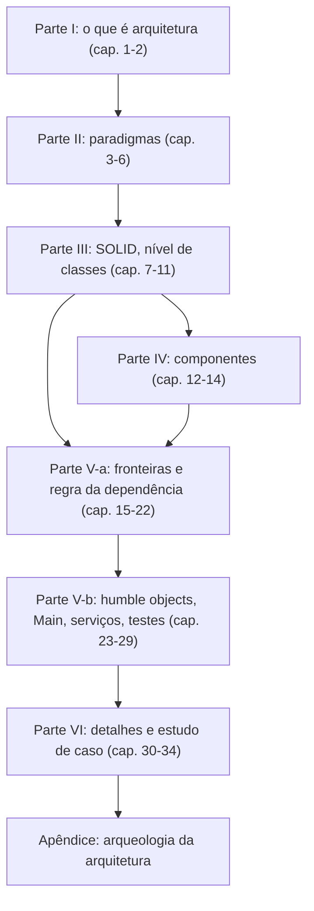

# Clean Architecture — guia de leitura

> [!NOTE] Em uma frase
> A regra é uma só: as dependências do código apontam para dentro, para as regras de negócio, e nunca para o banco, o framework ou a interface; tudo o mais no livro decorre dela.

## Para quem é e quando ler

*Clean Architecture: A Craftsman's Guide to Software Structure and Design* (2017), de Robert C. Martin, é para quem já escreve código em produção e começou a sentir que o sistema fica mais lento de mudar a cada mês. Se você já teve medo de mexer num módulo, já viu uma regra de negócio copiada em dois lugares ou já precisou subir banco e servidor só para testar um cálculo, o livro dá nome e solução para isso.

Bom momento para ler: depois de um ou dois anos programando, quando você já sabe o que é uma classe, uma interface e um teste automatizado, e antes de assumir decisões de estrutura de um projeto. Não é preciso saber Java (a linguagem dos exemplos do livro); este guia usa Python e pseudocódigo.

## O que o livro NÃO é

- **Não é um manual de frameworks nem um template de projeto.** Ele não ensina a montar pastas para Spring, Django ou NestJS. Os "templates de Clean Architecture" que circulam no GitHub são interpretações de terceiros, muitas vezes mais rígidas que o livro.
- **Não é sobre sistemas distribuídos.** Microsserviços aparecem só para dizer que eles não são, sozinhos, uma arquitetura. Para escala, replicação e consistência, procure DDIA.
- **Não é baseado em evidência empírica.** Os argumentos vêm da experiência do autor e de exemplos pessoais, não de estudos. Isso não os invalida, mas é bom saber.
- **Não é de graça.** As críticas honestas mais comuns, que vale levar junto na leitura:
  - **Excesso de camadas em projetos pequenos.** Um CRUD simples (sistema que só cria, lê, altera e apaga registros) ganha interfaces, DTOs, mappers e presenters que não protegem nada, porque não há regra de negócio para proteger. O próprio livro oferece fronteiras parciais, mas muitos leitores aplicam a versão completa em tudo.
  - **Custo da indireção.** Cada interface entre camadas é mais um arquivo para abrir, mais um salto para seguir no "ir para a definição" e mais código de conversão de dados. Em times pequenos ou sistemas de vida curta, esse custo pode superar o benefício de trocar o banco algum dia, troca que muitas vezes nunca acontece.
  - **"O banco é um detalhe" é contestado.** Para muitos sistemas, transações, consistência e desempenho de consulta são parte central do desenho; esconder o banco atrás de interfaces genéricas pode esconder também o custo real das operações.
  - **Repetição de material antigo.** Boa parte das Partes II a IV reapresenta ideias que o autor publicou nos anos 1990 e 2000. Quem já leu SOLID pode ler essas partes rapidamente.

## Como o livro está organizado

São seis partes e um apêndice, em 34 capítulos. As três primeiras sobem de nível de abstração (do código à classe ao componente); a Parte V junta tudo na arquitetura; a VI mostra detalhes e um caso aplicado.

## Como ler

- **Ordem sugerida:** I, depois V-a (o coração), depois volte para II, III e IV para entender de onde vêm as regras, e termine com V-b e VI. Quem prefere linear pode seguir a ordem do livro sem problema.
- **O que pular na primeira leitura:** o capítulo 12 (história dos componentes), o 29 (embarcado), se você não trabalha com hardware, e o apêndice.
- **O que não pular:** capítulo 22 (o diagrama dos círculos) e capítulo 34 (de Simon Brown), que mostra como a teoria se perde no código real.
- **Ritmo:** uma parte por semana é confortável. Depois de cada uma, abra um projeto seu e procure um exemplo do que acabou de ler, a favor ou contra.

## O que você leva ao terminar

- Um critério objetivo de qualidade: arquitetura boa é a que mantém baixo o custo de cada mudança.
- A capacidade de dizer, olhando um `import`, se ele aponta na direção certa.
- Vocabulário para discutir estrutura: SRP por ator, inversão de dependência, componentes estáveis e abstratos, entidades, casos de uso, humble objects, fronteiras parciais.
- Ceticismo saudável sobre microsserviços como solução de acoplamento e sobre frameworks como fundação do sistema.
- Critério para decidir quando **não** construir uma fronteira.

## Capítulos

- [1. Introdução: o que é design e arquitetura](01-introducao-o-que-e-design-e-arquitetura.md): por que arquitetura se mede pelo custo de mudança e por que estrutura vale mais que o comportamento de hoje.
- [2. Paradigmas de programação](02-paradigmas-de-programacao.md): estruturado, OO e funcional como restrições, e o polimorfismo como ferramenta para inverter dependências.
- [3. Princípios SOLID](03-principios-solid.md): os cinco princípios para organizar classes e módulos, com o SRP definido por ator.
- [4. Princípios de componentes](04-principios-de-componentes.md): o que vai junto num pacote, por que não pode haver ciclos e as métricas de estabilidade e abstração.
- [5a. Fronteiras e a regra da dependência](05a-fronteiras-e-a-regra-da-dependencia.md): políticas e detalhes, entidades e casos de uso, e o diagrama dos círculos concêntricos.
- [5b. Detalhes de fronteira e humble objects](05b-detalhes-e-humble-objects.md): presenters testáveis, fronteiras parciais, o componente Main, a crítica aos microsserviços e a fronteira dos testes.
- [6. Detalhes e estudo de caso](06-detalhes-e-estudo-de-caso.md): banco, web e frameworks como detalhes, o caso da venda de vídeos e as quatro formas de organizar pacotes.

## Fontes públicas para acompanhar

Resumos por capítulo, o post original de 2012 e uma resenha estruturada estão em [Fontes públicas — Clean Architecture](fontes.md).
