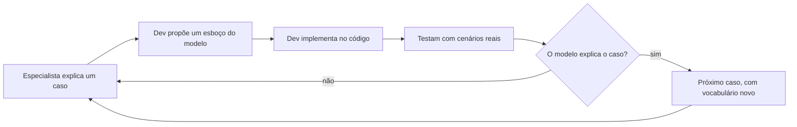

# 1. Colocando o modelo de domínio para trabalhar

> [!NOTE] Em uma frase
> O jeito mais confiável de construir software para um negócio complicado é desenvolvedores e especialistas do negócio montarem juntos um entendimento compartilhado (o modelo), falarem dele com as mesmas palavras e escreverem o código como uma tradução direta desse entendimento.

## Por que isso importa

Imagine a loja online que vai acompanhar todo este guia. Ela vende eletrônicos, tem um time de operações que cuida de estoque e entregas e um time de desenvolvimento. Um dia, a gerente de operações pede: "quando o pedido for **reservado**, o cliente precisa receber um aviso". O desenvolvedor procura no código e encontra `Order.status = "PENDING"`, `Order.status = "CONFIRMED"` e uma tabela `stock_lock`. Reservado é `CONFIRMED`? Ou é quando aparece uma linha em `stock_lock`? Ele chuta `CONFIRMED`. Na semana seguinte, clientes reclamam de avisos de "pedido reservado" para itens que nem existiam no estoque: para a operação, "reservado" significava "estoque separado no armazém", algo que acontece depois da confirmação do pagamento.

Ninguém errou por preguiça. O problema é que havia duas línguas: a do negócio ("reservado", "separado", "despachado") e a do código ("PENDING", "CONFIRMED", `stock_lock`). Cada conversa exigia uma tradução, e toda tradução perde informação. A Parte I do livro de Eric Evans existe para eliminar essa tradução. A tese é que, em domínios complexos, a dificuldade principal não é técnica (banco, framework, rede), é entender o negócio. E entender o negócio só vira software bom se esse entendimento estiver escrito no próprio código.

## O que você precisa saber antes

Nada além de já ter escrito código orientado a objetos (classes, métodos, objetos que chamam outros objetos). Os termos novos são definidos ao longo da página:

- **Domínio**: a área de atividade que o software atende. Aqui, vender produtos pela internet e entregá-los.
- **Especialista do domínio**: a pessoa que conhece o negócio por dentro, como a gerente de operações do exemplo. Não precisa saber programar.

## As ideias centrais

### O modelo é um conhecimento destilado, não um diagrama

Um [modelo de domínio](../../glossario.md#modelo-de-domínio) é uma representação simplificada e escolhida a dedo dos conceitos e regras do negócio que importam para o problema que o software resolve. A palavra-chave é "simplificada". Um mapa de metrô é um modelo da cidade: ignora ruas, prédios e distâncias reais, e por isso mesmo é útil para quem quer saber onde baldear. Um modelo que tenta representar tudo é tão inútil quanto um mapa em escala 1:1.

Na loja, um modelo inicial poderia ter `Pedido`, `Item`, `Produto`, `Cliente` e `Estoque`. Ele não diz nada sobre a cor da caixa de papelão nem sobre o nome do motorista, porque essas coisas não mudam nenhuma decisão do sistema. Se um dia o sistema precisar escolher embalagem pelo tamanho do produto, "embalagem" entra no modelo.

Evans insiste que o modelo não é o diagrama UML nem o documento: é a ideia organizada na cabeça das pessoas, que pode ser expressa em diagramas, em conversa e, principalmente, em código. O diagrama é só uma das formas de mostrar essa ideia.

### Triturar conhecimento: o modelo nasce de conversa e de experimentos

Evans chama o processo de construir o modelo de *knowledge crunching*, algo como "triturar conhecimento". O desenvolvedor não recebe uma especificação pronta e codifica. Ele senta com o especialista, ouve, propõe um esboço, ouve "não é bem assim", ajusta, implementa um protótipo, descobre um caso que ninguém tinha previsto, volta a conversar.

Na loja, a primeira conversa produz "o cliente faz um pedido e a gente envia". A terceira revela que um pedido pode ser enviado em mais de um pacote, porque itens saem de armazéns diferentes. A quinta revela que, se um pacote atrasa, a operação quer reembolsar o frete só daquele pacote. Agora o modelo precisa de um conceito que não existia: `Remessa` (cada pacote físico de um pedido). Esse conceito não estava em lugar nenhum por escrito; ele saiu da conversa.

O ciclo nunca termina de verdade: cada volta deixa o modelo mais preciso e o time com mais vocabulário. Isso é o oposto de um processo em que analistas escrevem um documento, entregam para programadores e vão embora. Nesse modelo de "passar o bastão", o conhecimento que só aparece durante a implementação não volta para ninguém.

### Linguagem ubíqua: uma língua só, do quadro branco ao código

A [linguagem ubíqua](../../glossario.md#linguagem-ubíqua) é o vocabulário que o time inteiro usa igual na conversa, nos documentos, nos testes e nos nomes do código. "Ubíquo" quer dizer "presente em todo lugar".

Voltando ao incidente do começo: com linguagem ubíqua, o código não teria `status = "CONFIRMED"`. Teria algo como `pedido.reservar_estoque()` e um estado `EstoqueReservado`, exatamente as palavras da operação. A conversa "quando o pedido for reservado, avise o cliente" vira uma busca por `reservar_estoque` sem ambiguidade nenhuma.

Três consequências práticas aparecem nesse ponto:

1. **Mudar a linguagem é mudar o modelo, e vice-versa.** Se o time descobre que "reservar" e "separar" são coisas diferentes, os dois termos precisam aparecer no código. Renomear uma classe deixa de ser cosmética: é registrar uma descoberta.
2. **Termos ambíguos são sinal de modelo ruim.** Se "pedido" significa uma coisa para vendas e outra para o armazém, não adianta escolher uma; é preciso nomear as duas ou separar os contextos (assunto da [página 5](05-design-estrategico.md)).
3. **O especialista deve conseguir ler os nomes.** Ele não lê Python, mas se você ler em voz alta `remessa.marcar_como_atrasada()` e ele franzir a testa, o modelo tem um problema.

> [!TIP]
> Um teste rápido: descreva um cenário em voz alta usando só os nomes de classes e métodos do código ("o cliente adiciona um item ao carrinho, fecha o pedido, o estoque é reservado, o pedido é dividido em remessas"). Se a frase soar estranha para quem é do negócio, é aí que a linguagem e o código se separaram.

### Model-Driven Design: o código é o modelo

O terceiro capítulo da Parte I junta tudo em um princípio que Evans chama de *Model-Driven Design* (design dirigido pelo modelo): não pode haver um "modelo de análise" bonito em um documento e um código que faz outra coisa. O modelo e a implementação precisam ser o mesmo artefato, de forma que mudar um seja mudar o outro.

O porquê é direto. Se o diagrama diz que um pedido tem remessas, mas o código guarda tudo em uma tabela `order_lines` com uma coluna `warehouse_id`, a próxima pessoa a mudar o comportamento de entregas vai ler o código, não o diagrama. O diagrama envelhece, o conhecimento que ele carregava some, e o time volta a traduzir. Quando o código tem uma classe `Remessa` com um método `atrasar()`, o conhecimento sobrevive na única fonte que todos são obrigados a manter atualizada.

Isso tem uma consequência sobre ferramentas: o paradigma de programação precisa permitir expressar o modelo. Evans trabalha com orientação a objetos porque objetos com estado e comportamento mapeiam bem para conceitos de negócio. Ele reconhece que em outros paradigmas (regras lógicas, por exemplo) a ideia continua valendo, mas o mapeamento é outro.

### Modeladores com a mão na massa

A última ideia da Parte I é organizacional. Se quem desenha o modelo não programa, e quem programa não participa da modelagem, o modelo e o código se separam de novo. Evans chama de *hands-on modelers* (modeladores com a mão na massa) a regra de que toda pessoa técnica que contribui para o modelo precisa tocar no código, e todo desenvolvedor precisa se sentir responsável pelo modelo, não só por "fazer funcionar".

Na loja, isso significa que o arquiteto que propôs `Remessa` no quadro branco deveria parear com quem a implementa, e que o desenvolvedor que descobrir, codando, que uma remessa pode ser dividida em duas deve levar isso de volta à conversa com a operação.

## Onde isso aparece no mundo real

- **Nomes de domínio em APIs públicas.** APIs de pagamento bem desenhadas usam termos do negócio de pagamentos (autorização, captura, estorno, chargeback) em vez de termos técnicos genéricos. Quem conhece o domínio entende o que cada chamada faz sem ler a implementação. É linguagem ubíqua aplicada na fronteira do sistema.
- **Event Storming.** É uma oficina em que especialistas e desenvolvedores escrevem, em post-its, os eventos que acontecem no negócio ("Pedido realizado", "Estoque reservado", "Remessa despachada") e os ordenam numa parede. Ela foi criada depois do livro, por Alberto Brandolini, e é hoje a forma mais comum de fazer o "triturar conhecimento" em grupo. O processo do ddd-crew listado em [Para ir além](#para-ir-além) usa essa técnica.
- **Code review que discute nomes.** Quando um revisor pergunta "o negócio chama isso de `cancelamento` ou de `desistência`? São a mesma coisa?", ele está fazendo knowledge crunching dentro do pull request.

## Erros comuns de quem está aprendendo

- **Achar que DDD é desenhar diagramas UML antes de codar.** O livro é explícito: o diagrama é auxiliar, o modelo vive no código e na conversa. Um diagrama de 40 classes que ninguém atualiza é o anti-padrão que Evans critica.
- **Confundir linguagem ubíqua com glossário corporativo.** Um glossário único para a empresa inteira não funciona, porque palavras como "cliente" mudam de sentido entre áreas. A linguagem é ubíqua *dentro de um contexto* (ver [página 5](05-design-estrategico.md)).
- **Traduzir os nomes para inglês "técnico" e esquecer o termo do negócio.** Não é proibido programar em inglês, mas a tradução precisa ser uma convenção fixa e combinada (`Remessa` sempre vira `Shipment`), não uma escolha de cada desenvolvedor. Senão a tradução volta pela porta dos fundos.
- **Esperar o modelo "certo" antes de começar.** O modelo melhora com a implementação. Ficar semanas modelando sem código perde exatamente o retorno que o código dá.

## Verifique se entendeu

1. Por que um modelo que representa "tudo" sobre o negócio é pior do que um modelo seletivo? (seção "O modelo é um conhecimento destilado")
2. No exemplo da loja, de onde surgiu o conceito de `Remessa`, e por que ele não estaria numa especificação escrita antes? (seção "Triturar conhecimento")
3. O que deu errado no incidente do aviso de "pedido reservado", e como a linguagem ubíqua teria evitado? (seções "Por que isso importa" e "Linguagem ubíqua")
4. Qual é o risco concreto de manter um modelo em documento separado do código? (seção "Model-Driven Design")
5. Por que Evans exige que quem modela também programe? (seção "Modeladores com a mão na massa")

## Para ir além

- [nadakamel/books-notes — domain-driven-design.md](https://github.com/nadakamel/books-notes/blob/main/books/domain-driven-design-tackling-complexity-in-the-heart-of-software.md): as seções Crunching Knowledge, Ubiquitous Language e Binding Model and Implementation resumem os três capítulos desta Parte na ordem do livro.
- [DDD Reference (Eric Evans)](https://www.domainlanguage.com/ddd/reference/): as entradas Ubiquitous Language, Model-Driven Design e Hands-on Modelers trazem a definição oficial e curta de cada padrão.
- [ddd-crew/ddd-starter-modelling-process](https://github.com/ddd-crew/ddd-starter-modelling-process): os passos Understand e Discover mostram como fazer o "triturar conhecimento" na prática, com oficinas como Event Storming.
- [Domain-Driven Design by Eric Evans — DEV Community](https://dev.to/alco/domain-driven-design-by-eric-evans-30g8): síntese curta de linguagem ubíqua, útil como revisão rápida.

---
Próximo: [2. Os blocos de construção](02-blocos-de-construcao.md) · Voltar ao livro: [Guia de leitura](index.md)
