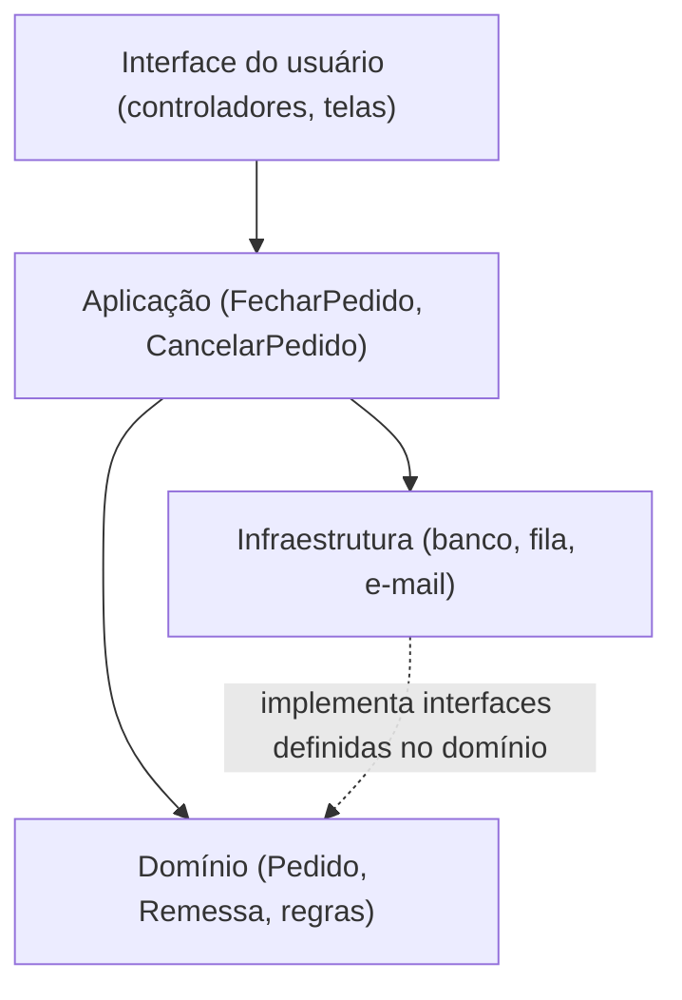
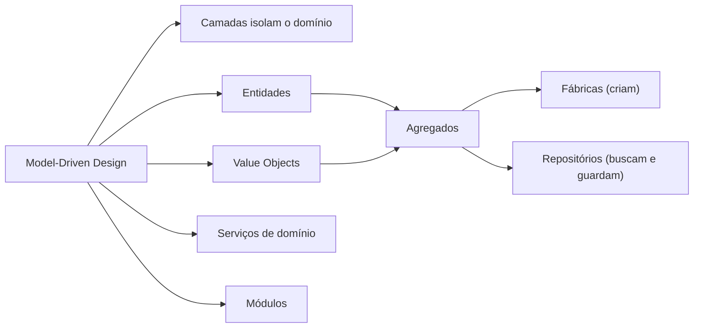

# 2. Os blocos de construção

> [!NOTE] Em uma frase
> Para o modelo de domínio sobreviver no código, ele precisa morar num lugar separado de tela, banco e rede, e ser montado com um pequeno conjunto de peças padronizadas cujo papel todo mundo do time reconhece.

## Por que isso importa

Na [página anterior](01-colocando-o-modelo-de-dominio-para-trabalhar.md), a loja online descobriu o conceito de `Remessa` conversando com a operação. Agora imagine onde esse conhecimento vai parar num código típico feito às pressas. A regra "se uma remessa atrasar mais de 3 dias, reembolse o frete dela" aparece primeiro no controlador HTTP da tela de rastreio. Depois alguém copia a mesma regra para o job noturno que manda e-mails. Depois alguém a reescreve em SQL num relatório. Seis meses depois o prazo muda para 5 dias, a regra é atualizada em dois dos três lugares, e o reembolso passa a depender de qual caminho o cliente usou.

O modelo que o time construiu com tanto cuidado se diluiu em código de tela, de banco e de agendamento. A Parte II do livro responde a duas perguntas: onde o código do modelo deve morar para não se misturar com o resto, e com que peças ele deve ser montado. As respostas são, respectivamente, uma camada de domínio isolada e um vocabulário de padrões que Evans chama de blocos de construção (*building blocks*).

## O que você precisa saber antes

- [1. Colocando o modelo de domínio para trabalhar](01-colocando-o-modelo-de-dominio-para-trabalhar.md): o que é um modelo de domínio e por que o código precisa expressá-lo diretamente (Model-Driven Design).
- [Camada](../../glossario.md#camada): agrupamento horizontal de código por responsabilidade técnica, em que cada camada só conhece a de baixo.
- [Acoplamento e coesão](../../glossario.md#acoplamento-e-coesão): o quanto as partes dependem umas das outras e o quanto cada parte é focada.

## As ideias centrais

### Isolar o domínio: a arquitetura em camadas

Evans não inventa a arquitetura em camadas, ele a adota com um propósito: dar ao modelo um lugar onde só ele exista. A divisão que ele usa tem quatro camadas.

| Camada | Responsabilidade | Na loja online |
|---|---|---|
| Interface do usuário | Mostrar informação e receber comandos de pessoas ou de outros sistemas | Controlador HTTP de `/pedidos`, tela de rastreio |
| Aplicação | Coordenar uma tarefa do usuário: buscar objetos, chamar o domínio, salvar. Não contém regra de negócio | `FecharPedido`: carrega o carrinho, pede ao domínio para criar o pedido, salva, dispara o e-mail |
| Domínio | Os conceitos, o estado e as regras do negócio. É onde o modelo vive | `Pedido`, `Remessa`, a regra de reembolso de frete |
| Infraestrutura | Capacidades técnicas: banco, fila, envio de e-mail, chamadas HTTP externas | Implementação SQL do repositório de pedidos, cliente do gateway de pagamento |

A regra principal é a [direção das dependências](../../glossario.md#dependência-direção-da): uma camada pode usar as de baixo, nunca as de cima. O domínio não sabe que existe HTTP, nem qual banco é usado. A seta pontilhada mostra um refinamento que se popularizou depois do livro e que Evans já sugere nos repositórios: o domínio declara do que precisa (por exemplo, "um lugar para buscar pedidos") e a infraestrutura implementa. Assim a dependência aponta para o domínio, como a [Clean Architecture](../clean-architecture/index.md) formalizou anos depois.

Com isso, a regra do reembolso de frete tem um único endereço: um método em `Remessa` ou num objeto do domínio. A tela de rastreio, o job noturno e o relatório chamam esse método; nenhum deles reimplementa a regra.

> [!IMPORTANT]
> A camada de aplicação deve ser fina. Se `FecharPedido` começa a ter `if` sobre valor mínimo do pedido ou sobre região de entrega, uma regra de negócio vazou do domínio. O teste mental: essa linha mudaria se o negócio mudasse uma política? Se sim, ela pertence ao domínio.

### O anti-padrão Smart UI, e quando ele é aceitável

Evans descreve o caminho oposto com honestidade. No anti-padrão *Smart UI* (interface inteligente), toda a lógica fica junto da tela: cada formulário lê o banco, valida, calcula e grava. Ele chama de anti-padrão porque é incompatível com DDD, mas reconhece que é uma escolha racional em certos casos: aplicações simples, time sem experiência em modelagem, prazos curtíssimos, dados que mudam pouco. Uma tela interna de cadastro de cupons promocionais, sem regra nenhuma além de "salvar", não precisa de modelo.

O ponto do livro é que a escolha deve ser consciente. Começar com Smart UI e depois tentar migrar para um modelo rico é muito caro, porque não há fronteira nenhuma onde começar a separar.

### O mapa dos blocos de construção

Dentro da camada de domínio, Evans propõe um conjunto de padrões, cada um com um papel claro. Saber o nome de cada peça é o que permite a alguém dizer "isso aqui é um value object" e o resto do time entender o que esperar dele.

- **Entidade**: objeto com identidade que persiste no tempo (um `Pedido`).
- **Value object**: objeto definido só pelos atributos, imutável (um valor em `Dinheiro`).
- **Serviço de domínio**: operação do negócio que não pertence naturalmente a nenhum objeto.
- **Módulo**: agrupamento de conceitos relacionados, como um pacote.
- **Agregado**: grupo de objetos tratado como uma unidade de consistência.
- **Fábrica**: encapsula a criação de objetos ou agregados complexos.
- **Repositório**: dá a ilusão de uma coleção em memória de agregados, escondendo o banco.

Entidades, value objects, agregados, fábricas e repositórios são o assunto da [próxima página](03-entidades-value-objects-agregados-e-repositorios.md). O resto desta seção cobre as peças mais leves.

### Associações: menos é mais

Uma associação é uma ligação entre dois objetos do modelo: um pedido tem itens, um item aponta para um produto. No mundo real quase tudo se relaciona com tudo, e modelar todas as ligações nos dois sentidos gera um emaranhado difícil de manter. Evans recomenda três cortes:

1. **Escolher uma direção de navegação.** O pedido conhece seus itens; o item não precisa conhecer o pedido. Isso já elimina metade das ligações.
2. **Qualificar para reduzir a multiplicidade.** Um cliente tem muitos endereços, mas "o endereço de entrega padrão" é um só. Nomear o qualificador transforma uma lista em uma referência.
3. **Eliminar o que não é essencial.** Se nenhuma regra precisa ir de `Produto` para todos os `Pedido` que o contêm, essa associação não deve existir no modelo; uma consulta de relatório resolve.

O efeito é um modelo menor, mais fácil de entender e com menos objetos carregados à toa.

### Serviços de domínio: quando a ação não tem dono

Algumas operações do negócio não são responsabilidade natural de nenhum objeto. Calcular o frete de um pedido depende do pedido (peso, volume), do endereço do cliente e da tabela de transportadoras. Colocar `calcular_frete()` dentro de `Pedido` faria o pedido conhecer transportadoras; colocar em `Transportadora` faria ela conhecer pedidos. A saída é um serviço de domínio: `CalculoDeFrete.cotar(pedido, endereco)`.

Um bom serviço de domínio tem três características: a operação é um conceito do negócio (a operação diz "cotar frete"), a interface usa termos do modelo, e ele não guarda estado entre chamadas. Ele é diferente de um serviço de aplicação (que coordena e não decide nada) e de um serviço de infraestrutura (que envia e-mail ou chama uma API). O perigo é usar serviços demais: se toda lógica vira serviço, as entidades viram sacos de dados sem comportamento, o que Martin Fowler chamou depois de *modelo anêmico*.

### Módulos: agrupar por conceito, não por tipo técnico

Módulos (pacotes, namespaces) também fazem parte do modelo e devem contar uma história. Evans pede [alta coesão e baixo acoplamento](../../glossario.md#acoplamento-e-coesão) entre módulos *conceituais*. Na loja, faz sentido ter `pedidos`, `catalogo`, `estoque` e `entregas`. Não faz sentido ter `entities`, `services` e `repositories`, porque essa divisão agrupa coisas que não têm nada a ver entre si (o repositório de pedidos ao lado do repositório de produtos) e separa coisas que mudam juntas (`Pedido` longe de `RepositorioDePedidos`).

Os nomes dos módulos entram na linguagem ubíqua. Se o time diz "isso é coisa de entregas", deve existir um módulo `entregas`.

### O exemplo estendido do livro

O capítulo 7 aplica tudo isso num sistema de transporte de cargas, mostrando o modelo evoluir a cada requisito. Vale a pena ler no original, porque mostra as decisões sendo tomadas uma a uma. Neste guia seguimos com a loja online para manter um exemplo só.

## Onde isso aparece no mundo real

- **Arquitetura hexagonal e Clean Architecture.** As duas são variações da ideia de proteger o domínio de detalhes técnicos, com a dependência apontando para dentro. Quem leu este capítulo reconhece o mesmo objetivo com outros desenhos.
- **Frameworks como Rails e Django.** Eles incentivam um estilo próximo de Smart UI ou de modelos acoplados ao banco (Active Record, em que a classe de domínio é também a linha da tabela). Funciona muito bem para aplicações simples, e é exatamente o trade-off que Evans descreve.
- **Organização de pastas por funcionalidade.** Muitos projetos trocaram `controllers/`, `models/` e `services/` por `pedidos/`, `pagamentos/`, `entregas/`, que é a recomendação de módulos do livro.

## Erros comuns de quem está aprendendo

- **Achar que as camadas são o DDD.** Camadas são só o pré-requisito para o modelo existir isolado. Um sistema perfeitamente em camadas com um domínio anêmico não está fazendo DDD.
- **Colocar regra de negócio no serviço de aplicação.** É o vazamento mais comum, e quase sempre começa pequeno: um `if` "só para esse caso". Regra de negócio vai para o domínio.
- **Criar um serviço para tudo.** Antes de criar `PedidoService.cancelar(pedido)`, pergunte se `pedido.cancelar()` não é o lugar natural.
- **Organizar módulos por tipo técnico.** Pastas `entities/` e `repositories/` parecem organizadas, mas escondem o domínio. Ver [o que o livro NÃO é](index.md#o-que-o-livro-não-é).

## Verifique se entendeu

1. Na loja, em qual camada fica a regra "reembolsar frete de remessa atrasada", e por que não no job noturno? (seção "Isolar o domínio")
2. Em que situação o Smart UI é uma escolha razoável, e por que migrar dele depois é caro? (seção "O anti-padrão Smart UI")
3. Dê um exemplo de associação da loja que deveria ser eliminada ou ter a direção restringida. (seção "Associações")
4. Por que `calcular_frete` virou um serviço de domínio, e o que diferencia esse serviço de um serviço de aplicação? (seção "Serviços de domínio")
5. Por que `entities/` e `repositories/` são nomes ruins para módulos? (seção "Módulos")

## Para ir além

- [nadakamel/books-notes — domain-driven-design.md](https://github.com/nadakamel/books-notes/blob/main/books/domain-driven-design-tackling-complexity-in-the-heart-of-software.md): a seção Building Blocks resume camadas, associações, serviços e módulos na ordem do livro.
- [Domain-Driven Design by Eric Evans — DEV Community](https://dev.to/alco/domain-driven-design-by-eric-evans-30g8): a tabela das quatro camadas (UI, Application, Domain, Infrastructure) é uma boa revisão desta página.
- [DDD Reference (Eric Evans)](https://www.domainlanguage.com/ddd/reference/): as entradas Layered Architecture, Services e Modules trazem a definição oficial curta de cada padrão.

---
Anterior: [1. Colocando o modelo de domínio para trabalhar](01-colocando-o-modelo-de-dominio-para-trabalhar.md) · Próximo: [3. Entidades, value objects, agregados e repositórios](03-entidades-value-objects-agregados-e-repositorios.md) · Voltar ao livro: [Guia de leitura](index.md)
