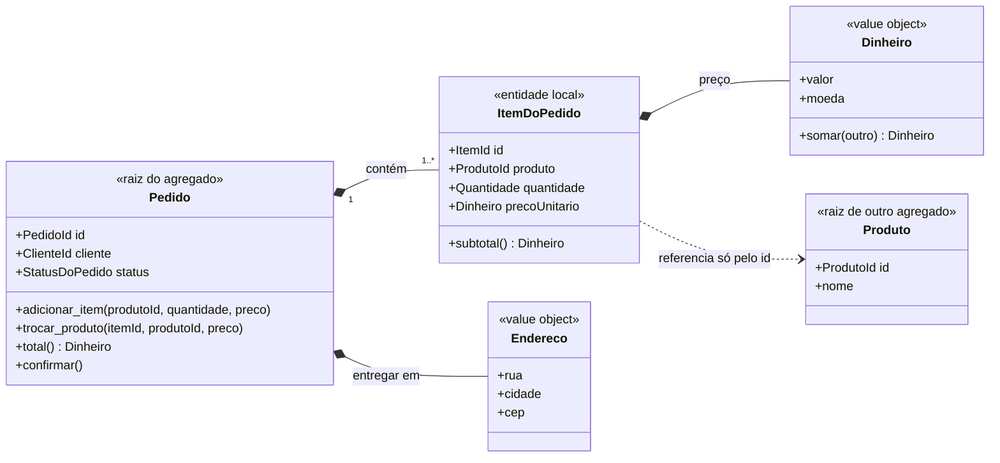

# 3. Entidades, value objects, agregados e repositórios

> [!NOTE] Em uma frase
> Alguns objetos do negócio importam por quem são, outros só pelo que valem, e grupos de objetos que precisam estar sempre coerentes entre si devem ser mudados, criados e guardados como um bloco só, por uma única porta de entrada.

## Por que isso importa

A loja online tem uma regra simples: um pedido não pode passar de R$ 20.000,00 sem análise antifraude. O código guarda o total na tabela `pedidos` e os itens na tabela `itens_pedido`. Duas partes do sistema mexem em itens: o carrinho (quando o cliente altera a quantidade antes de pagar) e o atendimento (quando um atendente troca um produto esgotado por outro). O atendimento faz `UPDATE itens_pedido SET produto_id = ..., preco = ...` direto, e esquece de recalcular o total. Um pedido de R$ 19.000,00 vira, na prática, um pedido de R$ 26.000,00 que nunca passou pela análise.

A regra existia, mas não tinha dono: qualquer código podia mexer em qualquer item. O capítulo 5 e o capítulo 6 do livro dão as ferramentas para que isso não aconteça: classificar cada objeto pelo tipo de identidade que ele tem, agrupar os objetos que precisam estar coerentes e definir uma única porta pela qual eles são alterados, criados e recuperados do banco.

## O que você precisa saber antes

- [2. Os blocos de construção](02-blocos-de-construcao.md): a camada de domínio isolada e o mapa geral dos padrões táticos.
- [ACID](../../glossario.md#acid): as garantias de uma transação de banco, em especial a atomicidade (tudo ou nada).
- **Invariante**: uma regra que precisa ser verdadeira sempre que alguém olha os dados. "O total do pedido é a soma dos itens" é uma invariante.

## As ideias centrais

### Entidade: importa quem é

Uma [entidade](../../glossario.md#entidade) é um objeto do domínio que tem identidade própria e contínua: ele continua sendo "o mesmo" mesmo que todos os atributos mudem. O pedido nº 4812 continua sendo o pedido nº 4812 depois de ganhar itens, mudar de endereço e ser pago. Dois clientes chamados "Ana Souza", nascidos no mesmo dia, são duas pessoas diferentes.

O trabalho de modelagem aqui é decidir *o que define a identidade* e garantir que ela seja única e estável. Na loja: o pedido recebe um número gerado pelo sistema; o cliente é identificado por um ID interno, não pelo e-mail (que pode mudar). Evans recomenda manter a classe de uma entidade enxuta, com a identidade e o comportamento essencial, e empurrar atributos e cálculos para value objects associados a ela.

### Value object: importa o que vale

Um [value object](../../glossario.md#value-object) é definido só pelos seus atributos, sem identidade. Se dois objetos `Dinheiro(100, "BRL")` têm os mesmos atributos, eles são iguais e intercambiáveis, como duas notas de R$ 100 na carteira. Na loja, são value objects: `Dinheiro`, `Endereco`, `Quantidade`, `Cep`, `PrazoDeEntrega`.

Value objects devem ser **imutáveis**: em vez de alterar o valor, você cria um novo. `preco.somar(frete)` devolve um novo `Dinheiro`, sem mexer no original. Isso traz três vantagens concretas:

1. **Compartilhar sem medo.** O mesmo objeto `Endereco` pode ser usado pelo cliente e pela remessa, porque ninguém consegue alterá-lo por baixo do outro.
2. **Validação num lugar só.** `Cep("abc")` falha na construção. Depois disso, todo `Cep` que existe no sistema é válido.
3. **Regras que viram linguagem.** `Dinheiro` sabe que não se soma real com dólar. Essa regra deixa de estar espalhada em `if`s pelo código.

A pergunta para classificar um conceito é: "se eu trocar este objeto por outro com os mesmos valores, alguém nota?". Para um endereço de entrega, não. Para um pedido, sim. A resposta depende do contexto: numa empresa de correios, um endereço pode ter identidade própria, porque o sistema acompanha aquele endereço ao longo do tempo.

### Agregado: uma fronteira de consistência com uma porta só

Voltando ao incidente do começo: o problema foi que `itens_pedido` podia ser alterado sem passar pelo pedido. Um [agregado](../../glossario.md#agregado) resolve exatamente isso. Ele é um grupo de objetos tratado como unidade para mudanças, com uma entidade escolhida como **raiz**. Na loja, o agregado `Pedido` contém os itens, e o próprio `Pedido` é a raiz.

As regras que Evans dá para agregados, aplicadas ao exemplo:

- **Só a raiz é acessível de fora.** Ninguém fora do agregado guarda referência para um `ItemDoPedido`. O atendimento não altera um item; ele chama `pedido.trocar_produto(item_id, novo_produto)`.
- **A raiz garante as invariantes do grupo todo.** Dentro de `trocar_produto`, o pedido recalcula o total e, se passar de R$ 20.000,00, marca o pedido para análise antifraude. Não existe outro caminho de alteração, então não existe como esquecer.
- **Objetos de dentro podem referenciar outros agregados, mas só pelas raízes deles.** O item aponta para um produto do catálogo pelo identificador (`produto_id`), não carrega o objeto `Produto` inteiro como parte do pedido.
- **Apagar a raiz apaga tudo dentro.** Itens não existem sem o pedido.
- **Só raízes são buscadas no banco.** Não existe "busque o item 77"; existe "busque o pedido 4812".

Note o que o diagrama mostra: `ItemDoPedido` tem um `id`, mas só dentro do pedido (Evans chama isso de identidade local). `Produto` está fora da fronteira; o pedido conhece só o identificador dele. Se o preço do produto mudar no catálogo amanhã, o pedido de hoje não muda, porque guardou o preço como value object no momento da compra. Isso não é detalhe técnico, é regra de negócio: o cliente paga o preço que viu.

**Como decidir o tamanho do agregado.** A fronteira deve envolver exatamente o que precisa estar consistente *na mesma transação*. Total e itens precisam (é a regra antifraude). Pedido e estoque não precisam estar consistentes no mesmo instante: o negócio aceita que o estoque seja reservado alguns segundos depois da confirmação. Por isso `Estoque` é outro agregado. Regras que atravessam agregados são resolvidas de forma assíncrona, aceitando [consistência eventual](../../glossario.md#consistência-forte-e-eventual) entre eles. A formulação "uma transação altera um agregado só", que ficou popular depois do livro com Vaughn Vernon, é a versão prática dessa ideia.

> [!WARNING]
> Agregados grandes demais são o erro mais caro. Se `Cliente` contiver todos os pedidos, endereços e avaliações, cada alteração trava e carrega o cliente inteiro, e dois atendentes mexendo em pedidos diferentes do mesmo cliente entram em conflito. Comece pequeno e só aumente a fronteira quando uma invariante real exigir.

### Fábricas: quando criar já é uma regra

Criar um pedido válido envolve regras: precisa de pelo menos um item, do cliente, do endereço, do preço congelado de cada produto. Se cada parte do código montar pedidos à mão, essas regras se espalham. Uma **fábrica** encapsula essa criação e devolve um agregado inteiro e válido, ou falha. Pode ser um método na própria raiz (`Pedido.a_partir_do_carrinho(carrinho, endereco)`), um método em outro objeto (`carrinho.fechar()`), ou uma classe própria quando a montagem é complexa.

A fábrica não tem regra de negócio além da criação. Depois que o pedido existe, quem cuida dele é a raiz. Fábricas também servem para *reconstituir* um objeto que veio do banco, caso em que não geram identidade nova.

### Repositórios: a ilusão de uma coleção

Depois de criado, o pedido precisa ser guardado e, mais tarde, encontrado. Um **repositório** é um objeto que se comporta como uma coleção em memória de agregados de um tipo: `pedidos.adicionar(pedido)`, `pedidos.por_id(4812)`, `pedidos.em_aberto_do_cliente(cliente_id)`. Por trás, há SQL, ORM ou uma API, mas o domínio não vê isso.

Três regras práticas tiradas do livro:

1. **Um repositório por agregado, nunca por tabela.** Existe `RepositorioDePedidos`, não `RepositorioDeItens`. Isso reforça a regra de que itens só são acessados pelo pedido.
2. **A interface fica no domínio, a implementação na infraestrutura.** O domínio define `RepositorioDePedidos` com os métodos que os casos de uso precisam; a infraestrutura implementa com o banco escolhido. Trocar o banco não toca no domínio.
3. **Os métodos de busca falam a linguagem ubíqua.** `em_aberto_do_cliente` em vez de um `find(filter)` genérico que deixa a consulta solta pelo código.

O repositório não controla transações: quem decide quando começar e confirmar é a camada de aplicação, que coordena o caso de uso.

## Onde isso aparece no mundo real

- **Tipos para dinheiro.** Bibliotecas de dinheiro como Joda-Money (Java) e py-moneyed (Python) são value objects prontos: imutáveis, com moeda, e recusam somar moedas diferentes. Usar `float` para preço é o contrário disso.
- **Raízes de agregado em bancos de documentos.** Em bancos como MongoDB, um documento de pedido com os itens embutidos é, na prática, um agregado: é lido e gravado inteiro, de forma atômica.
- **Conflitos de concorrência.** Quando dois atendentes editam o mesmo pedido e um recebe "o pedido foi alterado por outra pessoa", o sistema está usando a raiz do agregado como unidade de travamento (uma versão no pedido, conferida a cada gravação).

## Erros comuns de quem está aprendendo

- **Transformar tudo em entidade.** Dar ID e tabela própria para `Endereco` gera código para sincronizar cópias que ninguém precisa sincronizar. Pergunte se a identidade importa ao negócio.
- **Value object mutável.** Um `Dinheiro` com `set_valor()` compartilhado entre dois objetos é um bug esperando para acontecer. Se precisa mudar, crie outro.
- **Agregado desenhado pelo diagrama de tabelas.** Chaves estrangeiras não definem agregados; invariantes definem. Duas tabelas ligadas podem ser agregados diferentes.
- **Repositório genérico com `find_all()` exposto para tudo.** Isso devolve o banco para o domínio pela porta dos fundos e permite que qualquer um busque e altere objetos internos.

## Verifique se entendeu

1. Por que `Cliente` é entidade e `Endereco` é value object na loja, e em que tipo de empresa isso poderia se inverter? (seções "Entidade" e "Value object")
2. Como o agregado `Pedido` impediria o incidente do pedido de R$ 26.000,00? (seção "Agregado")
3. Por que o item guarda `produto_id` e o preço congelado, em vez do objeto `Produto` inteiro? (seção "Agregado", parágrafo após o diagrama)
4. Por que `Estoque` não deve estar dentro do agregado `Pedido`? (seção "Agregado", "Como decidir o tamanho")
5. Por que não existe `RepositorioDeItens`? (seção "Repositórios")

## Para ir além

- [nadakamel/books-notes — domain-driven-design.md](https://github.com/nadakamel/books-notes/blob/main/books/domain-driven-design-tackling-complexity-in-the-heart-of-software.md): as subseções Entities, Value Objects, Aggregates, Factories e Repositories resumem os capítulos 5 e 6 com as regras do livro.
- [DDD Reference (Eric Evans)](https://www.domainlanguage.com/ddd/reference/): as entradas Entities, Value Objects, Aggregates, Factories e Repositories dão a definição oficial de cada padrão em uma página cada.
- [Domain-Driven Design by Eric Evans — DEV Community](https://dev.to/alco/domain-driven-design-by-eric-evans-30g8): explicação curta de entidade versus value object, boa para fixar a distinção.

---
Anterior: [2. Os blocos de construção](02-blocos-de-construcao.md) · Próximo: [4. Refatorando rumo a um insight mais profundo](04-refatorando-rumo-a-um-insight-mais-profundo.md) · Voltar ao livro: [Guia de leitura](index.md)
