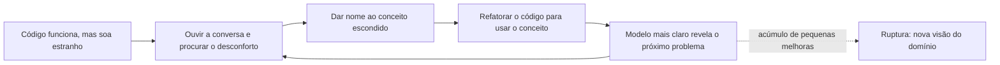

# 4. Refatorando rumo a um insight mais profundo

> [!NOTE] Em uma frase
> O primeiro modelo é sempre raso; ele melhora quando o time presta atenção ao que soa estranho na conversa e no código, dá nome aos conceitos escondidos e refatora para que o código diga o que o negócio quer dizer.

## Por que isso importa

A loja online cresceu e passou a ter promoções. Primeiro, "frete grátis acima de R$ 200". Depois, "frete grátis para clientes do plano Premium". Depois, "frete grátis acima de R$ 150 para o Sul durante a Black Friday, exceto itens volumosos". Cada regra entrou como mais um `if` dentro de `CalculoDeFrete.cotar()`. Hoje o método tem 140 linhas, ninguém sabe dizer quais combinações estão ativas e a equipe de marketing tem medo de pedir campanhas novas porque "sempre quebra alguma coisa".

O código funciona, no sentido de que passa nos testes. Mas ele não tem um conceito para aquilo que o marketing discute toda semana: a *regra de elegibilidade* para o frete grátis. A Parte III do livro trata disso. Os blocos de construção da [página anterior](03-entidades-value-objects-agregados-e-repositorios.md) garantem um código organizado; esta Parte ensina a chegar a um modelo que capture o que realmente importa no negócio, e isso quase nunca acontece na primeira tentativa.

## O que você precisa saber antes

- [3. Entidades, value objects, agregados e repositórios](03-entidades-value-objects-agregados-e-repositorios.md): especialmente value objects imutáveis, que voltam aqui como base do design flexível.
- **Refatoração**: mudar a estrutura do código sem mudar o comportamento observável, em passos pequenos e protegidos por testes.

## As ideias centrais

### Refatorar o modelo, não só o código

Existe a refatoração de código, que melhora nomes, extrai métodos e remove duplicação. Evans fala de outra, mais profunda: refatorar porque o *entendimento do domínio* mudou. Extrair as 140 linhas de `cotar()` em cinco métodos privados é refatoração de código. Perceber que o negócio tem um conceito chamado "regra de elegibilidade" e criar um objeto para ele é refatoração rumo a um insight mais profundo.

O livro descreve o processo como contínuo: cada pequena descoberta leva a um modelo um pouco melhor, que torna a próxima descoberta mais fácil. De vez em quando, essas mudanças pequenas se acumulam e geram uma **ruptura** (*breakthrough*): o time enxerga o domínio de um jeito novo, e uma parte grande do modelo muda de uma vez. Rupturas são valiosas e assustadoras, porque exigem uma refatoração grande quando o sistema já está em uso. Evans recomenda encará-las, desde que o time tenha testes e coragem.



### Tornar explícitos os conceitos implícitos

O capítulo 9 lista onde procurar conceitos que estão escondidos:

- **Ouvir a linguagem.** O marketing fala "regra de elegibilidade", "campanha", "público-alvo". O código fala `if total > 200 and regiao == ...`. Toda palavra que o especialista usa e o código não tem é candidata a conceito.
- **Examinar o código desajeitado.** O método de 140 linhas é o sintoma. Onde o código é difícil de mudar, quase sempre falta um conceito.
- **Contradições entre especialistas.** Se o financeiro diz que o frete grátis "é um desconto" e a logística diz que "é um frete que a loja paga", os dois estão certos de pontos de vista diferentes, e o modelo talvez precise das duas ideias.
- **Ler a literatura do domínio.** Varejo, contabilidade e logística têm livros e padrões consolidados; muitas vezes o conceito já tem nome lá fora.
- **Restrições e processos também são objetos.** Uma regra ("acima de R$ 150 para o Sul") e um processo ("como uma devolução acontece") podem merecer classes próprias em vez de ficarem embutidos em métodos.

### O padrão Specification

Para regras como a do frete grátis, Evans apresenta o padrão *Specification* (especificação): um value object cujo único trabalho é responder "este objeto satisfaz o critério?". Na loja:

```python
class AcimaDe:
    def __init__(self, minimo): self.minimo = minimo
    def satisfeita_por(self, pedido): return pedido.total() >= self.minimo

class ParaRegiao:
    def __init__(self, regiao): self.regiao = regiao
    def satisfeita_por(self, pedido): return pedido.endereco.regiao == self.regiao

black_friday_sul = AcimaDe(Dinheiro(150)).e(ParaRegiao("Sul")).e(SemItensVolumosos())
```

O exemplo assume uma classe base pequena que fornece `e`, `ou` e `nao`, cada um devolvendo uma nova especificação. O ganho não é ter menos linhas. É que agora a regra é um *objeto do domínio com nome*, que pode ser guardado, mostrado ao marketing, testado isoladamente e combinado com `e`, `ou` e `nao`. O livro mostra três usos para a mesma especificação: **validar** (este pedido tem direito?), **selecionar** (quais pedidos de ontem tinham direito?, consulta que um repositório pode traduzir para SQL) e **construir** (gerar algo que satisfaça o critério). Combinar especificações com operadores lógicos é justamente o tipo de técnica que o capítulo 10 chama de design flexível.

### Design flexível (supple design)

O capítulo 10 responde a uma pergunta: como fazer um design que seja fácil de mudar *e* fácil de usar por quem chega depois? Evans chama isso de *supple design* (design maleável) e o descreve com um conjunto de padrões. Os mais úteis no dia a dia:

- **Interfaces que revelam a intenção.** O nome diz *o que* faz e *por que*, não *como*. `pedido.elegivel_a_frete_gratis(campanha)` em vez de `pedido.check_rules_v2(cfg)`. Quem usa não deveria precisar ler a implementação.
- **Funções sem efeitos colaterais.** Coloque o máximo de lógica em operações que devolvem um resultado sem alterar nada, de preferência em value objects. `Dinheiro.somar()` devolvendo um novo valor pode ser chamada mil vezes sem medo. As operações que alteram estado (os comandos) ficam poucas, simples e separadas.
- **Asserções.** Deixe explícito o que cada operação garante depois de rodar (pós-condições) e o que precisa ser sempre verdade (invariantes), em testes ou no próprio código. "Depois de `trocar_produto`, o total é a soma dos subtotais."
- **Contornos conceituais.** Corte classes e métodos nos pontos onde o domínio naturalmente se divide. Se toda nova campanha exige mexer em três classes, o corte está no lugar errado; se exige criar uma nova especificação, está no lugar certo.
- **Classes independentes.** Reduza ao mínimo o que uma classe precisa conhecer para ser entendida. `Dinheiro` não depende de nada da loja; por isso qualquer pessoa entende e testa.
- **Fechamento de operações.** Quando uma operação recebe e devolve o mesmo tipo (`Dinheiro + Dinheiro -> Dinheiro`, `Especificacao.e(Especificacao) -> Especificacao`), ela pode ser encadeada sem introduzir conceitos novos. É o que torna a linha `black_friday_sul` legível.

### Padrões de análise e padrões de projeto a serviço do modelo

Os capítulos 11 e 12 mostram que o time não precisa inventar tudo. *Padrões de análise* são modelos de domínio já testados em outras empresas, como os de contabilidade (lançamentos, contas) catalogados por Martin Fowler. A loja pode adotar a ideia de "lançamento" para registrar créditos de reembolso em vez de inventar uma tabela `saldo_cliente` que alguém altera direto.

Padrões de projeto clássicos também servem ao modelo, desde que representem um conceito do domínio, não só um truque técnico. O padrão *Strategy* vira uma **Política** (`PoliticaDeFrete`, com variações por transportadora); o padrão *Composite* representa um **kit** de produtos vendido como um item só, mas cujo preço e peso são a soma das partes.

### Refatorar quando, e como

O capítulo 13 fecha a Parte com conselhos práticos. Refatore quando o design não expressa o entendimento atual do time, quando um conceito importante está implícito, ou quando surge uma oportunidade de tornar uma parte importante mais flexível. Faça isso em passos pequenos, com testes, mantendo o sistema funcionando. E aceite que um modelo útil é sempre o resultado de várias voltas; esperar o modelo perfeito antes de codar contradiz tudo o que a [página 1](01-colocando-o-modelo-de-dominio-para-trabalhar.md) disse.

## Onde isso aparece no mundo real

- **Motores de regras de promoção** em plataformas de e-commerce são, por dentro, especificações combináveis: condições (valor mínimo, categoria, região) ligadas por "e/ou", criadas pelo marketing sem deploy.
- **Filtros de busca e permissões.** Bibliotecas de controle de acesso que expressam "pode editar se é dono E o documento não está arquivado" como objetos combináveis são o padrão Specification com outro nome.
- **Linguagens de consulta montadas por código.** Construtores de consulta que combinam condições em objetos e só no fim geram SQL usam o mesmo princípio de fechamento de operações.

## Erros comuns de quem está aprendendo

- **Achar que refatoração é só limpeza de código.** Renomear variáveis ajuda, mas o ganho real vem de mudar o modelo quando o entendimento muda.
- **Usar Specification para tudo.** Uma regra simples que nunca muda e nunca é combinada fica melhor como um método com bom nome. O padrão paga seu custo quando as regras variam e se combinam.
- **Aplicar padrões de projeto por estética.** Um `Strategy` sem nome no domínio é indireção sem propósito. Se o negócio não fala em "política", talvez o conceito não exista.
- **Adiar a ruptura para sempre.** Quando o time enxerga um modelo muito melhor e decide "deixar para depois" toda vez, o código vai se afastando da linguagem até a tradução voltar.

## Verifique se entendeu

1. Qual a diferença entre extrair métodos de `cotar()` e criar o conceito de regra de elegibilidade? (seção "Refatorar o modelo, não só o código")
2. Cite três sinais de que existe um conceito implícito no código da loja. (seção "Tornar explícitos os conceitos implícitos")
3. Quais são os três usos de uma especificação, com um exemplo da loja para cada? (seção "O padrão Specification")
4. Por que fechamento de operações deixa o código mais legível? (seção "Design flexível")
5. Em que condição um padrão de projeto, como Strategy, ajuda o modelo em vez de atrapalhar? (seção "Padrões de análise e padrões de projeto")

## Para ir além

- [nadakamel/books-notes — domain-driven-design.md](https://github.com/nadakamel/books-notes/blob/main/books/domain-driven-design-tackling-complexity-in-the-heart-of-software.md): a seção Refactoring Toward Deeper Insight resume ruptura, conceitos implícitos, Specification e os padrões de design flexível.
- [DDD Reference (Eric Evans)](https://www.domainlanguage.com/ddd/reference/): a seção "Supple Design" lista os padrões do capítulo 10 (interfaces que revelam intenção, funções sem efeitos colaterais, fechamento de operações etc.) com a definição oficial de cada um.

---
Anterior: [3. Entidades, value objects, agregados e repositórios](03-entidades-value-objects-agregados-e-repositorios.md) · Próximo: [5. Design estratégico](05-design-estrategico.md) · Voltar ao livro: [Guia de leitura](index.md)
