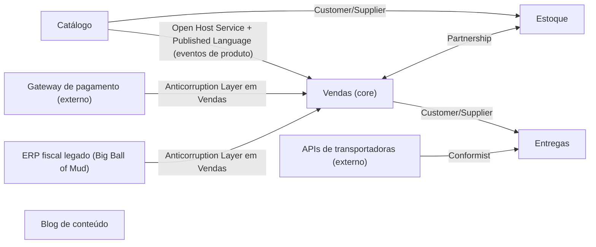

# 5. Design estratégico

> [!NOTE] Em uma frase
> Num sistema grande não existe um modelo único para tudo: o trabalho é dividir o sistema em contextos com modelos próprios, deixar explícito como esses contextos se relacionam e concentrar o melhor esforço na parte do negócio que realmente diferencia a empresa.

## Por que isso importa

A loja online agora tem cinco times. Vendas, estoque, entregas, catálogo e financeiro, todos mexendo num mesmo código e numa mesma classe `Produto`. Para o catálogo, produto tem descrição, fotos, ficha técnica e categoria. Para o estoque, produto é um SKU (código de unidade de estoque) com localização no armazém e quantidade. Para entregas, é peso, dimensões e "pode ir de moto ou não". A classe `Produto` tem 70 atributos, cada time mexe nos seus, e toda alteração quebra algo em outro time.

As Partes I a III do livro mostraram como construir um bom modelo. A Parte IV encara a realidade de projetos grandes: vários times, sistemas legados, fornecedores externos e prioridades diferentes. Ela responde a três perguntas: até onde um modelo vale (bounded context e context map), onde investir o melhor talento (destilação e core domain) e como dar uma forma geral a um sistema grande demais para caber numa cabeça (estrutura de larga escala).

## O que você precisa saber antes

- [1. Colocando o modelo de domínio para trabalhar](01-colocando-o-modelo-de-dominio-para-trabalhar.md): linguagem ubíqua e por que modelo e código precisam ser o mesmo.
- [3. Entidades, value objects, agregados e repositórios](03-entidades-value-objects-agregados-e-repositorios.md): os blocos que vivem *dentro* de cada contexto.
- [Acoplamento e coesão](../../glossario.md#acoplamento-e-coesão) e [fronteira arquitetural](../../glossario.md#fronteira-arquitetural): por que separar partes que mudam por motivos diferentes.

## As ideias centrais

### Bounded context: até onde um modelo vale

Um [bounded context](../../glossario.md#bounded-context) (contexto delimitado) é a fronteira explícita dentro da qual um modelo e sua [linguagem ubíqua](../../glossario.md#linguagem-ubíqua) têm um significado único e consistente. Fora dela, as mesmas palavras podem significar outra coisa, e isso é aceito.

A solução para o `Produto` de 70 atributos não é achar o modelo "certo" de produto. É admitir que existem vários: `Produto` no contexto de Catálogo, `ItemDeEstoque` no contexto de Estoque, `Volume` no contexto de Entregas. Cada um tem só o que o seu contexto precisa, e eles se conectam por um identificador comum (o SKU). Martin Fowler usa o mesmo argumento com "cliente": vendas, suporte e cobrança têm visões diferentes, e forçar uma só gera um modelo que não serve bem a ninguém.

A fronteira de um contexto costuma coincidir com um time, uma base de código e um esquema de banco, mas o que a define é o *modelo*: dentro dela, cada termo tem um sentido só. Evans complementa com dois padrões de apoio. **Integração contínua** dentro do contexto (juntar e testar o trabalho de todos com frequência e conversar sem parar) evita que o modelo se fragmente silenciosamente. E o **mapa de contextos** registra o que acontece entre eles.

### Context map: desenhando as relações

O *context map* (mapa de contextos) é um documento, quase sempre um diagrama, que mostra todos os contextos de um sistema e como cada par se relaciona. Ele descreve o que *é*, não o que se gostaria que fosse. A relação mais básica é a direção: o contexto **upstream** (rio acima) fornece algo, e o **downstream** (rio abaixo) depende dele.

A seta vai do upstream para o downstream. O blog não tem seta: é um caso de Separate Ways, explicado abaixo.

### Os padrões de relação entre contextos

Evans e o *DDD Reference* (o resumo oficial que ele publicou em 2015, que acrescentou Partnership e Big Ball of Mud aos padrões do livro) nomeiam as formas de dois contextos conviverem. Cada uma é um trade-off entre autonomia e custo de coordenação.

- **Partnership (parceria).** Dois times cujos sucessos dependem um do outro combinam juntos as mudanças na interface e entregam em conjunto. Vendas e Estoque na loja: se a reserva de estoque falhar, a venda falha. Custa muita coordenação; só vale quando a dependência é mútua.
- **Shared Kernel (núcleo compartilhado).** Dois contextos compartilham explicitamente um pedaço pequeno do modelo, por exemplo o value object `Sku` e `Dinheiro`, e nenhum time o altera sem consultar o outro. Reduz duplicação, mas cria acoplamento forte; mantenha o núcleo mínimo.
- **Customer/Supplier (cliente/fornecedor).** O upstream (fornecedor) leva em conta as necessidades do downstream (cliente) no próprio planejamento, e os dois negociam prioridades, de preferência com testes automatizados de aceite escritos pelo cliente. Catálogo fornecendo dados ao Estoque.
- **Conformist (conformista).** O downstream não tem poder de negociar e simplesmente adota o modelo do upstream como está. Entregas usa o formato das APIs das transportadoras sem traduzir, porque elas não vão mudar por causa da loja e o modelo delas é aceitável. Barato, mas o modelo de fora invade o seu.
- **Anticorruption Layer (camada anticorrupção, ACL).** O downstream constrói uma camada de tradução que converte o modelo do outro sistema para o seu, protegendo sua linguagem. Vendas usa uma ACL para o gateway de pagamento e para o ERP fiscal: o código de Vendas fala em `Pagamento` e `NotaFiscal`; a ACL traduz para os códigos e campos esquisitos do fornecedor. Custa código, mas é o padrão certo quando o modelo externo é ruim ou instável e o seu é importante.
- **Open Host Service (serviço aberto).** O upstream define um protocolo público e estável que serve a muitos consumidores, em vez de fazer uma integração sob medida para cada um. O Catálogo expõe uma API e eventos de produto que qualquer contexto pode consumir.
- **Published Language (linguagem publicada).** Um formato de troca bem documentado e compartilhado, como um esquema JSON versionado dos eventos de produto. Costuma andar junto com o Open Host Service.
- **Separate Ways (caminhos separados).** Integrar custa mais do que vale, então os contextos simplesmente não se integram. O blog de conteúdo da loja tem seus próprios produtos digitados à mão; ligar ao Catálogo não paga o esforço.
- **Big Ball of Mud (grande bola de lama).** Reconhece que partes do sistema não têm fronteira nem modelo coerente. A recomendação é desenhar uma fronteira em volta, não tentar modelar lá dentro e se proteger com uma ACL. O ERP legado é isso.

> [!TIP]
> O mapa é um diagnóstico, não um plano. Se ele mostra Vendas como conformista do ERP legado, isso já é informação útil: explica por que termos estranhos do ERP aparecem no código de Vendas e justifica investir numa ACL.

### Destilação: encontrar e proteger o core domain

Nem toda parte do sistema merece o mesmo cuidado. Destilação é o processo de separar o essencial do resto. O **core domain** (domínio central) é a parte do modelo que diferencia a empresa e justifica o software existir. Na loja, digamos que seja a experiência de compra e a promessa de entrega em 24h: Vendas e a parte de Entregas que calcula prazos. Ali vão os melhores desenvolvedores e o modelo mais cuidadoso.

Em volta dele ficam os **subdomínios genéricos**: partes necessárias, mas que não diferenciam ninguém. Autenticação, emissão de nota fiscal, envio de e-mail. Para esses, a recomendação é comprar uma solução pronta, usar uma biblioteca ou fazer algo simples, e nunca colocar os melhores talentos lá. (A literatura posterior acrescentou "subdomínio de suporte" para partes específicas do negócio que não diferenciam; o termo não é do livro original.)

Evans lista ferramentas para tornar o core visível e separado: uma **declaração de visão do domínio** (uma página dizendo o que o core faz e por que importa), um **core destacado** (marcar no código e nos documentos quais elementos são do core), **mecanismos coesos** (extrair algoritmos complicados, mas genéricos, como o cálculo de rota, para módulos próprios) e **core segregado** e **core abstrato** (refatorar para que o core fique isolado e, no limite, expresso por abstrações).

### Estrutura de larga escala

Quando o sistema é grande demais para alguém entender tudo, mesmo com contextos bem definidos, falta uma ideia que organize o todo. Evans chama de *estrutura de larga escala* um conjunto de regras ou papéis que dá forma ao sistema inteiro, e insiste que ela deve **evoluir** com o sistema (*evolving order*), não ser imposta no começo. Os exemplos dele:

- **Metáfora do sistema.** Uma analogia que todos entendem e que orienta o design.
- **Camadas de responsabilidade.** Organizar os conceitos do domínio em níveis com responsabilidades amplas, em que os de cima dependem dos de baixo. Na loja: *Capacidade* (armazéns, transportadoras), *Operação* (estoque, remessas), *Compromisso* (pedidos, prazos prometidos), *Decisão* (promoções, previsão de demanda).
- **Knowledge level (nível de conhecimento).** Separar objetos que descrevem regras configuráveis (tipos de promoção) dos objetos operacionais que seguem essas regras (pedidos).
- **Framework de componentes plugáveis.** Quando o modelo amadurece, definir interfaces abstratas para que implementações diferentes se encaixem. É a estrutura mais exigente e, segundo o próprio autor, a que mais costuma ser aplicada cedo demais.

O capítulo 17 junta tudo: decisões estratégicas são tomadas com quem trabalha no código, e contextos, destilação e estrutura se combinam (por exemplo, marcando no mapa quais contextos são core).

## Onde isso aparece no mundo real

- **Microsserviços.** A fronteira de um bounded context é a heurística mais citada para decidir o tamanho de um microsserviço. O livro é anterior a microsserviços e não fala deles; a relação é inversa: um contexto pode ser um monólito modular ou vários serviços.
- **Integração com ERPs e gateways.** Praticamente toda empresa que integra com um ERP legado acaba escrevendo uma ACL, com ou sem esse nome.
- **Lei de Conway.** A observação de que sistemas copiam a estrutura de comunicação da organização explica por que bounded contexts e times costumam coincidir, e por que o mapa de contextos também é um mapa organizacional.

## Erros comuns de quem está aprendendo

- **Tentar um modelo único para a empresa inteira.** É o erro que a Parte IV inteira combate.
- **Igualar bounded context a microsserviço.** Contexto é uma fronteira de modelo; serviço é uma unidade de deploy. Um pode conter vários do outro.
- **Desenhar o mapa idealizado.** O mapa útil mostra as relações reais, incluindo as feias.
- **Investir igualmente em tudo.** Modelar nota fiscal com o mesmo cuidado que o core desperdiça os melhores desenvolvedores.

## Verifique se entendeu

1. Por que a solução para o `Produto` de 70 atributos não é melhorar a classe, e sim dividi-la? (seção "Bounded context")
2. No mapa da loja, qual a diferença prática entre Entregas ser conformista das transportadoras e Vendas usar uma ACL para o gateway? (seção "Os padrões de relação")
3. Quando vale um Shared Kernel e qual o risco dele? (seção "Os padrões de relação")
4. O que é core domain na loja, e o que você faria com a emissão de nota fiscal? (seção "Destilação")
5. Por que a estrutura de larga escala deve evoluir em vez de ser definida no início? (seção "Estrutura de larga escala")

## Para ir além

- [DDD Reference (Eric Evans)](https://www.domainlanguage.com/ddd/reference/): as seções de Context Mapping, Distillation e Large-scale Structure trazem a definição oficial de cada padrão desta página, incluindo Partnership e Big Ball of Mud.
- [BoundedContext — martinfowler.com](https://martinfowler.com/bliki/BoundedContext.html): o argumento contra o modelo único de empresa e o exemplo de "cliente" com sentidos diferentes por contexto.
- [ddd-crew/ddd-starter-modelling-process](https://github.com/ddd-crew/ddd-starter-modelling-process): os passos Decompose, Strategize e Connect mostram como encontrar contextos, classificar o core e desenhar o mapa na prática.

---
Anterior: [4. Refatorando rumo a um insight mais profundo](04-refatorando-rumo-a-um-insight-mais-profundo.md) · Voltar ao livro: [Guia de leitura](index.md)
