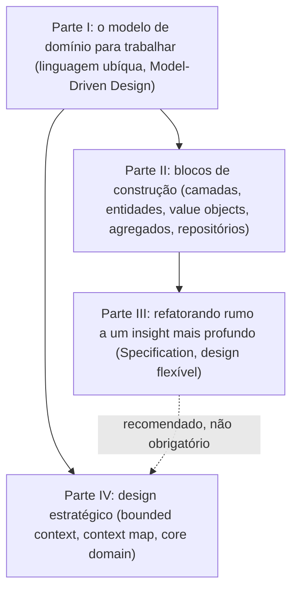

# Domain-Driven Design — guia de leitura

> [!NOTE] Em uma frase
> Software complexo fica sob controle quando o código fala a mesma língua que o negócio e quando um sistema grande é dividido em contextos, cada um com seu próprio modelo consistente.

## Para quem é e quando ler

*Domain-Driven Design: Tackling Complexity in the Heart of Software*, de Eric Evans (2003), é para quem constrói sistemas cuja dificuldade principal está nas regras do negócio, não na tecnologia: seguros, logística, finanças, comércio eletrônico, sistemas jurídicos. Se você já abriu um código e não conseguiu saber qual regra do negócio ele implementa, ou já viu duas áreas da empresa usarem a mesma palavra com sentidos diferentes, este livro fala do seu problema.

Leia depois de ter alguma experiência com orientação a objetos e de ter trabalhado em pelo menos um sistema de tamanho médio. Antes disso os problemas que ele resolve parecem abstratos. Combina bem com [Clean Architecture](../clean-architecture/index.md), que trata de como proteger o código de negócio de frameworks e banco; DDD trata de como construir esse código de negócio.

## O que o livro NÃO é

- **Não é um livro sobre microsserviços.** Ele é de 2003, anos antes do termo existir. A ideia de bounded context virou a heurística favorita para dividir microsserviços, mas o livro trata de fronteiras de *modelo*, que podem viver num monólito.
- **Não é uma estrutura de pastas.** Criar `entities/`, `value_objects/` e `repositories/` não é fazer DDD. O livro, aliás, recomenda organizar módulos por conceito do negócio, não por tipo técnico.
- **Não é leitura leve.** O original é denso, longo (mais de 500 páginas), cheio de exemplos extensos de domínios como transporte de carga e bancos, e escrito numa época de Java e UML. As ideias continuam atuais; o estilo e parte das técnicas de implementação envelheceram.
- **Não é obrigatório para todo sistema.** O próprio Evans diz que aplicações simples, de cadastro e consulta, não pagam o custo de um modelo rico.

## Como o livro está organizado

São quatro partes. A I dá a filosofia, a II dá as peças para montar o modelo no código, a III mostra como o modelo melhora com o tempo e a IV trata de sistemas grandes, com vários modelos e vários times.

A Parte IV depende mais da Parte I (linguagem e modelo) do que dos detalhes táticos das Partes II e III. Por isso há uma seta direta de I para IV.

## Como ler

1. **Parte I inteira, com calma.** Ela é curta e todo o resto se apoia nela.
2. **Parte II: capítulos 4 a 6 com atenção, capítulo 7 se quiser.** O capítulo 7 é um exemplo estendido; útil, mas pode ficar para uma segunda leitura.
3. **Parte III: capítulos 9 e 10 primeiro.** Specification e design flexível são os mais aproveitáveis. Os capítulos 11 e 12 podem ser lidos por cima na primeira vez.
4. **Parte IV: capítulo 14 (contextos) é essencial.** Os capítulos 15 (destilação) e 16 (estrutura de larga escala) são mais úteis quando você já tem um sistema grande nas mãos.

Muitas pessoas recomendam ler a Parte IV logo depois da Parte I, porque é nela que está a contribuição mais influente do livro. É uma ordem válida. Para acompanhar, o [DDD Reference](https://www.domainlanguage.com/ddd/reference/), resumo gratuito do próprio autor, tem uma página por padrão e serve de mapa durante a leitura. Ritmo sugerido: uma parte por semana, com as páginas deste guia como resumo antes ou depois de cada uma.

Este guia usa um único exemplo nas cinco páginas, uma loja online, para que você acompanhe o mesmo domínio do primeiro conceito ao mapa de contextos.

## O que você leva ao terminar

- Saber conduzir conversas com especialistas do negócio e transformar o vocabulário deles em nomes de classes e métodos.
- Distinguir entidade de value object e desenhar agregados que protegem as regras do negócio.
- Reconhecer quando um código desajeitado esconde um conceito do domínio, e refatorar para torná-lo explícito.
- Dividir um sistema grande em bounded contexts e descrever, com um mapa de contextos, como eles se relacionam.
- Decidir onde investir o melhor esforço técnico (core domain) e onde comprar ou simplificar.

## Capítulos

1. [Colocando o modelo de domínio para trabalhar](01-colocando-o-modelo-de-dominio-para-trabalhar.md): o que é um modelo de domínio, como ele nasce da conversa com o negócio e por que a linguagem ubíqua precisa chegar ao código.
2. [Os blocos de construção](02-blocos-de-construcao.md): isolar o domínio em camadas, o mapa dos padrões táticos, associações, serviços de domínio e módulos.
3. [Entidades, value objects, agregados e repositórios](03-entidades-value-objects-agregados-e-repositorios.md): identidade, imutabilidade, fronteiras de consistência e o ciclo de vida dos objetos com fábricas e repositórios.
4. [Refatorando rumo a um insight mais profundo](04-refatorando-rumo-a-um-insight-mais-profundo.md): como o modelo melhora com o tempo, o padrão Specification e as técnicas de design flexível.
5. [Design estratégico](05-design-estrategico.md): bounded contexts, mapa de contextos e seus padrões de relação, core domain e estrutura de larga escala.

## Fontes públicas para acompanhar

As [fontes públicas verificadas](fontes.md) reúnem notas por capítulo, o DDD Reference oficial do autor, um processo open-source para aplicar DDD e artigos sobre bounded context.
