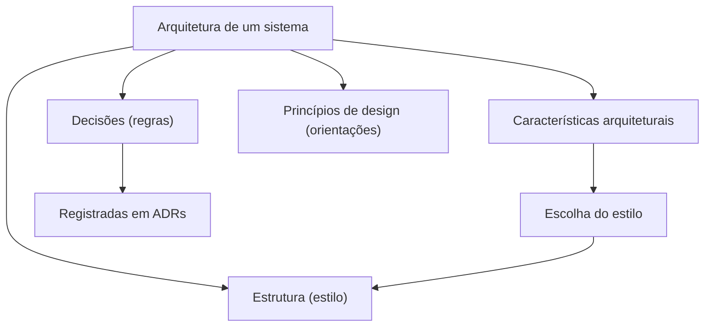

# 1. Pensamento arquitetural

> [!NOTE] Em uma frase
> Arquitetura não é escolher a tecnologia "melhor", é entender o que o sistema precisa garantir, enxergar o que cada opção ganha e perde, e explicar por que você escolheu o que escolheu.

## Por que isso importa

Imagine uma pessoa desenvolvedora que, depois de cinco anos escrevendo código, é promovida a arquiteta. Na primeira semana alguém pergunta: "usamos fila ou chamada HTTP direta entre o serviço de pedidos e o de pagamentos?". O reflexo dela é responder como respondia antes: qual das duas é a mais moderna, a mais rápida, a que ela conhece melhor. Seis meses depois, o time descobre que a escolha dificultou rastrear pagamentos perdidos, algo que ninguém tinha colocado na mesa. A decisão não estava errada no sentido técnico, ela só foi tomada sem olhar para o que se perdia.

Os dois primeiros capítulos do livro existem para trocar esse reflexo. Eles não ensinam nenhuma tecnologia; ensinam um jeito de pensar. Toda decisão estrutural tem custo, e o papel de quem arquiteta é tornar esse custo visível antes que ele vire incidente.

## O que você precisa saber antes

Nada além de já ter trabalhado (ou estudado) em algum sistema com mais de um módulo. Se o termo "acoplamento" for novo, leia a entrada [acoplamento e coesão](../../glossario.md#acoplamento-e-coesão) no glossário; ele volta com força na [próxima página](02-modularidade.md).

## As ideias centrais

### As quatro dimensões de uma arquitetura

O livro recusa a definição única de "arquitetura" e propõe olhar para quatro coisas ao mesmo tempo:

1. **Estrutura**: o estilo escolhido (camadas, microsserviços, microkernel e assim por diante). Dizer "nossa arquitetura é de microsserviços" descreve só isso, e é pouco.
2. **Características arquiteturais**: as qualidades que o sistema precisa ter e que não são funcionalidades de negócio, como [disponibilidade](../../glossario.md#disponibilidade), escalabilidade (aguentar mais carga) e segurança. O livro as chama de "-ilities" porque em inglês quase todas terminam assim (*availability*, *scalability*). Elas ganham uma página inteira, a [3](03-caracteristicas-arquiteturais.md).
3. **Decisões arquiteturais**: as regras de como o sistema deve ser construído. Exemplo: "só a camada de negócio pode acessar o banco". Decisão é restrição; ela diz o que não pode.
4. **Princípios de design**: orientações, não regras. Exemplo: "prefira mensagens assíncronas entre serviços para ganhar desempenho". Um princípio deixa espaço para exceção; uma decisão não.

A distinção entre decisão e princípio parece burocrática, mas resolve brigas reais: se "usar mensageria" é princípio, um time pode justificar uma chamada síncrona; se é decisão, precisa de aprovação para fugir dela.

### O que se espera de quem é arquiteto

O livro lista oito expectativas. Vale conhecer todas, porque várias não são técnicas:

- **Tomar decisões arquiteturais** e guiar as decisões de tecnologia, sem necessariamente escolher a biblioteca de cada time.
- **Analisar a arquitetura continuamente**: uma arquitetura que fazia sentido há três anos pode estar apodrecendo. O termo usado é vitalidade arquitetural.
- **Acompanhar tendências** de tecnologia e de mercado.
- **Garantir que as decisões sejam seguidas**. Uma regra que ninguém verifica não existe na prática; a [página 3](03-caracteristicas-arquiteturais.md) mostra como automatizar essa verificação.
- **Ter exposição e experiência diversas**: conhecer várias linguagens, plataformas e bancos, mesmo que superficialmente.
- **Conhecer o domínio de negócio**. Uma arquitetura bonita para o problema errado é inútil.
- **Ter habilidades interpessoais**: liderar, negociar, explicar.
- **Entender e navegar a política** da empresa. Quase toda decisão arquitetural afeta orçamento, prazo ou o trabalho de outro time, e por isso vai ser contestada.

### As duas leis

O livro resume a disciplina em duas "leis":

- **Primeira lei: tudo em arquitetura de software é trade-off.** Trade-off é uma troca: para ganhar uma coisa, você abre mão de outra. O corolário é ainda mais útil: se você acha que encontrou uma solução sem trade-off, provavelmente só não identificou o trade-off ainda.
- **Segunda lei: o porquê é mais importante do que o como.** Olhando um sistema pronto, dá para descobrir como ele foi feito. O que não dá para descobrir é por que cada escolha foi feita, e é isso que impede o próximo arquiteto de desfazer uma boa decisão por ignorância. Daí a insistência do livro em registrar decisões ([página 8](08-decisoes-e-adrs.md)).

A resposta favorita de arquiteto, "depende", não é fuga: é a primeira lei aplicada. O trabalho é dizer **do que** depende.

### Arquitetura versus design, e largura versus profundidade

Antigamente se pensava em fluxo de mão única: o arquiteto desenha, o desenvolvedor implementa. O livro defende que essa separação quebra, porque decisões de código afetam a arquitetura e vice-versa. Arquiteto e time de desenvolvimento precisam estar na mesma conversa o tempo todo.

Para explicar o que muda na carreira, o livro usa uma pirâmide de conhecimento em três níveis: o que você sabe (topo), o que você sabe que não sabe (meio) e o que você nem sabe que não sabe (base). Uma pessoa desenvolvedora investe em **profundidade**, o topo da pirâmide: dominar a fundo uma linguagem ou um framework. Quem arquiteta precisa de **largura**, o meio da pirâmide: saber que existem cinco tipos de cache diferentes e para que cada um serve vale mais do que ser especialista em um só. Manter profundidade em muitas coisas é impossível, e tentar leva ao esgotamento.

Um alerta do livro sobre isso é o anti-padrão do **homem das cavernas congelado**: o arquiteto que, por ter se queimado uma vez com algum problema, passa a vetar tudo que lembra aquele problema, mesmo quando o contexto mudou.

### Analisar trade-offs na prática

O exemplo clássico do capítulo 2 é um sistema de leilão em que o serviço que recebe lances precisa avisar outros serviços. Duas opções:

- **Tópico** (um canal de publicação em que todos os interessados recebem a mesma mensagem): o produtor não sabe quem consome. Adicionar um novo consumidor é só se inscrever no tópico. Ganha-se **extensibilidade** (facilidade de estender o sistema) e desacoplamento.
- **Filas separadas**, uma por consumidor (veja [fila e mensageria](../../glossario.md#fila-e-mensageria)): o produtor manda explicitamente para cada uma. Parece pior, mas cada consumidor pode receber um contrato de dados diferente, dá para monitorar a profundidade de cada fila e escalar cada consumidor de forma independente, e é mais fácil controlar quem pode ler o quê (segurança).

Nenhuma é "a certa". Se o sistema precisa crescer em consumidores rapidamente, o tópico ganha; se segurança e controle de contrato pesam mais, as filas ganham. A análise boa é a que lista as duas colunas e liga cada item a uma necessidade de negócio.

### Equilibrar arquitetura e código

Quem arquiteta precisa continuar programando, mas sem virar gargalo. A armadilha é pegar uma tarefa crítica do caminho principal e atrasar o time porque passa o dia em reuniões. O livro sugere outras formas de manter a mão no código: fazer provas de conceito (protótipos pequenos para testar uma ideia), pegar histórias de débito técnico ou correções de bug fora do caminho crítico, automatizar tarefas repetitivas do time e participar de revisões de código.

## Onde isso aparece no mundo real

- **Monolito do Shopify**: a empresa ficou conhecida por manter um monolito Ruby gigante e modularizá-lo por dentro, em vez de quebrar tudo em microsserviços. Foi um trade-off explícito: abriram mão de implantar partes separadamente para manter simplicidade operacional. É a primeira lei vista de fora.
- **Decisões que viram "folclore"**: em quase toda empresa existe uma regra do tipo "aqui não usamos ORM" sem que ninguém lembre por quê. É a segunda lei sendo violada: o como sobreviveu, o porquê se perdeu.
- **Radar de tecnologia**: a consultoria Thoughtworks publica um "Technology Radar" classificando tecnologias em adotar, experimentar, avaliar e evitar. O livro sugere que cada arquiteto mantenha um radar pessoal assim, como forma de cultivar largura de forma deliberada.

## Erros comuns de quem está aprendendo

- **Achar que arquitetura é escolher o estilo.** Estilo é uma das quatro dimensões. Duas equipes com "microsserviços" podem ter arquiteturas completamente diferentes por causa das características priorizadas e das decisões tomadas.
- **Tratar "depende" como resposta final.** "Depende" é o começo da análise. A resposta completa é "depende de X e Y; no nosso caso, X pesa mais, então escolhemos A sabendo que perdemos B".
- **Buscar a arquitetura ótima.** O livro fala em buscar a arquitetura "menos pior": aquela cujos defeitos o negócio consegue aceitar. Otimizar tudo é impossível porque as características competem entre si.
- **Parar de programar.** Arquiteto que perde contato com o código começa a decidir com base em como as coisas funcionavam há anos.

## Verifique se entendeu

1. Qual a diferença entre uma decisão arquitetural e um princípio de design? Dê um exemplo de cada. (Veja "As quatro dimensões de uma arquitetura".)
2. Por que o corolário da primeira lei é útil quando alguém apresenta uma solução "sem desvantagens"? (Veja "As duas leis".)
3. Em que cenário você escolheria filas separadas em vez de um tópico no sistema de leilão? (Veja "Analisar trade-offs na prática".)
4. Por que largura de conhecimento importa mais para arquitetura do que profundidade? (Veja "Arquitetura versus design, e largura versus profundidade".)
5. Cite duas formas de continuar programando sem virar gargalo do time. (Veja "Equilibrar arquitetura e código".)

## Para ir além

- [Resumo de Dan Lebrero](https://danlebrero.com/2021/11/17/fundamentals-of-software-architecture-summary/): os "key insights" do topo e as notas dos capítulos 1 e 2 recapitulam as leis e as expectativas do arquiteto.
- [Q&A de Edwin Torres, Parte 1](https://dev.to/codesandtags/fundamentals-of-software-architecture-book-part-1-ela): respostas às perguntas de autoavaliação dos capítulos 1 e 2, boas para conferir se você absorveu as dimensões e a Primeira Lei.
- [Software Architecture Monday](https://developertoarchitect.com/lessons/): a seção de Soft Skills tem lições curtas de Mark Richards sobre o papel do arquiteto e como analisar trade-offs.

---
Próximo: [2. Modularidade](02-modularidade.md) · Voltar ao livro: [Guia de leitura](index.md)
