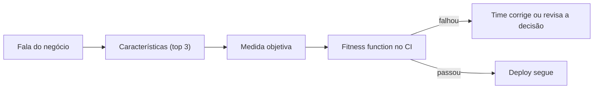

# 3. Características arquiteturais

> [!NOTE] Em uma frase
> Antes de escolher qualquer estilo, descubra as poucas qualidades que o sistema não pode deixar de ter, transforme cada uma em algo mensurável e automatize a checagem.

## Por que isso importa

Uma empresa de venda de ingressos decide reescrever seu site. O documento de requisitos fala de busca de shows, carrinho e pagamento. Ninguém escreveu "no dia em que abrir a venda do show mais esperado do ano, 2 milhões de pessoas vão entrar no mesmo minuto". O time entrega tudo que foi pedido, e o sistema cai na primeira venda grande. Os requisitos funcionais estavam certos; faltou uma característica arquitetural, a **elasticidade** (capacidade de aguentar picos súbitos de carga).

Os capítulos 4 a 7 tratam exatamente disso: o que o sistema precisa ser, além do que ele precisa fazer. São essas qualidades, e não as funcionalidades, que decidem o estilo de arquitetura.

## O que você precisa saber antes

- [Página 1](01-pensamento-arquitetural.md): características arquiteturais são uma das quatro dimensões de uma arquitetura.
- [Página 2](02-modularidade.md): métricas de acoplamento e conascência, usadas aqui para medir e para definir quantum.
- Glossário: [disponibilidade](../../glossario.md#disponibilidade), [latência e throughput](../../glossario.md#latência-e-throughput), [SLO](../../glossario.md#slo).

## As ideias centrais

### O que conta como característica arquitetural

O livro dá três critérios. Uma característica arquitetural:

1. **Especifica uma preocupação que não é do domínio**: não diz o que o sistema faz para o negócio, e sim como ele precisa se comportar.
2. **Influencia algum aspecto estrutural do design**: exige uma decisão de estrutura. Segurança básica (senhas com hash) é boa prática de código; processar pagamento sem nunca guardar dados de cartão pode exigir um módulo isolado, e isso é estrutura.
3. **É crítica ou importante para o sucesso da aplicação.**

Algumas são **explícitas** (aparecem no requisito: "suportar 10 mil usuários simultâneos"); outras são **implícitas** (ninguém escreve, mas todo mundo espera, como disponibilidade e segurança).

O livro agrupa as mais comuns em três famílias:

| Família | Exemplos | O que pergunta |
|---|---|---|
| Operacionais | disponibilidade, desempenho, escalabilidade, elasticidade, recuperabilidade, confiabilidade | como o sistema se comporta rodando |
| Estruturais | manutenibilidade, extensibilidade, configurabilidade, portabilidade, instalabilidade | como o código é organizado e evolui |
| Transversais | segurança, privacidade, acessibilidade, requisitos legais, usabilidade | o que atravessa tudo |

Duas distinções que confundem muito: **escalabilidade** é aguentar mais carga ao longo do tempo (de 1 mil para 100 mil usuários em um ano); **elasticidade** é aguentar picos repentinos (de 1 mil para 100 mil em um minuto). E várias características são **compostas**: "agilidade", por exemplo, é na prática a soma de modularidade, implantabilidade (*deployability*, facilidade de colocar mudanças em produção) e testabilidade.

### Menos é mais: escolher as que dirigem a arquitetura

Cada característica suportada custa complexidade, e elas competem: mais segurança costuma significar mais etapas por requisição, o que piora desempenho. Por isso o livro insiste em escolher poucas. A técnica sugerida é pedir ao negócio que escolha as **três mais importantes** de uma lista, em vez de ordenar todas (ninguém concorda com uma ordenação completa).

Para traduzir a fala do negócio em características, o livro propõe um mapeamento. Alguns exemplos:

- "Precisamos lançar rápido" (tempo de mercado) → agilidade, testabilidade, implantabilidade.
- "Vamos comprar outras empresas" (fusões e aquisições) → interoperabilidade, escalabilidade, extensibilidade.
- "O usuário não pode ficar insatisfeito" → desempenho, disponibilidade, tolerância a falhas.
- "Orçamento e prazo apertados" → simplicidade, viabilidade.

Também dá para extrair dos requisitos: "o sistema atende lojas em vários fusos horários" sugere disponibilidade 24h; "o número de lojas deve dobrar" sugere escalabilidade. O livro pratica isso com *architecture katas*, exercícios em que grupos recebem um enunciado curto de sistema fictício e precisam listar as características que dirigem a arquitetura.

### Medir: transformar adjetivo em número

"Precisa ser rápido" não serve para nada. O livro separa três tipos de medida:

- **Operacionais**: desempenho medido como tempo de resposta, de preferência com percentis em vez de médias (veja [p50, p99](../../glossario.md#p50-p99-percentis-de-latência)), e com orçamento por etapa, como "a primeira renderização em até 500 ms".
- **Estruturais**: o exemplo principal é a **complexidade ciclomática**, que conta os caminhos independentes dentro de uma função (cada `if` ou laço cria um novo caminho). O livro considera aceitável até cerca de 10 e prefere abaixo de 5.
- **De processo**: testabilidade medida por cobertura de testes (com a ressalva de que cobertura alta não prova testes bons); implantabilidade medida pela proporção de deploys que dão certo e pelo tempo que um deploy leva.

### Governar: fitness functions

Medir uma vez não basta, porque o código muda todo dia. O livro pega emprestado de *Building Evolutionary Architectures* (de Ford e coautores) a ideia de **fitness function**: qualquer mecanismo que avalia de forma objetiva se uma característica arquitetural continua sendo atendida. O nome vem de algoritmos genéticos, em que a função de aptidão diz se uma solução é boa.

Na prática, quase sempre é um teste automatizado sobre a arquitetura, rodando no CI. Exemplos do livro e do dia a dia:

- **Sem ciclos**: um teste que falha se o pacote A depende de B e B depende de A.
- **Regras de camada**: com bibliotecas como ArchUnit (Java) ou NetArchTest (.NET), um teste do tipo "classes do pacote `apresentacao` não podem importar `persistencia`".
- **Distância da sequência principal**: falhar o build se algum módulo passar de D = 0,7 (métrica da [página 2](02-modularidade.md)).
- **Desempenho**: um teste de carga que falha se o p99 subir acima do [SLO](../../glossario.md#slo).
- **Resiliência**: o Chaos Monkey da Netflix, que derruba servidores aleatoriamente em produção para garantir que o sistema tolere falhas.

### Escopo: o quantum arquitetural

Até aqui, falamos de características "do sistema". Mas sistemas grandes não têm as mesmas necessidades em toda parte: no site de ingressos, a fila de compra precisa de elasticidade extrema, enquanto o painel administrativo não. O livro introduz o **quantum arquitetural** para definir o escopo de um conjunto de características: um artefato que pode ser implantado de forma independente, com alta coesão funcional e conascência síncrona.

Destrinchando:

- **Implantável de forma independente**: inclui tudo que ele precisa para funcionar, banco de dados incluso. Se dez serviços compartilham o mesmo banco, os dez formam **um único quantum**, porque mudar o esquema do banco pode quebrar todos.
- **Alta coesão funcional**: faz uma coisa de negócio coerente.
- **Conascência síncrona**: partes que se chamam de forma síncrona (uma espera a resposta da outra) ficam acopladas em desempenho e disponibilidade; se a chamada demora, quem chamou também demora.

Um monolito com um banco é sempre um quantum. Um sistema com cinco serviços independentes, cada um com seu banco e conversando por mensagens assíncronas, pode ter cinco quanta, cada um com características próprias. É essa contagem que, na [página 4](04-estilos-de-arquitetura-visao-geral.md), decide entre monolito e arquitetura distribuída: se as características diferem muito entre partes do sistema, você precisa de mais de um quantum.

## Onde isso aparece no mundo real

- **Vendas de ingressos para grandes shows** são o exemplo público mais lembrado de elasticidade como característica dirigente: plataformas de venda adotaram filas virtuais justamente porque o pico é muito maior do que a carga média.
- **Chaos Engineering na Netflix**: o Chaos Monkey é uma fitness function rodando em produção, e virou disciplina adotada por muitas empresas.
- **SLOs de serviços internos**: quando uma empresa define "99,9% das requisições em menos de 300 ms" e alerta quando o orçamento de erro está acabando, está medindo e governando uma característica operacional.

## Erros comuns de quem está aprendendo

- **Querer todas as características.** Um sistema desenhado para ser máximo em tudo fica caro, lento e complexo. Escolha poucas e aceite as perdas.
- **Confundir escalabilidade com elasticidade.** Crescer devagar e aguentar pico pedem soluções diferentes.
- **Medir só uma vez.** Sem fitness function, a arquitetura se degrada a cada pull request.
- **Achar que microsserviços com banco compartilhado são vários quanta.** Banco compartilhado amarra todos em um só quantum.

## Verifique se entendeu

1. Pelos três critérios, "o sistema deve calcular o imposto de cada nota" é uma característica arquitetural? Por quê? (Veja "O que conta como característica arquitetural".)
2. Um diretor diz "precisamos sair na frente da concorrência". Que características você extrairia? (Veja "Menos é mais".)
3. Escreva em português uma fitness function para a regra "o domínio não depende de frameworks". (Veja "Governar".)
4. Três serviços compartilham um banco e se chamam via HTTP síncrono. Quantos quanta existem? (Veja "Escopo".)

## Para ir além

- [Architecture Characteristics Worksheet](https://developertoarchitect.com/resources.html): a planilha oficial de Mark Richards para escolher as características dirigentes, com vídeo explicando o uso.
- [Clube de leitura no GitHub](https://github.com/melaniebrgr/bookclub-fundamentals-software-architecture): o resumo dos capítulos 4 e 5 detalha os três critérios, a taxonomia e o método de identificação com exemplo.
- [Q&A de Edwin Torres, Parte 2](https://dev.to/codesandtags/fundamentals-of-software-architecture-book-part-2-1go8): respostas sobre "-ilities", complexidade ciclomática, fitness functions e quantum.
- [Software Architecture Monday](https://developertoarchitect.com/lessons/): lições curtas sobre características arquiteturais e fitness functions na voz do coautor.

---
Anterior: [2. Modularidade](02-modularidade.md) · Próximo: [4. Estilos de arquitetura: visão geral](04-estilos-de-arquitetura-visao-geral.md) · Voltar ao livro: [Guia de leitura](index.md)
