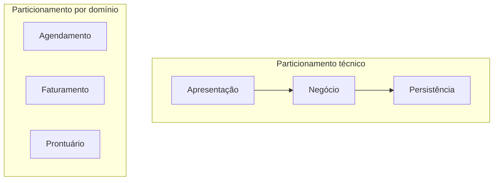

# 4. Estilos de arquitetura: visão geral

> [!NOTE] Em uma frase
> Antes de escolher um estilo específico, decida duas coisas: se o código se divide por camada técnica ou por área de negócio, e se tudo roda em um só processo ou espalhado pela rede, sabendo que a rede cobra caro.

## Por que isso importa

Um time de seis pessoas, animado com o que leu sobre a Netflix, quebra seu sistema de agendamento médico em doze microsserviços logo no início. Em três meses, metade do tempo vai para depurar timeouts entre serviços, montar logs de várias máquinas para entender uma única consulta marcada e coordenar deploys porque um contrato mudou. O sistema não tinha nenhuma característica que justificasse distribuir; o time pagou o preço da rede sem receber nada em troca.

Os capítulos 8 e 9 dão as duas perguntas que vêm antes de qualquer estilo concreto e o aviso que precisa estar na cabeça de quem pensa em distribuir. Esta página é o mapa para as três seguintes.

## O que você precisa saber antes

- [Página 3](03-caracteristicas-arquiteturais.md): características arquiteturais e quantum arquitetural. O número de quanta é o que decide entre monolito e distribuído.
- Glossário: [camada](../../glossario.md#camada), [bounded context](../../glossario.md#bounded-context), [latência e throughput](../../glossario.md#latência-e-throughput).

## As ideias centrais

### Componentes: a unidade com que o arquiteto trabalha

Para o livro, **componente** é a manifestação física de um módulo: um pacote, um namespace, uma biblioteca, um serviço. É o bloco que aparece nos diagramas de arquitetura. O arquiteto decide os componentes de alto nível e como eles se relacionam; o time decide as classes dentro deles.

O livro sugere um ciclo para identificar componentes: chutar um conjunto inicial, atribuir requisitos (histórias de usuário) a cada um, analisar se as responsabilidades estão coerentes, verificar se as características arquiteturais são atendidas, e reestruturar. É iterativo porque o primeiro chute quase sempre erra.

Um anti-padrão citado é a **armadilha da entidade**: criar um componente por tabela do banco (`GerenciadorDeCliente`, `GerenciadorDePedido`), o que produz componentes que são só CRUD (criar, ler, atualizar e apagar) sem comportamento real. Alternativas melhores são partir dos atores e das ações que eles fazem, ou do fluxo de trabalho do negócio, ou de técnicas como *event storming* (oficinas em que o time mapeia os eventos de negócio em post-its).

### Particionamento técnico versus por domínio

A primeira grande decisão é como fatiar o sistema no nível mais alto:

- **Particionamento técnico**: por responsabilidade técnica. Uma pasta para apresentação, uma para regras de negócio, uma para persistência. É o modelo das [camadas](../../glossario.md#camada).
- **Particionamento por domínio**: por área de negócio. Uma parte para agendamento, outra para faturamento, outra para prontuário. Cada parte tem por dentro sua própria apresentação, regra e acesso a dados.

O trade-off fica claro com uma mudança concreta: "adicionar o campo convênio ao agendamento". No particionamento técnico, a mudança atravessa as três camadas, e se cada camada pertence a um time, três times se coordenam. No particionamento por domínio, a mudança fica dentro do componente de agendamento. Em compensação, o particionamento técnico deixa regras genéricas (log, validação) em um só lugar, enquanto no por domínio elas tendem a se repetir.

O livro liga isso à **Lei de Conway**: organizações produzem sistemas cuja estrutura copia a estrutura de comunicação delas. Times divididos por especialidade (front, back, DBA) tendem a gerar particionamento técnico. A **manobra inversa de Conway** é organizar os times do jeito que se quer que a arquitetura fique. A tendência das últimas décadas, puxada pelo DDD (Domain-Driven Design, abordagem que organiza o software em torno do modelo de negócio), é o particionamento por domínio.

### Padrões fundamentais

Antes dos estilos nomeados, o livro lembra três formas básicas:

- **Grande bola de lama** (*big ball of mud*): ausência de estrutura reconhecível, tudo chamando tudo. É o que acontece quando ninguém decide nada. O livro inclui como alerta, não como opção.
- **Unitária**: tudo em um único programa em uma máquina, como os sistemas de mainframe antigos ou software embarcado.
- **Cliente/servidor**: separa quem pede de quem atende. Evoluiu de "aplicativo desktop + banco" para "navegador + servidor web" e para a arquitetura de três camadas (navegador, servidor de aplicação, banco).

### Monolito ou distribuído

A segunda grande decisão. Um **monolito**, aqui, é uma arquitetura com uma única unidade de implantação: um só artefato vai para produção. Uma **arquitetura distribuída** tem várias unidades implantadas separadamente, conversando pela rede.

O critério do livro volta ao [quantum](03-caracteristicas-arquiteturais.md): se um único conjunto de características serve ao sistema inteiro, um monolito resolve e é mais simples. Se partes diferentes precisam de características diferentes (o checkout precisa de elasticidade, o relatório não), você precisa de vários quanta, e isso empurra para o distribuído.

| Estilos monolíticos ([página 5](05-monolitos.md)) | Estilos distribuídos ([página 6](06-microsservicos-e-event-driven.md)) |
|---|---|
| Em camadas, pipeline, microkernel | Service-based, event-driven, space-based, SOA orientada a orquestração, microsserviços |

### As oito falácias da computação distribuída

Distribuir traz ganhos de escala, elasticidade e isolamento de falhas, mas cobra um preço que iniciantes subestimam. O livro adota a lista de falácias formulada por L. Peter Deutsch e colegas na Sun Microsystems nos anos 1990: suposições falsas que quem nunca operou um sistema distribuído costuma fazer.

1. **A rede é confiável.** Não é. Requisições se perdem, e por isso existem timeouts, retentativas e circuit breakers (mecanismos que param de chamar um serviço que está falhando, para não derrubar quem chama).
2. **A latência é zero.** Uma chamada local leva nanossegundos; uma chamada remota, milissegundos. Uma requisição que encadeia dez serviços soma dez latências. Olhe para o [p99](../../glossario.md#p50-p99-percentis-de-latência), não só para a média.
3. **A banda é infinita.** Devolver o objeto cliente inteiro (500 KB) quando quem chamou só queria o nome, multiplicado por milhares de requisições por segundo, satura a rede. O livro chama isso de *stamp coupling* (acoplamento por carimbo): passar a estrutura toda quando só uma parte é usada.
4. **A rede é segura.** Cada serviço exposto é uma nova porta de entrada; todo endpoint precisa ser protegido.
5. **A topologia nunca muda.** Um roteador trocado ou um upgrade de rede muda latências e pode quebrar suposições escondidas.
6. **Existe só um administrador.** Na prática há vários times e fornecedores mexendo na rede, e coordenar com eles faz parte do trabalho.
7. **O custo de transporte é zero.** Distribuir exige mais infraestrutura: balanceadores, gateways, proxies, mensageria.
8. **A rede é homogênea.** Equipamentos de fabricantes diferentes nem sempre se entendem perfeitamente, e pacotes se perdem por isso.

Além das falácias, o livro lista dores que só existem no distribuído: **log distribuído** (montar a história de uma requisição a partir de logs de várias máquinas, o que exige [observabilidade](../../glossario.md#observabilidade) e IDs de correlação), **transações distribuídas** (sem uma transação [ACID](../../glossario.md#acid) única, usa-se consistência eventual ou sagas, sequências de passos com compensação para desfazer em caso de falha) e **versionamento de contratos** entre serviços mantidos por times diferentes.

## Onde isso aparece no mundo real

- **Segment voltou de microsserviços para monolito**: a empresa publicou em 2018 um texto conhecido ("Goodbye Microservices") contando como a sobrecarga operacional de centenas de serviços superou o benefício. É a lista de falácias cobrando a conta.
- **Amazon e os "times de duas pizzas"**: a organização em times pequenos donos de um serviço é o exemplo mais citado da manobra inversa de Conway.
- **Prime Video e o monitoramento de vídeo**: em 2023 o time publicou como trocou uma arquitetura distribuída serverless por um processo único para uma ferramenta de monitoramento, cortando custo de transporte de dados entre componentes. Note que foi uma ferramenta, não o Prime Video inteiro.

## Erros comuns de quem está aprendendo

- **Escolher distribuído por moda.** Se o sistema tem um só conjunto de características, um monolito bem modularizado entrega mais com menos.
- **Achar que monolito é sinônimo de bola de lama.** Monolito diz respeito ao deploy, não à organização interna. Dá para ter um monolito muito bem particionado por domínio.
- **Ignorar a Lei de Conway.** Desenhar componentes por domínio e manter times por especialidade técnica faz a organização puxar a arquitetura de volta.
- **Tratar chamada remota como chamada local.** Toda chamada de rede pode falhar, demorar ou chegar duplicada; o código precisa assumir isso (veja [idempotência](../../glossario.md#idempotência)).

## Verifique se entendeu

1. Para a mudança "adicionar campo convênio ao agendamento", compare o esforço nos dois tipos de particionamento. (Veja "Particionamento técnico versus por domínio".)
2. O que a Lei de Conway prevê para uma empresa com times de front, back e banco separados? (Veja a mesma seção.)
3. Qual o critério do livro para escolher entre monolito e distribuído? (Veja "Monolito ou distribuído".)
4. Dê um exemplo concreto de *stamp coupling* e de qual falácia ele viola. (Veja "As oito falácias".)

## Para ir além

- [Resumo de Dan Lebrero](https://danlebrero.com/2021/11/17/fundamentals-of-software-architecture-summary/): as notas dos capítulos 8 e 9 cobrem componentes, particionamento e as falácias.
- [Q&A de Edwin Torres, Parte 2](https://dev.to/codesandtags/fundamentals-of-software-architecture-book-part-2-1go8): inclui as respostas do capítulo 8 sobre particionamento técnico versus por domínio.
- [Software Architecture Monday](https://developertoarchitect.com/lessons/): a seção General Architecture tem lições sobre falácias da computação distribuída e particionamento.

---
Anterior: [3. Características arquiteturais](03-caracteristicas-arquiteturais.md) · Próximo: [5. Monolitos](05-monolitos.md) · Voltar ao livro: [Guia de leitura](index.md)
