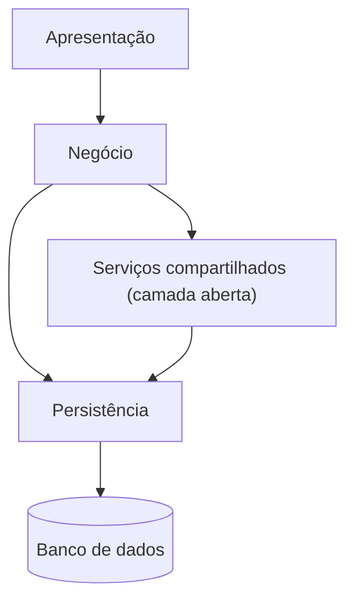
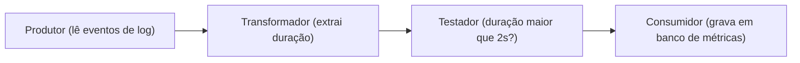
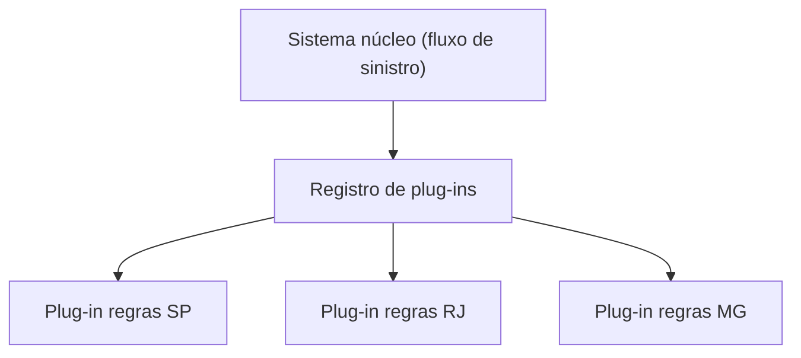

# 5. Monolitos: camadas, pipeline e microkernel

> [!NOTE] Em uma frase
> Monolitos são baratos, simples e rápidos de começar; a escolha entre camadas, pipeline e microkernel depende de como o trabalho flui e de onde o sistema precisa ser estendido.

## Por que isso importa

A maioria dos sistemas que você vai encontrar na vida profissional é um monolito: um único artefato implantado, um banco de dados. Muitos são aplicações web em camadas que começaram simples e cresceram. Saber reconhecer qual estilo monolítico um sistema usa (ou deveria usar) evita duas besteiras opostas: reescrever em microsserviços algo que só precisava de uma reorganização, ou empilhar funcionalidade em uma estrutura que já passou do limite.

Esta página cobre os capítulos 10 a 12 da 1ª edição. Para cada estilo, o livro descreve a topologia (as peças e como se conectam), dá exemplos, e avalia o estilo contra as características arquiteturais da [página 3](03-caracteristicas-arquiteturais.md).

## O que você precisa saber antes

- [Página 4](04-estilos-de-arquitetura-visao-geral.md): particionamento técnico versus por domínio e o que é um monolito (uma única unidade de implantação).
- Glossário: [camada](../../glossario.md#camada), [pipeline](../../glossario.md#pipeline), [acoplamento e coesão](../../glossario.md#acoplamento-e-coesão).

## As ideias centrais

### Arquitetura em camadas

O estilo mais comum de todos, muitas vezes adotado sem ninguém decidir. O código é dividido em camadas horizontais, tipicamente quatro:

1. **Apresentação**: telas, controladores HTTP, o que fala com o usuário.
2. **Negócio**: as regras.
3. **Persistência**: o código que lê e grava no banco.
4. **Banco de dados**.

O conceito-chave é o de **camadas fechadas**: uma requisição precisa passar por cada camada em ordem, sem pular. A apresentação não pode chamar a persistência direto. Isso cria **isolamento entre camadas**: dá para trocar o banco mexendo só na persistência, sem que a apresentação perceba.

Às vezes vale ter uma **camada aberta**, que pode ser pulada. O exemplo do livro é uma camada de serviços compartilhados (utilitários de auditoria, formatação) entre negócio e persistência: o negócio pode usá-la, mas também pode ir direto à persistência quando não precisa dela. Deixar claro e documentado o que é aberto e o que é fechado é essencial, senão cada desenvolvedor decide sozinho.

**Pontos fortes**: simples, barato, familiar a todo mundo. É um bom ponto de partida quando o domínio ainda não está claro.

**Pontos fracos**: é particionado tecnicamente, então mudanças de negócio atravessam todas as camadas. É um quantum só, então escala inteiro ou não escala. Implantar qualquer mudança exige implantar tudo. Testabilidade cai à medida que o código cresce.

**Anti-padrão do ralo** (*architecture sinkhole*): requisições que só atravessam as camadas sem que nenhuma faça nada, cada uma repassando para a próxima. O livro sugere uma regra 80/20: se até uns 20% das requisições são ralo, tudo bem; se a maioria é, as camadas estão fechadas demais ou o estilo é o errado. Outro alerta: **arquitetura por implicação**, quando o time acaba em camadas só porque o framework gerou as pastas assim, sem ninguém ter escolhido.

### Arquitetura pipeline (pipes and filters)

Um estilo para quando o trabalho é uma sequência de transformações sobre dados. Duas peças:

- **Pipes** (canos): canais de mão única que levam dados de uma etapa para a próxima.
- **Filters** (filtros): etapas independentes, sem estado entre execuções, cada uma fazendo uma coisa.

O livro classifica os filtros em quatro tipos:

- **Produtor** (fonte): onde os dados entram.
- **Transformador**: recebe, transforma, repassa.
- **Testador**: verifica uma condição e decide se repassa ou não (às vezes produz um resultado à parte).
- **Consumidor**: ponto final, grava no banco ou mostra na tela.

O exemplo mais conhecido é o shell do Unix: `cat acessos.log | grep 500 | wc -l` encadeia três filtros. Ferramentas de ETL (extrair, transformar e carregar dados entre sistemas) e de processamento de logs seguem o mesmo desenho.

**Pontos fortes**: simples e barato, filtros são fáceis de testar isoladamente e reaproveitar, e adicionar uma etapa é só encaixar um filtro novo. Tem alguma modularidade, porque os filtros são bem separados.

**Pontos fracos**: continua sendo um monolito com um quantum (no sentido do livro), então escalabilidade, elasticidade e tolerância a falhas são fracas. Não serve para interações complexas de ida e volta; é um fluxo de mão única.

### Arquitetura microkernel (plug-ins)

Um estilo para produtos que precisam ser estendidos sem mexer no núcleo. Duas peças:

- **Sistema núcleo** (*core*): o mínimo para o sistema funcionar, o "caminho feliz".
- **Plug-ins**: componentes independentes que adicionam ou especializam comportamento.

O núcleo encontra os plug-ins por meio de um **registro** (uma tabela que diz quais plug-ins existem, como chamá-los e qual o contrato de dados deles). O **contrato** entre núcleo e plug-in deve ser estável; se um plug-in de terceiros fala outro formato, cria-se um adaptador.

Exemplos clássicos são o editor VS Code e o IDE Eclipse (o núcleo é um editor de texto; tudo mais vem de extensões), navegadores com extensões, e ferramentas como Jenkins e Jira. O livro também mostra usos fora de "produto com loja de plug-ins": um sistema de sinistros de seguradora em que as regras de cada estado ou país ficam em plug-ins separados, em vez de um `if` gigante. Software de cálculo de impostos, com regras que mudam todo ano por jurisdição, é outro encaixe natural.

**Pontos fortes**: extensibilidade e adaptabilidade, isolamento de regras voláteis, e testabilidade razoável (cada plug-in se testa à parte). Pode ser particionado tecnicamente ou por domínio, dependendo do que os plug-ins representam.

**Pontos fracos**: o núcleo vira gargalo de escala, porque tudo passa por ele; ainda é um quantum só, então elasticidade e tolerância a falhas continuam fracas. Projetar um bom contrato de plug-in é difícil, e mudar o contrato depois quebra todos os plug-ins.

### Uma nota sobre o monolito modular

A 2ª edição do livro (2025) acrescenta um capítulo sobre o **monolito modular**: um monolito particionado por domínio, com fronteiras internas fortes entre módulos, que mantém o deploy único mas evita que cada mudança atravesse o sistema inteiro. Este guia segue a estrutura da 1ª edição, mas o conceito vale conhecer, porque é a resposta mais comum hoje para "não queremos microsserviços ainda, mas não aguentamos mais as camadas". Ele combina a simplicidade do monolito com o particionamento por domínio da [página 4](04-estilos-de-arquitetura-visao-geral.md).

## Onde isso aparece no mundo real

- **Aplicações Rails, Django e Spring Boot "de livro"**: os frameworks geram pastas de controllers, models e views, e o time acaba em camadas por implicação.
- **VS Code**: o exemplo vivo de microkernel. O núcleo é pequeno; suporte a Python, Git avançado e temas vêm de extensões com um contrato bem definido.
- **Pipelines de log e de dados**: ferramentas como Logstash ou Fluentd (coletam, filtram e encaminham logs) são pipes and filters configuráveis, e o shell do Unix é o ancestral de todos.

## Erros comuns de quem está aprendendo

- **Achar que camadas fechadas são burocracia.** O isolamento só existe se ninguém pular camadas; abrir tudo destrói o benefício.
- **Confundir pipeline com arquitetura de eventos.** Pipeline é um fluxo fixo de etapas em um só processo; event-driven ([página 6](06-microsservicos-e-event-driven.md)) é distribuído e muito mais flexível.
- **Colocar regra de negócio no núcleo do microkernel.** O núcleo deve ser mínimo; o que muda vai para plug-ins. Núcleo inchado volta a ser um monolito comum.
- **Achar que monolito não escala nunca.** Dá para rodar várias cópias atrás de um balanceador. O problema é que escala tudo junto, inclusive o que não precisava.

## Verifique se entendeu

1. Qual o benefício de uma camada fechada e quando faz sentido abrir uma? (Veja "Arquitetura em camadas".)
2. Como você saberia que um sistema em camadas sofre do anti-padrão do ralo? (Veja a mesma seção.)
3. Classifique cada etapa de `cat acessos.log | grep 500 | wc -l` em um dos quatro tipos de filtro. (Veja "Arquitetura pipeline".)
4. Para regras fiscais que mudam todo ano em cada estado, por que microkernel faz mais sentido que camadas? (Veja "Arquitetura microkernel".)

## Para ir além

- [Resumo de Dan Lebrero](https://danlebrero.com/2021/11/17/fundamentals-of-software-architecture-summary/): cada estilo monolítico com forças, fraquezas e anti-padrões, incluindo o ralo.
- [Architecture Styles Worksheet](https://developertoarchitect.com/resources.html): a planilha oficial com o gráfico de estrelas para comparar estilos, útil para fixar os pontos fortes e fracos de cada monolito.
- [Software Architecture Monday](https://developertoarchitect.com/lessons/): lições curtas sobre arquitetura em camadas e microkernel na voz de Mark Richards.

---
Anterior: [4. Estilos de arquitetura: visão geral](04-estilos-de-arquitetura-visao-geral.md) · Próximo: [6. Arquiteturas distribuídas: de service-based a microsserviços](06-microsservicos-e-event-driven.md) · Voltar ao livro: [Guia de leitura](index.md)
