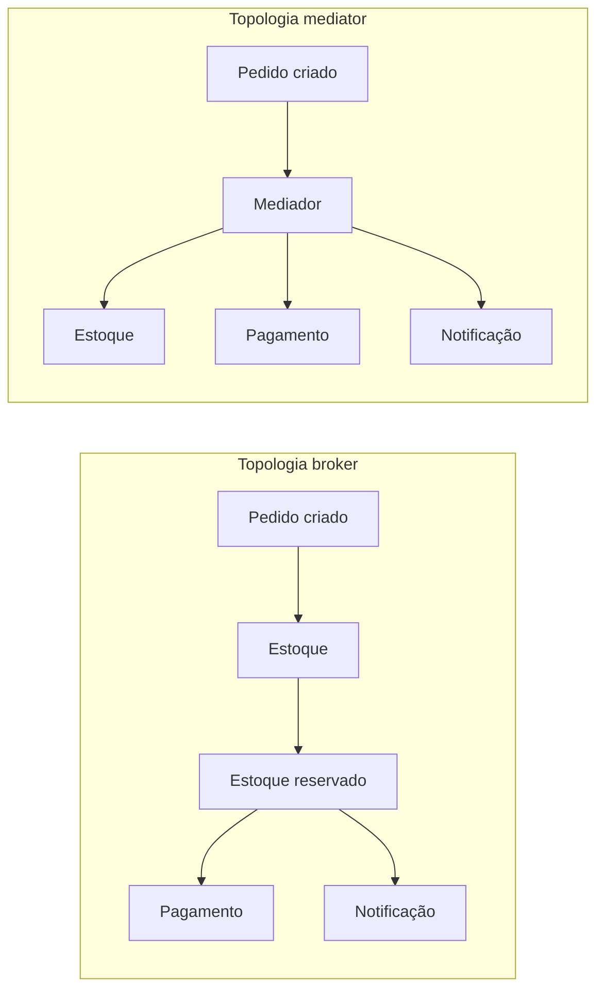

# 6. Arquiteturas distribuídas: de service-based a microsserviços

> [!NOTE] Em uma frase
> Os estilos distribuídos formam uma escada: cada degrau compra mais escala, elasticidade e independência entre partes, e paga com mais complexidade operacional e mais dificuldade de manter os dados consistentes.

## Por que isso importa

Um marketplace de leilões online tem partes com necessidades muito diferentes. A tela de lances recebe milhares de cliques por segundo no último minuto de um leilão popular; o cadastro de vendedores recebe alguns por hora; o pagamento precisa ser exato, mas não precisa ser instantâneo. Pela [página 3](03-caracteristicas-arquiteturais.md), isso é sinal de vários quanta, e pela [página 4](04-estilos-de-arquitetura-visao-geral.md), de arquitetura distribuída. Mas "distribuída" não é um estilo só.

Os capítulos 13 a 17 da 1ª edição apresentam cinco estilos distribuídos. Entender a diferença entre eles evita o erro mais caro da área: pular direto para o mais complexo (microsserviços) quando um degrau abaixo resolveria.

## O que você precisa saber antes

- [Página 4](04-estilos-de-arquitetura-visao-geral.md): as oito falácias da computação distribuída. Todos os estilos aqui pagam esse preço.
- Glossário: [fila e mensageria](../../glossario.md#fila-e-mensageria), [consistência (forte e eventual)](../../glossario.md#consistência-forte-e-eventual), [bounded context](../../glossario.md#bounded-context), [stateless e stateful](../../glossario.md#stateless-e-stateful), [cache](../../glossario.md#cache), [replicação](../../glossario.md#replicação).

## As ideias centrais

### Service-based: o degrau pragmático

A arquitetura **service-based** divide o sistema em poucos serviços grandes, um por área de negócio (o livro fala em algo entre 4 e 12), implantados separadamente, mas quase sempre compartilhando **um único banco de dados**. Há uma interface de usuário, e opcionalmente uma camada de API na frente.

Por que é pragmática: como os serviços são grandes, uma operação de negócio costuma caber inteira dentro de um serviço, e como o banco é um só, transações [ACID](../../glossario.md#acid) continuam funcionando. Você ganha deploy independente e isolamento de falhas sem enfrentar consistência eventual.

O custo é o banco compartilhado: mudar uma tabela pode afetar vários serviços, e pelo critério da [página 3](03-caracteristicas-arquiteturais.md) o sistema tende a continuar sendo um quantum só. O livro sugere mitigar com bibliotecas de entidades separadas por domínio, para saber quais serviços usam quais tabelas.

### Event-driven: reagir a acontecimentos

Na arquitetura **event-driven** (orientada a eventos), componentes não se chamam diretamente: eles publicam **eventos** ("lance recebido", "pedido pago") e outros componentes reagem a eles, de forma assíncrona. O livro descreve duas topologias:

- **Broker** (corretor): não há coordenador. Um evento inicial dispara um processador, que publica um novo evento ao terminar, que dispara outros processadores, e assim por diante. É uma corrente de reações.
- **Mediator** (mediador): um componente central recebe o evento inicial e orquestra os passos, mandando comandos para cada processador na ordem certa.

O trade-off entre as duas é clássico: no broker, adicionar um novo interessado é só assinar o evento, e não há gargalo central, mas ninguém sabe quando o fluxo inteiro terminou nem quem trata um erro no meio. No mediator, o fluxo é visível e os erros têm dono, mas o mediador vira acoplamento e possível gargalo.

O livro cobre problemas práticos do estilo: **tratamento de erro assíncrono** (com o padrão *workflow event*, em que um consumidor que não consegue processar delega o caso a um componente de reparo e segue em frente), **perda de dados** (resolvida com filas persistentes e confirmação explícita do consumidor só depois de gravar), e **requisição e resposta** sobre mensageria usando um ID de correlação. Também alerta que consumidores podem receber a mesma mensagem duas vezes, o que pede [idempotência](../../glossario.md#idempotência).

**Ganhos**: desempenho, escalabilidade, tolerância a falhas e evolução (adicionar comportamento sem mexer no que existe) muito altos. **Perdas**: simplicidade e testabilidade baixas; é difícil testar e depurar um fluxo que não existe em lugar nenhum do código.

### Space-based: tirar o banco do caminho

Quase todo sistema web tem o banco como último gargalo: dá para multiplicar servidores de aplicação, mas todos batem no mesmo banco. A arquitetura **space-based** resolve removendo o banco do caminho síncrono. Cada **unidade de processamento** (uma instância da aplicação) guarda os dados de que precisa em uma **grade de dados em memória** replicada entre as unidades. O banco é atualizado de forma assíncrona, por **bombas de dados** (*data pumps*, que mandam as alterações para fila) e **escritores de dados** (que consomem a fila e gravam).

Uma camada de **middleware virtualizado** coordena tudo: a grade de mensagens (roteia requisições), a grade de dados (replica o cache), a grade de processamento (orquestra quando uma requisição envolve várias unidades) e o gerenciador de implantação (sobe e derruba unidades conforme a carga).

É o estilo para picos extremos e imprevisíveis: venda de ingressos, leilões online. O preço é alto: complexidade grande, testes difíceis (simular a carga real é caro), risco de **colisão de dados** (duas unidades atualizam o mesmo registro antes de a replicação sincronizar) e custo de infraestrutura.

### SOA orientada a orquestração: o que não deu certo

O livro dedica um capítulo curto à SOA (*Service-Oriented Architecture*) dos anos 2000, com serviços em camadas de taxonomia (de negócio, corporativos, de aplicação, de infraestrutura) e um motor de orquestração central, geralmente um ESB (*Enterprise Service Bus*, barramento corporativo que roteia e transforma mensagens). A meta era **reuso máximo**: um serviço de "cliente" corporativo usado por todos. O resultado foi acoplamento máximo: qualquer mudança no serviço compartilhado afetava a empresa inteira. A lição que o livro tira é que reuso e desacoplamento brigam entre si, e microsserviços nasceram em parte como reação a isso.

### Microsserviços: independência máxima

**Microsserviços** levam ao extremo o particionamento por domínio. Cada serviço corresponde a um [bounded context](../../glossario.md#bounded-context), o conceito de DDD de uma fronteira em que um modelo de negócio tem significado único. O princípio central é o **isolamento de dados**: cada serviço é dono do seu banco, e ninguém mais lê aquele banco diretamente. Isso garante que cada serviço é seu próprio quantum.

Pontos que o livro destaca:

- **Granularidade**: "micro" é um rótulo, não uma meta de tamanho. O livro recomenda que a fronteira acompanhe propósito, transações e coreografia: se dois serviços vivem precisando de uma transação juntos, talvez devessem ser um só.
- **Preferir duplicação a acoplamento**: em vez de uma biblioteca de domínio compartilhada, cada serviço repete o que precisa. O reuso operacional (log, monitoramento, segurança) vai para um **sidecar**, um componente que roda ao lado de cada serviço, e o conjunto de sidecars forma uma **service mesh** (malha de serviços) controlada centralmente.
- **Comunicação**: **coreografia** (cada serviço reage a eventos, como no broker) ou **orquestração** (um serviço coordena os outros, como no mediator).
- **Transações**: entre serviços não há ACID. A saída é a **saga**, uma sequência de passos locais com ações de compensação para desfazer se algo falhar. O conselho do livro é direto: se você precisa de muitas sagas, sua granularidade está errada.

**Ganhos**: escalabilidade, elasticidade, evolução, implantabilidade e testabilidade de cada parte muito altos. **Perdas**: desempenho (muitas chamadas de rede), simplicidade e custo.

## Onde isso aparece no mundo real

- **Netflix e Amazon** popularizaram microsserviços em escala, com centenas ou milhares de serviços e times donos de cada um. Ambas investiram pesado em ferramentas internas para pagar o custo operacional.
- **Uber** contou publicamente que, depois de chegar a milhares de microsserviços, reagrupou-os em "domínios" maiores (a chamada DOMA), um movimento em direção a menos granularidade.
- **Kafka como espinha de eventos**: muitas empresas usam o Kafka (uma plataforma de log de eventos distribuído) como broker para arquiteturas event-driven, com cada time publicando e consumindo eventos de negócio.

## Erros comuns de quem está aprendendo

- **Achar que microsserviços é o único estilo distribuído.** Service-based resolve boa parte dos casos com uma fração da complexidade.
- **Compartilhar banco entre microsserviços.** Elimina o isolamento de dados e transforma o sistema em um monolito distribuído: todas as dores da rede, nenhum dos ganhos.
- **Usar eventos como chamadas síncronas disfarçadas.** Se o produtor fica esperando a resposta do evento, você pagou a complexidade da mensageria sem o desacoplamento.
- **Esquecer que mensagens se repetem e se perdem.** Consumidores precisam ser idempotentes e filas precisam ser persistentes.

## Verifique se entendeu

1. Por que service-based consegue manter transações ACID e microsserviços não? (Veja "Service-based" e "Microsserviços".)
2. Em que caso você escolheria a topologia mediator em vez de broker? (Veja "Event-driven".)
3. Qual gargalo a arquitetura space-based remove, e que novo problema ela cria? (Veja "Space-based".)
4. Qual a lição da SOA sobre reuso? (Veja "SOA orientada a orquestração".)
5. O que o livro sugere se você precisa de muitas sagas? (Veja "Microsserviços".)

## Para ir além

- [Resumo de Dan Lebrero](https://danlebrero.com/2021/11/17/fundamentals-of-software-architecture-summary/): cada estilo distribuído com forças, fraquezas e anti-padrões.
- [Software Architecture Monday](https://developertoarchitect.com/lessons/): as seções Microservices e Event-Driven têm dezenas de lições curtas, incluindo sagas e topologias de cache.
- [Architecture Styles Worksheet](https://developertoarchitect.com/resources.html): a planilha oficial de comparação de estilos, útil para contrastar os distribuídos entre si.

---
Anterior: [5. Monolitos: camadas, pipeline e microkernel](05-monolitos.md) · Próximo: [7. Comparando estilos](07-comparando-estilos.md) · Voltar ao livro: [Guia de leitura](index.md)
