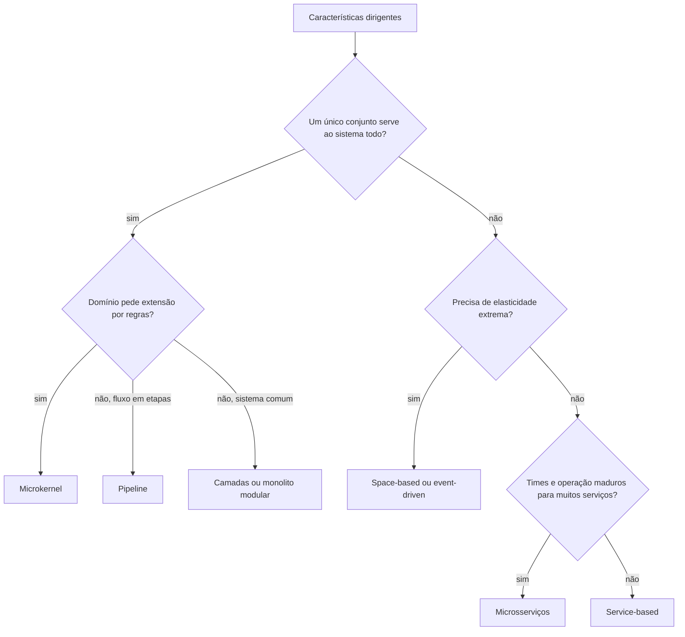

# 7. Comparando estilos

> [!NOTE] Em uma frase
> Não existe estilo vencedor: o estilo certo é o que atende às poucas características que dirigem o seu sistema, cabe nos seus dados e na sua organização, e cujos defeitos você consegue aceitar.

## Por que isso importa

Duas empresas recebem o mesmo conselho de um palestrante: "migrem para microsserviços". A primeira tem 400 desenvolvedores, partes do sistema com cargas muito diferentes e times travados esperando deploys uns dos outros; a migração destrava o trabalho. A segunda tem 8 desenvolvedores e um sistema interno de RH com carga estável; a migração consome um ano e entrega um sistema mais lento e mais caro de operar. O conselho era o mesmo. O contexto não.

O capítulo 18 do livro é a síntese das páginas anteriores: em vez de apresentar um estilo novo, ensina a escolher entre eles. Esta página junta esse capítulo com uma comparação lado a lado de tudo que vimos.

## O que você precisa saber antes

- [Página 3](03-caracteristicas-arquiteturais.md): características arquiteturais e quantum.
- [Página 4](04-estilos-de-arquitetura-visao-geral.md): particionamento técnico versus por domínio, monolito versus distribuído.
- [Página 5](05-monolitos.md) e [página 6](06-microsservicos-e-event-driven.md): os estilos em si.

## As ideias centrais

### A moda muda, e por bons motivos

O livro abre lembrando que o estilo "preferido" da indústria muda a cada década. Parte disso é moda, mas parte é real: o que era caro ficou barato. Contêineres, orquestradores como Kubernetes (que sobem, distribuem e reiniciam contêineres automaticamente) e nuvem tornaram viável operar dezenas de serviços, algo impensável quando cada servidor era comprado e configurado à mão. A lição é dupla: não descarte um estilo só porque está fora de moda, e não adote um só porque está na moda; verifique se as condições que o tornam viável existem no seu contexto.

### Os critérios de decisão

O livro lista o que pesar ao escolher:

1. **O domínio**: entender o negócio bem o bastante para saber quais partes mudam juntas e quais têm necessidades diferentes.
2. **As características dirigentes** (a lista curta da [página 3](03-caracteristicas-arquiteturais.md)). É o critério principal.
3. **A arquitetura de dados**: onde os dados ficam e quem é dono deles. Um banco legado que não pode ser dividido limita muito as opções.
4. **Fatores organizacionais**: custo da nuvem, orçamento, fusões planejadas, quantos times existem e como estão divididos (lembre da Lei de Conway).
5. **Conhecimento de processo, times e operação**: um time sem experiência em sistemas distribuídos e sem automação de deploy vai sofrer com microsserviços, por mais que eles "caibam" no problema.
6. **Isomorfismo entre domínio e arquitetura**: alguns problemas têm uma forma que casa com um estilo. Um sistema de regras por jurisdição tem a forma de um microkernel; um processamento em etapas tem a forma de pipeline. Quando a forma do problema não casa com o estilo, você briga com a arquitetura todo dia.

E as três decisões que saem disso: **monolito ou distribuído** (quantos quanta), **onde ficam os dados**, e **comunicação síncrona ou assíncrona** entre partes. Para a última, o livro dá uma regra simples: use síncrono por padrão e assíncrono quando precisar, porque o assíncrono traz ganhos reais de desempenho e escala mas complica tratamento de erro e transações.

Este fluxograma é uma simplificação minha para fixar o raciocínio, não um algoritmo do livro. Decisões reais misturam estilos: um sistema pode ser service-based na maior parte e usar eventos para a parte que precisa de escala.

### Tabela comparativa: estilos × características

A tabela abaixo é uma síntese própria deste guia, montada a partir das forças e fraquezas descritas no livro para cada estilo. O livro usa uma escala de uma a cinco estrelas; aqui simplifiquei para alto, médio e baixo, e em alguns casos meu julgamento pode diferir em um ponto da avaliação original. Use como mapa mental, não como verdade absoluta.

| Estilo | Particionamento | Quanta | Simplicidade | Custo | Implantabilidade | Escalabilidade | Elasticidade | Tolerância a falhas | Desempenho | Testabilidade | Evolução |
|---|---|---|---|---|---|---|---|---|---|---|---|
| Camadas | técnico | 1 | alta | baixo | baixa | baixa | baixa | baixa | médio | baixa | baixa |
| Pipeline | técnico | 1 | alta | baixo | baixa | baixa | baixa | baixa | médio | média | média |
| Microkernel | técnico ou domínio | 1 | alta | baixo | média | baixa | baixa | baixa | médio | média | média |
| Service-based | domínio | 1 ou mais | média | médio | alta | média | baixa | alta | médio | alta | média |
| Event-driven | técnico | 1 ou mais | baixa | médio | média | alta | média | alta | alto | baixa | alta |
| Space-based | técnico | 1 ou mais | baixa | alto | média | alta | alta | alta | alto | baixa | média |
| Microsserviços | domínio | muitos | baixa | alto | alta | alta | alta | alta | baixo | alta | alta |

Como ler: "custo" alto é ruim; nas outras colunas, alto é bom. Algumas leituras que valem fixar:

- **Os monolitos ganham em simplicidade e custo e perdem em quase todo o resto operacional.** É por isso que são o ponto de partida certo quando o sistema é pequeno ou o domínio ainda é incerto.
- **Microsserviços têm desempenho baixo.** Parece contraintuitivo, mas cada chamada entre serviços atravessa a rede (falácia 2 da [página 4](04-estilos-de-arquitetura-visao-geral.md)). Eles escalam bem, o que é outra coisa: aguentam mais carga somando instâncias, mas cada requisição individual tende a ser mais lenta.
- **Event-driven e space-based dominam desempenho e escala, mas são difíceis de testar.** O fluxo de uma operação não está escrito em um lugar só.
- **Service-based é o meio-termo** que muitos times ignoram: boa implantabilidade, testabilidade e tolerância a falhas, com complexidade moderada.

### Dois estudos de caso do livro

O livro fecha o capítulo aplicando o raciocínio a dois *katas* que acompanham a obra:

- **Silicon Sandwiches** (uma rede de lanchonetes que quer pedidos online): as características dirigentes cabem em um quantum, e o livro desenha um monolito, discutindo uma versão modular por domínio e uma versão microkernel, em que as personalizações de cada loja ficam em plug-ins.
- **Going, Going, Gone** (leilões online): partes com características muito diferentes (lances ao vivo precisam de elasticidade e desempenho, cadastro não) levam a vários quanta e a uma solução distribuída, misturando serviços independentes com comunicação assíncrona onde a carga exige.

O ponto pedagógico dos dois é o mesmo: o estilo saiu das características, não de preferência.

## Onde isso aparece no mundo real

- **Monolitos de sucesso em grande escala**: Shopify e Basecamp são exemplos públicos de empresas que mantêm monolitos (modularizados) por escolha, aceitando a perda de deploy independente em troca de simplicidade.
- **Arquiteturas híbridas**: é comum encontrar um núcleo service-based com um pedaço event-driven para notificações e analytics. A tabela compara estilos puros, mas os sistemas reais costumam ser mistos.
- **Migrações de volta**: os casos de Segment e do monitoramento do Prime Video, citados na [página 4](04-estilos-de-arquitetura-visao-geral.md), são exemplos de times que refizeram a conta e escolheram menos distribuição.

## Erros comuns de quem está aprendendo

- **Comparar estilos por popularidade ou por ser "moderno".** O critério é atender às características dirigentes.
- **Ler a tabela como ranking.** Nenhuma linha é "a melhor"; cada uma é um pacote de trade-offs.
- **Ignorar a organização.** Um estilo que exige times autônomos e automação madura falha em uma empresa que não tem nem uma coisa nem outra.
- **Escolher um estilo puro por purismo.** Misturar estilos é normal, desde que cada mistura tenha um porquê registrado.

## Verifique se entendeu

1. Por que o livro diz que parte da mudança de moda em arquitetura é legítima? (Veja "A moda muda, e por bons motivos".)
2. O que é isomorfismo entre domínio e arquitetura? Dê um exemplo. (Veja "Os critérios de decisão".)
3. Por que microsserviços aparecem com desempenho baixo e escalabilidade alta na mesma tabela? (Veja "Tabela comparativa".)
4. Qual estilo você proporia para um sistema interno com um time pequeno e um domínio ainda pouco entendido? Justifique com a tabela. (Veja "Tabela comparativa".)

## Para ir além

- [Architecture Styles Worksheet](https://developertoarchitect.com/resources.html): a planilha oficial com o gráfico de estrelas para avaliar estilos, para comparar com a tabela desta página.
- [Resumo de Dan Lebrero](https://danlebrero.com/2021/11/17/fundamentals-of-software-architecture-summary/): as notas do capítulo sobre escolha do estilo listam os critérios de decisão.
- [Clube de leitura no GitHub](https://github.com/melaniebrgr/bookclub-fundamentals-software-architecture): o resumo do bloco de estilos traz as perguntas de discussão do grupo sobre escolha de arquitetura.

---
Anterior: [6. Arquiteturas distribuídas: de service-based a microsserviços](06-microsservicos-e-event-driven.md) · Próximo: [8. Decisões, ADRs e risco](08-decisoes-e-adrs.md) · Voltar ao livro: [Guia de leitura](index.md)
