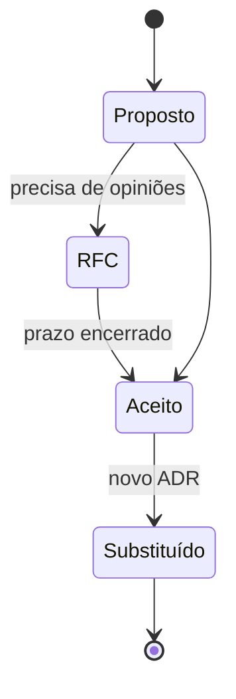

# 8. Decisões, ADRs e risco

> [!NOTE] Em uma frase
> Uma decisão arquitetural só vale se for tomada com a informação suficiente, comunicada para quem precisa e registrada com o porquê, e os riscos da arquitetura precisam ser avaliados em grupo e de forma contínua.

## Por que isso importa

Um time decide, em uma reunião de duas horas, usar um banco de documentos em vez de um relacional para o novo serviço de catálogo. Um ano depois, metade das pessoas saiu, e alguém novo pergunta: "por que não usamos Postgres como o resto da empresa?". Ninguém lembra. A conversa é refeita do zero, a mesma discussão de duas horas acontece de novo, e talvez a decisão seja revertida por motivos que já tinham sido considerados e descartados.

É a segunda lei da [página 1](01-pensamento-arquitetural.md) em ação: o porquê se perde, o como fica. Os capítulos 19 e 20 do livro tratam de como decidir sem travar, como registrar a decisão para que ela sobreviva às pessoas, e como avaliar os riscos que a arquitetura carrega.

## O que você precisa saber antes

- [Página 1](01-pensamento-arquitetural.md): decisões arquiteturais como uma das quatro dimensões e as duas leis.
- [Página 3](03-caracteristicas-arquiteturais.md): características arquiteturais e fitness functions (a decisão registrada é a que a fitness function verifica).
- [Página 7](07-comparando-estilos.md): como pesar estilos; é o tipo de decisão que vira ADR.

## As ideias centrais

### Três anti-padrões de decisão

O livro descreve três armadilhas em sequência, porque escapar de uma costuma levar à próxima:

1. **Cobrir o próprio traseiro** (*Covering Your Assets*): o arquiteto evita decidir, ou adia indefinidamente, com medo de errar. O time fica parado esperando. A saída é decidir no **último momento responsável**: quando já há informação suficiente para justificar e validar a decisão, mas antes que o atraso trave o desenvolvimento. Colaborar com o time ajuda, porque eles avisam quando a decisão começa a bloquear.
2. **Dia da marmota** (*Groundhog Day*, referência ao filme em que o protagonista revive o mesmo dia): a decisão foi tomada, mas ninguém sabe por quê, então ela é rediscutida eternamente. A saída é justificar a decisão com valor técnico e de negócio. Justificativas de negócio típicas: custo, prazo de entrega, satisfação do usuário, posicionamento estratégico.
3. **Arquitetura por e-mail** (*Email-Driven Architecture*): a decisão foi tomada e justificada, mas a informação se perdeu em uma thread ou nunca chegou a quem precisava implementar. A saída é ter um lugar único onde a decisão vive, e notificar só os interessados com um link para lá, nunca com a decisão inteira no corpo da mensagem.

### O que é uma decisão arquiteturalmente significativa

Nem toda decisão merece cerimônia. O livro adota a lista de Michael Nygard: uma decisão é arquiteturalmente significativa se afeta pelo menos um destes pontos:

- **Estrutura**: padrões e estilos (adotar microsserviços, criar uma camada de serviços compartilhados).
- **Características não funcionais**: as características arquiteturais da [página 3](03-caracteristicas-arquiteturais.md).
- **Dependências**: pontos de acoplamento entre componentes ou serviços.
- **Interfaces**: como serviços e componentes são acessados (gateways, contratos, versionamento).
- **Técnicas de construção**: plataformas, frameworks, ferramentas e processos.

Escolher qual biblioteca de datas usar normalmente não entra. Escolher entre REST e mensageria entre serviços entra.

### ADRs: o formato do registro

O **ADR** (*Architecture Decision Record*, registro de decisão arquitetural) é um documento curto, geralmente uma ou duas páginas, que registra uma decisão. O formato foi popularizado por Michael Nygard, e o livro propõe uma versão com estas seções:

- **Título**: numerado e curto. "042. Usar mensageria assíncrona entre Pedidos e Pagamentos".
- **Status**: proposto, aceito ou substituído. Uma decisão **substituída** não é apagada: ganha um link para o ADR que a substitui, e o novo aponta para o antigo. Isso preserva a história. O livro sugere ainda o status **RFC** (pedido de comentários) com prazo, para coletar opiniões antes de aceitar.
- **Contexto**: que forças levaram à decisão. Qual era o problema, quais alternativas existiam. É aqui que entra a análise de trade-offs.
- **Decisão**: escrita em voz afirmativa e direta ("vamos usar", não "acho que seria bom usar"), com a justificativa. O livro insiste que o porquê pesa mais do que o como.
- **Consequências**: o impacto, bom e ruim. Escrever as consequências negativas obriga a pensar se o benefício compensa.
- **Conformidade**: como a decisão vai ser verificada. Manualmente, em revisão, ou automaticamente, com uma [fitness function](03-caracteristicas-arquiteturais.md). É uma seção que o livro adiciona ao formato original.
- **Notas**: metadados como autor, data de aprovação, quem aprovou e data da última modificação.

Um modelo pronto para copiar, com conteúdo de exemplo:

```markdown
# 042. Usar mensageria assíncrona entre Pedidos e Pagamentos

## Status
Aceito (substitui o ADR 017)

## Contexto
Na Black Friday, Pedidos ficou indisponível porque esperava respostas
lentas de Pagamentos via HTTP síncrono. Alternativas avaliadas:
manter HTTP com timeout curto; fila persistente; tópico com vários consumidores.

## Decisão
Vamos publicar o evento "pedido criado" em uma fila persistente consumida
por Pagamentos. Escolhemos fila (e não tópico) porque só Pagamentos consome
e queremos monitorar a profundidade dessa fila isoladamente.

## Consequências
+ Pedidos deixa de depender da disponibilidade de Pagamentos.
- O status do pagamento passa a ser eventualmente consistente na tela do cliente.
- Pagamentos precisa ser idempotente, porque mensagens podem chegar duplicadas.

## Conformidade
Teste de arquitetura no CI falha se o módulo de Pedidos importar o cliente HTTP de Pagamentos.

## Notas
Autor: ... · Aprovado em: ... · Última alteração: ...
```

Onde guardar: o livro discute o repositório de código (versionado junto com o que ele descreve) e uma wiki (mais fácil de ler para quem não é desenvolvedor). Uma estrutura comum é uma pasta por aplicação e uma pasta comum para decisões que valem para toda a empresa. ADRs também servem de documentação viva da arquitetura e de forma de registrar padrões: em vez de um documento de padrões que ninguém lê, cada padrão vira um ADR com seu porquê.



### Análise de risco: a matriz

O capítulo 20 trata de como avaliar se uma arquitetura está em risco em alguma característica. A ferramenta básica é uma **matriz de risco** com duas dimensões, cada uma de 1 (baixo) a 3 (alto):

- **Impacto**: se o problema acontecer, quão grave é?
- **Probabilidade**: quão provável é que aconteça?

O risco é o produto: 1 ou 2 é baixo, 3 ou 4 é médio, 6 ou 9 é alto. O livro recomenda pensar primeiro no impacto e depois na probabilidade, porque o impacto costuma ser mais fácil de estimar.

Com a matriz, monta-se uma **avaliação de risco**: uma tabela com as características dirigentes nas linhas (desempenho, disponibilidade, segurança) e as áreas do sistema nas colunas (cadastro, catálogo, pagamento). Cada célula recebe um número. Repetida periodicamente, a tabela mostra também a **direção** do risco (melhorando ou piorando), o que costuma ser mais informativo do que o valor isolado. Uma dica do livro é filtrar a tabela para mostrar só os riscos altos ao apresentar para gestores; o resto é ruído para esse público.

### Risk storming

Um arquiteto sozinho deixa passar riscos, porque não conhece todos os detalhes. O **risk storming** é uma atividade colaborativa em três fases:

1. **Identificação** (individual): cada participante, sozinho e antes da reunião, marca no diagrama da arquitetura onde vê risco e com que nota, usando a matriz. Fazer sozinho evita que a opinião do mais sênior contamine os outros.
2. **Consenso** (em grupo): os post-its são juntados no diagrama. Onde as notas divergem, o grupo discute; frequentemente alguém sabe de algo que os outros não sabiam.
3. **Mitigação** (em grupo): para cada risco alto, propõe-se uma mudança de arquitetura e se discute o custo com o negócio. O livro mostra que a negociação é parte do processo: uma mitigação ideal pode custar caro demais, e uma alternativa parcial pode ser aceita.

Recomenda-se focar cada sessão em uma característica (só disponibilidade, por exemplo) para não dispersar. O livro também sugere aplicar a mesma lógica no nível de histórias ágeis, estimando risco de cada história no planejamento.

## Onde isso aparece no mundo real

- **ADRs em projetos públicos**: muitos projetos open source e times de governo mantêm uma pasta `docs/adr/` no repositório, com decisões numeradas em markdown. Ferramentas como `adr-tools` geram o esqueleto e mantêm os links de substituição.
- **RFCs em empresas de produto**: várias empresas usam documentos de "RFC" ou "design doc" com prazo para comentários, que são a versão expandida do status RFC do livro.
- **Revisões de prontidão para produção**: checklists de lançamento em empresas grandes funcionam como avaliação de risco por característica antes de um sistema ir ao ar.

## Erros comuns de quem está aprendendo

- **Escrever ADR para tudo.** Vira burocracia e ninguém lê. Use a lista de decisões arquiteturalmente significativas como filtro.
- **Apagar ADRs antigos.** A decisão substituída faz parte da história; sem ela, o próximo time repete o erro.
- **Omitir consequências negativas.** Um ADR que só lista vantagens esconde o trade-off, e a primeira lei diz que ele existe.
- **Fazer risk storming em grupo desde o início.** A fase individual é o que garante opiniões independentes.

## Verifique se entendeu

1. Qual a relação entre os três anti-padrões de decisão? Como escapar de cada um? (Veja "Três anti-padrões de decisão".)
2. A escolha de um framework web para todos os serviços é arquiteturalmente significativa? Por qual critério? (Veja "O que é uma decisão arquiteturalmente significativa".)
3. Para que serve a seção de conformidade de um ADR, e como ela se liga às fitness functions? (Veja "ADRs".)
4. Um risco tem impacto 3 e probabilidade 2. Qual a classificação? (Veja "Análise de risco: a matriz".)
5. Por que a fase de identificação do risk storming é individual? (Veja "Risk storming".)

## Para ir além

- [joelparkerhenderson/architecture-decision-record](https://github.com/joelparkerhenderson/architecture-decision-record): guia extenso sobre ADRs, com 13 templates (incluindo o de Nygard e o MADR) e exemplos reais para comparar com o modelo desta página.
- [Software Architecture Monday](https://developertoarchitect.com/lessons/): lições curtas de Mark Richards sobre ADRs e decisões arquiteturais.
- [Resumo de Dan Lebrero](https://danlebrero.com/2021/11/17/fundamentals-of-software-architecture-summary/): as notas dos capítulos 19 e 20 resumem os anti-padrões de decisão, as seções de um ADR e a matriz de risco.

---
Anterior: [7. Comparando estilos](07-comparando-estilos.md) · Voltar ao livro: [Guia de leitura](index.md)
