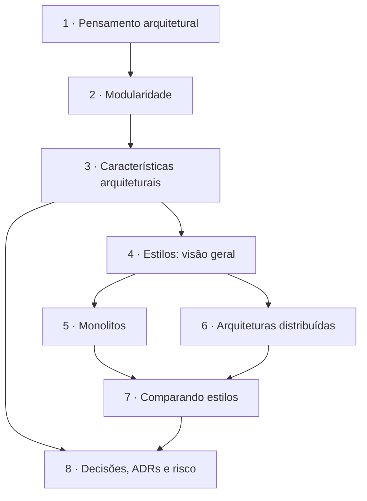

# Fundamentals of Software Architecture — guia de leitura

> [!NOTE] Em uma frase
> Não existe arquitetura certa, só trade-offs; o trabalho do arquiteto é identificar quais características o sistema precisa ter, escolher o estilo que as atende e registrar o porquê.

## Para quem é e quando ler

Para quem já programa há algum tempo e começa a tomar decisões que vão além de uma função ou classe: como dividir o sistema, quando separar em serviços, como justificar uma escolha para o time. É um bom primeiro livro de arquitetura porque cobre o terreno inteiro com vocabulário consistente. Leia depois de ter trabalhado em pelo menos um sistema de tamanho médio; sem essa vivência, os trade-offs parecem abstratos.

## O que o livro NÃO é

- Não é um livro sobre design de código (classes, padrões de projeto). Para isso, veja o guia de [Clean Architecture](../clean-architecture/index.md).
- Não é um mergulho em bancos de dados e sistemas distribuídos por dentro (replicação, consenso). Isso está em [DDIA](../../system-design/ddia/index.md).
- Não ensina a modelar o domínio de negócio; ele cita DDD, mas quem aprofunda é o guia de [DDD](../ddd/index.md).
- Não é receita: o livro se recusa a dizer qual estilo usar sem conhecer o contexto.

## Como o livro está organizado

O livro tem três partes. A Parte I (Fundamentos) define o que é arquitetura, modularidade e características arquiteturais. A Parte II (Estilos) apresenta cada estilo de arquitetura com topologia, exemplos e avaliação. A Parte III (Técnicas e soft skills) trata de decisões, risco, diagramação, times, negociação e carreira. Este guia cobre as Partes I e II por inteiro e, da Parte III, os capítulos de decisões e risco.

> [!IMPORTANT]
> Este guia segue a numeração da 1ª edição (2020). A 2ª edição (2025) acrescenta, entre outras coisas, um capítulo sobre monolito modular, o que desloca a numeração dos capítulos seguintes. O conteúdo das páginas vale para as duas.

## Como ler

- **Ordem sugerida**: as páginas 1 a 4 em sequência, porque cada uma usa o vocabulário da anterior. Depois, 5 e 6 em qualquer ordem, e 7 e 8 no fim.
- **O que pular na 1ª leitura**: as métricas numéricas de modularidade (abstração, instabilidade, distância) na página 2; volte a elas quando for configurar análise estática. Na página 6, a SOA orientada a orquestração pode ser lida só pela lição final.
- **Ritmo**: uma página por sessão de estudo, respondendo às perguntas de "Verifique se entendeu" antes de passar adiante. No livro, os capítulos dos estilos são curtos e podem ser lidos dois por vez.
- **Pratique**: escolha um sistema que você conhece e, ao fim da página 3, liste as três características dirigentes dele; ao fim da página 8, escreva um ADR para uma decisão que já foi tomada nele.

## O que você leva ao terminar

- Um jeito de pensar: toda escolha é trade-off, e o porquê precisa ser registrado.
- Vocabulário para discutir modularidade com números (coesão, acoplamento, conascência) em vez de gosto.
- Um método para extrair as características que dirigem a arquitetura e transformá-las em testes automatizados.
- Um mapa dos estilos de arquitetura, com o que cada um ganha e perde.
- Ferramentas práticas: ADRs, matriz de risco e risk storming.

## Capítulos

1. [Pensamento arquitetural](01-pensamento-arquitetural.md): as quatro dimensões de uma arquitetura, o papel do arquiteto e as duas leis (tudo é trade-off; o porquê importa mais que o como).
2. [Modularidade](02-modularidade.md): coesão, acoplamento aferente e eferente, instabilidade, distância da sequência principal e conascência.
3. [Características arquiteturais](03-caracteristicas-arquiteturais.md): as "-ilities", como identificá-las e medi-las, fitness functions e quantum arquitetural.
4. [Estilos de arquitetura: visão geral](04-estilos-de-arquitetura-visao-geral.md): particionamento técnico versus por domínio, monolito versus distribuído e as oito falácias da computação distribuída.
5. [Monolitos: camadas, pipeline e microkernel](05-monolitos.md): os três estilos monolíticos, seus pontos fortes e seus anti-padrões.
6. [Arquiteturas distribuídas: de service-based a microsserviços](06-microsservicos-e-event-driven.md): service-based, event-driven, space-based, SOA e microsserviços.
7. [Comparando estilos](07-comparando-estilos.md): critérios para escolher e uma tabela comparativa de estilos por característica.
8. [Decisões, ADRs e risco](08-decisoes-e-adrs.md): anti-padrões de decisão, o formato de um ADR, matriz de risco e risk storming.

## Fontes públicas para acompanhar

As [fontes públicas verificadas](fontes.md) reúnem resumos capítulo a capítulo, as videoaulas gratuitas de Mark Richards, as planilhas oficiais de características e estilos e um guia completo de ADRs.
