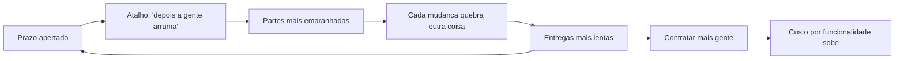
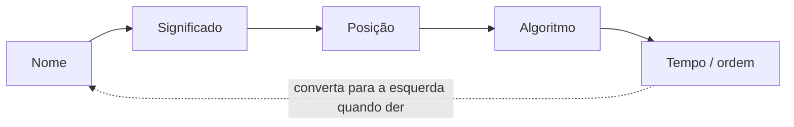
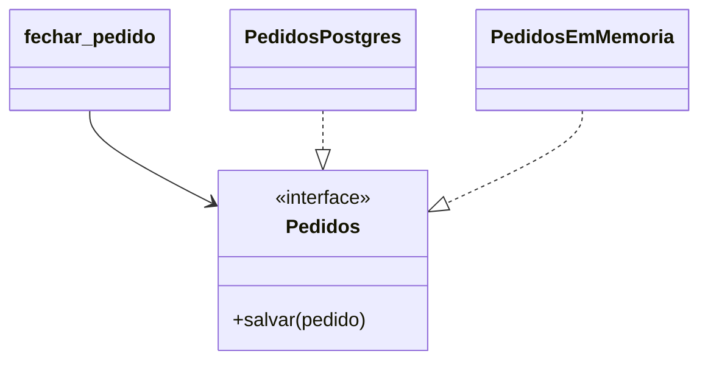

# 1. Código que aguenta mudança

> [!NOTE] Em uma frase
> Código bom não é o que funciona hoje, é o que continua barato de mudar daqui a dois anos; e isso depende de como as partes dele estão ligadas umas às outras.

## Por que isso importa

Este guia inteiro acompanha um sistema só: **a Lojinha**, uma loja online pequena que vende canecas, camisetas e cadernos. Hoje ela tem duas pessoas programando, um site, um banco de dados e um arquivo `loja.py` que faz quase tudo. Ao longo dos módulos ela vai crescer: ganhar um aplicativo, um time maior, milhões de pedidos, servidores espalhados e, no fim, um sistema que recomenda produtos. Cada módulo pega um problema que a Lojinha encontra nesse caminho.

O primeiro problema aparece cedo. No começo, cada pedido do dono da loja vira código em uma tarde. Seis meses depois, ele pede uma coisa que parece pequena: "quero dar frete grátis para pedidos acima de R$ 200". A pessoa que vai fazer a mudança abre `loja.py`, encontra o cálculo de frete misturado com o cálculo do desconto, com o envio de e-mail e com o SQL que grava o pedido. Muda uma linha, e o teste do cupom de desconto quebra. Conserta o cupom, e o e-mail de confirmação passa a mostrar o valor errado. A tarefa "de uma tarde" leva uma semana.

Ninguém fez nada errado de propósito. O código só foi crescendo sem que ninguém pensasse em **como as partes se ligam**. Este módulo é sobre isso: por que o custo de mudar sobe, como medir e nomear o problema, e quais regras simples evitam que ele aconteça.

## O que você precisa saber antes

Saber programar em qualquer linguagem. Os exemplos usam Python, mas são curtos e a ideia vale para qualquer linguagem.

## O custo de mudar código

### Dois valores: o que o código faz e o quão fácil é mudá-lo

Todo software entrega dois tipos de valor. O primeiro é o **comportamento**: o que ele faz. Calcular o frete, aplicar o cupom, mandar o e-mail. É o que o cliente vê e pede. O segundo é a **estrutura**: o quão fácil é mudar esse comportamento. Ninguém pede estrutura numa reunião, mas é ela que decide se o próximo pedido custa uma tarde ou uma semana.

A palavra "software" já entrega a ideia: *soft* quer dizer macio, maleável. Se fosse para ser rígido, seria hardware. Um bom sinal de estrutura saudável é este: **o custo de uma mudança é proporcional ao tamanho dela**. Frete grátis é uma regra de uma linha; se mexer nela exige tocar em cinco lugares, a estrutura está falhando.

Pense num exagero proposital. Você prefere um programa que funciona perfeitamente mas é impossível de mudar, ou um que tem bugs mas é fácil de mudar? O primeiro fica inútil no dia em que o negócio mudar (e ele sempre muda). O segundo você conserta. Isso não quer dizer que comportamento não importa: quer dizer que o comportamento de hoje é temporário, e a capacidade de mudar é o que garante valor amanhã.

### O ciclo da pressa

A frase mais cara da engenharia de software é "depois a gente arruma". Ela parece economizar tempo, mas alimenta um ciclo:



O "depois" quase nunca chega, porque a pressão por prazo não diminui; e a estrutura é importante, mas nunca urgente, então é sempre a primeira a ser sacrificada. A bagunça desacelera o time já no curto prazo, não só daqui a anos. A forma mais rápida de ir é ir bem feito.

### Design e arquitetura são a mesma coisa em escalas diferentes

Muita gente separa "arquitetura" (as decisões grandes: quais sistemas existem, qual banco usar) de "design" (as decisões pequenas: como uma função se organiza). Essa separação engana. Pense na planta de uma casa: ela mostra a forma dos cômodos e também onde fica cada tomada. As duas coisas são o mesmo desenho visto de perto ou de longe.

No código é igual. Onde você coloca a regra do frete grátis, dentro da função que grava no banco ou numa função própria, é uma decisão de arquitetura, mesmo que pareça só "implementação". Decisões pequenas acumuladas viram a forma do sistema. Por isso a medida de uma boa arquitetura é simples e econômica: **o esforço humano para construir e manter o sistema**. Se cada funcionalidade nova custa mais que a anterior, algo está errado, por mais que tudo funcione.

## Acoplamento e coesão

### As duas forças

Para entender por que mudar custa caro, você precisa de duas palavras. [Acoplamento](../glossario.md#acoplamento-e-coesão) é o quanto uma parte do código depende de outra: se eu mudar esta, quantas outras quebram? **Coesão** é o quanto as coisas dentro de uma mesma parte pertencem de fato umas às outras.

Uma analogia: numa cozinha bem organizada, as panelas ficam juntas, perto do fogão (alta coesão), e trocar o fogão não exige mexer na geladeira (baixo acoplamento). Numa cozinha bagunçada, metade das panelas está no banheiro e a geladeira só funciona ligada na mesma tomada do micro-ondas.

O objetivo clássico é **alta coesão dentro de cada parte e baixo acoplamento entre as partes**. Acoplamento zero não é a meta: um sistema sem nenhuma dependência não faz nada. O que se quer é que as dependências fortes fiquem *dentro* de uma parte e as fracas *entre* partes.

### O `loja.py` da Lojinha

Veja o código que causou a semana perdida:

```python
def fechar_pedido(carrinho, cliente, cupom):
    total = sum(i["preco"] * i["qtd"] for i in carrinho)
    if cupom == "PROMO10":
        total = total * 0.9
    frete = 0 if cliente["cep"].startswith("01") else 25
    total = total + frete
    db.execute("INSERT INTO pedidos VALUES (?, ?, ?)", (cliente["id"], total, 1))
    smtp.send(cliente["email"], f"Pedido fechado: R$ {total}")
    return total
```

Uma função de nove linhas faz cinco coisas que mudam por motivos diferentes: preço, desconto, frete, gravação e e-mail. Isso é **baixa coesão**. E ela conhece o formato exato da tabela, o servidor de e-mail e o código do cupom. Isso é **alto acoplamento**: mudar qualquer uma dessas coisas obriga a mexer aqui, e mexer aqui arrisca todas as outras.

### Modularidade e o tipo de coesão

**Modularidade** é dividir o código em grupos relacionados (funções, arquivos, pacotes) com fronteiras claras entre eles. Dividir não basta: um arquivo `utils.py` com funções de data, de frete e de validação de CPF está "modularizado", mas as coisas lá dentro estão juntas por acaso. Há uma escala informal de coesão, do melhor para o pior:

| Tipo de coesão | O que junta as coisas | Exemplo na Lojinha |
|---|---|---|
| Funcional | Uma única tarefa bem definida | Módulo `frete` que só calcula frete |
| Comunicacional | Trabalham sobre os mesmos dados | Ler e atualizar o cadastro do cliente |
| Temporal | Rodam no mesmo momento | Tudo que acontece ao iniciar o servidor |
| Lógica | Fazem coisas "parecidas" | `StringUtils`, `helpers.py` |
| Coincidental | Acaso | O `loja.py` de hoje |

A pergunta que separa coesão boa de ruim é: **essas coisas mudam juntas?** Se o dono da loja pede uma mudança no frete, quantos arquivos você abre? Idealmente, um.

### Quem depende de quem

Dá para olhar o acoplamento de um módulo em duas direções. Quantos módulos **dependem dele** (quantos me usam) e de quantos módulos **ele depende** (quantos eu uso). Um módulo de que todo mundo depende é caro de mudar: qualquer alteração se espalha. Um módulo que depende de muita coisa é frágil: quebra quando algo em volta muda. Guarde essa ideia; ela volta no [módulo 2](02-fronteiras-e-dependencias.md) para decidir para que lado as setas devem apontar.

## Conascência: dando nome ao tipo de acoplamento

Dizer "esses dois pedaços estão acoplados" é vago. **Conascência** é um vocabulário mais preciso: duas partes são conascentes quando mudar uma exige mudar a outra para o sistema continuar correto. O ganho é poder dizer *de que jeito* elas estão ligadas, e saber qual jeito é pior. Alguns tipos, do mais fraco ao mais forte:

- **De nome.** As duas partes concordam com um nome: quem chama `calcular_frete()` depende de a função se chamar assim. É o tipo mais fraco e inevitável; o editor renomeia em todo lugar automaticamente.
- **De significado.** As duas concordam com o que um valor quer dizer. No `loja.py`, o `1` gravado no banco significa "pedido pago". Se outra parte do código usa `2` para "pago", ninguém percebe até dar errado. Trocar por uma constante `STATUS_PAGO` transforma isso em conascência de nome, que é mais fraca.
- **De posição.** As duas concordam com a ordem dos valores. `criar_cliente("Ana", "ana@x.com", "01310-100")`: trocar e-mail e CEP de lugar roda sem erro e grava lixo. Parâmetros nomeados (`cep=...`) trocam posição por nome.
- **De algoritmo.** As duas precisam calcular a mesma coisa do mesmo jeito: o site e o app da Lojinha calculam o frete cada um com sua cópia da regra. Mudou num, esqueceu no outro, preços diferentes.
- **De tempo e de ordem de execução.** Só aparecem com o programa rodando: "configure o e-mail antes de enviar", ou duas requisições gravando o mesmo estoque ao mesmo tempo.

Além do tipo, importa a **distância**. Conascência forte dentro de uma mesma função é tolerável: está tudo à vista. Entre dois arquivos é pior. Entre dois sistemas que rodam em servidores diferentes é muito pior, porque mudar exige publicar os dois juntos. A regra prática: **deixe o acoplamento forte perto, o fraco longe, e converta formas fortes em fracas sempre que puder.**



## Paradigmas como restrições que ajudam

Um **paradigma de programação** é um estilo de organizar código que diz o que usar e o que evitar. Os três mais conhecidos são o estruturado, o orientado a objetos e o funcional. Um jeito útil de olhar para eles é perceber que cada um **tira** um poder do programador, e é justamente a proibição que ajuda a organizar sistemas grandes:

| Paradigma | O que ele proíbe | O que ganhamos com isso |
|---|---|---|
| Estruturado | Pular para qualquer linha do programa (`goto`) | Dividir o programa em funções pequenas que dá para testar sozinhas |
| Orientado a objetos | Chamadas indiretas soltas e perigosas | **Polimorfismo seguro**: o mesmo código chama comportamentos diferentes conforme o objeto |
| Funcional | Mudar o valor de uma variável | Menos bugs quando várias coisas rodam ao mesmo tempo |

Para este módulo e o próximo, a peça mais importante é o **polimorfismo** (o mesmo código chamar comportamentos diferentes conforme o objeto que recebe). Ele permite que a regra do pedido diga "salve isto" sem saber se quem salva é um banco de verdade ou uma lista em memória num teste. Essa é a base de quase todos os princípios abaixo.

## SOLID pelos problemas da Lojinha

**SOLID** é um acrônimo para cinco princípios de organização de código, reunidos por Robert C. Martin. Eles parecem regras arbitrárias quando apresentados em lista, então vamos ao contrário: um problema real da Lojinha para cada um, e como o princípio resolve.

### S: responsabilidade única

**O problema.** A classe `Pedido` tem `calcular_total()`, usado pelo time comercial (preços, cupons), `gerar_nota_fiscal()`, usado pelo financeiro (impostos), e as duas usam a mesma função auxiliar `_valor_base()`. O comercial pede para o valor base ignorar itens de brinde. A pessoa muda `_valor_base()`, os testes de total passam, e as notas fiscais saem sem o brinde, que deveria ser tributado. Ninguém nota por semanas.

**O princípio.** O nome engana: não é "cada classe faz uma coisa só". É **um módulo deve responder a um único ator**, e ator é um grupo de pessoas que pede mudanças pelo mesmo motivo (o comercial, o financeiro).

```python
# Antes: dois atores no mesmo lugar
class Pedido:
    def calcular_total(self): return self._valor_base() - self.desconto
    def gerar_nota_fiscal(self): return self._valor_base() * 1.18
    def _valor_base(self): ...

# Depois: dados num lugar, cada ator com seu código
@dataclass
class Pedido:
    itens: list
    desconto: float

def total_para_cliente(p: Pedido): ...   # muda quando o comercial pede
def valor_tributavel(p: Pedido): ...     # muda quando o financeiro pede
```

As duas funções podem ter código parecido. Tudo bem: é **duplicação acidental**, parecida hoje mas destinada a divergir. Juntá-las foi o erro.

### O: aberto para extensão, fechado para modificação

**O problema.** O frete é um `if` que cresce a cada transportadora nova:

```python
def frete(pedido, transportadora):
    if transportadora == "correios": ...
    elif transportadora == "motoboy": ...
    elif transportadora == "retirada": ...   # cada nova opção edita esta função
```

Toda transportadora nova mexe numa função que já funciona, e arrisca quebrar as outras.

**O princípio.** Deve ser possível **adicionar comportamento sem editar o que já funciona**. Com polimorfismo, cada transportadora vira uma peça que se encaixa:

```python
class Correios:
    def frete(self, pedido): ...

class Motoboy:
    def frete(self, pedido): ...

def total_com_frete(pedido, transportadora):
    return pedido.subtotal() + transportadora.frete(pedido)
```

Uma transportadora nova é uma classe nova. `total_com_frete` não muda. A ideia por trás é proteger o que é mais importante (a regra do pedido) de mudanças no que é menos importante (as opções de entrega).

### L: substituição de Liskov

**O problema.** Alguém cria `RetiradaNaLoja`, que não tem frete. Em vez de devolver zero, o método lança um erro "não se aplica". Agora todo lugar que chama `transportadora.frete()` precisa de um `if isinstance(t, RetiradaNaLoja)`. Depois chega uma transportadora cuja API devolve o valor em centavos em vez de reais, e ganha outro `if`.

**O princípio.** Formulado por Barbara Liskov: **se algo diz que é uma transportadora, qualquer código que espera uma transportadora tem que funcionar com ela sem saber a diferença**. Vale para herança, para interfaces e até para APIs entre sistemas.

```python
# Antes: quebra o contrato
class RetiradaNaLoja:
    def frete(self, pedido): raise NotImplementedError("não tem frete")

# Depois: cumpre o contrato
class RetiradaNaLoja:
    def frete(self, pedido): return 0
```

Cada violação do contrato vira um caso especial espalhado pelo sistema. O sinal de alerta é um `if` que pergunta "qual tipo exatamente é este objeto?".

### I: segregação de interfaces

**O problema.** A Lojinha tem um `ServicoCliente` com vinte métodos: cadastro, endereço, histórico de compras, pontos de fidelidade, preferências de e-mail. O módulo de frete só precisa do CEP, mas recebe o objeto inteiro. Quando o time de fidelidade muda `ServicoCliente`, os testes de frete precisam rodar de novo, e às vezes quebram porque o objeto ficou mais difícil de criar num teste.

**O princípio.** **Não force ninguém a depender do que não usa.**

```python
# Antes
def calcular_frete(servico_cliente: ServicoCliente, pedido): ...

# Depois: pede só o que precisa
def calcular_frete(cep: str, pedido): ...
```

Às vezes a correção é passar só o dado; às vezes é uma interface pequena, como `TemEndereco`, que expõe só o endereço. Quanto menos você conhece, menos coisas podem te quebrar.

### D: inversão de dependência

**O problema.** A regra de fechar pedido importa direto o cliente do PostgreSQL (o banco de dados) e a biblioteca do serviço de e-mail. Para testar "pedido acima de R$ 200 tem frete grátis", você precisa de um banco rodando e de um servidor de e-mail falso. E se a Lojinha trocar de serviço de e-mail, a regra de negócio muda.

**O princípio.** **As regras importantes não devem depender de detalhes técnicos; ambos dependem de uma abstração.** Uma abstração é uma interface que descreve *o que* fazer sem dizer *como*. E quem define essa interface é o lado das regras:

```python
# Antes
import psycopg2
def fechar_pedido(pedido):
    conn = psycopg2.connect(...)
    conn.execute("INSERT ...")

# Depois: a regra declara o que precisa
class Pedidos:                      # interface, mora junto da regra
    def salvar(self, pedido): ...

def fechar_pedido(pedido, pedidos: Pedidos):
    pedidos.salvar(pedido)

class PedidosPostgres(Pedidos):     # mora em outro arquivo, fora da regra
    def salvar(self, pedido): ...
```



Repare na direção das setas. Na hora de rodar, a regra chama o Postgres. Mas no código, quem importa quem é o contrário: o Postgres importa a interface que a regra definiu. A dependência foi **invertida**. No teste, você passa `PedidosEmMemoria` e não precisa de banco nenhum.

Atenção ao limite: o problema é depender de coisas **concretas e que mudam muito** (o banco, o serviço de e-mail, o framework). Depender da biblioteca padrão da linguagem, que quase nunca muda, é seguro. Criar interface para tudo só adiciona arquivos.

## Na prática

- **Antes de escrever, pergunte "quem vai pedir para mudar isto?"** Se a resposta são duas áreas diferentes, provavelmente são dois módulos.
- **Conte quantos arquivos uma mudança pequena toca.** Se "frete grátis acima de R$ 200" mexe em cinco lugares, a coesão está baixa. Esse número é um termômetro barato.
- **Desconfie de `if tipo == ...` que se repete.** Geralmente é um OCP ou um LSP pedindo para ser aplicado.
- **Troque números mágicos e parâmetros posicionais** por constantes e parâmetros nomeados. É a forma mais barata de enfraquecer conascência.
- **Se testar uma regra exige subir banco, e-mail ou servidor web**, a regra depende de detalhes. Inverta a dependência ali.
- **Não refatore tudo de uma vez.** Aplique o princípio no ponto que está doendo agora. O próximo problema mostra onde está a próxima fronteira.

## Armadilhas comuns

- **"SRP é cada classe fazer uma coisa."** O critério é o ator, quem pede a mudança. Uma classe com dez métodos pode estar ótima se todos mudam pelo mesmo motivo.
- **"Vou criar uma interface para cada classe, por garantia."** Interface com uma única implementação e um só usuário é indireção sem ganho. Abstraia o que é volátil (banco, serviços externos) ou o que já tem duas variações.
- **"Acoplamento é sempre ruim."** Sem acoplamento nada funciona. O ruim é acoplamento forte entre partes distantes.
- **"Código duplicado sempre deve ser unificado."** Só a duplicação verdadeira, em que mudar uma cópia exigiria mudar a outra. Duplicação acidental, como total do cliente e valor tributável, deve ficar separada.
- **"Depois a gente arruma."** O depois raramente chega e a bagunça atrasa já agora. Arrume enquanto o contexto está fresco.

## Verifique se entendeu

1. Por que o custo de mudar o frete da Lojinha subiu com o tempo, se ninguém escreveu código "errado"?
2. Com suas palavras: qual a diferença entre acoplamento e coesão? Dê um exemplo de cada um no `fechar_pedido` original.
3. O `1` gravado como status do pedido é que tipo de conascência? Como você a deixaria mais fraca?
4. Por que `total_para_cliente` e `valor_tributavel` devem ficar separados mesmo se hoje o código deles for quase igual?
5. No exemplo de inversão de dependência, para que lado vai a execução e para que lado vai a dependência no código? Por que isso facilita testar?
6. Quando criar uma interface é exagero?

## Quer ir mais fundo?

> [!TIP] Opcional
> Nada aqui é obrigatório. O módulo foi escrito para se bastar.

- [Clean Architecture, 1. O que é design e arquitetura](../arquitetura/clean-architecture/01-introducao-o-que-e-design-e-arquitetura.md): o argumento completo sobre comportamento versus estrutura e a matriz de urgência e importância.
- [Clean Architecture, 2. Paradigmas de programação](../arquitetura/clean-architecture/02-paradigmas-de-programacao.md): por que cada paradigma é uma restrição, com mais detalhes sobre polimorfismo e imutabilidade.
- [Clean Architecture, 3. Princípios SOLID](../arquitetura/clean-architecture/03-principios-solid.md): os cinco princípios com os exemplos originais do livro.
- [Fundamentals of Software Architecture, 2. Modularidade](../arquitetura/fundamentals-software-architecture/02-modularidade.md): métricas numéricas de coesão e acoplamento e a lista completa de tipos de conascência.
- Livros originais: *Clean Architecture*, de Robert C. Martin, e *Fundamentals of Software Architecture*, de Mark Richards e Neal Ford.

---
Próximo: [2. Fronteiras e dependências](02-fronteiras-e-dependencias.md) · Voltar ao [início do guia](index.md)
