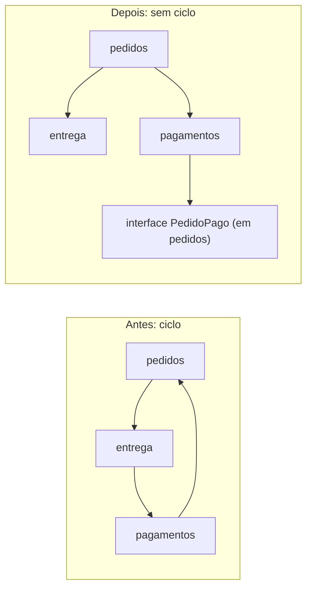
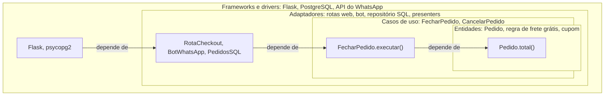
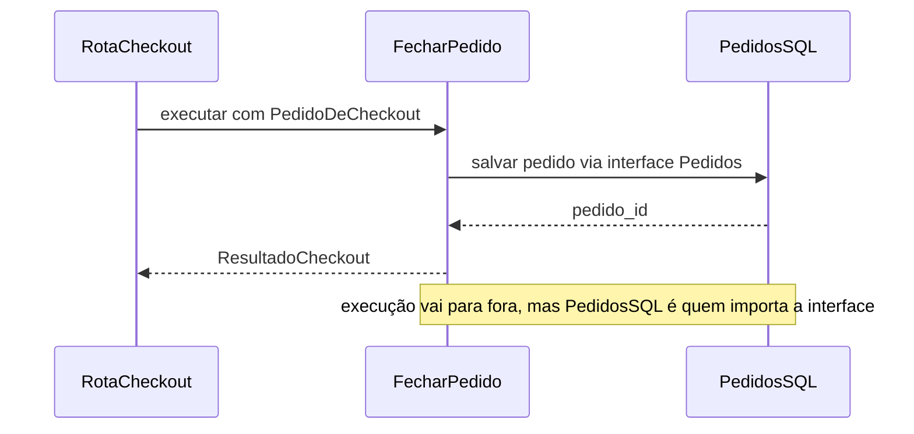

# 2. Fronteiras e dependências

> [!NOTE] Em uma frase
> As regras do seu negócio devem ficar no centro do código e não saber nada sobre banco, tela ou framework; são essas peças técnicas que se encaixam nas regras, nunca o contrário.

## Por que isso importa

A Lojinha cresceu. Depois de aplicar os princípios do [módulo 1](01-codigo-que-aguenta-mudanca.md), o código está em funções e classes menores. Mas um problema novo apareceu: o dono quer vender também pelo WhatsApp. A regra "pedido acima de R$ 200 tem frete grátis" mora dentro de uma rota do Flask (o framework web que a Lojinha usa, a biblioteca que recebe as requisições do navegador), logo depois de ler o formulário HTML e logo antes de gravar no banco com o ORM (uma biblioteca que traduz objetos do código em linhas de tabela).

Para o bot do WhatsApp, alguém copia a regra. Três meses depois, o site dá frete grátis acima de R$ 200 e o bot acima de R$ 150, porque uma promoção mudou só uma das cópias. E testar a regra exige subir o servidor web e um banco de dados, então quase ninguém testa.

SOLID organizou as classes. Este módulo sobe um nível: como organizar **o sistema inteiro**, decidindo quais partes podem conhecer quais, para que a regra exista em um lugar só e seja usada pelo site, pelo bot e pelos testes.

## O que você precisa saber antes

O [módulo 1](01-codigo-que-aguenta-mudanca.md), principalmente acoplamento e coesão e a inversão de dependência (a regra define uma interface e o detalhe técnico a implementa).

## Componentes: por que agrupar código

### O que é um componente

Um **componente** é um pedaço do sistema que você empacota, versiona e publica como unidade: um pacote Python instalável, um `.jar` em Java, uma biblioteca compartilhada. Num sistema pequeno, pode ser simplesmente uma pasta com fronteira clara. A Lojinha poderia ter componentes como `catalogo`, `pedidos`, `pagamentos` e `entrega`.

Agrupar classes em componentes existe pelo mesmo motivo do módulo 1, só que maior: quando uma mudança chega, você quer abrir um componente, não dez.

### O que vai junto

Há três princípios sobre o que colocar dentro de um componente. Em linguagem simples:

- **Junte o que muda junto.** Se toda mudança na regra de frete também mexe na tabela de transportadoras, as duas ficam no mesmo componente. É a responsabilidade única aplicada a pastas e pacotes, e para a maioria dos sistemas é o princípio que mais importa.
- **Junte o que é reusado junto.** Se outro sistema vai usar seu componente, as partes dele precisam fazer sentido juntas e ser versionadas juntas. Ninguém quer instalar `lojinha-utils` versão 4.2 sem saber o que mudou em qual pedaço.
- **Não force quem usa a levar o que não usa.** Se o componente de entrega importa `pedidos` só para pegar o CEP, toda mudança em `pedidos` obriga entrega a ser revalidada. É a segregação de interfaces aplicada a componentes.

Os dois primeiros puxam para componentes maiores; o terceiro puxa para menores. Não existe divisão perfeita. Projetos novos costumam priorizar "o que muda junto" (facilidade de desenvolver); quando outros times começam a reusar o código, o peso vai para os outros dois. **A divisão em componentes muda com o tempo**, e isso é normal.

### Sem ciclos

Um ciclo de dependências acontece quando `pedidos` importa `entrega`, que importa `pagamentos`, que importa `pedidos`. Na prática, os três viraram um componente só: não dá para testar, publicar ou entender um sem os outros. O sintoma clássico é deixar seu código funcionando à noite e encontrá-lo quebrado de manhã porque alguém mudou algo que depende de algo que depende de você.



Há duas formas de quebrar um ciclo: inverter a dependência com uma interface (como no diagrama, em que `pagamentos` passa a conhecer só uma interface pequena) ou extrair a parte compartilhada para um componente novo de que os dois dependem. Uma consequência importante: **a estrutura de componentes não se desenha inteira no primeiro dia**. Ela aparece conforme o código mostra onde estão os pontos de mudança.

### Dependa do que é estável

**Estável**, aqui, quer dizer difícil de mudar, porque muita coisa depende dele. A regra é: **dependa sempre de algo mais estável que você**. A tela da Lojinha muda toda semana, então pode depender das regras de pedido, que mudam pouco. O contrário prenderia a regra ao ritmo da tela.

E se o que é estável precisar ser estendido? Com abstrações (interfaces), que permitem adicionar comportamento sem editar, como no princípio aberto/fechado do módulo 1. Por isso, quanto mais estável um componente, mais ele deve ser feito de interfaces e regras puras, e menos de código técnico concreto.

## Política e detalhes

Todo sistema tem duas partes. A **política** são as regras de negócio: o que dá valor e existiria até sem computador. A Lojinha cobraria frete e daria desconto mesmo anotando pedidos num caderno. Os **detalhes** são as peças técnicas que fazem a política chegar ao mundo: banco de dados, framework web, tela, fila de mensagens, serviço de e-mail.

Chamar o banco de "detalhe" soa estranho, então vale ser preciso. **Detalhe não quer dizer pouco importante nem fácil de trocar.** Um banco mal escolhido ainda dói em desempenho e operação. Detalhe quer dizer que **as regras de negócio não devem depender dele**. O frete grátis não deveria saber que existe SQL, tabela ou requisição HTTP.

Por que essa separação vale a pena:

- **O banco é uma consequência da tecnologia, não do negócio.** Guardamos dados em tabelas e índices porque disco é lento e precisa de estruturas eficientes. Se tudo coubesse na memória, usaríamos listas e dicionários. A regra de frete não muda por causa disso.
- **A web é só mais um jeito de entrar e sair dados.** Antes foi o terminal, hoje é o navegador e o WhatsApp, amanhã será outra coisa.
- **O framework é um casamento assimétrico.** Você se compromete com ele (herda das classes dele, segue as convenções), e ele não se compromete com nada seu. Ele pode mudar numa direção que não te serve, ou aparecer um melhor.
- **Adiar decisões é uma vantagem.** Se as regras não dependem do banco, você pode começar com tudo em memória e escolher o banco quando souber mais sobre o volume e o formato dos dados.

Nem todo mundo concorda com o grau dessa separação. Há quem argumente que esconder o banco atrás de interfaces genéricas leva a código que ignora o custo real das consultas. O ponto razoável é o meio-termo: o banco influencia o desenho, mas não deveria aparecer dentro da regra.

## A regra da dependência e os círculos

### O desenho

Juntando tudo, a forma recomendada é a de círculos concêntricos, conhecida como **Clean Architecture** (proposta por Robert C. Martin a partir de ideias mais antigas, como a arquitetura hexagonal, também chamada de *ports and adapters*). Cada círculo é uma [camada](../glossario.md#camada), um agrupamento de código por responsabilidade. Na Lojinha:



- **Entidades.** As regras de negócio críticas, as que existiriam sem computador: o pedido sabe calcular seu total, aplicar cupom e decidir se o frete é grátis. São as que menos mudam. (A palavra [entidade](../glossario.md#entidade) aqui quer dizer objeto de regra de negócio, não a "entidade" do ORM.)
- **Casos de uso.** Os fluxos do sistema, descritos do ponto de vista de quem usa: "fechar pedido" é validar o carrinho, calcular o total, reservar o estoque, salvar e avisar o cliente. Um [caso de uso](../glossario.md#caso-de-uso) orquestra as entidades e não sabe se o pedido veio da web ou do WhatsApp.
- **Adaptadores.** Traduzem entre o formato conveniente para os casos de uso e o formato do mundo externo: JSON, HTML, SQL, mensagem do WhatsApp. Todo o SQL e toda a lógica de tela ficam aqui.
- **Frameworks e drivers.** A borda: Flask, o driver do banco, a biblioteca do WhatsApp. Quase nenhum código seu, só cola.

Quatro círculos é um exemplo, não uma lei. O que não muda é a regra.

### A regra

**A regra da dependência: no código, as dependências só apontam para dentro.** Nada de um círculo interno pode citar algo de um círculo externo: nem classe, nem função, nem formato de dado. A entidade `Pedido` não importa Flask. O caso de uso `FecharPedido` não importa `psycopg2`. Cada linha que separa dois círculos é uma [fronteira arquitetural](../glossario.md#fronteira-arquitetural): uma linha entre partes que mudam por motivos diferentes.

É a [direção da dependência](../glossario.md#dependência-direção-da) do módulo 1 aplicada ao sistema inteiro, e casa com "dependa do que é estável": o centro muda pouco, a borda muda muito, então a borda depende do centro.

### Que dados cruzam a fronteira

Se o caso de uso recebesse o objeto de requisição do Flask, ele passaria a conhecer o Flask. Se devolvesse a linha do banco, conheceria o banco. Por isso, o que atravessa a fronteira são **estruturas de dados simples**, criadas para isso:

```python
@dataclass
class PedidoDeCheckout:          # entra no caso de uso
    cliente_id: int
    itens: list[tuple[int, int]]  # (produto_id, quantidade)
    cupom: str | None

@dataclass
class ResultadoCheckout:         # sai do caso de uso
    pedido_id: int
    total_centavos: int
    frete_gratis: bool
```

A rota web converte o formulário em `PedidoDeCheckout`; o bot converte a mensagem do WhatsApp na mesma estrutura. O caso de uso é um só.

## Inversão de dependência na prática

### O problema da seta "para fora"

Há uma aparente contradição. O caso de uso precisa salvar o pedido no banco, que está num círculo externo. Na execução, a chamada vai de dentro para fora. Como isso não viola a regra?

Com a inversão de dependência do módulo 1: o caso de uso **define a interface** de que precisa, e o adaptador a implementa.

```python
# casos_de_uso/fechar_pedido.py  (dentro)
class Pedidos(Protocol):
    def salvar(self, pedido: Pedido) -> int: ...

class Notificador(Protocol):
    def pedido_fechado(self, cliente_id: int, total: int) -> None: ...

class FecharPedido:
    def __init__(self, pedidos: Pedidos, notificador: Notificador):
        self.pedidos, self.notificador = pedidos, notificador

    def executar(self, req: PedidoDeCheckout) -> ResultadoCheckout:
        pedido = Pedido.novo(req.cliente_id, req.itens, req.cupom)
        pedido_id = self.pedidos.salvar(pedido)
        self.notificador.pedido_fechado(req.cliente_id, pedido.total())
        return ResultadoCheckout(pedido_id, pedido.total(), pedido.frete_gratis())

# adaptadores/pedidos_sql.py  (fora)
class PedidosSQL:
    def salvar(self, pedido): ...   # SQL aqui
```

`Protocol` é o jeito do Python de dizer "qualquer objeto com estes métodos serve". A execução vai para fora; a dependência no código continua para dentro, porque é `PedidosSQL` que precisa respeitar o formato definido em `casos_de_uso`.



### Quem monta as peças

Alguém precisa criar o `PedidosSQL` de verdade, o notificador de verdade e entregá-los ao `FecharPedido`. Esse lugar é o **Main**: o ponto de entrada do programa, o componente mais externo de todos, que depende de tudo e de que ninguém depende.

```python
# main.py
pedidos = PedidosSQL(conexao_postgres())
notificador = NotificadorEmail(smtp_config())
fechar_pedido = FecharPedido(pedidos, notificador)
app = criar_app_flask(fechar_pedido)
```

Pense no Main como um plugin: pode haver um Main de produção, um de desenvolvimento com banco em memória e um para testes. As regras não mudam entre eles. Frameworks de **injeção de dependência** (ferramentas que criam e conectam esses objetos automaticamente) só automatizam este arquivo; num projeto pequeno, ele escrito à mão é suficiente.

## Humble object e testabilidade

### Separar o difícil do fácil de testar

Algumas coisas são difíceis de testar: desenhar na tela, falar com o banco, mandar e-mail. O padrão **humble object** (objeto humilde) resolve dividindo cada uma em duas partes. Uma parte "humilde", tão simples que nem precisa de teste, fica com o contato com o mundo externo. A outra fica com toda a lógica, e é fácil de testar.

O exemplo mais comum é **presenter e view**. A Lojinha mostra o total no checkout em vermelho se o cupom expirou, e com "Frete grátis!" quando for o caso:

```python
def apresentar_checkout(r: ResultadoCheckout, cupom_expirou: bool) -> dict:   # presenter
    reais = f"R$ {r.total_centavos / 100:.2f}".replace(".", ",")
    return {
        "total": reais,
        "selo_frete": "Frete grátis!" if r.frete_gratis else "",
        "total_em_vermelho": cupom_expirou,
    }

assert apresentar_checkout(ResultadoCheckout(1, 25000, True), False) == {
    "total": "R$ 250,00", "selo_frete": "Frete grátis!", "total_em_vermelho": False,
}
```

O presenter decide tudo e devolve um **view model** (uma estrutura com tudo pronto para exibir). O template HTML só copia os valores para a tela, sem decidir nada. A lógica foi testada sem navegador.

O mesmo padrão aparece em toda fronteira:

- **Banco.** O caso de uso conhece a interface `Pedidos`; a implementação com SQL é a parte humilde. Nos testes, entra uma versão em memória.
- **Mensagens externas.** O bot do WhatsApp só converte a mensagem em `PedidoDeCheckout` e passa adiante.

### Como fica o teste

Com as dependências invertidas, testar a regra mais importante da Lojinha não precisa de nada além de Python:

```python
class PedidosEmMemoria:
    def __init__(self): self.salvos = []
    def salvar(self, pedido): self.salvos.append(pedido); return len(self.salvos)

class NotificadorFalso:
    def pedido_fechado(self, cliente_id, total): pass

def test_frete_gratis_acima_de_200():
    caso = FecharPedido(PedidosEmMemoria(), NotificadorFalso())
    r = caso.executar(PedidoDeCheckout(cliente_id=1, itens=[(42, 3)], cupom=None))
    assert r.frete_gratis
```

O teste roda em milissegundos, não quebra quando a tela muda e não depende de banco. Isso é o que "arquitetura testável" quer dizer na prática. Os testes também estão no círculo mais externo: dependem de tudo, e nada depende deles.

## Quando isso tudo é exagero

### O custo de cada fronteira

Uma fronteira completa custa: interfaces dos dois lados, estruturas de dados próprias, conversões. Um time que aplica tudo isso num cadastro simples pode acabar com dezessete arquivos para salvar um nome. Se a Lojinha fosse só um site com uma página de contato, nada disto se pagaria.

A pergunta não é "devo seguir a Clean Architecture?", e sim **"onde uma fronteira se paga?"**. Fronteira cedo demais é custo sem retorno (o famoso YAGNI, *you aren't gonna need it*, "você não vai precisar disso"). Fronteira tarde demais é cara de colocar depois. A resposta é observar o sistema e criar a fronteira quando ignorá-la passar a custar mais que construí-la.

### Fronteiras parciais

Entre "nada" e "fronteira completa" há opções mais baratas:

| Opção | Como é | Custo | Risco |
|---|---|---|---|
| Nenhuma | Regra direto na rota do framework | Zero | A regra fica presa ao framework |
| Função pura | Regra numa função sem import de banco ou web; a rota chama | Muito baixo | Pouco; é o primeiro passo certo |
| Interface no mesmo pacote | `Protocol` para o banco, tudo no mesmo projeto | Baixo | A separação pode se degradar com o tempo |
| Fronteira completa | Componentes separados, estruturas próprias, Main | Alto | Arquivos demais se o sistema for simples |

Para a Lojinha de hoje, um bom ponto de partida é a segunda e a terceira linhas: entidades e casos de uso como Python puro, uma interface para o banco e outra para o e-mail, porque são as duas coisas que tornam os testes lentos. Nada além disso até um problema real pedir.

### Serviços não são arquitetura

Separar o sistema em vários serviços (programas independentes que conversam pela rede) **não** cria fronteiras boas sozinho. Um serviço é só uma fronteira física cara. Se a divisão não seguir os motivos de mudança, toda feature nova mexe em todos os serviços, e a coordenação fica igual, só mais lenta. O que importa é para onde apontam as dependências, não quantos processos existem. O [módulo 4](04-decisoes-de-arquitetura.md) volta a esse assunto.

### A estrutura de pastas deve contar o que o sistema faz

Um último sinal barato. Abrindo o repositório da Lojinha, a primeira coisa visível deveria ser `pedidos/`, `catalogo/`, `entrega/`, e não `controllers/`, `models/`, `views/`. Se o que salta aos olhos é o framework, a organização está contando a história errada.

## Na prática

- **Ao escrever uma regra de negócio, olhe os imports.** Se aparecer o framework web, o ORM ou o cliente de e-mail, a regra está do lado errado da fronteira.
- **Comece pela fronteira que dói.** Normalmente é o banco (testes lentos) ou o framework (regra presa a uma rota). Não crie interface para o que não incomoda.
- **Passe estruturas simples pelas fronteiras.** Se um caso de uso recebe `request` ou devolve um objeto do ORM, o círculo interno está conhecendo o externo.
- **Concentre a montagem num lugar só.** O `main.py` é o único arquivo que pode conhecer tudo.
- **Procure ciclos de import.** Ferramentas como `import-linter` (para Python) podem falhar o build quando uma dependência proibida aparece, o que protege a regra mesmo quando alguém está com pressa.
- **Pergunte: "consigo testar isto sem subir nada?"** Se não, há um humble object esperando para ser extraído.

## Armadilhas comuns

- **"Detalhe quer dizer que o banco não importa."** Importa muito para desempenho e operação. Detalhe quer dizer que as regras não dependem dele.
- **"Clean Architecture é ter quatro pastas com esses nomes."** A regra é a direção das dependências. Quatro pastas com imports apontando para fora não ajudam em nada.
- **"Toda classe precisa de interface e DTO."** Fronteira tem custo. Num projeto pequeno, uma função pura e uma interface para o banco costumam bastar.
- **"Microsserviços desacoplam o sistema."** Eles separam processos, não necessariamente motivos de mudança. Um monolito bem dividido é mais desacoplado que serviços mal divididos.
- **"Dá para desenhar todos os componentes no primeiro dia."** A divisão aparece conforme o código mostra o que muda junto, e muda com o tempo.

## Verifique se entendeu

1. Por que a regra de frete grátis da Lojinha divergiu entre o site e o WhatsApp, e onde ela deveria morar?
2. O que significa dizer que o banco é um "detalhe", e o que essa palavra **não** significa?
3. O caso de uso `FecharPedido` precisa salvar no banco, que está num círculo externo. Explique como isso acontece sem violar a regra da dependência.
4. Como o padrão humble object torna o checkout testável sem navegador?
5. Por que um ciclo entre `pedidos`, `entrega` e `pagamentos` transforma os três num componente só?
6. Para uma Lojinha com duas pessoas programando, quais fronteiras você criaria hoje e quais deixaria para depois? Por quê?

## Quer ir mais fundo?

> [!TIP] Opcional
> Nada aqui é obrigatório. O módulo foi escrito para se bastar.

- [Clean Architecture, 4. Princípios de componentes](../arquitetura/clean-architecture/04-principios-de-componentes.md): os seis princípios de componentes com nomes, siglas e as métricas de estabilidade e abstração.
- [Clean Architecture, 5a. Fronteiras e a regra da dependência](../arquitetura/clean-architecture/05a-fronteiras-e-a-regra-da-dependencia.md): onde traçar fronteiras, entidades, casos de uso e o diagrama dos círculos em detalhe.
- [Clean Architecture, 5b. Detalhes de fronteira e humble objects](../arquitetura/clean-architecture/05b-detalhes-e-humble-objects.md): fronteiras parciais, o componente Main, serviços e testes como parte da arquitetura.
- [Clean Architecture, 6. Detalhes e estudo de caso](../arquitetura/clean-architecture/06-detalhes-e-estudo-de-caso.md): por que banco, web e frameworks são detalhes, e quatro jeitos de organizar pacotes comparados.
- Livro original: *Clean Architecture*, de Robert C. Martin.

---
Anterior: [1. Código que aguenta mudança](01-codigo-que-aguenta-mudanca.md) · Próximo: [3. Modelando o negócio](03-modelando-o-negocio.md) · Voltar ao [início do guia](index.md)
