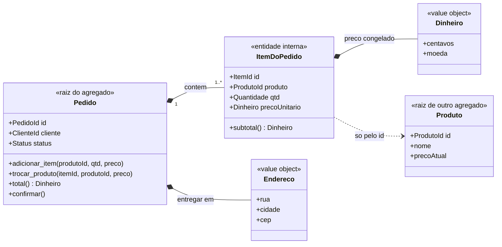
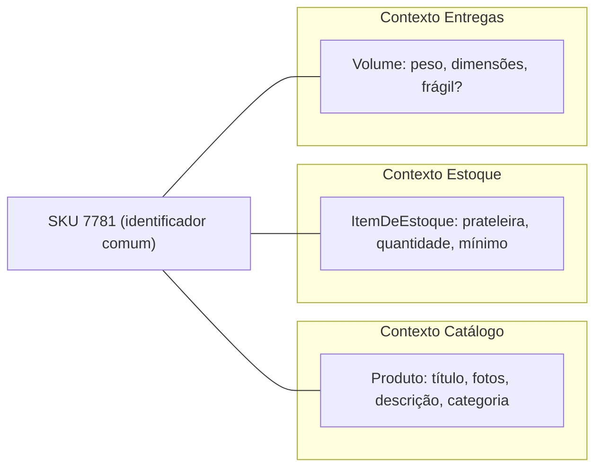
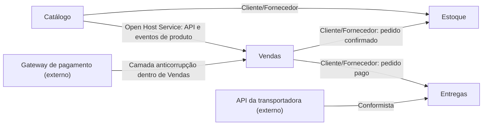
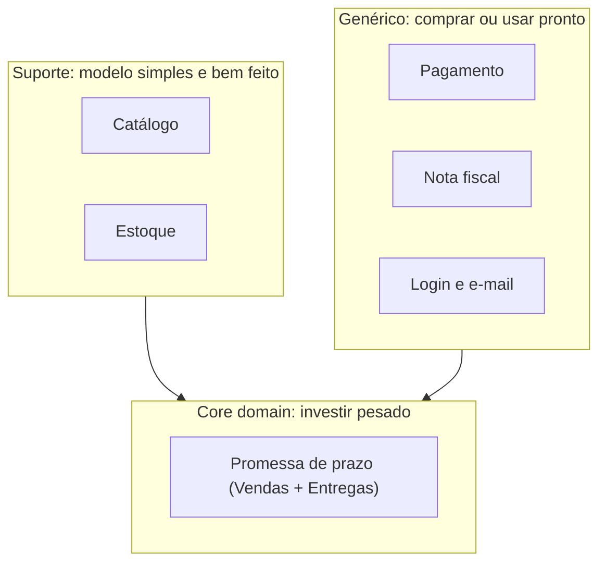

# 3. Modelando o negócio

> [!NOTE] Em uma frase
> O código fica mais fácil de mudar quando ele usa as mesmas palavras e as mesmas regras que as pessoas do negócio usam, e quando um sistema grande é dividido em partes em que cada palavra tem um significado só.

## Por que isso importa

A Lojinha vende bem. O time de marketing pede uma campanha: "mande um cupom de 15% para os clientes **inativos**, para trazê-los de volta". Um desenvolvedor abre o código, encontra `Cliente.ativo` (um booleano) e filtra quem tem `ativo = False`. A campanha sai. Na semana seguinte, duas coisas acontecem: clientes que compram toda semana reclamam que não ganharam cupom nenhum (até aí, tudo certo), e o suporte recebe dezenas de e-mails de pessoas que tinham **pedido para excluir a conta** perguntando por que continuam recebendo promoções.

O que deu errado? Para o marketing, "inativo" significa "não compra há mais de 90 dias". No código, `ativo = False` significa "conta bloqueada ou encerrada". As duas ideias usam a mesma palavra e não têm nada a ver uma com a outra. O desenvolvedor traduziu a palavra do negócio para a mais parecida que achou no código, e a tradução estava errada.

O módulo 2 protegeu as regras de negócio no centro do sistema. Este módulo responde à pergunta seguinte: **o que** vai nesse centro, e com que nomes? E como dividir quando "cliente" passa a significar coisas diferentes para times diferentes? As ideias vêm de uma abordagem chamada **DDD** (*Domain-Driven Design*, design dirigido pelo domínio), em que "domínio" é a área de atividade que o software atende; no caso da Lojinha, vender produtos pela internet e entregá-los.

## O que você precisa saber antes

- [2. Fronteiras e dependências](02-fronteiras-e-dependencias.md): a ideia de que as regras de negócio ficam numa camada própria, no centro, e que banco e interface dependem dela, nunca o contrário.
- [1. Código que aguenta mudança](01-codigo-que-aguenta-mudanca.md): [acoplamento e coesão](../glossario.md#acoplamento-e-coesão), que voltam aqui na hora de dividir o sistema.

## Uma língua só, do quadro branco ao código

### O custo da tradução

O bug do cupom é um caso de um problema geral: quando o negócio fala uma língua e o código fala outra, toda conversa exige tradução, e toda tradução perde alguma coisa. A **[linguagem ubíqua](../glossario.md#linguagem-ubíqua)** é a resposta do DDD: um vocabulário combinado entre quem desenvolve e quem conhece o negócio, usado igual na conversa, nos documentos, nos testes e nos nomes do código. "Ubíquo" quer dizer "presente em todo lugar".

Aplicada ao caso do cupom, a correção não é só renomear o booleano. É reconhecer que existem **dois conceitos** e dar um nome a cada um:

```python
class Cliente:
    def conta_encerrada(self) -> bool: ...
    def inativo_para_marketing(self, hoje) -> bool:
        return (hoje - self.ultima_compra).days > 90
```

Agora "clientes inativos" tem um endereço exato no código, a regra dos 90 dias mora num lugar só, e a pessoa de marketing consegue ler a resposta em voz alta.

### Três regras práticas

1. **Palavra nova na conversa, conceito novo no código.** Se o negócio passa a distinguir "reservar estoque" de "separar no armazém", as duas palavras precisam existir no código. Renomear uma classe deixa de ser cosmética: é registrar uma descoberta.
2. **Palavra ambígua é sinal de modelo ruim.** Quando uma palavra significa duas coisas (como "inativo"), não adianta escolher uma: nomeie as duas ou separe os contextos em que cada uma vale (assunto da seção sobre bounded contexts, mais abaixo).
3. **O especialista do negócio precisa entender os nomes.** Ele não lê Python, mas se você ler em voz alta `pedido.dividir_em_remessas()` e ele franzir a testa, o código e o negócio se separaram ali.

> [!TIP]
> Programar em inglês não quebra a linguagem ubíqua, desde que a tradução seja uma convenção fixa do time (`Remessa` é sempre `Shipment`), anotada em algum lugar. O que quebra é cada pessoa traduzir do seu jeito.

## O modelo de domínio

Um **[modelo de domínio](../glossario.md#modelo-de-domínio)** é a representação simplificada, escolhida a dedo, dos conceitos e regras do negócio que importam para o problema que o software resolve. A palavra que mais importa é "simplificada".

Pense na planta de uma casa: a do eletricista mostra tomadas e fios, a do decorador mostra móveis, e cada uma é útil exatamente porque deixa o resto de fora. O modelo da Lojinha tem `Pedido`, `Produto`, `Cliente`, `Remessa`, mas não tem "cor da fita adesiva da caixa", porque isso não muda nenhuma decisão do sistema.

Dois cuidados que fazem diferença:

- **O modelo nasce de conversa, não de especificação.** Quem desenvolve senta com quem conhece o negócio, propõe um esboço, ouve "não é bem assim", ajusta, implementa, descobre um caso que ninguém previu e volta a conversar. Foi assim que a Lojinha descobriu que um pedido pode sair em **mais de um pacote** (itens de armazéns diferentes), e que cada pacote, a `Remessa`, tem prazo e atraso próprios. Esse conceito não estava em documento nenhum.
- **O modelo vive no código.** Um diagrama num wiki que diverge do código envelhece em semanas, porque a próxima pessoa lê o código. As classes e métodos da camada de domínio *são* o modelo.

## Entidades e value objects

Dentro do modelo, os objetos se dividem em dois tipos, e a pergunta que separa um do outro é simples: **"se eu trocar este objeto por outro com os mesmos dados, alguém nota?"**

Uma **[entidade](../glossario.md#entidade)** é um objeto com identidade própria, que continua sendo "o mesmo" mesmo que todos os atributos mudem. O pedido nº 4812 continua sendo o 4812 depois de ganhar itens e trocar de endereço. Duas clientes chamadas "Ana Souza" são duas pessoas diferentes. Para uma entidade, o trabalho é decidir o que define a identidade (um ID gerado pelo sistema, não o e-mail, que pode mudar) e garantir que ela seja única e estável.

Um **[value object](../glossario.md#value-object)** (objeto de valor) é definido só pelos seus atributos. Duas notas de R$ 50 na carteira são intercambiáveis; ninguém liga para "qual" nota. Na Lojinha, são value objects: `Dinheiro`, `Endereco`, `Cep`, `Quantidade`.

Value objects devem ser **imutáveis**, ou seja, não podem ser alterados depois de criados; para "mudar", você cria outro.

```python
from dataclasses import dataclass

@dataclass(frozen=True)
class Dinheiro:
    centavos: int
    moeda: str = "BRL"

    def __add__(self, outro: "Dinheiro") -> "Dinheiro":
        if outro.moeda != self.moeda:
            raise ValueError("não se soma moedas diferentes")
        return Dinheiro(self.centavos + outro.centavos, self.moeda)
```

Três ganhos: a validação fica num lugar só; dá para compartilhar sem medo, porque ninguém altera o valor "por baixo" de outra parte do código; e regras viram vocabulário, em vez de `float` espalhado com arredondamentos diferentes.

A classificação depende do contexto. Para a Lojinha, um endereço é um valor: se o cliente digitar o mesmo endereço de novo, é o mesmo endereço. Para uma empresa de correios, que acompanha cada endereço ao longo do tempo, o endereço pode ser uma entidade.

## Agregados: a fronteira das regras

### O problema

A Lojinha tem uma regra: pedido acima de R$ 5.000 passa por análise antifraude antes de ser confirmado. O total fica no pedido; os itens ficam em outra tabela. Um dia, o time de atendimento ganha uma tela para trocar um produto esgotado por outro similar, e o código dessa tela faz um `UPDATE` direto na tabela de itens. Ninguém lembrou de recalcular o total. Um pedido de R$ 4.900 vira, na prática, um pedido de R$ 6.200 que nunca passou pela análise.

A regra existia. O problema é que ela não tinha **dono**: qualquer código podia mexer em qualquer item.

### A solução

Um **[agregado](../glossario.md#agregado)** é um grupo de objetos tratado como uma unidade para fins de mudança, com um objeto escolhido como **raiz** por onde todo acesso passa. Na Lojinha, o agregado `Pedido` contém os itens, e o próprio `Pedido` é a raiz. As regras:

- **Só a raiz é acessível de fora.** Ninguém altera um item diretamente; o atendimento chama `pedido.trocar_produto(item_id, novo_produto, preco)`.
- **A raiz garante as regras do grupo todo.** Dentro de `trocar_produto`, o pedido recalcula o total e, se passar de R$ 5.000, marca para análise. Como não existe outro caminho de alteração, não existe como esquecer.
- **Outros agregados são referenciados só pelo identificador.** O item guarda `produto_id` e o preço do momento da compra, não o objeto `Produto` inteiro.
- **Uma transação altera um agregado só.** Uma **transação** é um conjunto de operações no banco que acontece por inteiro ou não acontece; a fronteira do agregado é exatamente o que precisa estar coerente dentro de uma delas.



Repare em `precoUnitario`: o item **congela** o preço do momento da compra. Se o catálogo mudar o preço amanhã, o pedido de hoje não muda. Isso não é detalhe técnico, é regra de negócio: o cliente paga o preço que viu.

### Qual o tamanho certo?

A fronteira deve envolver exatamente o que precisa estar coerente **no mesmo instante**. Total e itens precisam (é a regra antifraude). Pedido e estoque não precisam: o negócio aceita que o estoque seja baixado alguns segundos depois da confirmação. Por isso `Estoque` é outro agregado, e a regra entre os dois é resolvida depois, aceitando [consistência eventual](../glossario.md#consistência-forte-e-eventual) (os dados ficam corretos depois de um curto atraso, em vez de imediatamente).

> [!WARNING]
> Agregado grande demais é o erro mais caro. Se `Cliente` contiver todos os pedidos, dois atendentes mexendo em pedidos diferentes do mesmo cliente entram em conflito. Comece pequeno e só aumente a fronteira quando uma regra real exigir.

### Repositórios e fábricas, em uma frase cada

- **Repositório**: um objeto que se comporta como uma coleção de agregados em memória (`pedidos.por_id(4812)`, `pedidos.adicionar(p)`), escondendo o banco; existe um por agregado, nunca um por tabela, por isso há `RepositorioDePedidos` e não `RepositorioDeItens`.
- **Fábrica**: o lugar que cria um agregado já válido, ou falha (`Pedido.a_partir_do_carrinho(carrinho, endereco)`), para que as regras de criação não fiquem espalhadas por quem precisa criar pedidos.

## Bounded contexts: o mesmo nome, coisas diferentes

### O Produto de 60 atributos

A Lojinha agora tem quatro áreas com times próprios: **Catálogo**, **Vendas**, **Estoque** e **Entregas**. Todas usam uma classe `Produto`. Para o Catálogo, produto é título, descrição, fotos e categoria. Para o Estoque, é um código de unidade (SKU), localização na prateleira e quantidade. Para Entregas, é peso, dimensões e "pode ir de moto?". A classe chegou a 60 atributos, cada time mexe nos seus, e toda alteração quebra algo em outro time.

A tentação é procurar o modelo "certo" de produto. Não existe. Existem **vários**, e isso é normal.

### A ideia

Um **[bounded context](../glossario.md#bounded-context)** (contexto delimitado) é a fronteira dentro da qual um modelo e sua linguagem ubíqua têm um significado único. Fora dela, a mesma palavra pode significar outra coisa, e isso é aceito, desde que a fronteira esteja explícita.



Cada contexto tem só o que precisa, e eles se ligam por um identificador comum. O bug do cupom também se explica assim: "inativo" em Marketing e "inativo" em Contas são conceitos diferentes que dividiam a mesma palavra no mesmo lugar.

A fronteira costuma coincidir com um time e uma base de código, mas o que a define é o **modelo**. E contexto **não** é sinônimo de microsserviço: contexto é fronteira de significado; serviço é uma unidade que vai para produção sozinha. Um contexto pode ser um módulo dentro de um único programa, como a Lojinha vai decidir no próximo módulo.

## Context map: como os contextos convivem

Contextos separados ainda precisam conversar: Vendas precisa saber o preço que o Catálogo mostra, Estoque precisa saber o que foi vendido. O **context map** (mapa de contextos) é um diagrama que mostra todos os contextos e **o tipo de relação** entre cada par. Ele descreve o que *é*, inclusive as relações feias, não o que se gostaria que fosse.

Toda relação tem uma direção. O contexto **upstream** (rio acima) fornece algo; o **downstream** (rio abaixo) depende dele. Mudanças no upstream afetam o downstream, não o contrário.



Os padrões de relação mais úteis no dia a dia:

| Padrão | O que é | Na Lojinha | Custo |
|---|---|---|---|
| **Cliente/Fornecedor** | O upstream planeja levando em conta as necessidades do downstream; os dois negociam prioridades. | Vendas avisa Estoque quando um pedido é confirmado e combina o formato do aviso. | Coordenação entre times, mas cada um mantém seu modelo. |
| **Conformista** | O downstream não tem poder de negociar e adota o modelo do upstream como está. | Entregas usa os campos e status da transportadora sem traduzir. | Barato, mas o vocabulário de fora invade o seu. |
| **Camada anticorrupção** (ACL) | O downstream escreve uma camada de tradução que converte o modelo de fora para o seu. | Vendas fala em `Pagamento` aprovado ou recusado; a ACL traduz os códigos esquisitos do gateway. | Código a mais, mas protege a linguagem de quem importa. |
| **Open Host Service + linguagem publicada** | O upstream oferece uma interface pública e estável, num formato documentado e versionado, para qualquer interessado. | Catálogo publica eventos "produto alterado" num formato JSON versionado. | Exige disciplina para não quebrar o contrato. |
| **Núcleo compartilhado** (*Shared Kernel*) | Dois contextos compartilham um pedaço pequeno de modelo e só mudam em acordo. | Vendas e Estoque compartilham `Dinheiro` e `Sku`. | Acoplamento forte; mantenha mínimo. |
| **Caminhos separados** | Integrar custa mais do que vale; cada um segue sozinho. | O blog de receitas da Lojinha digita nomes de produtos à mão. | Duplicação, conscientemente aceita. |

Cada padrão é uma troca entre **autonomia** (cada time muda o seu sem pedir licença) e **custo de coordenação**. A regra prática: use camada anticorrupção quando o modelo de fora é ruim ou instável **e** o seu é importante; seja conformista quando o modelo de fora é aceitável e você não tem como influenciá-lo.

## Core domain: onde investir esforço

Nem toda parte do sistema merece o mesmo cuidado. O **core domain** (domínio central) é a parte que diferencia a empresa, o motivo de o software existir em vez de ser comprado pronto. O resto se divide em:

- **Subdomínios genéricos**: necessários, mas iguais em qualquer empresa. Login, emissão de nota fiscal, envio de e-mail, processamento de cartão. Compre, use uma biblioteca ou faça o simples.
- **Subdomínios de suporte**: específicos do negócio, mas que não diferenciam. O termo não está no livro original do DDD; foi popularizado depois por outros autores e hoje é de uso comum.

Digamos que o diferencial da Lojinha seja **prometer um prazo de entrega preciso e cumprir**. Então o core é o cálculo e o acompanhamento dessa promessa, que vive entre Vendas e Entregas. Ali vão as melhores pessoas, o modelo mais cuidadoso, os testes mais rigorosos e as conversas mais frequentes com o negócio. O cadastro do Catálogo e o controle do Estoque são de suporte: precisam funcionar bem, mas um modelo simples serve. Pagamento e nota fiscal são genéricos: a Lojinha usa um gateway e um emissor prontos, isolados por camadas anticorrupção.



Melhorar o modelo do Catálogo não faz um cliente escolher a Lojinha em vez da concorrência; investir igual em tudo desperdiça o talento que o core precisa.

## Na prática

- **Em code review, discuta nomes.** "O negócio chama isso de cancelamento ou de desistência? São a mesma coisa?" é uma pergunta de modelagem, não de estilo.
- **Ao ver uma regra de negócio fora do domínio** (num controlador, num job, num SQL de relatório), pergunte qual agregado deveria ser o dono dela.
- **Sinal de alerta: uma classe que todo time edita.** É quase sempre um conceito que deveria estar dividido em contextos.
- **Sinal de alerta: palavras do fornecedor no seu código** (`status_cod = "AP02"`). Falta uma camada anticorrupção; o mapa de contextos ajuda a enxergar onde.
- **Pergunte ao negócio o que diferencia a empresa** antes de decidir onde gastar esforço de modelagem.

## Armadilhas comuns

- **"DDD é desenhar diagramas antes de programar."** O modelo vive no código e na conversa; o diagrama é só um apoio. Um diagrama de 40 classes que ninguém atualiza é o contrário do que se busca.
- **"Precisamos de um glossário único para a empresa."** Não funciona, porque palavras como "cliente" e "produto" mudam de sentido entre áreas. A linguagem é única *dentro de um contexto*.
- **"Agregado é o que as chaves estrangeiras dizem."** Quem define a fronteira são as regras que precisam estar coerentes no mesmo instante, não o desenho das tabelas. Duas tabelas ligadas podem ser agregados diferentes.
- **"Um bounded context é um microsserviço."** Contexto é fronteira de significado; serviço é unidade de deploy. Começar com contextos como módulos de um único programa é, muitas vezes, a escolha mais sensata.

## Verifique se entendeu

1. No bug do cupom, por que só renomear o booleano `ativo` não resolveria? O que precisa mudar no modelo?
2. `Endereco` é value object na Lojinha. Descreva um negócio em que ele precisaria ser entidade e explique por quê.
3. Como o agregado `Pedido` impede o incidente do pedido de R$ 6.200 que escapou do antifraude? E por que `Estoque` não deve estar dentro dele?
4. Por que o item do pedido guarda o preço congelado em vez de consultar o preço atual do produto?
5. Na relação com a transportadora, quando valeria trocar "conformista" por uma camada anticorrupção?
6. Se o diferencial da Lojinha mudasse para "o melhor catálogo de produtos artesanais do país", o que mudaria na decisão de onde investir esforço?

## Quer ir mais fundo?

> [!TIP] Opcional
> Nada aqui é obrigatório. O módulo foi escrito para se bastar.

- [DDD, página 1: colocando o modelo de domínio para trabalhar](../arquitetura/ddd/01-colocando-o-modelo-de-dominio-para-trabalhar.md): como o modelo nasce de conversas sucessivas e por que modelo e código precisam ser o mesmo artefato.
- [DDD, página 2: os blocos de construção](../arquitetura/ddd/02-blocos-de-construcao.md): camadas, serviços de domínio e módulos organizados por conceito.
- [DDD, página 3: entidades, value objects, agregados e repositórios](../arquitetura/ddd/03-entidades-value-objects-agregados-e-repositorios.md): as regras completas de agregados, fábricas e repositórios.
- [DDD, página 4: refatorando rumo a um insight mais profundo](../arquitetura/ddd/04-refatorando-rumo-a-um-insight-mais-profundo.md): como o modelo melhora com o tempo e o padrão Specification para regras combináveis.
- [DDD, página 5: design estratégico](../arquitetura/ddd/05-design-estrategico.md): todos os padrões do mapa de contextos, destilação do core e estrutura de larga escala.
- *Domain-Driven Design: Tackling Complexity in the Heart of Software*, de Eric Evans (2003).

---
Anterior: [2. Fronteiras e dependências](02-fronteiras-e-dependencias.md) · Próximo: [4. Decisões de arquitetura](04-decisoes-de-arquitetura.md) · Voltar ao [início do guia](index.md)
