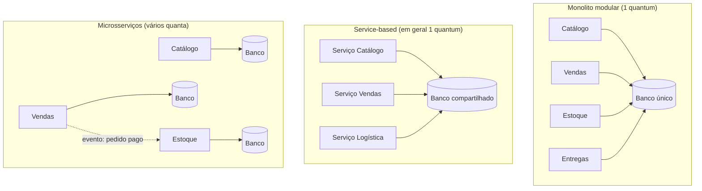
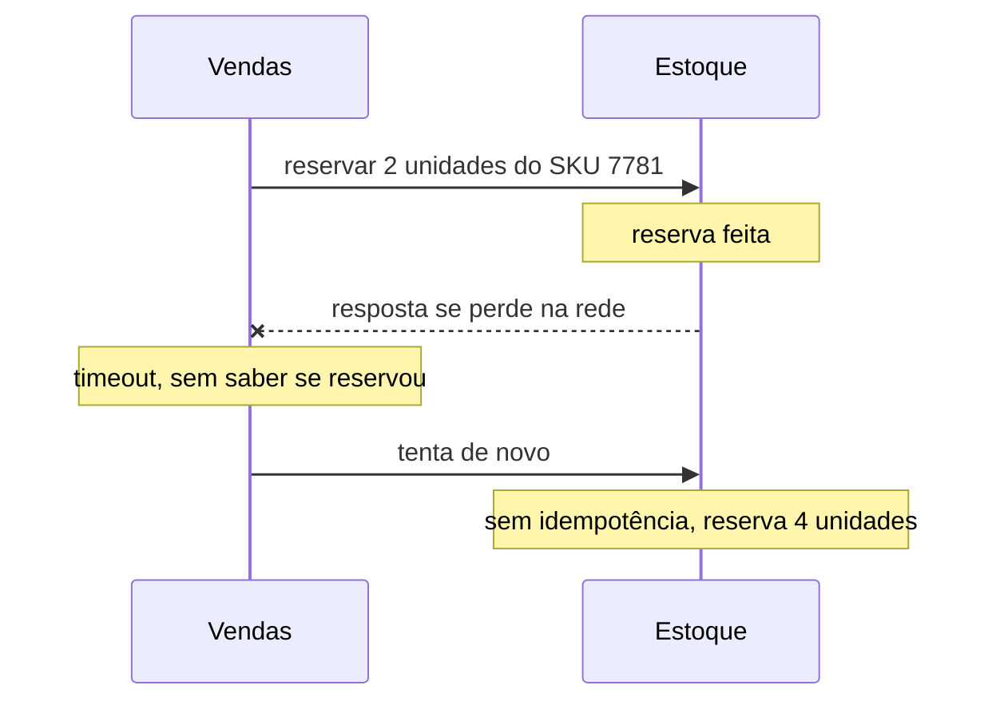

# 4. Decisões de arquitetura

> [!NOTE] Em uma frase
> Não existe arquitetura certa, existe a que perde nas coisas que o seu negócio aceita perder; o trabalho é descobrir quais qualidades importam, escolher o formato que as entrega e escrever o porquê para quem vier depois.

## Por que isso importa

A Lojinha cresceu. Tem quatro times (Catálogo, Vendas, Estoque e Entregas, os contextos do módulo anterior), um único programa em Python e um único banco. Numa reunião, alguém volta de uma conferência animado: "as grandes empresas usam microsserviços; precisamos quebrar o monolito". Outra pessoa responde que da última vez que tentaram algo parecido, numa empresa anterior, levaram um ano para ter de volta o que já funcionava. As duas falam com convicção, e nenhuma das duas disse **o que** a Lojinha precisa que o sistema atual não entrega.

Essa conversa costuma terminar com a vitória de quem fala mais alto, ou sem decisão nenhuma. Os módulos 1 a 3 trataram de decisões dentro do código: classes, camadas, modelos. Este módulo sobe um andar. **Arquitetura** aqui é o conjunto de decisões caras de desfazer: como o sistema é dividido em partes que vão para produção, como essas partes conversam e quais qualidades o todo precisa garantir. O objetivo é trocar a briga de opiniões por uma análise que qualquer pessoa do time consegue repetir.

## O que você precisa saber antes

- [2. Fronteiras e dependências](02-fronteiras-e-dependencias.md): [camadas](../glossario.md#camada) e a ideia de que dependências apontam para o centro.
- [3. Modelando o negócio](03-modelando-o-negocio.md): [bounded contexts](../glossario.md#bounded-context), as fronteiras de significado que viram candidatas naturais a fronteiras de arquitetura.

## Tudo é trade-off: "depende", e do quê

Um **trade-off** é uma troca: para ganhar uma coisa, você abre mão de outra. A frase que resume a disciplina é que **tudo em arquitetura é trade-off**, e se você acha que encontrou uma escolha sem lado ruim, provavelmente só não achou o lado ruim ainda.

Por isso "depende" é a resposta honesta de quem arquiteta. Mas "depende" sozinho é fuga. A resposta completa tem três partes: **depende de X e de Y; no nosso caso X pesa mais; então escolhemos A, sabendo que perdemos B**.

Um exemplo pequeno da Lojinha. Quando um pedido é pago, três partes precisam saber: Estoque (baixar a quantidade), Entregas (separar o pacote) e o e-mail de confirmação. Duas formas de avisar:

| | Vendas chama cada um diretamente | Vendas publica "pedido pago" e quem quiser escuta |
|---|---|---|
| Ganha | Fluxo visível num lugar só; fácil de depurar; Vendas sabe na hora se deu certo | Adicionar um quarto interessado não mexe em Vendas; se o e-mail cair, a venda não cai |
| Perde | Vendas conhece todo mundo; se Entregas estiver fora, a venda trava ou precisa de tratamento | Ninguém vê o fluxo inteiro; erros acontecem "em outro lugar"; mensagens podem chegar duas vezes |

Nenhuma coluna é a certa. Se a Lojinha vai ganhar novos interessados todo mês (programa de pontos, antifraude, análise de vendas), a segunda ganha. Se o time é pequeno e precisa entender tudo rápido, a primeira ganha. A análise boa liga cada linha da tabela a uma necessidade real do negócio.

Uma segunda regra completa a primeira: **o porquê importa mais do que o como**. Olhando um sistema pronto, dá para descobrir *como* ele foi feito. O que não dá é descobrir *por que*, e sem o porquê a próxima pessoa desfaz uma boa decisão achando que era descuido. Guarde isso para a última seção.

## Características arquiteturais: o que o sistema precisa ser

### O que são

Uma **característica arquitetural** é uma qualidade que o sistema precisa ter além de fazer o que o negócio pede. "Calcular o frete" é funcionalidade. "Calcular o frete em menos de 300 ms mesmo na Black Friday" envolve uma característica: desempenho sob carga. Elas são chamadas também de requisitos não funcionais ou, em inglês, de *-ilities*, porque quase todas terminam assim (*scalability*, *availability*).

Um bom filtro: uma qualidade é arquitetural quando **muda a estrutura** do sistema. Guardar senha com hash é boa prática de código. Nunca guardar número de cartão, para escapar de uma auditoria pesada, pode exigir isolar o pagamento num pedaço separado; isso é estrutura.

As mais comuns, em três famílias:

| Família | Exemplos | Pergunta que responde |
|---|---|---|
| Operacionais | [disponibilidade](../glossario.md#disponibilidade), desempenho, escalabilidade, elasticidade, recuperabilidade | Como o sistema se comporta rodando? |
| Estruturais | manutenibilidade, extensibilidade, testabilidade, implantabilidade | Como o código evolui e chega em produção? |
| Transversais | segurança, privacidade, acessibilidade, requisitos legais | O que atravessa tudo? |

Duas que todo mundo confunde: **escalabilidade** é aguentar mais carga ao longo do tempo (a Lojinha dobra de clientes em um ano); **elasticidade** é aguentar um pico repentino (o tráfego multiplica por dez às 0h da Black Friday e volta ao normal às 2h). Crescer devagar e aguentar pico pedem soluções diferentes. E **implantabilidade** (*deployability*) é a facilidade de colocar uma mudança em produção com segurança e frequência.

### Como descobrir quais importam

O erro clássico é querer todas. Elas competem: mais segurança costuma significar mais verificações por requisição, o que piora desempenho; mais disponibilidade exige cópias e redundância, o que aumenta custo e complexidade. Um sistema desenhado para ser máximo em tudo fica caro, lento e difícil de mudar.

Três técnicas práticas:

1. **Traduzir a fala do negócio.** Ninguém do negócio diz "precisamos de elasticidade". Diz outras coisas, e cabe a você traduzir:
   - "Precisamos lançar coisas rápido" → implantabilidade, testabilidade, modularidade.
   - "Na Black Friday o site não pode cair" → elasticidade, disponibilidade.
   - "Vamos comprar outras lojas e integrar os catálogos" → extensibilidade, interoperabilidade.
   - "O orçamento é apertado" → simplicidade, custo baixo.
2. **Ler os requisitos com lupa.** "Clientes compram de madrugada" esconde disponibilidade 24h.
3. **Pedir as três mais importantes.** Ordenar uma lista de quinze qualidades gera brigas infinitas; escolher três de uma lista força a conversa sobre o que realmente pesa. As outras não somem, mas deixam de decidir a arquitetura.

Aplicando à Lojinha: o negócio quer lançar promoções toda semana sem medo (implantabilidade, testabilidade), não pode cair na Black Friday (elasticidade, mas **só no fluxo de compra**) e tem um time pequeno e orçamento curto (simplicidade). Repare no "só no fluxo de compra": o painel interno de cadastro de produtos pode ficar lento na Black Friday que ninguém liga. Essa diferença entre partes vai importar daqui a pouco.

### De adjetivo para número

"Precisa ser rápido" não decide nada. Uma característica só serve quando vira uma medida objetiva: "o checkout responde em até 500 ms para 99% das requisições" (o [p99](../glossario.md#p50-p99-percentis-de-latência), assunto do [módulo 5](05-dados-por-dentro.md)), "o site fica no ar 99,9% do mês" (um [SLO](../glossario.md#slo), a meta numérica que o time promete). Número permite discordar com dados.

## Fitness functions: o teste que vigia a arquitetura

Combinar uma regra não basta, porque o código muda todo dia e cada mudança pode quebrar a regra sem ninguém notar. Imagine que a Lojinha decidiu que o módulo de Catálogo nunca importa nada de dentro de Vendas. Seis meses depois, numa sexta à tarde, alguém precisa mostrar "mais vendidos" na página do produto e faz exatamente esse import. Funciona, passa no review apressado, e a fronteira deixou de existir.

Uma **fitness function** (função de aptidão; o nome vem de algoritmos genéticos, em que ela mede se uma solução é boa) é qualquer verificação objetiva e, de preferência, automática de que uma característica arquitetural continua sendo respeitada. Na prática, quase sempre é um teste que roda no CI (*continuous integration*, o processo que roda os testes a cada mudança enviada) e falha o build quando a regra é violada.

```python
import ast, pathlib

PROIBIDO = {"catalogo": "lojinha.vendas", "estoque": "lojinha.vendas.interno"}

def test_fronteiras_entre_modulos():
    for modulo, alvo in PROIBIDO.items():
        for arq in pathlib.Path(f"lojinha/{modulo}").rglob("*.py"):
            for no in ast.walk(ast.parse(arq.read_text())):
                if isinstance(no, ast.ImportFrom) and (no.module or "").startswith(alvo):
                    raise AssertionError(f"{arq} importa {no.module}")
```

Outros exemplos: um teste de carga que falha se o p99 do checkout passar de 500 ms; um teste que falha se houver ciclo de dependência entre módulos; derrubar de propósito uma cópia do sistema em produção para provar que o resto aguenta (o chamado *chaos engineering*).


O ganho é transformar uma regra que dependia da memória das pessoas numa regra que o computador lembra por elas.

## Quantum arquitetural: até onde vai "o sistema"

Até agora falamos de características "do sistema", como se ele fosse uma coisa só. Mas a Lojinha já mostrou que não é: o checkout precisa de elasticidade, o painel de cadastro não. Para falar disso com precisão existe o conceito de **quantum arquitetural**: o maior pedaço do sistema que vai para produção de forma independente e que, por isso, compartilha um mesmo conjunto de características. Três ingredientes definem a fronteira de um quantum:

- **Vai para produção sozinho, com tudo de que precisa, banco incluído.** Se cinco serviços leem e escrevem nas mesmas tabelas, uma mudança no esquema do banco pode quebrar os cinco, então eles formam **um** quantum, não cinco.
- **Faz uma coisa de negócio coerente** (alta coesão, no sentido do [módulo 1](01-codigo-que-aguenta-mudanca.md)).
- **Partes que se chamam esperando resposta ficam presas juntas.** Se o checkout chama o Catálogo e espera, quando o Catálogo fica lento o checkout fica lento junto. Chamada síncrona (quem chama espera a resposta) amarra desempenho e disponibilidade; mensagem assíncrona (quem envia segue em frente) solta essa amarra.

A consequência prática é a pergunta mais útil deste módulo: **todas as partes do sistema precisam das mesmas características?** Se sim, um quantum basta, e um monolito resolve. Se não, você precisa de mais de um quantum, e isso empurra para uma arquitetura distribuída. A pergunta não é "monolito ou microsserviços?", é "quantos conjuntos diferentes de necessidades eu tenho?".

## Os estilos de arquitetura

Um **estilo de arquitetura** é um formato conhecido de organizar um sistema, com forças e fraquezas já estudadas.

Duas decisões separam os estilos. A primeira é **monolito ou distribuído**. Um **monolito** tem uma única unidade de implantação: um só artefato vai para produção. Monolito diz respeito ao deploy, não à bagunça interna; dá para ter um monolito muito bem organizado. Uma arquitetura **distribuída** tem várias unidades implantadas separadamente, conversando pela rede. A segunda decisão é **como fatiar**: por responsabilidade técnica (tela, regra, banco) ou por área de negócio (Catálogo, Vendas, Estoque).

### Monolito em camadas

O formato que quase todo projeto começa sem ninguém decidir, porque é o que o framework gera: pastas de apresentação, negócio e persistência. É simples e barato. O problema aparece com o crescimento: como o corte é técnico, a mudança "adicionar cupom por categoria" atravessa todas as camadas e todos os times; e como tudo é um quantum, se o checkout precisa de dez cópias na Black Friday, o painel de cadastro sobe dez cópias junto.

### Monolito modular

O mesmo deploy único, mas fatiado **por domínio** por dentro: um módulo por bounded context, cada um com suas camadas internas, e fronteiras vigiadas (pela fitness function da seção anterior, por exemplo). Uma mudança em Estoque fica em Estoque. Continua sendo um quantum, mas organiza o código como se fossem vários, o que deixa a porta aberta para separar um módulo no futuro, se um dia precisar.

### Service-based

Poucos serviços grandes, um por área de negócio (algo como 4 a 12), cada um implantado separadamente, mas quase sempre **compartilhando um banco**. É o degrau pragmático: ganha deploy independente e isolamento de falhas (se Entregas cai, o Catálogo continua no ar), e ainda usa transações [ACID](../glossario.md#acid) normais, porque o banco é um só. O preço é que o banco compartilhado amarra os serviços: mudar uma tabela pode quebrar vários.

### Microsserviços

O extremo do particionamento por domínio: muitos serviços pequenos, cada um dono **exclusivo** do seu banco, que ninguém mais acessa direto. Cada serviço é seu próprio quantum, com escala, deploy e falhas independentes. O preço é alto: cada conversa vira chamada de rede, não existe transação que abranja dois serviços (é preciso coordenar passos com compensação, as chamadas *sagas*), e operar dezenas de serviços exige automação e [observabilidade](../glossario.md#observabilidade) maduras.

### Event-driven

Em vez de se chamarem, as partes publicam **eventos** ("pedido pago") e outras reagem quando quiserem, de forma assíncrona, normalmente por meio de [filas e mensageria](../glossario.md#fila-e-mensageria). É a segunda coluna da tabela do início deste módulo, levada a sério. Ganha muito em desempenho, escala e facilidade de adicionar comportamento novo; perde em simplicidade e testabilidade, porque o fluxo de uma compra não está escrito em lugar nenhum, ele emerge de quem escuta o quê. E como mensagens podem chegar duplicadas, quem consome precisa ser [idempotente](../glossario.md#idempotência) (processar a mesma mensagem duas vezes dá o mesmo resultado que uma).



### Comparando

A tabela abaixo é um mapa mental deste guia, não uma medida exata: "alto" e "baixo" resumem tendências, e um time competente pode empurrar qualquer célula para um lado. Em "custo operacional", alto é ruim; nas outras colunas, alto é bom.

| Estilo | Corte | Quanta | Simplicidade | Custo operacional | Deploy independente | Escala por parte | Tolerância a falhas | Testabilidade | Bom ponto de partida quando |
|---|---|---|---|---|---|---|---|---|---|
| Monolito em camadas | técnico | 1 | alta | baixo | não | não | baixa | cai com o tamanho | sistema pequeno, domínio ainda nebuloso |
| Monolito modular | domínio | 1 | alta | baixo | não | não | baixa | alta | domínio claro, um conjunto de características |
| Service-based | domínio | 1 (às vezes mais) | média | médio | sim | parcial | alta | alta | quer isolar falhas e deploys sem enfrentar dados distribuídos |
| Microsserviços | domínio | muitos | baixa | alto | sim | sim | alta | alta por serviço, baixa no todo | muitas partes com necessidades diferentes e times autônomos |
| Event-driven | por fluxo | 1 ou mais | baixa | médio | parcial | sim | alta | baixa | picos de carga e muitos interessados no mesmo acontecimento |

Duas leituras para fixar. Microsserviços escalam bem, mas cada requisição individual tende a ser **mais lenta**, porque atravessa a rede várias vezes; escalar e ser rápido são coisas diferentes. E sistemas reais misturam estilos: um núcleo service-based com um pedaço event-driven para notificações é comum e saudável, desde que cada mistura tenha um porquê.

Por fim, a organização pesa tanto quanto a técnica. A **Lei de Conway** observa que sistemas tendem a copiar a estrutura de comunicação de quem os constrói: times divididos em "front", "back" e "banco" produzem camadas; times divididos por área de negócio produzem módulos por domínio.

## As falácias da computação distribuída

Distribuir troca chamadas de função (nanossegundos, sempre funcionam) por chamadas de rede (milissegundos, às vezes não funcionam). Nos anos 1990, engenheiros da Sun Microsystems reuniram as suposições falsas que quem nunca operou um sistema distribuído costuma fazer. São oito, e cada uma vira um custo concreto:

1. **A rede é confiável.** Requisições se perdem. Toda chamada remota precisa de tempo limite (*timeout*), política de nova tentativa e um plano para quando a outra ponta não responde.
2. **A latência é zero.** Uma página que consulta cinco serviços em sequência soma cinco esperas, e a mais lenta manda.
3. **A banda é infinita.** Devolver o cadastro inteiro do cliente quando quem chamou só queria o nome, milhares de vezes por segundo, entope a rede.
4. **A rede é segura.** Cada serviço exposto é uma nova porta de entrada a proteger.
5. **A topologia não muda.** Máquinas sobem, descem e trocam de endereço; endereço fixo no código quebra.
6. **Existe um administrador só.** Vários times e fornecedores mexem na rede, e coordenar com eles vira parte do trabalho.
7. **O transporte não custa nada.** Balanceadores, gateways, filas e monitoramento custam dinheiro e gente.
8. **A rede é homogênea.** Equipamentos e versões diferentes nem sempre se entendem.



No monolito, "reservar estoque" é uma chamada de função dentro de uma transação: ou aconteceu ou não. Em serviços separados, existe um terceiro estado, "não sei", e o código precisa lidar com ele. O [módulo 7](07-sistemas-distribuidos-falham.md) aprofunda o que acontece quando a rede mente; por ora, a lição de arquitetura é: **cada fronteira de rede que você cria é uma dívida que você paga para sempre**. Crie só as que compram alguma característica que você realmente precisa.

## ADRs: escrevendo o porquê

Decisões sem registro adoecem de três jeitos: ninguém decide, com medo de errar; decide-se, mas ninguém lembra por quê, e o assunto volta a cada trimestre; ou o porquê ficou numa conversa de chat que ninguém acha.

Um **ADR** (*Architecture Decision Record*, registro de decisão arquitetural) é um documento curto, de uma ou duas páginas, guardado de preferência no próprio repositório, que registra **uma** decisão. As seções usuais:

- **Título**, numerado.
- **Status**: proposto, aceito ou substituído. ADR substituído não é apagado; ganha um link para o novo, porque a história também ensina.
- **Contexto**: o problema e as alternativas consideradas.
- **Decisão**: em voz afirmativa ("vamos usar"), com a justificativa.
- **Consequências**: as boas **e as ruins**. Escrever o que se perde é o que prova que o trade-off foi pensado.
- **Conformidade**: como saber se a decisão está sendo seguida, de preferência com uma fitness function.

Nem toda escolha merece ADR. Merece quando afeta a estrutura, uma característica arquitetural, as dependências entre partes, as interfaces entre elas ou as ferramentas de construção. Escolher a biblioteca de datas não entra; escolher entre chamada direta e eventos entre Vendas e Estoque entra.

Decidir também tem hora: no **último momento responsável**, quando já há informação suficiente para justificar, mas antes de o atraso travar o time.

### A Lojinha decide

De volta à reunião do começo, agora com perguntas respondíveis no lugar de "microsserviços sim ou não":

```markdown
# 007. Manter um monolito, organizado em módulos por contexto

## Status
Aceito

## Contexto
Características dirigentes: implantabilidade (promoção nova toda semana),
elasticidade no fluxo de compra (Black Friday) e simplicidade (time pequeno,
sem plataforma de deploy de muitos serviços). Hoje o código é um monolito
em camadas: toda mudança atravessa o sistema e os quatro times se atrapalham.
Alternativas: (a) manter como está; (b) monolito modular por contexto;
(c) service-based com banco compartilhado; (d) microsserviços.
O único ponto com necessidade diferente é o pico do checkout, e ele se
resolve rodando mais cópias do monolito inteiro, que é stateless.

## Decisão
Vamos reorganizar o monolito em módulos Catálogo, Vendas, Estoque e
Entregas, cada um com suas camadas e conversando só pela interface pública
do outro. Não vamos separar serviços agora, porque nenhuma parte tem hoje
características que um único quantum não atenda, e (d) traria custo de
operação e de consistência que o time não consegue pagar.

## Consequências
+ Mudanças de um contexto ficam dentro de um módulo; menos atrito entre times.
+ Separar um módulo no futuro vira extração, não reescrita.
- Deploy continua único: um erro em Entregas pode atrasar a promoção de Vendas.
- Escalar o checkout escala o sistema todo, com custo de máquina maior que o necessário.
- O banco continua compartilhado; as fronteiras precisam ser respeitadas também nas tabelas.

## Conformidade
Teste no CI falha se um módulo importar o interior de outro.
Revisitar se: o custo de escalar tudo junto passar de X por mês, ou um
contexto precisar de disponibilidade diferente das demais.
```

Repare em três detalhes. O contexto cita as características, não a moda. As consequências negativas estão escritas, inclusive a do banco compartilhado. E a seção de conformidade diz **quando reabrir a decisão**, o que transforma "nunca vamos ter microsserviços" em "vamos ter quando estes sinais aparecerem". O "stateless" do contexto quer dizer que o programa não guarda nada entre requisições, então qualquer cópia atende qualquer cliente (veja [stateless e stateful](../glossario.md#stateless-e-stateful)); é isso que permite multiplicar cópias no pico.

## O que fica para a Parte 2

Repare onde quase todo trade-off deste módulo foi parar: **nos dados**. O quantum é definido por quem compartilha o banco. O service-based é pragmático porque mantém um banco só; os microsserviços são caros porque cada um tem o seu. A falácia da reserva duplicada é um problema de dado gravado duas vezes. E a consequência mais incômoda do ADR 007 é justamente "o banco continua compartilhado".

Não é coincidência. Na Parte 1, o banco foi tratado como detalhe, e para proteger as regras de negócio ele é mesmo. Mas para decidir arquitetura, saber como os dados são guardados, copiados, divididos e movidos deixa de ser opcional. A Lojinha está prestes a descobrir isso: o próximo problema dela não é de código nem de estilo, é uma página de pedido que demora três segundos para alguns clientes. A Parte 2 começa abrindo a caixa-preta do banco, no [módulo 5](05-dados-por-dentro.md).

## Na prática

- **Antes de propor um estilo, escreva as três características dirigentes.** Se não conseguir, a discussão de estilo é prematura.
- **Desconfie de "nunca" e "sempre".** "Nunca chamada síncrona entre módulos" é uma decisão; registre-a com o porquê e com o critério para exceções.
- **Toda regra importante merece um teste.** Se uma fronteira só existe na memória do time, ela vai cair na próxima sexta-feira apressada.
- **Pergunte "quantos quanta?" antes de "quantos serviços?".** Serviços que compartilham banco ou se chamam em cadeia síncrona são um quantum só, com todas as dores da rede.
- **Sinal de alerta: deploy coordenado.** Se dois "serviços independentes" sempre sobem juntos, eles não são independentes.

## Armadilhas comuns

- **"Monolito é bagunça."** Monolito é uma unidade de deploy; bagunça é falta de fronteiras, e acontece igualmente em microsserviços. Um monolito modular bem vigiado é uma escolha madura.
- **"Microsserviços com um banco compartilhado já dão os benefícios."** Banco compartilhado amarra tudo num quantum só: você paga as oito falácias e não ganha independência. O nome disso é monolito distribuído.
- **"Vamos otimizar todas as características."** Elas competem. A meta é a arquitetura menos pior para o seu caso, aquela cujos defeitos o negócio consegue aceitar.
- **"Event-driven deixa tudo desacoplado."** Se quem publica fica esperando a resposta do evento, você pagou a complexidade da mensageria e manteve o acoplamento.

## Verifique se entendeu

1. Reescreva "depende" como uma resposta completa para a pergunta "Vendas deve chamar Estoque diretamente ou publicar um evento?" no caso da Lojinha.
2. Qual a diferença entre escalabilidade e elasticidade? Dê um exemplo da Lojinha em que só uma das duas importa.
3. Cinco serviços que compartilham um banco formam quantos quanta? Por quê?
4. Escolha uma regra de arquitetura do seu dia a dia e descreva a fitness function que a vigiaria.
5. No diagrama da reserva de estoque, que falácia está em jogo e o que o serviço de Estoque precisa garantir para a nova tentativa ser segura?
6. Que sinal faria a Lojinha reabrir o ADR 007, e qual estilo você consideraria primeiro nesse caso?

## Quer ir mais fundo?

> [!TIP] Opcional
> Nada aqui é obrigatório. O módulo foi escrito para se bastar.

- [Fundamentals, página 1: pensamento arquitetural](../arquitetura/fundamentals-software-architecture/01-pensamento-arquitetural.md): as quatro dimensões de uma arquitetura, as duas leis e como analisar trade-offs.
- [Fundamentals, página 2: modularidade](../arquitetura/fundamentals-software-architecture/02-modularidade.md): métricas de acoplamento e conascência, a ponte entre código e quantum.
- [Fundamentals, página 3: características arquiteturais](../arquitetura/fundamentals-software-architecture/03-caracteristicas-arquiteturais.md): a lista completa de características, como medi-las e mais exemplos de fitness functions.
- [Fundamentals, página 4: estilos, visão geral](../arquitetura/fundamentals-software-architecture/04-estilos-de-arquitetura-visao-geral.md): particionamento técnico versus por domínio, Lei de Conway e as falácias em detalhe.
- [Fundamentals, página 5: monolitos](../arquitetura/fundamentals-software-architecture/05-monolitos.md): camadas, pipeline e microkernel, com os anti-padrões de cada um.
- [Fundamentals, página 6: microsserviços e event-driven](../arquitetura/fundamentals-software-architecture/06-microsservicos-e-event-driven.md): service-based, topologias broker e mediator, space-based e sagas.
- [Fundamentals, página 7: comparando estilos](../arquitetura/fundamentals-software-architecture/07-comparando-estilos.md): critérios de decisão e uma tabela com mais estilos e características.
- [Fundamentals, página 8: decisões e ADRs](../arquitetura/fundamentals-software-architecture/08-decisoes-e-adrs.md): anti-padrões de decisão, o formato completo do ADR e análise de risco.
- *Fundamentals of Software Architecture*, de Mark Richards e Neal Ford (2020; 2ª edição em 2025).

---
Anterior: [3. Modelando o negócio](03-modelando-o-negocio.md) · Próximo: [5. Dados por dentro](05-dados-por-dentro.md) · Voltar ao [início do guia](index.md)
