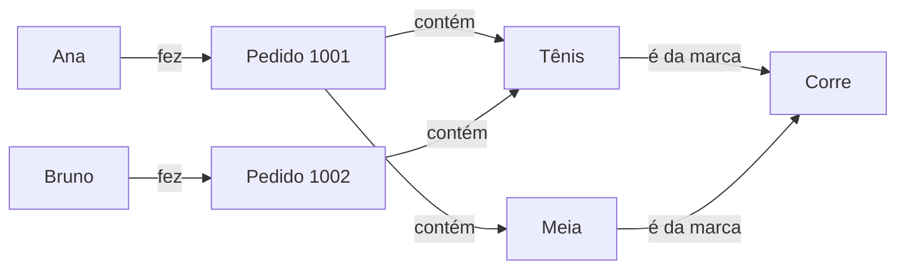
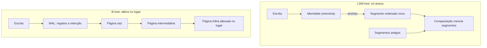
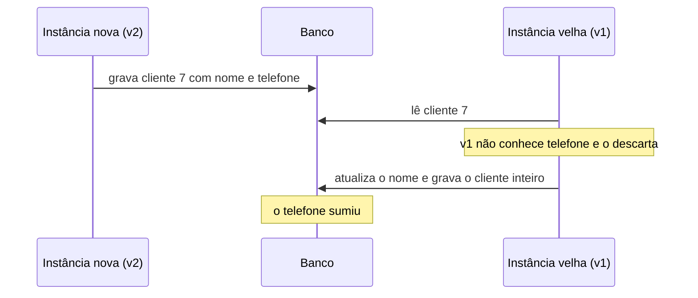

# 5. Dados por dentro

> [!NOTE] Em uma frase
> O banco de dados não é uma caixa-preta onde dados entram e saem: o jeito como ele guarda as coisas decide o que fica rápido, o que fica lento e o que quebra quando o sistema muda.

## Por que isso importa

Na Parte 1 o banco da Lojinha foi tratado como "detalhe", e com razão: a regra de negócio não deve depender dele. Mas detalhe não quer dizer irrelevante. A Lojinha agora tem dez mil produtos, alguns milhares de pedidos por dia, e começam as perguntas que o código sozinho não responde. Por que a página do pedido demora três segundos para alguns clientes e é instantânea para outros? Por que o relatório de vendas do mês deixa o site lento quando roda? Por que o deploy de terça apagou o telefone de alguns clientes?

Quase todo sistema que você vai construir é **intensivo em dados**: o gargalo não é calcular, é guardar, buscar e mover dados que crescem e mudam. Você raramente vai escrever um banco, mas vai escolher qual usar, quais índices criar, qual formato mandar pela rede. Sem saber o que acontece embaixo, essas escolhas viram superstição. Este módulo abre a Parte 2 olhando para dentro de uma máquina só; o [módulo 6](06-quando-uma-maquina-nao-basta.md) trata de quando ela não basta.

## O que você precisa saber antes

- Já ter usado um banco em alguma aplicação (`SELECT`, `INSERT`) e já ter visto um JSON.
- Do [módulo 4](04-decisoes-de-arquitetura.md): a ideia de características arquiteturais, as "qualidades" que um sistema precisa ter além de funcionar. Aqui elas ganham números.

## Três metas: continuar certo, continuar rápido, continuar mudável

Antes de escolher qualquer tecnologia, vale combinar o que "funcionar bem" quer dizer. Três metas cobrem quase tudo.

### Confiabilidade

Um sistema é **confiável** quando continua fazendo o que o usuário espera mesmo quando algo dá errado. Aqui ajuda separar duas palavras que no dia a dia viram sinônimos:

- **Falha de componente**: uma peça sai do esperado. Um disco morre, um processo trava, alguém roda o comando no servidor errado.
- **Falha do sistema**: o usuário deixa de ser atendido.

Zerar falhas de componente é impossível. O objetivo é que elas não virem falhas do sistema, e a isso se chama **tolerância a falhas**. As falhas vêm de três lugares, cada um com defesa diferente:

| Fonte | Exemplo na Lojinha | Por que é traiçoeira | Defesa |
|---|---|---|---|
| Hardware | O disco do servidor do banco morre | Com muitas máquinas, algum disco morre toda semana | Redundância, software que tolera perder uma máquina inteira |
| Software | Um bug no cálculo de frete trava todo pedido com CEP de outro país | O mesmo bug está em todas as máquinas e dispara em todas ao mesmo tempo | Testes, isolamento, deixar o processo cair e reiniciar, monitorar |
| Humano | Alguém muda a configuração de produção achando que era a de teste | É a causa mais comum de indisponibilidade em grandes serviços | Ambientes de teste parecidos com produção, rollback rápido, liberação gradual, [observabilidade](../glossario.md#observabilidade) |

Repare que redundância de disco não protege contra bug nem contra configuração errada. Confiabilidade é sobre as três fontes.

### Escalabilidade

"O sistema é escalável" sozinho não diz nada. A pergunta útil é: **se a carga crescer de tal jeito, o que fazemos?** Para responder, primeiro se descreve a carga com **parâmetros de carga**, os números que importam para aquele sistema.

Para a Lojinha, "pedidos por dia" é o parâmetro óbvio, mas talvez não o decisivo. Pense no "avise-me quando voltar ao estoque": um produto comum tem dez interessados; o tênis da promoção, duzentos mil. Avisar todos no momento em que o estoque muda (trabalho na escrita) é ótimo para o primeiro e péssimo para o segundo. O que decide é a **distribuição** de interessados por produto, não o total. A timeline de redes sociais foi resolvida com o mesmo raciocínio: copiar o post para cada seguidor na escrita, exceto para contas com milhões de seguidores, que são buscadas na leitura.

Com a carga descrita, há dois jeitos clássicos de crescer: **escalar verticalmente** (uma máquina maior) e **escalar horizontalmente** (mais máquinas). O módulo 6 trata do segundo.

### Manutenibilidade

A maior parte do custo de um software vem depois do lançamento: corrigir, operar, adaptar. Três princípios ajudam:

- **Operabilidade**: quem mantém o sistema no ar consegue ver o que acontece e agir.
- **Simplicidade**: sem **complexidade acidental**, a que vem da implementação e não do problema. O SQL é uma boa abstração: esconde como os dados estão no disco.
- **Evolutibilidade**: mudar é barato, a preocupação do módulo 1 aplicada aos dados.

## Medindo desempenho: percentis, não médias

Com a carga descrita, mede-se o desempenho. Num serviço online o número que importa costuma ser a **latência**, o tempo entre o pedido e a resposta (veja [latência e throughput](../glossario.md#latência-e-throughput)). E latência não é um número, é uma distribuição: a mesma consulta demora 20 ms numa vez e 900 ms na outra, por causa de uma pausa de coleta de lixo, um pacote perdido, um disco ocupado.

A média esconde quem está sofrendo. Suponha dez requisições à página do pedido, com estes tempos em milissegundos:

```
40, 42, 45, 45, 50, 52, 55, 60, 70, 2500
```

A média é 296 ms, número que não descreve ninguém: nove pessoas foram atendidas em menos de 70 ms e uma esperou dois segundos e meio. Por isso se usam **percentis**: ordenam-se os tempos, e o percentil N é o valor abaixo do qual estão N% das requisições. O p50 (a mediana) aqui fica em torno de 51 ms; o p90, em 70 ms; o p99, com mais dados, mostraria o caso de 2,5 s. Veja [p50, p99](../glossario.md#p50-p99-percentis-de-latência).

Dois detalhes que mudam decisões:

- **Os percentis altos importam mais do que parecem.** Na Lojinha, quem demora mais costuma ser o cliente com histórico grande, ou seja, quem mais compra.
- **Amplificação de cauda.** Se a página do pedido chama cinco serviços (estoque, frete, pagamento, recomendações, cupons) e espera todos, basta um estar lento para a página ficar lenta. Quanto mais chamadas por página, mais provável que o usuário caia na cauda lenta de alguma.

Uma meta como "99% das requisições em menos de 300 ms no mês" é um [SLO](../glossario.md#slo). E um cuidado prático: não tire a média dos p99 de várias máquinas, isso não dá o p99 do sistema. Junte os dados brutos (ou histogramas) e calcule o percentil sobre o total.

## Modelos de dados: o mesmo dado de três jeitos

O **modelo de dados** é a forma em que você organiza os dados para o banco: tabelas, documentos ou grafos. Ele decide quais perguntas são fáceis e quais são penosas. Vamos guardar o mesmo trecho da Lojinha nos três: a cliente Ana fez o pedido 1001 com dois itens, um tênis e uma meia; o tênis é da marca Corre.

### Relacional

Tabelas com colunas fixas, ligadas por identificadores:

```sql
clientes(id, nome)            -- (7, 'Ana')
marcas(id, nome)              -- (3, 'Corre')
produtos(id, nome, marca_id)  -- (50, 'Tênis', 3), (51, 'Meia', 3)
pedidos(id, cliente_id)       -- (1001, 7)
itens(pedido_id, produto_id, qtd)  -- (1001, 50, 1), (1001, 51, 2)
```

O nome "Corre" aparece uma vez só; todos os produtos apontam para ele. Isso é **normalização**: não repetir dados, para que uma mudança seja feita num lugar. Para montar o pedido, o banco junta as tabelas com `JOIN`. O relacional brilha quando muitas coisas apontam para a mesma coisa (muitos produtos para uma marca, muitos pedidos para um cliente).

### Documento

Cada pedido vira uma árvore autocontida, em geral JSON:

```json
{
  "id": 1001,
  "cliente": {"id": 7, "nome": "Ana"},
  "itens": [
    {"produto": "Tênis", "marca": "Corre", "qtd": 1},
    {"produto": "Meia", "marca": "Corre", "qtd": 2}
  ]
}
```

Abrir a tela do pedido é uma leitura só, e o JSON tem o mesmo formato do objeto no código. Isso se chama **localidade**: tudo o que se usa junto está guardado junto. Bancos como MongoDB vivem disso, e PostgreSQL e MySQL também aceitam colunas JSON. O preço aparece quando a marca Corre muda de nome: ela está copiada em milhares de pedidos. E perguntas que cruzam documentos ("quem mais comprou produtos da Corre?") viram trabalho manual no código.

Documento combina com dados em árvore, em que cada pedaço tem um dono só. Os itens de um pedido são um bom exemplo, e lembram o [agregado](../glossario.md#agregado) do módulo 3.

### Grafo

Vértices (as coisas) e arestas (as relações):



O grafo brilha quando a pergunta é sobre caminhos de tamanho variável: "clientes que compraram algo que alguém que comprou este tênis também comprou", ou detectar contas falsas que compartilham cartão, endereço e celular. Em SQL isso exige consultas recursivas longas; numa linguagem de grafo como Cypher (do Neo4j) cabe em poucas linhas.

### Schema na escrita e na leitura

Bancos de documento não são "sem schema"; o schema só fica implícito. No relacional, o banco valida cada escrita contra a estrutura declarada (**schema na escrita**, como tipagem estática). No documento, qualquer JSON entra e quem lê interpreta (**schema na leitura**, como tipagem dinâmica), o que ajuda quando os itens são realmente diferentes: um celular tem campos que uma camiseta não tem.

| Modelo | Bom quando | Sofre quando |
|---|---|---|
| Relacional | Muitas referências cruzadas, consultas variadas | Objetos muito aninhados exigem montar várias tabelas |
| Documento | Dados em árvore, lidos inteiros de uma vez | Muitas referências entre documentos |
| Grafo | Tudo se relaciona com tudo, perguntas de caminho | Dados simples e tabulares, onde é exagero |

Na dúvida, relacional continua sendo o padrão sensato: absorveu JSON, busca textual e consultas recursivas.

## Como um banco guarda e acha dados

### O banco mais simples do mundo

Imagine um banco com duas operações. `set(chave, valor)` acrescenta uma linha `chave,valor` no fim de um arquivo. `get(chave)` lê o arquivo inteiro e devolve a última linha com aquela chave. Esse arquivo que só cresce no fim se chama **log**. Escrever é rapidíssimo: anexar no fim é a operação mais barata que um disco faz. Ler é horrível: a cada linha nova, o `get` fica mais lento.

Toda a engenharia de armazenamento é uma série de respostas a esse problema, e todas usam a mesma ideia: o **índice**, uma estrutura extra, derivada dos dados, que ajuda a achar registros sem varrer tudo. A troca é sempre a mesma: **todo índice acelera leituras e deixa escritas mais lentas**, porque cada escrita precisa atualizar o índice também. Por isso o banco não indexa tudo sozinho; você escolhe.

### Índice hash

O índice mais simples para o log é um mapa em memória (um hash, como um `dict` do Python) de cada chave para a posição da sua última versão no arquivo. O `get` consulta o mapa e pula direto para a linha. Para o arquivo não crescer para sempre, ele é quebrado em **segmentos**, e uma **compactação** periódica junta segmentos jogando fora versões velhas. Limites: todas as chaves precisam caber na memória, e buscar intervalos ("produtos com id entre 50 e 90") é ineficiente.

### LSM-tree: ordenar e mesclar

A melhoria seguinte é guardar cada segmento **ordenado por chave**. Com segmentos ordenados, juntar dois deles é rápido (é o passo de "merge" do mergesort), o índice em memória pode guardar só uma chave a cada tanto (o resto está em ordem) e buscas por intervalo ficam naturais.

As escritas chegam fora de ordem, então primeiro vão para uma árvore ordenada em memória (a **memtable**); quando ela enche, é gravada no disco como um segmento ordenado novo. Leituras procuram primeiro na memtable, depois do segmento mais novo para o mais velho. Uma compactação em segundo plano mescla segmentos. Essa estrutura se chama **LSM-tree** (Log-Structured Merge-Tree), usada por RocksDB, Cassandra e pelo índice do Elasticsearch.

### B-tree: páginas fixas, alteradas no lugar

A **B-tree** é o índice padrão de PostgreSQL e MySQL há décadas. Ela divide o disco em **páginas** de tamanho fixo (alguns KB) organizadas em árvore: cada página tem chaves e ponteiros para páginas filhas que cobrem faixas de chaves. Para achar o produto 73, começa-se na raiz, desce-se para a página que cobre "50 a 99", e assim até a folha. Com centenas de filhos por página, três ou quatro níveis cobrem bilhões de linhas.

A diferença essencial: a B-tree **sobrescreve a página no lugar**; a LSM-tree **nunca sobrescreve**, só anexa e compacta. Como uma queda no meio de uma sobrescrita corromperia a árvore, a B-tree registra cada mudança antes num **WAL** (write-ahead log, um log de "o que estou prestes a fazer") e consegue refazer o trabalho depois.



| | LSM-tree | B-tree |
|---|---|---|
| Escrita | Em geral mais rápida: grava em sequência | Reescreve a página inteira para mudar pouco |
| Leitura | Pode olhar vários segmentos | Cada chave em um lugar só, mais previsível |
| Ponto fraco | Se a compactação fica para trás, leituras pioram, sobretudo no p99 | Fragmentação e mais escrita no disco |
| Exemplos | RocksDB, Cassandra | PostgreSQL, MySQL (InnoDB) |

A única resposta honesta para "qual é mais rápido" é testar com a sua carga.

## OLTP, OLAP e por que existe data warehouse

O banco da Lojinha atende o site: "mostre o pedido 1001", "grave este item no carrinho". Muitas consultas pequenas, cada uma tocando poucas linhas por chave. Isso é **OLTP** (online transaction processing, processamento de transações online).

Aí o time comercial pergunta: "qual foi a receita por categoria em cada mês do último ano?". Essa consulta varre milhões de linhas de itens, mas só usa três colunas. Isso é **OLAP** (online analytic processing, processamento analítico). Rodar isso no banco do site faz a varredura disputar disco e memória com os clientes, e o site fica lento justamente na hora do relatório.

A resposta é copiar os dados para um **data warehouse**, um banco separado só para análise, alimentado por **ETL** (extrair da produção, transformar, carregar). Lá os dados costumam ser guardados **por coluna**: cada coluna num arquivo próprio. A consulta da receita lê só `categoria`, `data` e `valor` e ignora o resto; e colunas comprimem muito bem, porque valores parecidos ficam lado a lado. BigQuery, Redshift, ClickHouse e o formato Parquet funcionam assim.

| | OLTP | OLAP |
|---|---|---|
| Quem usa | O cliente, pelo site | O analista, pelo painel |
| Consulta típica | Poucas linhas por chave | Milhões de linhas, poucas colunas |
| Gargalo | Tempo para achar cada registro | Volume de dados lido |
| Armazenamento | Por linha, com B-tree ou LSM | Por coluna, comprimido |

## Mudando o formato dos dados sem quebrar ninguém

### Duas versões ao mesmo tempo

Para gravar em disco ou mandar pela rede, os objetos em memória precisam virar bytes. Isso é **codificação** (ou serialização); o caminho de volta é a decodificação. O problema não é codificar, é que **o formato muda** e versões diferentes do código convivem.

Volte ao telefone perdido da Lojinha. O time adiciona o campo `telefone` ao cliente e faz o deploy. O deploy é **gradual** (rolling upgrade): troca-se uma instância por vez, para o site não sair do ar. Durante dez minutos, metade das instâncias roda o código novo e metade o velho.



Ninguém escreveu um bug no sentido comum: o formato não estava pronto para duas versões juntas. Duas propriedades dão nome ao problema:

- **Compatibilidade para trás** (backward): código novo lê dados escritos por código velho. Costuma ser fácil, porque quem escreve o código novo conhece o formato velho.
- **Compatibilidade para frente** (forward): código velho lê dados escritos por código novo. É mais difícil, porque exige que o código velho ignore com cuidado o que não conhece, e **preserve** esses campos ao regravar.

O caso do telefone é uma falha para frente. A correção é o código ler o registro preservando campos desconhecidos (ou atualizar só a coluna que mudou, em vez de regravar o objeto inteiro).

### As regras de um deploy seguro

Formatos binários com schema, como **Protocol Buffers** (do Google) e **Avro**, transformam essas regras em contrato. No Protobuf, cada campo tem um número fixo (tag), e os bytes guardam só a tag e o valor:

```
message Cliente {
  string nome = 1;
  string telefone = 2;
}
```

As regras que saem disso valem para qualquer formato, JSON incluído:

1. **Campo novo sempre opcional ou com valor padrão.** Se for obrigatório, o código novo não consegue ler os dados antigos, que não têm o campo.
2. **Código velho ignora campo desconhecido, e o preserva.** É o que torna a compatibilidade para frente possível.
3. **Nunca reaproveite o número ou o nome de um campo removido.** Dados antigos com aquele campo seriam lidos como o campo novo, com tipo e significado errados.
4. **Renomear e mudar tipo são remoção mais adição.** Faça em etapas.

O Avro chega ao mesmo lugar sem tags: o leitor compara o schema de quem escreveu com o seu, pelo nome dos campos. Em sistemas de mensagens, um **registro de schemas** (schema registry, um serviço que guarda as versões do formato) pode recusar, na publicação, um schema que quebraria os consumidores.

### Dados vivem mais que código

Um deploy troca o código em minutos, mas linhas gravadas há anos continuam no formato antigo: o código de hoje lê dados de 2019, então compatibilidade para trás no banco é obrigatória. Em mensagens e APIs valem as duas direções, porque produtor e consumidor são atualizados em momentos diferentes (o app de um cliente pode ficar meses sem atualizar).

## Na prática

- **Ao dizer "precisa escalar", escreva o número.** Qual parâmetro de carga, qual valor hoje, qual valor esperado. "Escala em relação a quê?" é a primeira pergunta.
- **Monitore p50, p95 e p99, não a média.** Se o p99 sobe e a média não, alguém está sofrendo e o painel está mentindo.
- **Escolha o modelo de dados pelo formato das relações.** Desenhe as entidades e as setas antes de escolher o banco. Muitas setas cruzadas pedem relacional; árvores isoladas aceitam documento.
- **Antes de criar um índice, pergunte que consulta ele acelera.** E antes de manter um, pergunte se alguém ainda usa: cada índice cobra em toda escrita.
- **Em todo PR que muda formato de dados, pergunte: o que acontece com a versão N e a N+1 rodando juntas?** E com o dado de dois anos atrás?

## Armadilhas comuns

- **"NoSQL não tem schema."** Tem, só não é imposto pelo banco; está espalhado pelo código que lê. Documente e versione o formato, porque cada leitor precisa lidar com todas as versões antigas.
- **"Mais índices, mais rápido."** Só para leitura. Cada índice ocupa espaço e deixa todo `INSERT` e `UPDATE` mais lento.
- **Olhar só a média de latência.** Média de 100 ms convive com p99 de 5 s. E média de p99 de várias máquinas não é o p99 do sistema.
- **Testar a mudança de formato só com todo mundo na mesma versão.** O problema aparece durante o deploy gradual e nos dados antigos, não no ambiente de teste limpo.
- **Tornar obrigatório um campo novo.** A leitura de qualquer dado antigo passa a falhar no dia do deploy.

## Verifique se entendeu

1. Dê um exemplo de falha de software e um de falha humana na Lojinha. Por que redundância de disco não protege contra nenhum dos dois?
2. Uma página tem latência média de 120 ms e p99 de 4 s. O que isso diz sobre os usuários? Por que a página que chama cinco serviços sofre mais com isso?
3. Por que a lista de itens de um pedido combina com documento e a marca do produto combina com relacional?
4. Explique, com suas palavras, por que todo índice deixa a escrita mais lenta, e qual a diferença essencial entre como uma B-tree e uma LSM-tree gravam uma alteração.
5. Por que rodar o relatório de receita mensal no banco do site é má ideia, e o que o armazenamento por coluna resolve?
6. No caso do telefone perdido, qual compatibilidade faltou? Que regra você seguiria para adicionar um campo `cpf` sem repetir o problema?

## Quer ir mais fundo?

> [!TIP] Opcional
> Nada aqui é obrigatório. O módulo foi escrito para se bastar.

- [DDIA, capítulo 1: confiável, escalável, sustentável](../system-design/ddia/01-confiavel-escalavel-sustentavel.md): o caso da timeline de rede social em detalhe e mais sobre percentis e amplificação de cauda.
- [DDIA, capítulo 2: modelos de dados e linguagens de consulta](../system-design/ddia/02-modelos-de-dados-e-linguagens-de-consulta.md): a história do modelo relacional, linguagens declarativas e os dois sabores de banco de grafo.
- [DDIA, capítulo 3: armazenamento e recuperação](../system-design/ddia/03-armazenamento-e-recuperacao.md): filtros de Bloom, índices de cobertura, esquema estrela e compressão de colunas.
- [DDIA, capítulo 4: codificação e evolução](../system-design/ddia/04-codificacao-e-evolucao.md): Protobuf, Thrift e Avro lado a lado, e a crítica ao RPC.
- Livro original: *Designing Data-Intensive Applications*, de Martin Kleppmann.

---
Anterior: [4. Decisões de arquitetura](04-decisoes-de-arquitetura.md) · Próximo: [6. Quando uma máquina não basta](06-quando-uma-maquina-nao-basta.md) · Voltar ao [início do guia](index.md)
