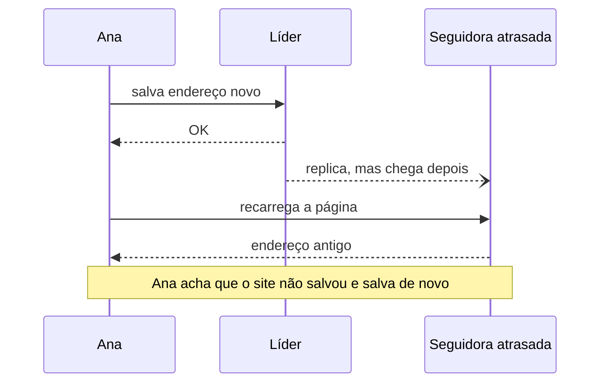
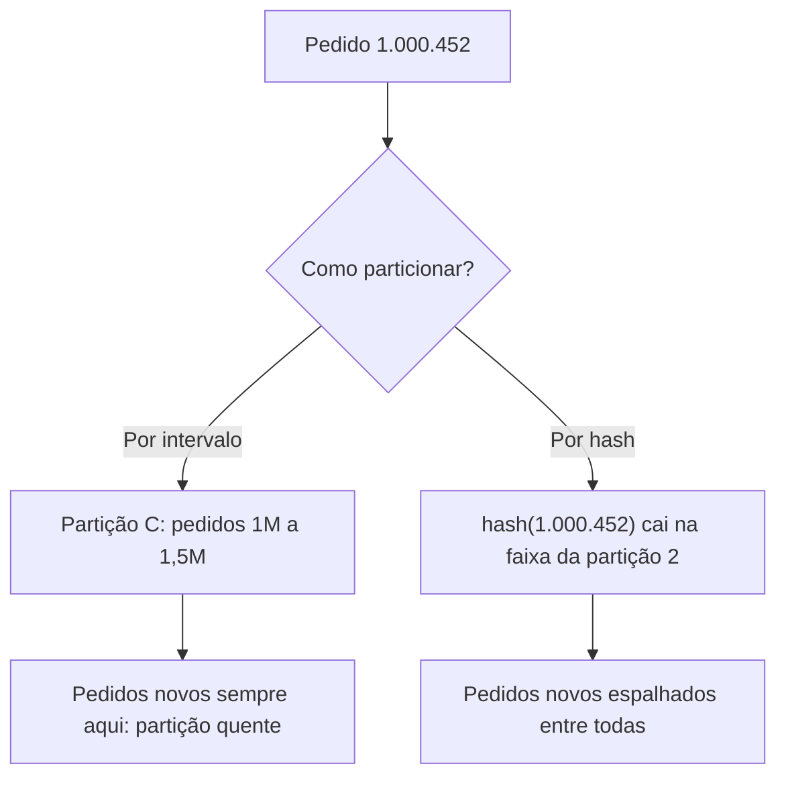
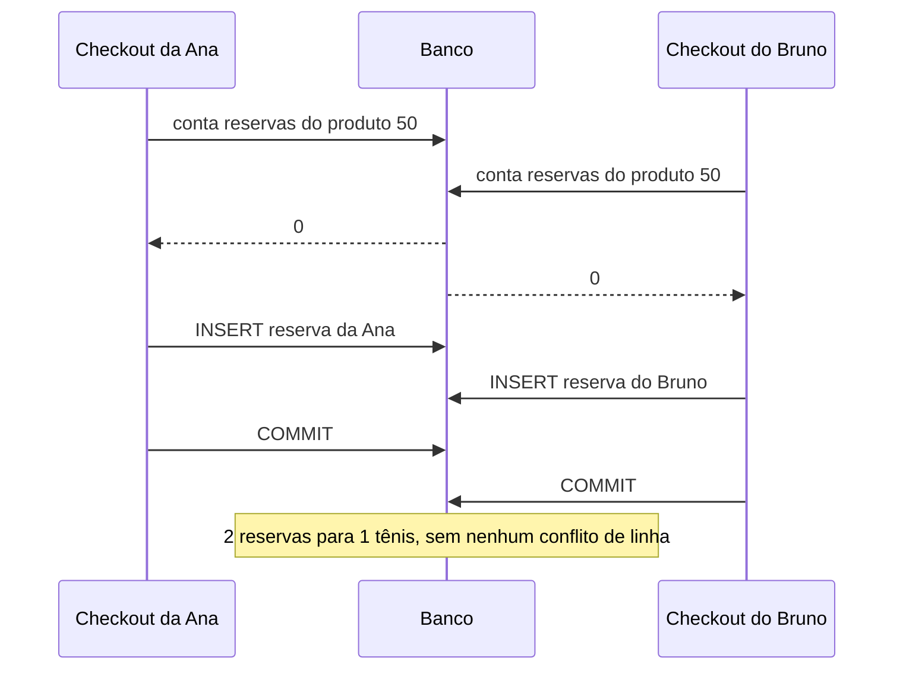

# 6. Quando uma máquina não basta

> [!NOTE] Em uma frase
> Para crescer, você copia os dados (replicação) e os divide (particionamento), e cada cópia e cada divisão abre um jeito novo de o usuário ver algo errado; transações são a ferramenta para manter os dados corretos quando muita coisa acontece ao mesmo tempo.

## Por que isso importa

A Lojinha deu certo. Na Black Friday, o único servidor de banco chega a 100% de CPU às 20h, o site trava, e no mesmo mês o disco desse servidor dá sinais de falha. Duas perguntas aparecem de uma vez: "e se essa máquina morrer?" e "e se nem a maior máquina que dá para comprar aguentar?".

As respostas clássicas são duas, e quase sempre andam juntas. **Replicação** é manter cópias dos mesmos dados em várias máquinas: se uma morre, outra assume; e leituras se espalham entre as cópias. **Particionamento** é dividir os dados em pedaços, cada um numa máquina: nenhuma precisa guardar ou servir tudo. Uma loja grande tem cada partição replicada em três máquinas, por exemplo.

Só que, assim que existem várias máquinas, aparecem problemas que não existiam com uma. O cliente salva o endereço e, ao recarregar, vê o endereço antigo. Dois clientes compram o último tênis do estoque e os dois recebem "pedido confirmado". Este módulo explica de onde vêm esses problemas e como cada técnica lida com eles.

## O que você precisa saber antes

- Do [módulo 5](05-dados-por-dentro.md): o que é um log, um índice, e a diferença entre latência média e percentis.
- Saber o que é uma transação num banco (`BEGIN`, `COMMIT`), mesmo que vagamente. A seção de transações explica de novo.

## Replicação: copiar os dados

[Replicação](../glossario.md#replicação) serve a três objetivos: tolerar a perda de uma máquina, servir mais leituras e deixar uma cópia perto do usuário (outra região, outro continente). Se os dados nunca mudassem, bastaria copiar uma vez. Toda a dificuldade está nas **escritas**: como fazer cada mudança chegar a todas as cópias? Há três famílias de resposta.

### Líder único

Uma das réplicas é eleita **líder**. Toda escrita vai para ela; ela grava e repassa a mudança, em ordem, para as **seguidoras**. Leituras podem ir a qualquer réplica. É o modelo padrão de PostgreSQL e MySQL, e é o que a Lojinha usaria primeiro: um banco principal e duas réplicas de leitura.

Uma escolha importante é se o líder espera a seguidora antes de responder "OK" ao cliente:

- **Síncrona**: espera. A cópia está garantida, mas se a seguidora travar, as escritas travam junto.
- **Assíncrona**: não espera. É rápida, mas se o líder morrer antes de repassar, escritas já confirmadas ao cliente se perdem.

O meio-termo comum é ter uma seguidora síncrona e o resto assíncrono.

Quando o líder morre, acontece o **failover**: detectar a falha (em geral, "não responde há X segundos"), promover a seguidora mais atualizada e redirecionar os clientes. Cada passo tem armadilha. Um timeout curto demais promove uma nova líder só porque a antiga estava lenta. Duas máquinas podem se achar líderes ao mesmo tempo (**split brain**) e aceitar escritas conflitantes. E, na replicação assíncrona, o que a líder antiga não repassou se perde.

### Múltiplos líderes

Às vezes se aceita escrita em mais de um lugar: um líder em cada região, para o cliente do Japão não esperar a ida e volta até o Brasil; ou um app que funciona offline, em que cada celular é um "líder" que sincroniza depois. O ganho é latência e resistência à queda de uma região inteira.

O preço são os **conflitos de escrita**. O gerente da Lojinha em São Paulo muda o preço do tênis para R$ 300; ao mesmo tempo, o de Lisboa muda para R$ 280. Os dois recebem "OK". Quem vence? As saídas são evitar o conflito (todas as escritas de um mesmo produto vão sempre ao mesmo líder), "a última escrita vence" pelo relógio (simples, e perde a outra escrita sem avisar) ou guardar as duas versões e deixar alguém resolver. É uma família que se evita quando dá.

### Sem líder

O terceiro modelo, popularizado pelo Dynamo da Amazon e usado pelo Cassandra, não tem líder. O cliente manda a escrita para várias réplicas ao mesmo tempo e também lê de várias. Com **n** réplicas, exige-se **w** confirmações na escrita e **r** respostas na leitura. Se **w + r > n**, todo grupo de leitura cruza com todo grupo de escrita, e ao menos uma réplica lida tem o valor mais novo. É o **quórum**; um ajuste típico é n = 3, w = 2, r = 2. Réplicas atrasadas se corrigem quando uma leitura percebe a diferença ou por um processo de fundo que compara cópias. Em casos de borda (escritas simultâneas, falhas parciais), nem o quórum garante ler o valor mais recente.

| | Líder único | Múltiplos líderes | Sem líder |
|---|---|---|---|
| Onde se escreve | Só no líder | Em qualquer líder | Em várias réplicas por escrita |
| Ponto forte | Simples, sem conflito | Escrita local em cada região, funciona offline | Sem failover; tolera réplicas lentas |
| Ponto fraco | Failover delicado; líder é gargalo de escrita | Conflitos de escrita | Garantias de leitura fracas em casos de borda |

### O atraso de replicação e o que o usuário vê

Com replicação assíncrona, uma seguidora pode estar alguns milissegundos, ou minutos sob carga, atrás do líder. Isso é o **atraso de replicação** (replication lag). Se as escritas pararem, as cópias convergem: é a [consistência eventual](../glossario.md#consistência-forte-e-eventual). O problema é o "por enquanto", que aparece para o usuário em três formas.

**"Não vejo o que acabei de escrever."** A Ana troca o endereço de entrega, a página recarrega lendo de uma seguidora atrasada, e o endereço antigo está lá.



A correção é a garantia de **ler as próprias escritas**: ler do líder aquilo que o próprio usuário pode ter mudado (o perfil dele, o carrinho dele), ou lembrar quando foi a última escrita do usuário e só ler de réplicas que já passaram desse ponto.

**"Apareceu e sumiu."** A Ana recarrega a lista de pedidos duas vezes; a primeira leitura cai numa réplica em dia e mostra o pedido novo; a segunda cai numa atrasada e o pedido some. A garantia que falta se chama **leituras monotônicas** (o tempo não anda para trás). A correção comum é fixar cada usuário numa mesma réplica.

**"A resposta antes da pergunta."** No chat de atendimento, a resposta do atendente aparece antes da pergunta do cliente, porque as duas vieram por caminhos com atrasos diferentes. A garantia é o **prefixo consistente**: quem lê vê as escritas na ordem em que aconteceram.

Nenhuma dessas é exótica. Mandar leituras para réplicas é uma das primeiras otimizações que um time faz, e "salvei e não apareceu" é o primeiro bug que encontra.

## Particionamento: dividir os dados

Replicação não resolve um problema: se os dados ou as escritas não cabem numa máquina, copiar não ajuda, porque cada cópia tem tudo. É aí que entra o [particionamento](../glossario.md#particionamento-sharding) (também chamado de sharding): cada registro pertence a exatamente uma partição, e cada partição fica numa máquina (replicada, em geral). O objetivo é espalhar dados e carga por igual. Se uma partição recebe muito mais trabalho que as outras, ela vira uma **partição quente**, e o sistema fica tão rápido quanto essa máquina.

### Por intervalo de chave ou por hash

**Por intervalo.** Cada partição fica com uma faixa contínua de chaves, como os volumes de uma enciclopédia: pedidos de 1 a 1 milhão na partição A, de 1 milhão a 2 milhões na B. Buscar uma faixa é fácil, porque as chaves vizinhas estão juntas. O risco: se a chave cresce com o tempo (id sequencial, data), **todas as escritas novas caem na última partição**. Na Black Friday, a partição "pedidos de hoje" pega fogo e as outras ficam paradas.

**Por hash.** Aplica-se uma função de hash à chave, que devolve um número que parece aleatório, e cada partição fica com uma faixa de hashes. Chaves vizinhas caem em lugares distantes, e a carga se espalha. O preço: perde-se a ordem, e "pedidos de 1 a 1.000" precisa perguntar a todas as partições.



Hash não resolve tudo. Se **uma única chave** é muito acessada, como o tênis da promoção que todos estão olhando, todas as requisições para ela vão à mesma partição, qualquer que seja a estratégia. A saída costuma ser específica da aplicação: um [cache](../glossario.md#cache) na frente para leituras, ou dividir o contador desse produto em vários pedaços e somar na leitura.

### Índices secundários

Achar o pedido 1.000.452 é fácil: a chave diz a partição. Mas "todos os pedidos da cliente Ana" ou "todos os produtos vermelhos"? O campo pesquisado não determina a partição. Há duas saídas:

- **Índice local**: cada partição indexa só os próprios dados. Escrever é barato (tudo numa partição), mas a busca por cor precisa perguntar a **todas** as partições e juntar os resultados (o padrão "espalhar e reunir"), e fica tão lenta quanto a partição mais lenta.
- **Índice global**: um índice único para todos os dados, ele mesmo particionado pelo valor buscado (cores de A a M numa máquina, de N a Z em outra). A busca vai a um lugar só, mas uma escrita pode precisar atualizar índices em outras máquinas. Por isso esses índices costumam ser atualizados com atraso: o produto acabou de ficar vermelho e ainda não aparece na busca.

### Rebalanceamento

A carga cresce, máquinas entram e saem, e partições precisam mudar de lugar. Isso é **rebalancear**, e o objetivo é mover só o necessário, sem parar o sistema.

O erro clássico é `partição = hash(chave) % número_de_máquinas`. Funciona até o dia em que se adiciona uma máquina: com 10 máquinas, a chave 42 vai para a máquina 2; com 11, para a 9. Quase toda chave muda de lugar, e o sistema precisa mover quase tudo. A alternativa comum é criar **muito mais partições que máquinas** (1.000 partições para 10 máquinas) e mover partições inteiras: quando entra uma máquina nova, ela pega algumas partições de cada vizinha, e nenhuma chave muda de partição.

Com as partições mudando de lugar, alguém precisa saber onde está cada uma. Em geral um serviço de coordenação guarda esse mapa, e clientes ou uma camada de roteamento o consultam. Um cuidado operacional: rebalanceamento automático com detecção automática de falha pode piorar um incidente. Uma máquina lenta é declarada morta, o sistema começa a mover dados dela, a rede e as outras máquinas ficam sobrecarregadas, e outra máquina parece morta. Muitos times preferem um humano aprovando o rebalanceamento.

## Transações: manter os dados corretos

Copiar e dividir resolve volume. Não resolve outra coisa: muitos pedidos chegando ao mesmo tempo, mexendo nos mesmos dados, com máquinas que podem cair no meio. A **transação** é um grupo de leituras e escritas que o banco trata como uma unidade.

### ACID, de novo e de verdade

[ACID](../glossario.md#acid) é a sigla das quatro garantias de uma transação, e cada letra promete menos (ou outra coisa) do que parece:

- **Atomicidade: tudo ou nada.** O checkout da Lojinha baixa o estoque, cria o pedido e registra o pagamento. Se o processo cai depois do segundo passo, o banco desfaz os dois primeiros. Não tem a ver com concorrência; tem a ver com poder abortar e tentar de novo sem deixar lixo pela metade.
- **Consistência: as regras continuam valendo.** Estoque nunca negativo, todo item aponta para um pedido que existe. Quem define essas regras é a aplicação; o banco só ajuda a cobrar as que você declarar (chaves estrangeiras, `CHECK`). E não confunda com a "consistência" da replicação, que é outra ideia com o mesmo nome.
- **Isolamento: transações simultâneas não se atrapalham.** O ideal é a **serializabilidade**: o resultado é o mesmo que se as transações tivessem rodado uma depois da outra. Na prática, quase todo banco usa por padrão algo mais fraco, por desempenho. É aqui que moram os bugs.
- **Durabilidade: confirmado não se perde.** Gravado em disco e, em bancos replicados, copiado para outras máquinas. Nenhuma durabilidade é absoluta, só muito provável.

Uma armadilha da atomicidade: repetir uma transação que "falhou" nem sempre é seguro. Se ela foi confirmada e só a resposta se perdeu na rede, repetir cobra o cliente duas vezes.

### Os níveis de isolamento e o que cada um deixa passar

Cada nível de isolamento é uma lista do que ele impede. O jeito mais útil de aprender é pelas anomalias, os erros concretos que aparecem quando duas transações rodam juntas.

**Leitura suja.** A transação A baixa o estoque do tênis de 5 para 4, mas ainda não confirmou. A transação B lê 4 e mostra na vitrine. A aborta, o estoque volta a 5, e B mostrou um número que nunca existiu. O nível **read committed** (padrão do PostgreSQL) impede isso: só se lê o que já foi confirmado.

**Leitura inconsistente entre momentos** (read skew). Um relatório soma o estoque de todos os depósitos enquanto uma transferência move 10 tênis do depósito 1 para o 2. O relatório leu o depósito 1 antes da transferência e o 2 depois, e contou 10 tênis a mais. O **snapshot isolation** impede: cada transação lê uma "foto" do banco no instante em que começou, mesmo que outras mudem dados depois. O banco faz isso guardando várias versões de cada linha (técnica chamada MVCC, controle de concorrência por múltiplas versões). No PostgreSQL e no MySQL, esse nível se chama `REPEATABLE READ`.

**Atualização perdida** (lost update). Resta um tênis. O código do checkout faz ler-calcular-gravar:

```python
estoque = db.query("SELECT qtd FROM estoque WHERE produto = 50")  # lê 1
if estoque >= 1:
    db.execute("UPDATE estoque SET qtd = ? WHERE produto = 50", estoque - 1)
    criar_pedido()
```

Dois clientes clicam ao mesmo tempo. As duas transações leem 1, as duas gravam 0, as duas criam pedido. O estoque diz 0, mas foram vendidos dois tênis. A segunda escrita apagou a primeira. A correção mais simples é deixar o banco fazer a conta numa operação só e checar se ela pegou alguma linha:

```sql
UPDATE estoque SET qtd = qtd - 1 WHERE produto = 50 AND qtd >= 1;
-- 0 linhas afetadas = acabou o estoque
```

Outras saídas são travar a linha ao ler (`SELECT ... FOR UPDATE`) ou deixar o banco detectar o conflito, coisa que alguns fazem no nível snapshot e outros não.

**Write skew.** Agora a Lojinha mudou o modelo: em vez de um contador, cada venda grava uma linha em `reservas`, e o checkout confere se ainda cabe:

```sql
SELECT count(*) FROM reservas WHERE produto = 50;   -- estoque total é 1
-- se o resultado for menor que 1:
INSERT INTO reservas (produto, cliente) VALUES (50, :cliente);
```

Duas transações, em snapshot isolation:



As duas escreveram em linhas **diferentes**, então não há o que o banco reconheça como conflito; cada uma, sozinha, estava correta. Isso é **write skew**: duas transações leem o mesmo dado, decidem com base nele e escrevem coisas diferentes que, juntas, quebram a regra. O padrão é sempre ler, conferir uma condição, escrever algo que muda a condição. Aparece também em "nome de usuário único", "reserva de horário" e "pelo menos um plantonista".

O que torna o write skew traiçoeiro é que a linha que daria conflito **ainda não existe**: não dá para travar a reserva que alguém está prestes a criar. Esse "dado que aparece no meio" se chama **fantasma** (phantom). As correções:

- Usar o nível **serializable**, que pega esse caso. No PostgreSQL ele é otimista: deixa as transações rodarem e, no commit, aborta uma delas se percebe que a premissa lida mudou. A aplicação precisa estar pronta para tentar de novo.
- Criar algo concreto para travar: travar a linha do produto com `SELECT ... FOR UPDATE` antes de contar as reservas, de modo que o segundo checkout espere o primeiro.
- Quando der, transformar a regra em restrição do banco (uma restrição de unicidade, um `CHECK`).

| Nível | Leitura suja | Read skew | Atualização perdida | Write skew |
|---|---|---|---|---|
| Read committed | Impede | Permite | Permite | Permite |
| Snapshot (repeatable read) | Impede | Impede | Depende do banco | Permite |
| Serializable | Impede | Impede | Impede | Impede |

Por que não usar sempre serializable? Porque custa: mais transações abortadas sob disputa, ou mais espera por travas, dependendo de como o banco implementa. Por isso o padrão costuma ser read committed, e a responsabilidade de saber quando ele não basta é de quem escreve o código.

## Na prática

- **Ao mandar leituras para réplicas, pergunte: o usuário pode ter acabado de escrever isso?** Se sim (carrinho, perfil, pedido recém-criado), leia do líder.
- **Desconfie de toda chave de partição que cresce com o tempo.** Data, id sequencial e timestamp concentram as escritas novas numa partição só.
- **Antes de particionar, liste as consultas que não usam a chave.** Cada uma vira "pergunte a todas as partições" ou um índice global com atraso.
- **Procure no código o padrão ler, conferir, gravar.** Estoque, saldo, cupom de uso único, nome único: cada um é candidato a atualização perdida ou write skew.
- **Saiba qual nível de isolamento seu banco usa por padrão.** Na maioria, não é serializable.
- **Teste a concorrência de propósito.** Dois cliques simultâneos no mesmo botão revelam mais bugs que cem testes sequenciais.

## Armadilhas comuns

- **"Tenho transação, então não tenho problema de concorrência."** Transação no nível padrão impede leitura suja e quase nada mais. Atualização perdida e write skew passam por ela.
- **"Réplica é backup."** Uma réplica copia também o `DELETE` errado, na hora. Backup é uma cópia de um momento anterior, guardada à parte.
- **"Particionar por hash resolve partição quente."** Resolve a concentração por faixa de chaves, não a chave única muito acessada.
- **"Consistência em ACID é a mesma da replicação."** Em ACID, é respeitar as regras do negócio; em replicação, é se todas as cópias mostram o mesmo valor. Mesma palavra, ideias diferentes.
- **Repetir uma transação sem pensar se ela já foi aplicada.** Se a resposta se perdeu depois do commit, repetir duplica o efeito.

## Verifique se entendeu

1. Por que replicação sozinha não resolve um volume de escritas maior do que uma máquina aguenta, e o que o particionamento muda nisso?
2. A Ana troca o endereço e, ao recarregar, vê o antigo. Explique o que aconteceu e duas formas de evitar.
3. Por que particionar pedidos por data de criação é uma escolha arriscada? O que muda se a partição for escolhida pelo hash do id do pedido?
4. Qual a diferença entre atualização perdida e write skew no caso do último tênis? Por que snapshot isolation não pega o write skew?
5. Por que `hash(chave) % número_de_máquinas` é uma má escolha quando o número de máquinas muda?
6. Cite uma regra de negócio de um sistema que você conhece que segue o padrão "ler, conferir, gravar". Como você a protegeria?

## Quer ir mais fundo?

> [!TIP] Opcional
> Nada aqui é obrigatório. O módulo foi escrito para se bastar.

- [DDIA, capítulo 5: replicação](../system-design/ddia/05-replicacao.md): formas de copiar a mudança entre réplicas, failover em detalhe, quóruns e como detectar escritas concorrentes.
- [DDIA, capítulo 6: particionamento](../system-design/ddia/06-particionamento.md): as três estratégias de rebalanceamento e os desenhos de roteamento de requisições.
- [DDIA, capítulo 7: transações](../system-design/ddia/07-transacoes.md): execução serial, travamento em duas fases e o algoritmo otimista usado pelo nível serializable do PostgreSQL.
- Livro original: *Designing Data-Intensive Applications*, de Martin Kleppmann.

---
Anterior: [5. Dados por dentro](05-dados-por-dentro.md) · Próximo: [7. Sistemas distribuídos falham](07-sistemas-distribuidos-falham.md) · Voltar ao [início do guia](index.md)
