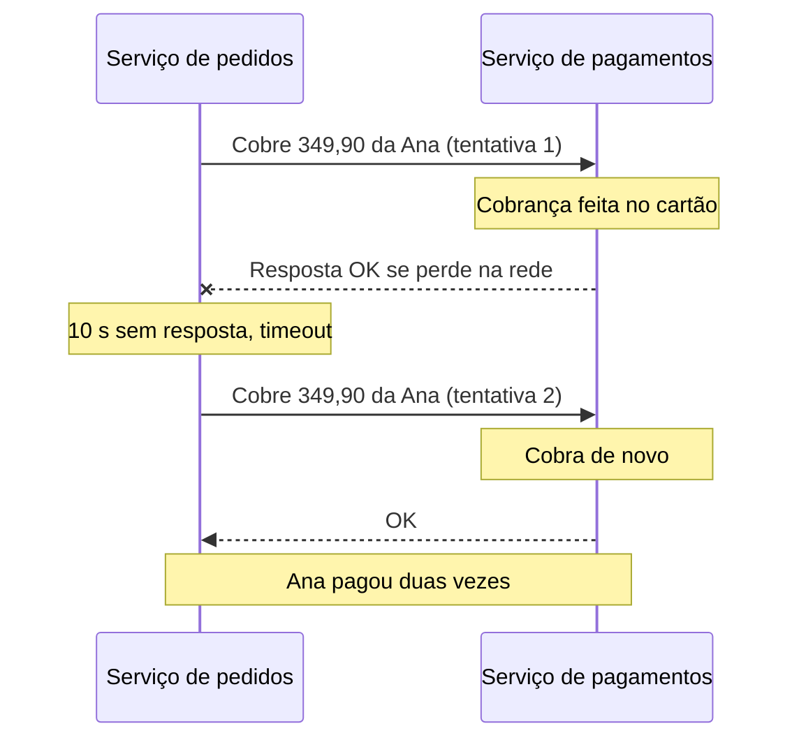
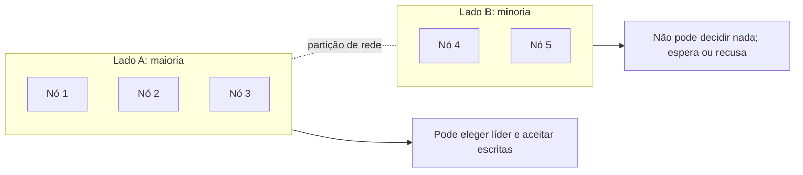
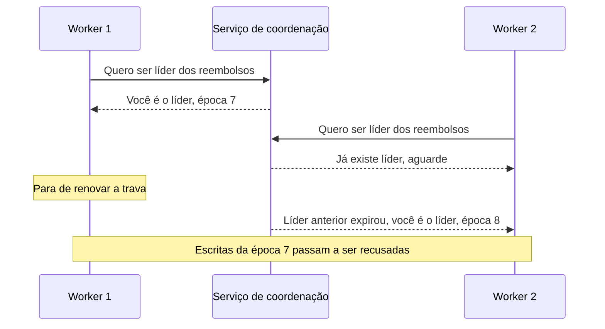

# 7. Sistemas distribuídos falham

> [!NOTE] Em uma frase
> Quando o sistema vive em várias máquinas, partes quebram enquanto outras seguem, ninguém tem certeza do que aconteceu do outro lado, e por isso as decisões importantes precisam ser tomadas por maioria, não por uma máquina sozinha.

## Por que isso importa

No módulo anterior, a Lojinha deixou de caber em uma máquina: o banco ganhou [réplicas](../glossario.md#replicação), os dados foram divididos em partições, e o serviço de pedidos passou a conversar com um serviço de pagamentos separado. Tudo parecia resolvido. Até a primeira Black Friday.

Às 21h03, o serviço de pedidos manda "cobre R$ 349,90 do cartão da Ana" para o serviço de pagamentos. Passam 10 segundos. Nada. O código desiste e mostra "erro no pagamento, tente de novo". A Ana tenta de novo. No dia seguinte, ela reclama: foi cobrada duas vezes. A primeira cobrança tinha dado certo; só a resposta é que se perdeu no caminho de volta.

Ninguém escreveu um bug no sentido clássico. O erro foi uma suposição escondida: "se não respondeu, não fez". Este módulo primeiro mostra o que dá errado entre máquinas (rede, relógios, pausas) e depois as ferramentas para construir algo confiável mesmo assim (maioria, linearizabilidade, ordenação e consenso).

## O que você precisa saber antes

- [Módulo 6](06-quando-uma-maquina-nao-basta.md): replicação com líder e seguidores, failover (trocar o líder quando ele cai) e partições.
- [Módulo 4](04-decisoes-de-arquitetura.md) ajuda: por que um sistema vira vários serviços que se chamam pela rede.

## Falha parcial: uma parte cai, o resto não sabe

Um computador sozinho é projetado para ser previsível: ou funciona, ou trava por inteiro (a famosa tela azul). Isso é de propósito. É melhor parar tudo do que devolver um resultado errado.

Em um sistema distribuído, isto é, um sistema cujas partes rodam em máquinas diferentes que se comunicam pela rede, o normal é o contrário: **algumas partes falham enquanto outras continuam funcionando**. Isso se chama **falha parcial**. O serviço de pagamentos pode estar travado enquanto o de pedidos segue aceitando clientes. Uma réplica do banco pode estar atrasada enquanto as outras estão em dia. E o pior: quem está funcionando muitas vezes **não sabe** que a outra parte caiu.

Um serviço de internet como a Lojinha não pode parar tudo a cada falha de uma máquina (cada máquina do conjunto é chamada de **nó**). Ele precisa de software que **tolere** falhas parciais: um sistema confiável feito de peças não confiáveis. O resto do módulo é sobre como fazer isso.

## A rede não é confiável, e o timeout é ambíguo

A rede dentro de um datacenter é **assíncrona**: uma máquina manda um pacote e a rede não promete nem *quando* ele chega, nem *se* chega. Quando você manda uma requisição e espera a resposta, muita coisa pode acontecer:

1. A requisição se perdeu (um cabo, um switch sobrecarregado).
2. A requisição está parada numa fila e vai chegar mais tarde.
3. O servidor remoto caiu.
4. O servidor remoto está pausado e vai voltar em alguns segundos.
5. O servidor processou tudo, mas a **resposta** se perdeu na volta.
6. A resposta está atrasada numa fila.

Do lado de quem pergunta, os seis casos parecem idênticos: silêncio. A única ferramenta disponível é o **timeout**: um prazo máximo de espera, depois do qual você desiste e considera que algo deu errado. Só que o timeout não diz *o quê* deu errado. Foi exatamente o caso 5 que cobrou a Ana duas vezes:



A lição central: **"não respondeu" significa "não sei", e não "não fez"**. Tentar de novo (retry) é necessário, mas só é seguro se a operação for [idempotente](../glossario.md#idempotência), ou seja, se executá-la duas vezes tiver o mesmo efeito que executar uma. A correção clássica: o serviço de pedidos gera um identificador único para aquela cobrança (`pedido-8812-cobranca`) e manda junto em toda tentativa. O serviço de pagamentos guarda os identificadores já processados e, ao ver um repetido, devolve o resultado anterior em vez de cobrar de novo.

```python
def cobrar(id_cobranca, cartao, valor):
    anterior = cobrancas.buscar(id_cobranca)
    if anterior:
        return anterior
    resultado = gateway.cobrar(cartao, valor)
    cobrancas.salvar(id_cobranca, resultado)
    return resultado
```

(Na vida real, o "buscar e salvar" precisa ser atômico, por exemplo com uma restrição de unicidade no banco; senão duas tentativas simultâneas passam juntas pelo `if`.)

### Quanto tempo esperar?

Escolher o valor do timeout é uma troca sem resposta certa:

| Timeout | Vantagem | Problema |
|---|---|---|
| Longo (30 s) | Raramente declara morto quem está só lento | Clientes esperam muito antes de o sistema reagir a uma falha real |
| Curto (500 ms) | Reage rápido | Máquinas vivas, mas lentas, são declaradas mortas; o trabalho delas vai para outras, que ficam lentas também, e o problema se espalha em cascata |

Por que a demora varia tanto? Por causa de **filas**. Um pacote espera na fila do switch, do sistema operacional, da máquina virtual, do próprio servidor. Em horário de pico, todas as filas crescem juntas. Por isso a boa prática é medir a distribuição real dos tempos de resposta (os [percentis](../glossario.md#p50-p99-percentis-de-latência), como o p99) e escolher o timeout a partir dela, e não de um número redondo.

Quando a rede separa dois grupos de máquinas vivas que deixam de se enxergar, isso se chama **partição de rede**. É raro, mas acontece, e é onde aparecem as escolhas mais difíceis.

## Relógios mentem

Toda máquina tem um relógio feito de um cristal de quartzo, e todo cristal erra um pouco: uns adiantam, outros atrasam, conforme a temperatura. Para corrigir, as máquinas usam o **NTP** (*Network Time Protocol*), que periodicamente consulta servidores de referência e ajusta a hora. O ajuste ajuda, mas não é perfeito: depende da própria rede, que já vimos ser imprevisível.

O sistema operacional oferece dois relógios diferentes, e confundi-los é um erro comum:

- **Relógio de parede** (*wall clock*): responde "que horas são agora?" (por exemplo, `13/10/2026 21:03:17`). Pode **pular para trás** quando o NTP corrige um adiantamento. Serve para mostrar data e hora a um humano ou registrar quando algo aconteceu, de forma aproximada.
- **Relógio monotônico**: um contador que **só anda para frente**. O valor sozinho não significa nada ("4.817.223 segundos desde algum momento"), mas a diferença entre duas leituras mede com confiança quanto tempo passou. É o certo para timeouts e medir duração.

```python
import time

inicio = time.monotonic()
fazer_algo()
duracao = time.monotonic() - inicio
```

Se você usar `time.time()` (relógio de parede) para medir a duração e o NTP ajustar a hora no meio, a duração pode sair negativa ou absurda.

### Por que "o último a escrever vence" perde dados

O uso mais perigoso do relógio de parede é **ordenar eventos de máquinas diferentes**. Uma estratégia popular para resolver conflitos entre réplicas é a "última escrita vence" (*last write wins*): cada escrita leva a hora em que foi feita, e, se duas escritas disputam o mesmo dado, fica a de hora maior.

Imagine o estoque de um produto da Lojinha em duas réplicas. O relógio do nó A está 5 ms adiantado em relação ao nó B.

1. Às 21:03:17.100 (pelo relógio de A), o nó A grava "estoque = 3".
2. Dois milissegundos depois, de verdade, o nó B grava "estoque = 2". Mas o relógio de B marca 21:03:17.097.
3. Na hora de reconciliar, a escrita de B parece *mais antiga* e é descartada.

O estoque fica em 3, e a última venda sumiu. Sem erro, sem log, sem alerta. Por isso a regra prática é: **para ordenar, não confie em horário de máquinas diferentes**. Use números de versão ou os relógios lógicos que aparecem mais adiante.

## Pausas de processo: o programa dorme sem saber

Mesmo com relógio perfeito e rede perfeita, um processo pode **parar por um tempo arbitrário sem perceber**. Causas reais:

- **Coleta de lixo** (*garbage collection*, GC): em linguagens como Java, o runtime às vezes congela todas as threads para liberar memória. Normalmente são milissegundos; em casos ruins, segundos.
- A máquina virtual é pausada e migrada para outro hardware.
- O sistema operacional fica trocando memória com o disco (*swap*).
- O notebook teve a tampa fechada.

Do ponto de vista do processo, ele estava na linha 42 e agora está na 43. Só que o mundo andou 15 segundos.

Isso quebra um padrão muito usado: a **trava com prazo** (*lease*). Digamos que só um worker da Lojinha pode processar a fila de reembolsos por vez. Ele pega uma trava que vale 10 segundos e a renova periodicamente. Ele confere "ainda tenho 5 segundos", começa a trabalhar e sofre uma pausa de GC de 15 segundos. A trava expira, outro worker pega a trava e começa a processar. O primeiro acorda, acha que ainda é o dono e também processa. Dois donos, reembolsos em dobro.

A defesa se chama **fencing token** (algo como "ficha de cerca"): toda vez que a trava é concedida, vem junto um número que sempre cresce (33, depois 34, depois 35). Quem guarda os dados lembra o maior número já visto e recusa qualquer escrita com número menor. O worker que acordou da pausa chega com o token 33, mas o armazenamento já viu o 34, e a escrita é rejeitada. O processo não precisa saber que dormiu; o sistema se protege por ele.

## A verdade é decidida pela maioria

Se um processo pode estar pausado sem saber, e se ele não consegue distinguir "o outro caiu" de "a rede caiu", então **nenhuma máquina pode confiar só no próprio julgamento** para decisões importantes, como "eu sou o líder".

A saída é decidir por **maioria**, também chamada de **quórum**: um grupo de nós vota, e vale o que mais da metade decidir. Se a maioria declarou que um nó está morto, ele deve aceitar isso, mesmo que se sinta perfeitamente vivo. É como uma reunião de condomínio: o que foi votado vale, ainda que um morador ache que não.

Por que maioria, e não "todos" ou "qualquer um"? Porque **duas maiorias do mesmo grupo sempre têm pelo menos um membro em comum**. Com 5 nós, qualquer maioria tem 3; dois grupos de 3 dentro de 5 obrigatoriamente se cruzam. Então é impossível que dois lados de uma partição decidam coisas contraditórias ao mesmo tempo: no máximo um lado tem maioria.



Consequência prática: com 5 nós, o sistema tolera 2 falhas; com 3, tolera 1. Com 4 nós, também só tolera 1 (a maioria de 4 é 3), então número par custa mais e não ganha nada.

Tudo isso supõe que os nós podem cair ou atrasar, mas **não mentem**. Tolerar nós que mandam mensagens falsas (falhas **bizantinas**) é bem mais caro e raramente necessário dentro de uma empresa.

## Linearizabilidade e CAP: o que dá para garantir

Com as ferramentas de maioria em mãos, que promessa um banco distribuído pode fazer? A mais forte, e a mais intuitiva, se chama **linearizabilidade**.

### Linearizabilidade em linguagem simples

Linearizabilidade é a promessa de que o sistema **se comporta como se existisse uma única cópia dos dados**, mesmo tendo várias réplicas. A consequência prática é uma frase só: **depois que alguém viu o valor novo, ninguém mais pode ver o antigo**.

Exemplo na Lojinha: o último exemplar de um tênis é vendido. A Ana atualiza a página e vê "esgotado". Logo depois, o Bruno, ao lado dela, atualiza e vê "1 disponível", porque a requisição dele caiu numa réplica atrasada. Cada réplica, sozinha, está "certa" no sentido de [consistência eventual](../glossario.md#consistência-forte-e-eventual) (vai convergir logo). Mas o comportamento visível é absurdo, e o Bruno pode tentar comprar algo que não existe. Num sistema linearizável, isso não acontece.

Onde você precisa disso de verdade:

- **Eleição de líder e travas**: todos precisam concordar sobre quem é o dono.
- **Unicidade**: dois clientes não podem ficar com o mesmo e-mail de cadastro, nem duas vendas com o último item.

Para o resto (contador de curtidas, lista de "mais vendidos"), um pouco de atraso não machuca, e não vale pagar o preço.

### CAP do jeito certo

O preço aparece no famoso [teorema CAP](../glossario.md#cap). Ele costuma ser ensinado como "escolha 2 entre Consistência, Disponibilidade e tolerância a Partição". Essa versão engana, porque **partições não são opcionais**: a rede vai se partir em algum momento, queira você ou não.

A leitura correta é: **quando a rede se partir, cada réplica isolada tem de escolher entre recusar requisições (preservando a consistência linearizável) ou responder com o que tem (preservando a disponibilidade, mas podendo devolver dado velho)**. No desenho acima, o lado B pode dizer "não posso responder agora" ou "o estoque é 1, pelo que eu sei".

E fora das partições, que é quase sempre? A troca real é outra: **consistência contra latência**. Garantir linearizabilidade exige coordenar réplicas a cada operação, e coordenar pela rede é lento. É por desempenho, mais do que por medo de partição, que a maioria dos sistemas abre mão dela onde pode.

## Ordem, causalidade e consenso

Por trás de todas essas garantias há uma pergunta: **em que ordem as coisas aconteceram?** Se todas as réplicas aplicarem as mesmas escritas na mesma ordem, elas ficam iguais. O problema é concordar sobre essa ordem sem um relógio confiável.

### Causalidade: o que precisa vir antes

Nem toda ordem importa. A que importa de verdade é a **causal**: se B foi feito por alguém que já tinha visto A, então B depende de A e todo mundo deve ver A antes de B. A resposta de um comentário vem depois do comentário. O "pedido cancelado" vem depois do "pedido criado". Dois clientes comprando produtos diferentes ao mesmo tempo, por outro lado, são **concorrentes**: nenhum causou o outro, e tanto faz em que ordem aparecem.

Para registrar causalidade sem relógio de parede, usam-se **relógios lógicos**. O mais simples é o de Lamport: cada nó mantém um contador; cada operação incrementa o contador e leva o número junto; ao receber uma mensagem com número maior que o seu, o nó pula para frente. Assim, se B foi causado por A, o número de B é sempre maior. Não diz que horas eram, mas diz o que veio antes, que era o que precisávamos.

### Consenso: fazer várias máquinas concordarem

**Consenso** é o problema de fazer vários nós decidirem **o mesmo valor, de forma definitiva**, mesmo com alguns caindo no meio. "Quem é o líder agora?" "Quem ficou com a trava?" "Qual é a próxima escrita na ordem?" Tudo isso é consenso.

Há algoritmos conhecidos que resolvem isso, como **Raft** e **Paxos**, além do protocolo interno do **ZooKeeper**. Você quase nunca vai implementá-los; o que vale saber é a ideia: eles funcionam enquanto uma **maioria** dos nós estiver viva e se comunicando, e usam um número de "época" que sempre cresce (o mesmo truque do fencing token) para que um líder antigo, que acordou de uma pausa, não consiga decidir nada.

Na prática, você usa um **serviço de coordenação** pronto, como **ZooKeeper** ou **etcd**, que roda consenso por baixo e oferece operações simples: eleger um líder, pegar uma trava, saber quais nós estão vivos, ser avisado quando algo mudar. Eles guardam pouca coisa (configuração, quem é dono do quê), e muitos sistemas que você usa dependem deles: o Kubernetes guarda todo o estado do cluster no etcd, e é por isso que se recomenda rodá-lo com 3 ou 5 nós.



## Na prática

- **Todo timeout é um "não sei".** Antes de colocar um retry, pergunte: "se a primeira tentativa tiver dado certo, o que acontece?" Se a resposta for "duplica", a operação precisa de um identificador de idempotência.
- **Escolha o relógio pelo uso.** Duração e timeout: relógio monotônico. Mostrar hora ao usuário: relógio de parede. Ordenar eventos entre máquinas: nenhum dos dois; use versões ou a ordem de um log.
- **Desconfie de travas caseiras.** "Uma chave no Redis com expiração" funciona até a primeira pausa longa. Se o efeito de dois donos for grave, use um serviço de coordenação e fencing tokens.
- **Saiba onde você precisa de linearizabilidade.** Normalmente são poucos pontos: unicidade, estoque do último item, liderança. Pague o preço só ali.
- **Clusters de consenso têm número ímpar de nós.** 3 ou 5, nunca 2 ou 4.

## Armadilhas comuns

- **"Deu timeout, então não aconteceu."** Pode ter acontecido. Projete o retry supondo que a primeira tentativa talvez tenha funcionado.
- **"Os servidores usam NTP, então os relógios estão iguais."** Estão parecidos, não iguais. Milissegundos de diferença bastam para a "última escrita vence" descartar a escrita errada.
- **"CAP: escolhi CA."** Não dá para escolher não ter partição. A pergunta é o que fazer quando ela vier, e o que fazer com a latência quando ela não vier.
- **"O processo vai perceber que ficou travado."** Não vai. Qualquer verificação "ainda sou o dono?" pode estar velha no instante em que você age; a proteção precisa estar em quem recebe a escrita.
- **"Mais nós no cluster de consenso, mais seguro."** Até certo ponto. Quatro nós toleram a mesma uma falha que três, e cada nó a mais deixa cada decisão mais lenta.

## Verifique se entendeu

1. Liste três situações diferentes que, para quem fez a requisição, aparecem como o mesmo timeout. Por que isso torna o retry perigoso?
2. A Lojinha mede o tempo de cada requisição com `time.time()`. O que pode dar errado, e qual a troca?
3. Explique, com um exemplo próprio, como a "última escrita vence" com relógio de parede perde um dado sem nenhum erro aparecer.
4. Um worker com trava sofre uma pausa de GC de 20 segundos. Como um fencing token evita o estrago, mesmo que o worker não saiba que pausou?
5. Por que duas metades de um cluster de 5 nós nunca conseguem eleger dois líderes ao mesmo tempo?
6. Reescreva a ideia do CAP com suas palavras, sem usar "escolha 2 de 3".

## Quer ir mais fundo?

> [!TIP] Opcional
> Nada aqui é obrigatório. O módulo foi escrito para se bastar.

- [DDIA, capítulo 8: Os problemas dos sistemas distribuídos](../system-design/ddia/08-os-problemas-dos-sistemas-distribuidos.md): o catálogo completo do que dá errado, com modelos de sistema e as propriedades de segurança e vivacidade.
- [DDIA, capítulo 9: Consistência e consenso](../system-design/ddia/09-consistencia-e-consenso.md): linearizabilidade com mais rigor, ordem total, commit em duas fases e por que ele trava, e como Raft e Paxos se encaixam.
- [DDIA, capítulo 5: Replicação](../system-design/ddia/05-replicacao.md): de onde vêm o atraso de réplica, o failover e o split brain que este módulo pressupõe.
- *Designing Data-Intensive Applications*, de Martin Kleppmann (O'Reilly): o livro original.

---
Anterior: [6. Quando uma máquina não basta](06-quando-uma-maquina-nao-basta.md) · Próximo: [8. Movendo dados: batch e streams](08-movendo-dados-batch-e-streams.md) · Voltar ao [início do guia](index.md)
