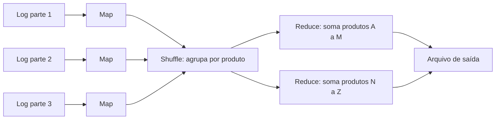
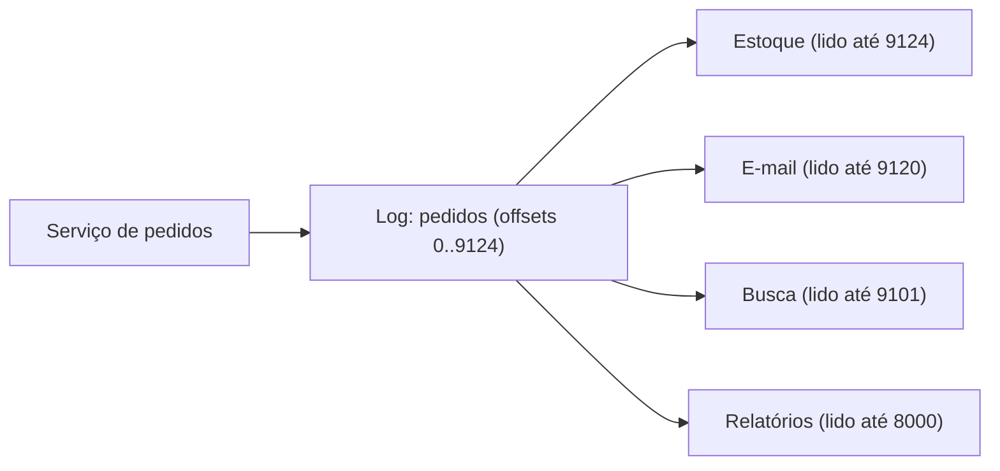
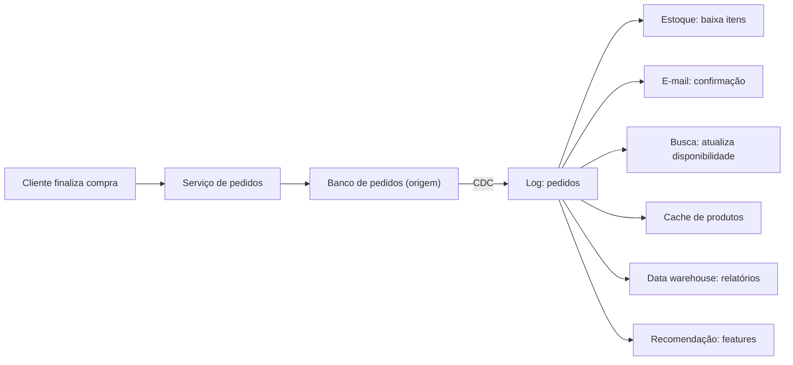

# 8. Movendo dados: batch e streams

> [!NOTE] Em uma frase
> Guarde os fatos uma vez, num lugar só e em ordem, e deixe cada sistema (busca, cache, relatórios) construir a sua própria visão a partir deles, de um jeito que dê para refazer quando algo der errado.

## Por que isso importa

A Lojinha cresceu. Quando um cliente fecha um pedido, muita coisa precisa acontecer: baixar o estoque, mandar o e-mail de confirmação, atualizar a busca (o produto esgotado não pode aparecer como disponível), alimentar o relatório de vendas que o financeiro abre toda manhã, e, em breve, o sistema de recomendação.

A primeira versão fazia tudo isso no mesmo código, em sequência, dentro da requisição do "finalizar compra": grava no banco, chama o serviço de e-mail, atualiza o índice de busca, grava numa tabela de relatório. Funcionou até o dia em que o serviço de busca ficou fora do ar por dez minutos. Os pedidos foram gravados, mas a busca ficou desatualizada, e ninguém sabia quais produtos tinham ficado errados. Em outro dia, o e-mail foi enviado mas a gravação falhou no meio: o cliente recebeu a confirmação de um pedido que não existia.

O problema não é nenhum desses serviços em particular. É **como os dados se movem entre eles**. Este módulo mostra as duas grandes formas de mover dados, em lote (*batch*) e em fluxo contínuo (*stream*), e a ideia que une as duas: tratar o pedido como um **evento**, um fato registrado uma vez, do qual todo o resto é derivado.

## O que você precisa saber antes

- [Módulo 6](06-quando-uma-maquina-nao-basta.md): replicação com líder, em que os seguidores copiam um log de escritas do líder.
- [Módulo 7](07-sistemas-distribuidos-falham.md): por que mensagens se repetem e por que retry exige [idempotência](../glossario.md#idempotência).
- [Módulo 5](05-dados-por-dentro.md) ajuda: o que é um índice e como um banco guarda dados em disco.

## Dados de origem e dados derivados

Antes de qualquer ferramenta, uma distinção que organiza todo o resto.

- **Dados de origem** (ou **sistema de registro**, a fonte da verdade): onde um fato é gravado pela primeira vez. Se houver discordância, a origem vence. Na Lojinha, a tabela de pedidos do banco principal.
- **Dados derivados**: tudo que é calculado a partir da origem e poderia ser **recriado** se fosse perdido. O índice de busca, o [cache](../glossario.md#cache) de produtos, a tabela de "mais vendidos", o relatório do financeiro, as [features](../glossario.md#feature) de um modelo de recomendação.

Dados derivados são redundantes de propósito: existem porque cada uso precisa dos dados num formato diferente. A busca quer texto indexado por palavra; o financeiro quer somas por dia e por categoria; o cache quer o produto pronto para exibir. Nenhum banco sozinho é ótimo em tudo.

Essa distinção responde uma pergunta prática: **quando dois sistemas discordam, quem está certo?** Se você sabe que a busca é derivada do banco, a resposta é "o banco, e a busca deve ser reconstruída". Sem essa clareza, cada incidente vira uma investigação para descobrir qual cópia confiar.

O resto do módulo é sobre **como levar os fatos da origem para os derivados**. Há dois jeitos: de tempos em tempos, tudo de uma vez ([batch](../glossario.md#batch-vs-streaming)), ou continuamente, um evento por vez (stream).

## Batch: processar tudo de uma vez

**Processamento em batch** (em lote) pega um conjunto **fechado** de dados, por exemplo todos os pedidos de ontem, processa tudo e produz uma saída. O relatório de vendas do financeiro é o exemplo típico: roda de madrugada e está pronto às 8h.

### A filosofia Unix

A melhor introdução ao batch é uma linha de terminal. Para descobrir os cinco produtos mais vistos a partir do log do servidor web:

```bash
cat acessos.log | grep '/produto/' | awk '{print $7}' | sort | uniq -c | sort -rn | head -5
```

Cada programa faz **uma coisa só**, lê texto de uma entrada e escreve texto numa saída, e o `|` (pipe) liga a saída de um à entrada do próximo. Isso é um [pipeline](../glossario.md#pipeline). Três princípios estão escondidos aí e valem para qualquer sistema de dados:

1. **Peças pequenas e combináveis**, com uma interface comum entre elas (linhas de texto).
2. **A entrada não é alterada.** `acessos.log` continua intacto. Você pode rodar de novo quantas vezes quiser.
3. **A lógica não sabe de onde vêm os dados.** O mesmo `sort` serve para qualquer arquivo.

### MapReduce, em ideia

O limite do terminal é uma máquina só. Quando o log tem terabytes, é preciso espalhar o trabalho. O **MapReduce**, modelo publicado pelo Google em 2004 e popularizado pelo Hadoop, é essencialmente o pipeline Unix distribuído por muitas máquinas, em três passos:

1. **Map**: cada máquina lê um pedaço dos dados e, para cada registro, emite um par chave-valor (por exemplo, `produto_id → 1` para cada visualização).
2. **Shuffle**: o sistema agrupa todos os pares de mesma chave na mesma máquina. Tudo de `produto_42` vai para o mesmo lugar.
3. **Reduce**: para cada chave, combina os valores (soma as visualizações de `produto_42`).



O MapReduce original envelheceu: gravava tudo em disco entre cada etapa, o que era lento. Ferramentas como Spark e Flink fazem o mesmo trabalho tratando o fluxo inteiro como um único grafo de etapas, muito mais rápido. O que permaneceu foram as ideias.

### Por que reprocessar é poderoso

A propriedade mais valiosa do batch não é velocidade, é **segurança contra erro humano**. Como a entrada é imutável e a saída é sempre recalculada a partir dela:

- Se um deploy introduziu um bug no cálculo do relatório, você corrige o código, roda de novo, e substitui a saída errada. Nada se perdeu.
- Se o financeiro pede uma métrica nova ("vendas por região, desde janeiro"), basta escrever o job e rodar sobre o histórico.
- Se uma etapa falha no meio, só ela é refeita.

Compare com um sistema que **altera dados no lugar**: se o bug sobrescreveu valores, os valores antigos sumiram. Uma regra prática derivada disso: um job de batch não deve escrever linha por linha no banco de produção (é lento e deixa dado pela metade se falhar); ele gera a saída completa e troca a versão antiga pela nova de uma vez.

O preço do batch é o **atraso**. O relatório de ontem só fica pronto hoje. Para o e-mail de confirmação ou o estoque, esperar a madrugada é inaceitável.

## Streams: um evento de cada vez

**Processamento de stream** (fluxo) é batch sem fim: em vez de um conjunto fechado, os dados chegam continuamente e são processados assim que chegam, em segundos ou menos.

A unidade de um stream é o **evento**: um registro pequeno e imutável de algo que **aconteceu**, no passado. "Pedido 8812 criado pela Ana às 21:03, com 2 itens, total 349,90". Um evento não é uma ordem ("faça isso"); é um fato ("isso aconteceu"). Fatos não mudam: se o pedido for cancelado depois, isso é **outro** evento.

### O log de eventos

Onde guardar os eventos? Uma [fila](../glossario.md#fila-e-mensageria) tradicional (como RabbitMQ) entrega cada mensagem a um consumidor e, depois que ele confirma, **apaga** a mensagem. Serve bem para distribuir tarefas, mas tem um problema: a mensagem processada sumiu, e outro sistema que precise dela, ou um reprocessamento, não a encontra mais.

A alternativa é um **log**: uma lista em que só se acrescenta no fim, em ordem, e nada é apagado ao ser lido. É a mesma estrutura que o banco usa para replicar escritas para os seguidores, vista no módulo 6. O **Kafka** é o exemplo mais conhecido de sistema construído em torno dessa ideia.

Como funciona, em ideia:

- Os eventos ficam em **tópicos** (por exemplo, `pedidos`), divididos em **partições** para caber em várias máquinas. Dentro de uma partição, a ordem é garantida.
- Cada evento tem uma posição numerada, o **offset** (0, 1, 2, 3...).
- Cada **consumidor** lê no seu próprio ritmo e só guarda até que offset já leu. Ler não altera o log.
- Os eventos ficam guardados por dias ou semanas (ou para sempre, se configurado).



Isso traz três propriedades que a fila tradicional não tem:

1. **Vários consumidores independentes** leem os mesmos eventos sem atrapalhar uns aos outros.
2. **Consumidor lento não derruba ninguém.** Se a busca cair por dez minutos, os eventos esperam no log; quando ela voltar, continua do seu offset e alcança os demais. A distância entre o fim do log e o offset de um consumidor se chama **lag** (atraso) e é a métrica mais importante a monitorar: se crescer além do tempo de retenção do log, eventos se perdem para aquele consumidor.
3. **Dá para reprocessar.** Basta voltar o offset. É a mesma segurança do batch, agora em tempo real.

A troca: dentro de uma partição, um evento que demora para processar segura os seguintes. Para paralelizar, você aumenta o número de partições.

## Capturando mudanças: CDC e event sourcing

Ainda falta uma peça. Os eventos precisam **entrar** no log. A tentação é o código fazer:

```python
banco.salvar(pedido)
kafka.publicar("pedidos", pedido)
```

Isso é a **escrita dupla**, e ela diverge cedo ou tarde. Se o processo cair entre as duas linhas, o pedido existe no banco e não no log. Se dois pedidos concorrentes forem gravados em ordem diferente no banco e no log, cada sistema terá uma versão diferente da história. É o mesmo problema do "finalizar compra" do início, só que mais escondido. Há duas saídas sólidas.

### Change data capture (CDC)

**Captura de mudanças de dados** (*change data capture*, CDC) é ler o log interno de replicação do banco, o mesmo que os seguidores usam, e publicar cada mudança como um evento no Kafka. A aplicação grava só no banco, como sempre; uma ferramenta (o Debezium é um exemplo comum para PostgreSQL e MySQL) cuida do resto. Como as mudanças saem do banco **na ordem em que foram confirmadas**, não há como o log e o banco discordarem.

Uma variação mais simples, chamada **outbox**: na mesma transação em que grava o pedido, a aplicação grava o evento numa tabela `outbox` do mesmo banco. Um processo separado lê essa tabela e publica no log. Como é uma transação só, ou os dois existem ou nenhum.

### Event sourcing

**Event sourcing** leva a ideia para dentro da aplicação: em vez de guardar o **estado atual** ("pedido 8812: status enviado"), a origem passa a ser a **sequência de eventos** ("criado", "pago", "separado", "enviado"). O estado atual é calculado relendo os eventos.

| | CDC | Event sourcing |
|---|---|---|
| A origem é | O banco, com o estado atual | O log de eventos do domínio |
| Os eventos descrevem | Mudanças de linha ("coluna status mudou") | Fatos do negócio ("pedido enviado") |
| Muda o código da aplicação? | Quase nada | Bastante |
| Ganho principal | Sincronizar sistemas sem escrita dupla | Histórico completo e auditável, novas visões a qualquer momento |

Um cuidado no event sourcing: o pedido do usuário ("quero cancelar") é um **comando**, que pode ser recusado. Só depois de validado ele vira **evento** ("pedido cancelado"), e a partir daí é um fato que não se discute.

Uma forma bonita de ver as duas: **o banco guarda a foto; o log guarda o filme**. O estado atual é o resultado de aplicar todos os eventos em ordem, e o log é o histórico de como se chegou até ele.

## Vários sistemas em sincronia a partir do mesmo log

Juntando as peças, eis a Lojinha redesenhada:



O serviço de pedidos faz uma coisa só: grava o pedido. Cada outro sistema é um consumidor independente do mesmo log, na mesma ordem. O **data warehouse** é o banco analítico onde o financeiro faz consultas pesadas sem atrapalhar a loja. E agora:

- **Busca fora do ar por dez minutos?** Os eventos esperam. Quando ela volta, alcança o atraso sozinha. Nenhum dado se perde e ninguém precisa descobrir o que ficou errado.
- **Novo sistema de recomendação?** Ele começa a consumir o log do início (ou de um ponto salvo) e constrói sua própria visão sem que ninguém mexa no serviço de pedidos.
- **Bug no cálculo do relatório?** Corrige, volta o offset, reprocessa.
- **Mudar o formato do índice de busca?** Cria um índice novo ao lado do antigo, alimentado pelo mesmo log; quando ele alcançar, troca. O antigo é descartado.

Batch e stream deixam de ser mundos separados: o mesmo log serve para processar o histórico de uma vez e para acompanhar os eventos novos.

Note a troca que foi feita: o sistema ficou **eventualmente consistente**. Por alguns segundos, a busca pode mostrar um produto que acabou de esgotar. Para a busca, tudo bem. Para a regra "não vender o que não existe", não: essa checagem continua acontecendo na origem, no momento do pedido, com as garantias do módulo 7.

## Idempotência e "exatamente uma vez" na prática

O log tem uma consequência que precisa ser encarada: **eventos vão ser processados mais de uma vez**. O consumidor de e-mail lê o evento 9121, envia o e-mail e cai antes de salvar "li até 9121". Ao voltar, ele relê o 9121 e envia de novo. Não é um caso raro; é o funcionamento normal em qualquer reinício.

Muitos sistemas anunciam entrega **"exatamente uma vez"** (*exactly-once*). O nome é enganoso. O que eles conseguem, quando conseguem, é que o **efeito** seja como se tivesse sido uma vez, e normalmente só dentro do próprio sistema. Um nome mais honesto seria **"efetivamente uma vez"**. Assim que o efeito sai para o mundo (mandar um e-mail, cobrar um cartão), a responsabilidade volta para você.

As técnicas, da mais simples para a mais trabalhosa:

1. **Torne a operação naturalmente idempotente.** "Definir estoque do produto 42 como 7" pode ser aplicado duas vezes sem dano; "subtrair 1 do estoque" não pode.
2. **Guarde o que já foi processado.** Cada evento tem um ID único (o pedido 8812, ou o offset). Antes de agir, o consumidor confere se já processou aquele ID. É o mesmo truque da cobrança no módulo 7.
3. **Grave o offset junto com o resultado, na mesma transação.** Se o consumidor de relatórios grava a soma e o "li até 9121" no mesmo banco, numa transação só, um reinício nunca conta o mesmo evento duas vezes.

```python
def ao_receber(evento):
    if enviados.contem(evento.pedido_id):
        return
    email.enviar_confirmacao(evento)
    enviados.adicionar(evento.pedido_id)
```

Repare que ainda há uma janela: se o processo cair entre `enviar_confirmacao` e `adicionar`, o e-mail sai duas vezes. Para e-mail, isso costuma ser aceitável. Para cobrança, não: aí o serviço externo também precisa aceitar uma chave de idempotência, como muitas APIs de pagamento aceitam. A deduplicação tem de existir **na ponta que produz o efeito**, porque nenhuma camada no meio do caminho consegue garanti-la por você.

## O futuro: sistemas como composição de dados derivados

Dê um passo atrás e olhe o desenho da Lojinha. Ele se parece com algo familiar: um **banco de dados virado do avesso**.

Dentro de um banco, quando você cria um índice, o banco varre a tabela inteira (um batch) e depois atualiza o índice a cada escrita (um stream). Um índice é um dado derivado mantido automaticamente. O que a Lojinha fez foi o mesmo, só que **entre sistemas**: o log de pedidos é a tabela, e busca, cache, warehouse e recomendação são "índices" especializados, cada um numa ferramenta diferente, unidos por logs como os programas Unix são unidos por pipes.

Essa visão muda como se projeta uma aplicação:

- **Pense em fluxos, não em chamadas.** Em vez de cada tela consultar cinco sistemas, os dados derivados são empurrados para onde serão lidos, já no formato certo. É como uma planilha: mude uma célula e as fórmulas que dependem dela se recalculam sozinhas.
- **Separe "atrasado" de "errado".** Ver o estoque com dois segundos de atraso é incômodo e passa sozinho. Perder um pedido ou cobrar duas vezes é permanente. Vale aceitar o primeiro para evitar com rigor o segundo.
- **Confie, mas verifique.** Como a origem é imutável, dá para recalcular periodicamente os derivados e comparar. Diferenças apontam bugs antes que um cliente aponte.

Isso é uma proposta, não uma lei: nem todo sistema precisa de um log central, e uma loja pequena vive muito bem com um banco só. Mas, quando o número de lugares que precisam dos mesmos dados cresce, essa é a forma mais robusta conhecida de mantê-los de acordo.

## Na prática

- **Pergunte "qual é a origem?"** para todo dado. Se a resposta não for óbvia, um incidente vai torná-la óbvia da pior forma.
- **Desconfie de duas escritas seguidas em sistemas diferentes** no mesmo trecho de código. É escrita dupla; use CDC ou outbox.
- **Monitore o lag de cada consumidor.** Ele mostra quem está ficando para trás antes que o atraso vire perda.
- **Escreva todo consumidor supondo que vai ver o mesmo evento duas vezes.** Teste isso de propósito: processe um evento duas vezes e confira o resultado.
- **Batch ou stream?** Se a resposta pode esperar horas (relatório, treino de modelo), batch é mais simples. Se precisa reagir em segundos (estoque, e-mail, antifraude), stream.
- **Prefira saídas recalculáveis.** Se um dado derivado não pode ser reconstruído a partir da origem, ele não é derivado: é uma segunda origem, e precisa ser tratado como tal.

## Armadilhas comuns

- **"Gravei no banco e publiquei no Kafka, então estão em sincronia."** Não estão. Uma queda entre as duas linhas ou uma corrida entre requisições basta para divergir. Use CDC ou outbox.
- **"O broker garante exactly-once, então não preciso me preocupar."** A garantia vale dentro do broker. E-mail, cobrança e chamadas externas precisam de idempotência própria.
- **"Stream substitui batch."** Os dois convivem. Reprocessar o histórico inteiro com uma lógica nova continua sendo um trabalho em lote, mesmo que leia do mesmo log.
- **"Evento é só uma mensagem."** Um evento é um fato imutável sobre o passado. Tratá-lo como um comando editável apaga exatamente a história que dá valor ao log.
- **"Se o consumidor está rodando, está tudo bem."** Um consumidor pode estar vivo e cada vez mais atrasado. Sem olhar o lag, você só descobre quando a retenção apaga eventos que ele ainda não leu.

## Verifique se entendeu

1. Na Lojinha, classifique como origem ou derivado: tabela de pedidos, índice de busca, relatório diário, cache de produtos. Que pergunta você usou para decidir?
2. Por que a entrada imutável do batch protege contra um deploy com bug, e por que um sistema que altera dados no lugar não tem essa proteção?
3. Qual a diferença entre uma fila tradicional e um log, e por que o log permite adicionar um novo consumidor sem mexer no produtor?
4. Explique, passo a passo, como a escrita dupla pode deixar banco e log discordando, e como o CDC evita isso.
5. O consumidor de e-mail reiniciou e reprocessou os últimos 50 eventos. O que você precisa ter feito para que nenhum cliente receba dois e-mails? Onde ainda sobra risco?
6. Em que sentido a arquitetura da Lojinha é "um banco de dados virado do avesso"?

## Quer ir mais fundo?

> [!TIP] Opcional
> Nada aqui é obrigatório. O módulo foi escrito para se bastar.

- [DDIA, capítulo 10: Processamento em lote](../system-design/ddia/10-processamento-em-lote.md): MapReduce em detalhe, junções em lote, e como Spark e Flink superaram o modelo original.
- [DDIA, capítulo 11: Processamento de streams](../system-design/ddia/11-processamento-de-streams.md): filas versus logs, CDC, event sourcing, janelas de tempo e o problema dos eventos atrasados.
- [DDIA, capítulo 12: O futuro dos sistemas de dados](../system-design/ddia/12-o-futuro-dos-sistemas-de-dados.md): o banco "desmembrado", corretude de ponta a ponta e a discussão ética sobre dados.
- *Designing Data-Intensive Applications*, de Martin Kleppmann (O'Reilly): o livro original.

---
Anterior: [7. Sistemas distribuídos falham](07-sistemas-distribuidos-falham.md) · Próximo: [9. Projetando sistemas na prática](09-projetando-sistemas-na-pratica.md) · Voltar ao [início do guia](index.md)
