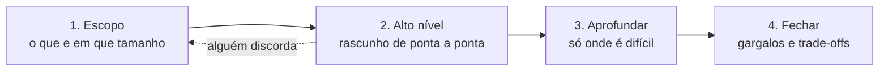
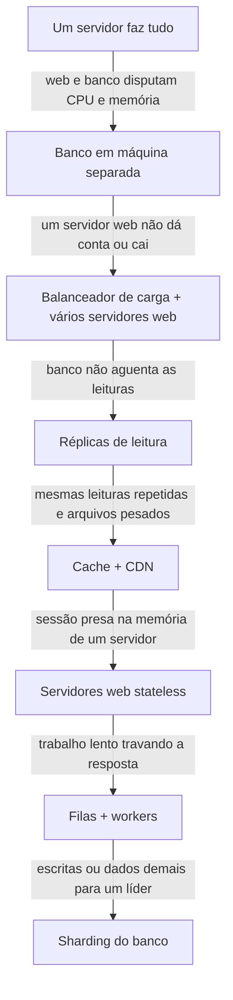
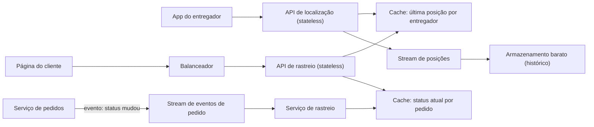
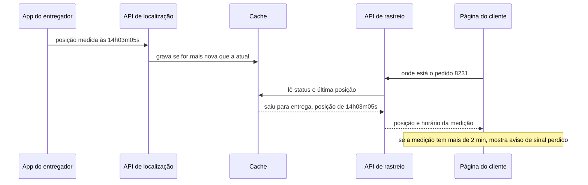

# 9. Projetando sistemas na prática

> [!NOTE] Em uma frase
> Projetar um sistema é uma conversa com roteiro: primeiro entender o que precisa existir e em que tamanho, depois desenhar o mínimo que resolve, aprofundar só onde é difícil de verdade e terminar dizendo o que ficou de fora.

## Por que isso importa

A Lojinha cresceu. Nos módulos anteriores ela ganhou um código organizado, fronteiras claras, um banco replicado, eventos que avisam outros sistemas quando um pedido muda. Agora a gerente de produto chega com uma frase: "quero que o cliente acompanhe o pedido em tempo real". Você conhece todas as peças (cache, fila, réplica, stream), mas olha para a frase e não sabe por onde começar. Desenha um WebSocket? Um Kafka? Pergunta alguma coisa? O quê?

Esse é o momento em que muito dev experiente trava, e não por falta de técnica. Saber o que é um cache não diz *quando* colocar um. O que falta é um processo: um jeito repetível de transformar um pedido vago num desenho justificado, em que cada caixa existe porque resolve um problema que você consegue apontar. Este módulo fecha a Parte 2 entregando esse processo, junto com as duas ferramentas que o sustentam: contas rápidas de tamanho e um repertório de padrões que aparecem de novo e de novo.

No fim, voltamos à frase da gerente e resolvemos o problema do começo ao fim.

## O que você precisa saber antes

O vocabulário dos módulos 4 a 8: [características e estilos de arquitetura](04-decisoes-de-arquitetura.md), [como um banco guarda dados](05-dados-por-dentro.md), [replicação e particionamento](06-quando-uma-maquina-nao-basta.md), [falhas de rede e relógio](07-sistemas-distribuidos-falham.md) e [filas e streams](08-movendo-dados-batch-e-streams.md). Cada termo é relembrado em uma frase quando aparecer.

## O método de 4 passos

O método vem do mundo das entrevistas de system design (a etapa em que pedem para você desenhar um sistema inteiro em 45 minutos), mas funciona igual numa reunião de kickoff ou num design doc. A ideia central: a maior parte dos desenhos ruins não nasce de técnica ruim, nasce de responder antes de entender a pergunta.

### Passo 1: escopo

Não desenhe nada enquanto não souber responder a estas perguntas:

- **Quais funcionalidades exatamente?** "Notificações" pode ser e-mail uma vez por dia ou push no celular em segundos. São sistemas diferentes.
- **Quantos usuários, e quantos ativos por dia?** Mil cabem num servidor; dez milhões não.
- **Quanto se espera crescer?** Dez vezes em um ano muda as escolhas de hoje.
- **O que já existe?** Se a empresa já tem fila, autenticação e cache, você usa.
- **Que números importam?** Leituras por segundo, tamanho dos dados, [latência](../glossario.md#latência-e-throughput) aceitável (o tempo entre o pedido e a resposta).

Quando ninguém sabe a resposta, você assume algo razoável, diz em voz alta e anota. Isso não é chute: é deixar a suposição visível para que alguém possa corrigi-la sem invalidar o resto. O sinal de que o passo terminou é conseguir escrever os requisitos em três a cinco linhas.

### Passo 2: alto nível

Agora sim, caixas e setas: um rascunho do sistema inteiro, de ponta a ponta, sem detalhe fino. Três hábitos tornam este passo útil:

1. **Mostre e peça acordo.** Se alguém discorda de algo grande, corrigir agora custa minutos; depois, semanas. É a seta tracejada do diagrama.
2. **Faça as contas** quando a escala decidir o desenho (próxima seção).
3. **Percorra um caso concreto.** "O cliente paga; o que acontece em cada caixa?" Isso revela caixas faltando.

Esquema de tabela e endpoints só entram se forem o coração do problema.

### Passo 3: aprofundar onde dói

Não dá para aprofundar tudo, e tentar é um erro. A pergunta-guia é: *qual parte deste sistema é difícil de verdade?* Num encurtador de links, é gerar códigos curtos sem colisão. Num chat, é manter milhões de conexões abertas e saber quem está online. Num limitador de requisições, é contar certo com vários servidores ao mesmo tempo. Escolha dois ou três pontos e diga por que eles. Gastar quinze minutos no algoritmo do balanceador de carga, um componente pronto que ninguém pediu, é o sinal clássico de que o passo foi mal usado.

### Passo 4: fechar com trade-offs

Todo desenho tem um ponto fraco, e dizer onde ele está é sinal de maturidade, não de fraqueza. Feche respondendo: onde quebra primeiro se a carga dobrar? O que acontece quando cada caixa cai? Como vou saber que algo está errado ([observabilidade](../glossario.md#observabilidade), a capacidade de entender o sistema por dentro a partir de métricas, logs e rastros)? O que mudaria para dez vezes mais usuários? E um resumo curto das decisões, com o porquê de cada uma.

## Contas de guardanapo

Uma *estimativa de guardanapo* (back-of-the-envelope) é uma conta rápida e arredondada que responde "isto cabe numa máquina ou precisa de uma frota?". O objetivo é acertar a **ordem de grandeza**, a potência de dez. Errar por 2× não muda nenhuma decisão; errar por 1.000× muda todas.

### Os atalhos

- **Um dia tem ~100 mil segundos.** São 86.400, mas arredonde para 10⁵. Assim, "por dia ÷ 100 mil = por segundo". Um milhão por dia é ~10 por segundo.
- **KB, MB, GB, TB, PB** são mil, milhão, bilhão, trilhão, quatrilhão de bytes. A diferença para as potências de dois exatas é de poucos por cento e não importa aqui.
- **QPS** (queries per second) é o número de requisições por segundo. O **pico** importa mais que a média, porque é no pico que o sistema cai. Use 2× a média para um dia normal e 10× ou mais para eventos como Black Friday.
- **Proporções de latência**, que valem mais do que os números exatos: ler da memória RAM é da ordem de 100 nanossegundos; uma ida e volta de rede dentro do mesmo data center, centenas de microssegundos; uma busca em disco rotativo, ~10 milissegundos; atravessar um oceano e voltar, ~150 milissegundos. Memória é milhares de vezes mais rápida que disco, e é por isso que [cache](../glossario.md#cache) funciona. Distância geográfica não se otimiza com código, só aproximando o dado do usuário.

### Uma conta completa: a Lojinha na Black Friday

O dono da Lojinha quer saber se o sistema atual aguenta a Black Friday. Primeiro, as suposições, todas escritas:

- 5 milhões de clientes cadastrados; num dia normal, **1 milhão de usuários ativos por dia** (DAU, daily active users).
- Cada ativo vê em média **30 páginas de produto** por dia.
- **2%** dos ativos compram. Um pedido ocupa ~**2 KB** no banco.
- O catálogo tem **100 mil produtos**, cada um com 5 fotos de ~**500 KB** e ~**5 KB** de dados de texto.
- Cada página de produto carrega ~**1 MB** de imagens.
- Na Black Friday, o tráfego é **10×** o normal.

Agora o passo a passo.

**1. Leituras de produto.** 1 milhão × 30 = 30 milhões de páginas por dia. Dividindo por 10⁵ segundos: **~300 QPS** de média. Na Black Friday, × 10: **~3.000 QPS**.

**2. Pedidos.** 1 milhão × 2% = 20 mil pedidos por dia. ÷ 10⁵ = **0,2 pedido por segundo**. Na Black Friday, ~2 por segundo. A razão entre leitura e escrita passa de mil para um.

**3. Armazenamento de pedidos.** 20 mil × 2 KB = 40 MB por dia. × 365 ≈ **15 GB por ano**. Cabe com folga num banco relacional numa máquina só, por muitos anos.

**4. Fotos.** 100 mil × 5 × 500 KB = **250 GB**. Não é muito, mas é arquivo estático: vai para um armazenamento de objetos (um serviço que guarda arquivos por nome, como o S3) e não para o banco.

**5. Tamanho do cache.** Se 20% dos produtos recebem quase todas as visitas, são 20 mil × 5 KB = **100 MB**. Cabe inteiro na memória de um único servidor de cache, com sobra enorme.

**6. Banda de rede.** 30 milhões de páginas × 1 MB = 30 TB por dia. ÷ 10⁵ = **300 MB por segundo** de média, ~3 GB por segundo na Black Friday. Esse é o número assustador.

**As decisões que saem da conta:**

- O banco **não** é o problema: 2 pedidos por segundo e 15 GB por ano não pedem [sharding](../glossario.md#particionamento-sharding). Quem propuser particionar o banco de pedidos está resolvendo um problema que não existe.
- As 3.000 leituras por segundo de produto pedem **cache** na frente do banco, e o cache inteiro custa 100 MB.
- O gargalo real é **imagem**. Gigabytes por segundo saindo dos próprios servidores é caro e lento; servir as fotos por uma **CDN** (Content Delivery Network, uma rede de servidores espalhados que guarda cópias perto do usuário) tira esse peso inteiro do sistema.

Em dez minutos de conta, a discussão saiu de "precisamos de microsserviços e Kafka para a Black Friday?" para "precisamos de CDN e de cache, e o resto aguenta". É para isso que serve a estimativa: cortar complexidade tanto quanto justificá-la.

## A escada do crescimento

Sistemas grandes não nascem grandes. Eles crescem trocando um gargalo por outro, e cada componente clássico existe para resolver um gargalo específico. Vale enxergar isso como uma escada: você sobe um degrau quando o gargalo de baixo aparece, não antes.

Cada degrau, com o problema que resolve:

- **Separar o banco.** Web e banco precisam de recursos diferentes; separados, crescem de forma independente.
- **Balanceador de carga** (load balancer, o distribuidor que recebe o tráfego e o reparte entre vários servidores). É a passagem da escala *vertical* (máquina maior, que tem teto e continua sendo ponto único de falha) para a *horizontal* (mais máquinas). Se um servidor cai, o balanceador manda tudo para os outros.
- **[Réplicas](../glossario.md#replicação).** Cópias do banco: um líder recebe as escritas e seguidores atendem leituras. Funciona porque quase todo sistema lê muito mais do que escreve. O preço, visto no [módulo 6](06-quando-uma-maquina-nao-basta.md): a réplica atrasa, e ler dela logo depois de escrever pode devolver o valor antigo.
- **Cache e CDN.** Não refazer trabalho. O cache guarda em memória o resultado de leituras frequentes; a CDN faz o mesmo com arquivos estáticos, perto do usuário. As decisões que todo cache exige: quanto tempo a cópia vale (TTL, time to live), o que sai quando ele enche e o que acontece com o banco se o cache cair de uma vez.
- **Stateless.** Um servidor [stateful](../glossario.md#stateless-e-stateful) guarda estado entre requisições, como o carrinho na memória; se a próxima requisição cair em outro servidor, o carrinho some. Tirar o estado para um armazenamento compartilhado faz qualquer servidor atender qualquer pessoa, e é isso que permite adicionar e remover máquinas automaticamente.
- **[Filas](../glossario.md#fila-e-mensageria).** Separam quem pede um trabalho de quem o executa. O checkout responde "pedido recebido" na hora e coloca "emitir nota fiscal" numa fila; workers fazem depois. Se a fila cresce, você adiciona workers; se eles caem, as mensagens esperam.
- **Sharding.** Dividir os dados em pedaços, cada um numa máquina. É o último degrau porque é o mais caro: quebra JOINs, complica transações e exige escolher bem a chave de divisão.

Dois degraus correm em paralelo à escada e não são opcionais em escala: **vários data centers** (para sobreviver à queda de uma região e ficar perto de usuários distantes) e **observabilidade com automação** (com dezenas de máquinas, ninguém consegue mais entrar em cada uma para ver o que houve).

A conta da Black Friday mostra a escada funcionando: a Lojinha precisava dos degraus 4 e talvez 2, e nem chegava perto do 7. Algumas empresas atendem tráfego enorme com poucos servidores grandes e cache agressivo. A escada é um mapa, não uma obrigação.

## Caixa de ferramentas: padrões que se repetem

Depois de resolver alguns problemas clássicos, você percebe que as mesmas peças voltam. Reconhecê-las encurta o passo 3: em vez de inventar, você identifica "isto é um problema de fan-out" e já sabe quais são as opções e os custos.

### Rate limiter: proteger o sistema de excesso

Um *rate limiter* (limitador de taxa) recusa requisições de quem passou de um limite, por exemplo "5 tentativas de login por minuto por IP". Resolve abuso (robôs testando senhas, raspagem do catálogo na Black Friday) e protege o sistema de um cliente que sozinho derrubaria todos. Fica na entrada, muitas vezes no API gateway, e responde `429 Too Many Requests` a quem estourou. O algoritmo mais comum é o *token bucket* (balde de fichas): um balde é reabastecido a uma taxa fixa, cada requisição gasta uma ficha, e sem ficha a requisição é recusada. Ele permite rajadas curtas e usa pouca memória.

O ponto difícil é ter vários servidores. Os contadores não podem viver na memória de cada um (cada servidor veria só uma fração do tráfego), então vão para um armazenamento rápido compartilhado, como o Redis. E a sequência "ler o contador, comparar, gravar + 1" precisa ser atômica, senão dois servidores leem 99 ao mesmo tempo e ambos aprovam a centésima primeira. Há ainda uma decisão de negócio: se o limitador cair, deixa tudo passar (protege a disponibilidade) ou bloqueia tudo (protege o backend)?

### Consistent hashing: dividir sem embaralhar tudo

Para espalhar chaves entre N servidores de cache, o óbvio é `hash(chave) % N`. Funciona até N mudar: ao passar de 3 para 4 servidores, quase todas as chaves mudam de dono, o cache inteiro vira "não encontrado" de uma vez e a carga despenca sobre o banco. *Consistent hashing* resolve isso colocando servidores e chaves num mesmo anel de posições; cada chave pertence ao primeiro servidor no sentido horário. Quando um servidor entra ou sai, só as chaves do trecho vizinho mudam de dono, em média 1/N do total.

Para a carga ficar equilibrada, cada servidor aparece no anel muitas vezes, como *nós virtuais*; assim cada um fica com muitos trechos pequenos e, quando um sai, a carga dele se espalha entre vários vizinhos em vez de cair num só. Esse é o mecanismo por trás do [particionamento](06-quando-uma-maquina-nao-basta.md) de vários bancos distribuídos. Um limite importante: ele equilibra *chaves*, não *popularidade*. Uma única chave muito acessada continua esquentando o servidor dela.

### IDs únicos sem coordenação

Com um banco só, o auto-incremento dá IDs para os pedidos. Com vários bancos ou vários servidores criando pedidos ao mesmo tempo, perguntar a um contador central toda vez cria um ponto único de falha. Um UUID aleatório não precisa de coordenação, mas tem 128 bits e não é ordenado por tempo, o que impede ordenar pedidos pelo ID.

O padrão conhecido como Snowflake monta um ID de 64 bits a partir de partes que cada máquina preenche sozinha: 41 bits de milissegundos desde uma data escolhida (dá uns 69 anos), 10 bits identificando a máquina e 12 bits de contador dentro do mesmo milissegundo (4.096 IDs por milissegundo por máquina). Como o tempo está nos bits mais altos, ID maior significa mais recente. O ponto fraco é exatamente o do [módulo 7](07-sistemas-distribuidos-falham.md): relógios mentem. Se a sincronização puxar o relógio para trás, o gerador pode repetir um ID, então ele precisa lembrar o último instante usado e esperar o tempo alcançar. E a ordem entre IDs de máquinas diferentes é só aproximada.

### Fan-out: um evento, muitos destinatários

*Fan-out* é quando um evento precisa chegar a muitas pessoas: um post para os seguidores, ou na Lojinha, "o produto voltou ao estoque" para 200 mil pessoas que pediram aviso. Há duas estratégias. **Na escrita (push):** quando o evento acontece, ele é copiado para a caixa de cada destinatário; ler fica trivial, mas um evento com milhões de destinatários gera milhões de escritas, inclusive para quem nunca vai olhar. **Na leitura (pull):** nada é copiado; quando a pessoa abre o app, o sistema busca e junta os eventos relevantes; não há desperdício, mas a leitura, que é a operação mais frequente, fica lenta.

A resposta usual é híbrida: push para a maioria, pull para as poucas fontes com audiência enorme (a "celebridade"). O fan-out na escrita quase sempre passa por uma [fila](08-movendo-dados-batch-e-streams.md) com workers, porque copiar para 200 mil caixas não pode travar quem disparou o evento, e as listas guardam só IDs, nunca o conteúdo inteiro, para não multiplicar o uso de memória por milhares.

## Exemplo resolvido: "acompanhe seu pedido em tempo real"

Voltemos à frase da gerente, aplicando o método.

### Passo 1: escopo

As perguntas e as respostas (as que ninguém sabia viraram suposições anotadas):

- **O que é "tempo real"?** Duas coisas diferentes. Mudanças de status (pago, separado, despachado, saiu para entrega, entregue) podem aparecer em até um minuto. O **mapa do entregador**, no dia da entrega, precisa se mover a cada poucos segundos.
- **Quem tem mapa?** Só entregas da frota própria da Lojinha nas capitais. Transportadoras terceiras mandam só status.
- **Escala?** 20 mil pedidos por dia num dia normal, 200 mil na Black Friday. No pico, ~500 entregadores na rua ao mesmo tempo.
- **Canal?** Página web e app. Notificação push quando o status muda já existe e fica fora.

Requisitos em quatro linhas: mostrar o status atual do pedido com atraso de até um minuto; no dia da entrega própria, mostrar a posição do entregador atualizada a cada ~5 segundos; aguentar a Black Friday; se a posição ficar velha, deixar isso visível em vez de mentir.

### A conta

- **Posições chegando.** 500 entregadores mandando GPS a cada 5 s = **100 escritas por segundo**. Pequeno.
- **Gente olhando.** Suponha que, no pico, 5 mil clientes estejam com a página do mapa aberta. Se cada um perguntar "onde está?" a cada 5 s, são **1.000 QPS**, todos lendo um dado minúsculo (a última posição de um entregador, ~100 bytes).
- **Memória.** Só a última posição de 500 entregadores: 50 KB. Ridículo.
- **Histórico.** 100 posições por segundo × 10⁵ segundos = 10 milhões de pontos por dia; a ~100 bytes, 1 GB por dia. Útil para análise depois, inútil no caminho da tela.

A conta já diz muito: não há nada aqui que exija sharding ou um cluster novo. O cuidado é não colocar 1.000 leituras por segundo no banco de pedidos.

### Passo 2: alto nível

Percorrendo um caso: o entregador da rua X manda sua posição; a API de localização grava "entregador 17 está em (lat, long) às 14:03:05" no cache, por cima do valor anterior, e publica o ponto num stream (o log de eventos do [módulo 8](08-movendo-dados-batch-e-streams.md)) que alimenta o histórico. Em paralelo, quando o pedido muda de status, o serviço de pedidos publica um evento, e o serviço de rastreio mantém no cache o status atual de cada pedido. A página do cliente consulta a API de rastreio, que lê só do cache. O banco de pedidos nunca é tocado por quem está olhando a tela.

### Passo 3: aprofundar

**1. Como a tela recebe as atualizações?** Três opções: *polling* (o cliente pergunta a cada poucos segundos), *long polling* (o servidor segura a pergunta até ter novidade) e *WebSocket* (uma conexão que fica aberta e deixa o servidor empurrar dados). O reflexo é escolher WebSocket, porque "tempo real". Mas a conta diz que polling a cada 5 s gera 1.000 QPS lidos de memória, algo que poucos servidores stateless aguentam sem esforço. WebSocket exigiria servidores *stateful* (cada um segurando milhares de conexões), um jeito de saber em qual servidor está a conexão de cada cliente e reconexão quando um deles cai. **Decisão para a v1: polling** a cada 5 s no mapa e a cada 30 s na página de status. WebSocket fica anotado como próximo passo, se o produto quiser o pino deslizando suavemente.

**2. Posições fora de ordem.** O celular do entregador perde sinal num túnel e depois manda três posições atrasadas de uma vez; pela rede, elas podem chegar fora de ordem. Se a API gravar cegamente "a última que chegou", o pino volta para trás no mapa. A defesa: cada posição carrega o horário em que foi medida no aparelho, e o cache só aceita um ponto mais novo do que o que já tem. Gravar duas vezes o mesmo ponto não muda nada, o que torna o reenvio seguro (isso é [idempotência](../glossario.md#idempotência)). E como relógios mentem ([módulo 7](07-sistemas-distribuidos-falham.md)), comparamos só pontos do *mesmo* aparelho, nunca de aparelhos diferentes.

**3. Status coerente com o pedido.** Se o serviço de pedidos grava "despachado" no banco e cai antes de publicar o evento, o rastreio fica para sempre em "separado". É o problema da escrita dupla do [módulo 8](08-movendo-dados-batch-e-streams.md): em vez de gravar e publicar como dois passos independentes, o evento sai do próprio banco (pela tabela de outbox ou pela captura de mudanças, CDC), e o rastreio passa a ser uma visão derivada que sempre converge. A tela pode atrasar alguns segundos, nunca divergir para sempre: [consistência eventual](../glossario.md#consistência-forte-e-eventual) aceita de propósito.

### Passo 4: fechar

- **Onde quebra primeiro:** o cache. Se ele cair, as APIs voltariam a consultar o banco, e 1.000 QPS ali machucam. Mitigação: cache replicado e, se ele estiver fora, a página mostra "rastreio indisponível" em vez de derrubar o banco de pedidos.
- **Dado velho:** a página sempre mostra o horário da última posição. Esconder isso faria o cliente achar que o entregador está parado.
- **Métricas que importam:** atraso entre a medição no celular e a gravação no cache, e quantos entregadores estão sem enviar há mais de um minuto. Um [SLO](../glossario.md#slo) razoável: 99% das posições visíveis na tela em menos de 10 s.
- **Próxima escala:** com dez vezes mais clientes olhando, o polling vira 10.000 QPS de memória, ainda viável; o motivo para trocar por WebSocket seria experiência (movimento suave, menos bateria), não capacidade.
- **Resumo:** dados quentes em memória, eventos como fonte da verdade do rastreio, polling porque a conta permite, e honestidade sobre dado velho na tela.

## Na prática

- **Antes de qualquer reunião de desenho, escreva o escopo em cinco linhas** e mande para os envolvidos. Metade das discordâncias aparece ali, quando ainda é barato.
- **Ponha uma conta em todo design doc.** Usuários ativos, QPS de pico, bytes por dia, retenção. Ela justifica cada caixa e, com a mesma frequência, apaga caixas desnecessárias.
- **Justifique cada componente por um gargalo.** Se você não consegue dizer "este cache existe porque X leituras por segundo não cabem no banco", ele provavelmente não deveria existir ainda.
- **Procure o padrão antes de inventar.** "Muita gente precisa receber isto" é fan-out; "alguém pode abusar disto" é rate limiting; "vários servidores criam registros" é geração de IDs.
- **Sinal de alerta:** um desenho sem nenhum ponto fraco declarado. Ou ninguém pensou em falha, ou alguém está escondendo.

## Armadilhas comuns

- **"Tempo real" sempre significa WebSocket.** Significa "rápido o bastante para o usuário". Às vezes é um minuto; às vezes polling a cada 5 s aguenta tudo. Correção: pergunte o atraso aceitável e faça a conta antes de escolher o mecanismo.
- **Subir a escada inteira no primeiro dia.** Sharding, filas e vários data centers custam caro para manter e falham de mais jeitos. Correção: cada degrau entra quando um gargalo concreto aparece.
- **Estimar pela média.** O sistema cai no pico. Correção: multiplique por 2 num dia normal, por 10 ou mais em eventos sazonais.
- **Confundir cadastrados com ativos.** 5 milhões de contas não são 5 milhões de pessoas por dia. Correção: parta sempre de usuários ativos por dia.
- **Decorar desenhos prontos.** Quem decorou "o desenho do Twitter" trava quando um requisito muda. Correção: estude cada problema como aplicação do método, prestando atenção ao porquê de cada caixa.

## Verifique se entendeu

1. Por que o passo de escopo costuma decidir mais do desenho do que o passo de aprofundamento? Dê um exemplo em que uma única resposta muda a arquitetura.
2. Refaça a conta da Black Friday supondo 3 MB de imagens por página. Alguma decisão muda? E se fossem 200 mil pedidos por segundo?
3. Na escada do crescimento, que problema torna os servidores stateless necessários, e por que ele só aparece depois do balanceador de carga?
4. Por que `hash(chave) % N` é um problema ao adicionar um servidor de cache, e o que o consistent hashing muda?
5. No rastreio da Lojinha, o que daria errado se a API de localização gravasse sempre "a última posição que chegou"?
6. Em que situação você trocaria o polling do rastreio por WebSocket, e o que passaria a precisar resolver?

## Quer ir mais fundo?

> [!TIP] Opcional
> Nada aqui é obrigatório. O módulo foi escrito para se bastar.

- [O método de 4 passos](../system-design/system-design-interview/01-o-metodo-de-4-passos.md): os tempos sugeridos para cada passo numa entrevista e a lista do que fazer e evitar.
- [Escalar de zero a milhões](../system-design/system-design-interview/02-escalar-de-zero-a-milhoes.md): cada degrau da escada em detalhe, incluindo vários data centers e as decisões de cache.
- [Estimativas de ordem de grandeza](../system-design/system-design-interview/03-estimativas-de-ordem-de-grandeza.md): a tabela de latências, a de disponibilidade em noves e outro exemplo completo de conta.
- [Rate limiter](../system-design/system-design-interview/problemas/01-rate-limiter.md): os cinco algoritmos de contagem comparados e como evitar corridas entre servidores.
- [Consistent hashing](../system-design/system-design-interview/problemas/02-consistent-hashing.md): o anel passo a passo e por que nós virtuais equilibram a carga.
- [Gerador de IDs únicos](../system-design/system-design-interview/problemas/04-gerador-de-ids-unicos.md): as quatro alternativas avaliadas e as contas de bits do Snowflake.
- [News feed](../system-design/system-design-interview/problemas/08-news-feed.md): fan-out na escrita e na leitura, a solução híbrida e as camadas de cache.
- [Chat](../system-design/system-design-interview/problemas/09-chat.md): polling, long polling e WebSocket comparados, e como saber quem está online.
- [Sistema de notificações](../system-design/system-design-interview/problemas/07-sistema-de-notificacoes.md): filas por canal, retry e como reduzir mensagens duplicadas.
- Livro original: Alex Xu, *System Design Interview – An Insider's Guide* (volume 1).

---
Anterior: [8. Movendo dados: batch e streams](08-movendo-dados-batch-e-streams.md) · Próximo: [10. Como uma máquina aprende](10-como-uma-maquina-aprende.md) · Voltar ao [início do guia](index.md)
