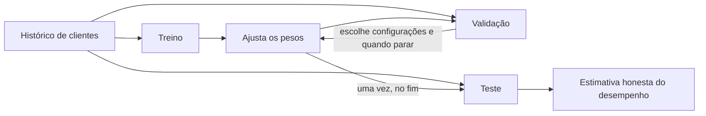
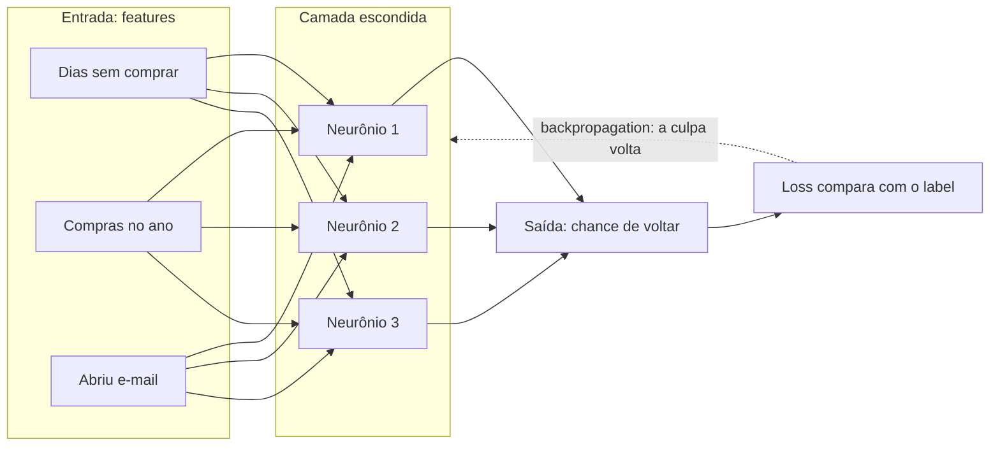
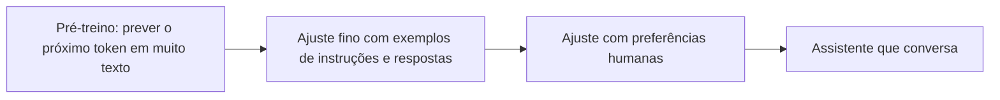

# 10. Como uma máquina aprende

> [!NOTE] Em uma frase
> Aprender, para uma máquina, é ajustar milhões de números até que um único número, o tamanho do erro, fique pequeno em exemplos que ela nunca viu.

## Por que isso importa

A Lojinha cresceu. O marketing quer mandar cupom só para quem está prestes a sumir, porque cupom para quem ia voltar de qualquer jeito é dinheiro jogado fora. A pergunta: **este cliente vai comprar de novo nos próximos 30 dias?**

O instinto de quem programa é escrever regras: "se não compra há 60 dias e não abre e-mail, vai sumir". Aí aparece o cliente que só compra no Natal, o que compra toda semana mas está brigando com o suporte, o que nunca abre e-mail e volta sempre. Cada exceção vira um `if`, os `if`s brigam entre si, e ninguém sabe mais por que a regra 47 existe.

Machine learning (aprendizado de máquina) inverte o jogo: em vez de escrever as regras, você junta milhares de exemplos do passado (clientes e se eles voltaram ou não) e deixa um algoritmo **descobrir** a regra. Este módulo abre a Parte 3 explicando o que acontece dentro desse "descobrir", por que às vezes dá errado, como uma rede neural funciona e como tudo isso virou os modelos de linguagem de hoje.

## O que você precisa saber antes

Saber programar e lembrar de matemática do ensino médio (o que é uma função, o que é um gráfico). Ajuda ter visto dados como tabelas, como no [módulo 5](05-dados-por-dentro.md). Toda fórmula vem traduzida em palavras ao lado; se uma travar, leia a frase e siga.

## Aprender com dados

### Features, labels e o modelo

Cada cliente do passado vira uma linha. As colunas que descrevem o cliente são as [features](../glossario.md#feature), as variáveis de entrada. A coluna com a resposta certa é o [label](../glossario.md#label).

| Dias desde a última compra | Compras no ano | Abriu e-mail no mês? | **Voltou em 30 dias?** (label) |
|---|---|---|---|
| 5 | 24 | sim | **sim** |
| 90 | 2 | não | **não** |
| 40 | 6 | sim | **sim** |

Aprender com exemplos que já trazem a resposta se chama **aprendizado supervisionado**: o aluno estuda com o gabarito ao lado.

Um **modelo** é uma função que recebe as features e devolve uma previsão. O que o torna treinável são os **parâmetros** (ou **pesos**): números internos que mudam o comportamento da função, como botões de uma mesa de som. O modelo mais simples para a Lojinha dá um peso a cada feature, soma tudo e espreme o resultado para virar uma probabilidade entre 0 e 1:

```python
def chance_de_voltar(c, w, b):
    placar = w[0] * c.dias_sem_comprar + w[1] * c.compras_no_ano + w[2] * c.abriu_email + b
    return 1 / (1 + exp(-placar))
```

A última linha é a **sigmoide**: placar muito negativo vira quase 0, muito positivo vira quase 1. O `b` (*bias*, viés) é um empurrão fixo. Esse modelo se chama **regressão logística** e ainda resolve muito problema real.

No começo os pesos são números quaisquer e o modelo chuta. **Treinar** é encontrar os pesos que fazem as previsões baterem com os labels. Se der certo, o peso de "dias sem comprar" sai negativo (mais tempo sumido, menos chance de voltar) sem ninguém ter escrito isso. É isso que "aprender a regra" quer dizer.

### Treino, validação e teste

Um modelo que acerta 100% dos clientes que já viu não prova nada: pode ter decorado. O que importa são os clientes de amanhã. Por isso os dados são divididos antes de treinar (ver [dataset e divisão treino / validação / teste](../glossario.md#dataset-e-divisão-treino--validação--teste)):

- **Treino**: com ele o modelo ajusta os pesos. É a lista de exercícios.
- **Validação**: não ensina o modelo, mas guia suas decisões: qual configuração usar, quando parar. É o simulado.
- **Teste**: guardado a sete chaves e usado **uma vez**, no fim, para estimar o desempenho real. É a prova.



As escolhas que o treino não faz sozinho (tamanho do modelo, velocidade de aprendizado, quando parar) se chamam **hiperparâmetros**. Se você as escolhe olhando o teste, o teste passou a influenciar o modelo e deixou de ser "dado nunca visto": a nota final fica otimista, e você só descobre em produção.

Quando os dados têm tempo, divida **por data**, não sorteando: treine com janeiro a setembro, valide com outubro, teste com novembro. Sortear deixa o modelo "ver o futuro" no treino, um tipo de vazamento que o módulo 11 detalha.

## Loss e descida do gradiente

### Um número para o erro

Para ajustar os pesos, o algoritmo precisa saber quão errado está. A [loss (função de perda)](../glossario.md#loss-função-de-perda) é esse número: grande quando o modelo erra muito, pequena quando acerta. **Treinar é minimizar a loss.**

Para prever um valor (quanto o cliente vai gastar), a loss comum é o **erro quadrático médio**: a diferença entre previsão e realidade, ao quadrado, na média. Para prever uma probabilidade ("vai voltar?"), usa-se a **cross-entropy** (entropia cruzada): olhe a probabilidade $p$ que o modelo deu à resposta certa e cobre $-\log(p)$.

| Probabilidade dada à resposta certa | Loss |
|---|---|
| 0,99 | 0,01 |
| 0,7 | 0,36 |
| 0,1 | 2,30 |
| 0,001 | 6,91 |

Acertar com confiança custa quase nada; errar com confiança custa caríssimo. É uma loss que ensina o modelo a não ser arrogante.

### A montanha no escuro

Imagine todas as combinações possíveis de pesos como um terreno: cada ponto é uma combinação, e a altura é a loss. O melhor modelo está no fundo do vale. Só que o terreno tem milhões de dimensões e não há mapa.

Faça como alguém perdido numa montanha à noite: você não vê nada, mas sente a inclinação do chão sob os pés. Dê um passo para onde o chão desce mais. Repita. Isso é a [descida do gradiente](../glossario.md#gradiente-e-descida-do-gradiente). O **gradiente** é a inclinação do chão medida para cada peso: quanto a loss sobe se aquele peso aumentar um pouquinho. Andamos no sentido contrário:

$$w \leftarrow w - \eta \cdot \text{gradiente}$$

Em palavras: peso novo é o peso atual menos um passo pequeno na direção em que o erro cresce. O tamanho do passo, $\eta$ ("eta"), é a **taxa de aprendizado** (*learning rate*), provavelmente o hiperparâmetro mais importante. Pequena demais, você chega ao vale numa eternidade. Grande demais, você pula o vale, cai mais alto do outro lado e a loss explode.

Calcular o gradiente com todos os exemplos a cada passo seria caro demais. Cada passo usa um lote sorteado de algumas centenas (um **minibatch**) para *estimar* a inclinação: barulhento, mas barato. Essa versão se chama **SGD** (*stochastic gradient descent*). Otimizadores como o **Adam** acrescentam "momento" (uma bola que ganha velocidade em descidas consistentes e amortece o ziguezague) e um passo ajustado para cada peso. Por baixo, continua sendo alguém descendo a montanha.

## Overfitting e regularização

### O aluno que decora

O modelo de churn (o nome do mercado para "cliente que vai embora") acerta 99% no treino e 62% na validação. Isso é [overfitting](../glossario.md#overfitting): ele aprendeu as coincidências do treino, não o padrão. É o aluno que decorou as respostas da lista e trava na prova.

A causa costuma ser **capacidade** demais, a variedade de funções que o modelo consegue representar. Ajuste uma curva a 10 pontos com ruído: uma reta não acompanha a tendência e erra em tudo (**underfitting**); uma curva maluca que passa exatamente por todos os pontos tem erro de treino zero e previsões absurdas entre eles (overfitting); uma curva suave no meio generaliza. O sinal clássico: a loss de treino desce sempre, a de validação desce junto, para, e começa a subir. Ali o modelo começou a decorar.

### Dificultar de propósito

**Regularização** é qualquer mudança no treino que melhora o desempenho em dados novos, mesmo piorando um pouco no treino:

- **Mais dados**: decorar um milhão de clientes é bem mais difícil que decorar mil. É a melhor regularização que existe.
- **Penalidade nos pesos (L2)**: soma à loss uma multa pelo tamanho dos pesos. Pesos pequenos geram funções suaves, incapazes das curvas malucas.
- **Early stopping** (parada antecipada): parar quando a loss de validação para de melhorar, exatamente antes de o modelo começar a decorar.
- **Dropout**: a cada passo, desligar neurônios ao acaso, para nenhuma parte da rede depender de outra específica.
- **Data augmentation**: criar variações que mantêm o label (a foto espelhada de um tênis continua sendo um tênis).

Regularização demais devolve o modelo ao underfitting. Comece com pouca e aumente só se a distância entre treino e validação for grande.

## O que é uma rede neural

### Neurônios e camadas

Lembra da `chance_de_voltar`? Soma ponderada, mais um viés, passada por uma função que "dobra" o resultado. Isso é essencialmente **um neurônio artificial**. A inspiração no cérebro é vaga; pense nele como "soma ponderada seguida de uma dobra". A dobra se chama **função de ativação**, e a mais usada hoje é a **ReLU**: negativos viram zero, positivos passam iguais.

Uma **rede neural** organiza esses neurônios em **camadas**: cada neurônio recebe as saídas de todos os da camada anterior. As camadas do meio são **escondidas**, porque ninguém diz a elas o que produzir; só a saída final é comparada com o label.



Cada seta é um peso. Por baixo, cada camada é uma multiplicação de matriz (a tabela de pesos vezes o vetor de entradas) seguida da ativação. Uma rede assim tem dezenas de pesos; um modelo de linguagem moderno tem bilhões.

### Por que a ativação é indispensável

Sem a dobra, empilhar camadas não adianta: soma ponderada de somas ponderadas é só outra soma ponderada, e uma rede de 100 camadas equivale a uma de uma camada, capaz apenas de separar os dados com "retas". O exemplo clássico é o XOR (saída 1 quando exatamente uma de duas entradas é 1): nenhuma reta separa $(0,1)$ e $(1,0)$ de $(0,0)$ e $(1,1)$. Uma camada escondida com ativação resolve, porque **transforma o espaço** (estica, gira, dobra) até os pontos ficarem separáveis.

"**Deep**" learning é só isso: muitas camadas, cada uma construindo conceitos a partir da anterior. Numa rede que olha fotos de produtos, as primeiras camadas aprendem bordas, as seguintes formas, as próximas "cadarço" e "sola". Ninguém programou esses conceitos; eles surgiram porque ajudavam a baixar a loss.

### Backpropagation: dividir a culpa de trás para frente

A descida do gradiente precisa saber, para **cada** peso, quanto a loss muda se ele mexer. Testar um a um, com milhões de pesos, é impraticável. O **backpropagation** (retropropagação) calcula todos de uma vez.

A intuição é distribuir a culpa. A saída errou por tanto. Quanto disso é culpa de cada neurônio da última camada escondida? Depende do peso que o liga à saída: peso grande, mais culpa. E quanto da culpa desse neurônio é dos neurônios anteriores? Mesma conta, um passo para trás. A culpa viaja da saída para a entrada, camada por camada, e o truque que torna isso barato é **reaproveitar** a conta de cada camada para calcular a da anterior.

A ferramenta matemática é a **regra da cadeia**, que funciona como engrenagens: se A gira 2 vezes por volta de B, e B gira 3 vezes por volta de C, então A gira 6 vezes por volta de C. Os efeitos se multiplicam ao longo do caminho.

Backprop só **calcula** os gradientes; quem **anda** com eles é o otimizador (SGD, Adam). E ninguém o escreve à mão: quando um código em PyTorch chama `loss.backward()`, a biblioteca faz essas contas sozinha.

## Por que deep learning decolou

Redes neurais e backpropagation existem desde os anos 1980 e passaram décadas perdendo para métodos mais simples. Por volta de 2010, três coisas mudaram juntas:

1. **Dados.** Redes grandes decoram datasets pequenos. A internet e a digitalização criaram datasets de milhões de imagens e bilhões de palavras, grandes o bastante para obrigar a rede a aprender o padrão.
2. **GPUs.** Treinar é quase só multiplicar matrizes, e placas de vídeo foram feitas para isso (gráfico 3D também é multiplicação de matrizes). Treinos de meses viraram treinos de dias. O marco mais citado é de 2012, quando uma rede treinada em GPUs, a AlexNet, venceu com folga a competição de reconhecimento de imagens ImageNet.
3. **Truques de treino.** ReLU no lugar de ativações que matavam o gradiente, inicialização cuidadosa dos pesos, dropout, Adam. Cada um removeu um obstáculo para redes profundas.

Juntos, fizeram a qualidade crescer de forma consistente com mais dados e mais computação, e essa tendência levou aos modelos de hoje.

## O que mudou desde 2016

A base deste módulo continua valendo integralmente. O que mudou foi o topo da pilha: a arquitetura dominante e a escala.

### Atenção: cada palavra olha para as outras

Texto é sequência. Até 2017, o padrão eram as **redes recorrentes**, que leem uma palavra por vez carregando um resumo do que já leram. Dois problemas: o resumo se perde em textos longos, e ler uma palavra por vez desperdiça o paralelismo das GPUs.

Em 2017, o artigo "Attention Is All You Need" apresentou o **Transformer**, construído sobre a **atenção**. Pense em "O cliente devolveu o tênis porque **ele** era apertado". Para entender "ele", você olha para trás e decide que é o tênis, não o cliente. A atenção faz isso com números: para cada palavra, calcula uma nota de relevância de cada outra palavra (uma conta de similaridade entre vetores) e monta a representação daquela palavra como uma média ponderada das outras. Os critérios de relevância não são programados: são pesos aprendidos por descida do gradiente, como todo o resto.

Consequências: qualquer palavra olha diretamente para qualquer outra, por mais longe que esteja, e todas são processadas **ao mesmo tempo**, o que casa perfeitamente com GPUs. Um Transformer é uma pilha de blocos, cada um com uma camada de atenção seguida de uma rede como a da seção anterior.

### LLMs: prever o próximo pedaço de texto, em escala gigante

Um **LLM** (*large language model*, grande modelo de linguagem) é um Transformer enorme treinado numa tarefa simples: dado um trecho de texto, prever o próximo **token** (um pedaço de palavra). A loss é a mesma cross-entropy da tabela lá em cima. E essa tarefa não precisa de label humano: qualquer texto já traz a resposta (o token seguinte). Isso se chama **aprendizado autossupervisionado** e permite treinar com quantidades imensas de texto. Para prever bem o próximo token em textos de todo tipo, o modelo acaba capturando gramática, fatos, estilo e alguma forma de raciocínio.



O modelo pré-treinado sabe continuar texto, não necessariamente seguir instruções. Etapas seguintes o ajustam com exemplos de boas respostas (*fine-tuning*) e com avaliações humanas de qual resposta é melhor (a técnica mais conhecida se chama RLHF, aprendizado por reforço com feedback humano). Observou-se também que o desempenho melhora de forma bastante previsível com mais dados, parâmetros e computação, as **leis de escala**, o que justificou investimentos cada vez maiores. Em imagens, a virada equivalente foram os **modelos de difusão**, que aprendem a remover ruído passo a passo e, partindo de ruído puro, criam imagens novas.

### O que é honesto dizer

- **É o mesmo motor.** Um LLM é treinado com cross-entropy, gradiente, backprop, Adam e regularização. Tudo deste módulo está lá dentro.
- **Prever bem não é saber a verdade.** O modelo produz texto *provável*, não texto *verdadeiro*, e pode inventar com a mesma fluência quando não sabe (a **alucinação**). É o "errar com confiança" da cross-entropy, em escala.
- **Por que funciona tão bem ainda não é totalmente entendido.** Há muita pesquisa e pouca certeza. Desconfie de explicações muito confiantes, em qualquer direção.

## Na prática

- **Antes de treinar, pergunte se uma regra simples resolve.** Se três `if`s acertam 90%, comece por eles. Um modelo é uma dependência cara de manter.
- **Separe treino, validação e teste antes de tudo**, por data quando houver tempo nos dados.
- **Acompanhe as duas curvas.** Treino descendo e validação subindo é overfitting; as duas altas é underfitting. Os remédios são opostos.
- **Loss que vira `NaN` ou explode** quase sempre é taxa de aprendizado alta demais. Comece reduzindo.
- **Teste o caminho com um lote minúsculo.** Um modelo saudável consegue decorar 10 exemplos; se nem isso, é bug.
- **Compare com um baseline bobo**, como "todo cliente volta". Se o modelo não ganha disso com folga, não aprendeu nada útil.

## Armadilhas comuns

- **"Acurácia alta no treino, então funciona."** Treino mede memória. Só dados nunca vistos dizem algo sobre o futuro.
- **"Escolhi a melhor configuração olhando o teste."** Aí o teste virou validação e o número final ficou otimista.
- **"Mais camadas sempre é melhor."** Mais capacidade sem mais dados é receita de overfitting. Em dados de tabela, como o churn da Lojinha, um modelo simples bem feito muitas vezes vence uma rede profunda.
- **"Backpropagation é o treino."** Backprop calcula gradientes; o otimizador dá o passo; a loss define o destino.
- **"O LLM sabe as coisas."** Ele estima qual texto é provável. Quando a resposta importa, confira.

## Verifique se entendeu

1. No churn da Lojinha, o que são as features, o label e os pesos? O que muda nos pesos durante o treino?
2. Por que precisamos de validação separada do teste? O que dá errado se o teste escolhe os hiperparâmetros?
3. Explique a descida do gradiente com a montanha no escuro. O que acontece com uma taxa de aprendizado grande demais?
4. Por que uma rede de muitas camadas sem ativação não é mais poderosa que uma de uma camada?
5. Descreva o backpropagation sem fórmulas, usando a ideia de distribuir a culpa.
6. O que a atenção permite que uma rede recorrente não permitia, e por que treinar um LLM dispensa labels humanos?

## Quer ir mais fundo?

> [!TIP] Opcional
> Nada aqui é obrigatório. O módulo foi escrito para se bastar.

- [A matemática que você precisa](../ia/deep-learning/01-a-matematica-que-voce-precisa.md): o mapa da matemática por trás de um passo de treino, e quanto de cada parte você precisa.
- [Álgebra linear](../ia/deep-learning/02-algebra-linear.md): por que uma camada é uma matriz que estica, gira e achata o espaço.
- [Probabilidade e teoria da informação](../ia/deep-learning/03-probabilidade-e-teoria-da-informacao.md): de onde vem a cross-entropy.
- [Computação numérica e fundamentos de ML](../ia/deep-learning/04-computacao-numerica-e-fundamentos-de-ml.md): descida do gradiente, capacidade e validação em detalhe.
- [Redes feedforward](../ia/deep-learning/05-redes-feedforward.md): backpropagation feito à mão, com números.
- [Regularização](../ia/deep-learning/06-regularizacao.md): L2, L1, augmentation, early stopping e dropout.
- [Otimização para treino](../ia/deep-learning/07-otimizacao-para-treino.md): momento, Adam, inicialização e batch normalization.
- [Capítulos 9 a 20 e o que envelheceu](../ia/deep-learning/08-parte-iii-e-o-que-envelheceu.md): redes convolucionais e recorrentes, e o que ficou de fora (Transformers, difusão, LLMs).
- O livro original: *Deep Learning*, de Ian Goodfellow, Yoshua Bengio e Aaron Courville (MIT Press, 2016), gratuito e oficial em [deeplearningbook.org](https://www.deeplearningbook.org/).

---
Anterior: [9. Projetando sistemas na prática](09-projetando-sistemas-na-pratica.md) · Próximo: [11. ML em produção](11-ml-em-producao.md) · Voltar ao [início do guia](index.md)
