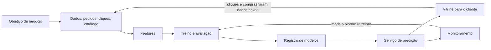
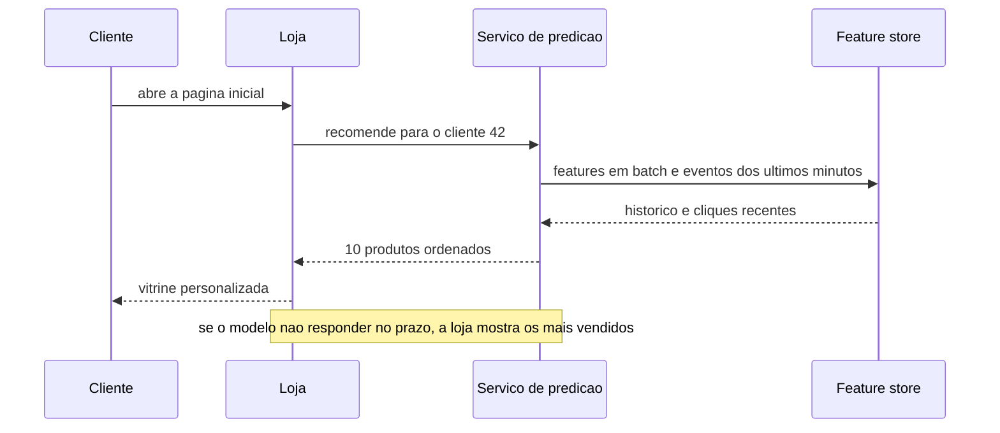

# 11. ML em produção

> [!NOTE] Em uma frase
> Treinar o modelo é a parte curta; o trabalho de verdade é alimentá-lo com dados certos, colocá-lo no ar, perceber quando ele começa a errar em silêncio e trocá-lo sem quebrar nada.

## Por que isso importa

A Lojinha quer recomendar produtos. "Quem comprou este tênis também levou...", uma vitrine "para você" na página inicial, um e-mail de segunda-feira com sugestões. A conta parece óbvia: recomendação boa vende mais.

Alguém do time baixa o histórico de pedidos, abre um notebook (um caderno interativo onde código e resultados ficam juntos), treina um modelo e mostra um número bonito: "acerta 92% das próximas compras". Três meses depois, a vitrine está no ar, o número de vendas não mexeu, o modelo recomenda casaco em dezembro (verão no Brasil) e ninguém sabe dizer desde quando. O modelo não deu erro nenhum. Ele continuou respondendo, com toda a confiança, coisas cada vez piores.

Esse é o problema deste módulo. O [módulo 10](10-como-uma-maquina-aprende.md) explicou o que acontece dentro do treino. Aqui é o resto: de onde vêm os dados, como saber se o modelo presta antes de ligá-lo, como servi-lo, como perceber que ele envelheceu e quem cuida de tudo isso. É o último módulo do guia, e ele usa quase tudo o que veio antes.

## O que você precisa saber antes

O [módulo 10](10-como-uma-maquina-aprende.md) (features, labels, treino/validação/teste, overfitting). Ajuda muito ter lido o [módulo 8](08-movendo-dados-batch-e-streams.md) (batch e streams) e o [módulo 9](09-projetando-sistemas-na-pratica.md) (desenhar um sistema de ponta a ponta).

## Antes do modelo: ML é a resposta?

### Os filtros

Machine learning faz sentido quando existe um **padrão a aprender**, esse padrão é **complexo demais para regras**, há **dados do passado** que o mostram, o problema cabe na forma "dado isto, qual a resposta mais provável?" e o **futuro se parece com o passado**. Falhou um filtro, ML não é a ferramenta.

Ajuda ainda mais quando a tarefa se repete muito, quando errar sai barato e quando o padrão muda rápido.

Recomendação passa em todos: o gosto de cada cliente é complexo, a Lojinha tem anos de pedidos, são milhares de vitrines por dia, e uma sugestão ruim custa um clique perdido. Já "calcular o frete" não é padrão a aprender, é uma tabela. E "aprovar crédito" até usa ML, mas o erro é caro, então o modelo vira só parte da decisão, com regras e revisão humana em volta.

### Comece sem ML

Mesmo quando ML é a resposta, ele raramente é o **primeiro** passo. A sequência saudável tem fases:

1. **Heurística**: "mostre os 10 mais vendidos da categoria que a pessoa está vendo". Uma consulta SQL. Já vende alguma coisa e, principalmente, vira o **número a bater**.
2. **O modelo mais simples possível**, de ponta a ponta no ar. O objetivo não é ser bom, é provar que o caminho dados → modelo → vitrine → medição funciona.
3. **Melhorar o simples**: features melhores, objetivo melhor.
4. **Só então** modelos complexos, quando o simples se esgotou.

Pular para a fase 4 é o erro mais caro: meses num modelo sofisticado para descobrir que o problema era o pipeline de dados.

### Traduzir o objetivo

O negócio quer **vender mais**. Um modelo precisa de algo que ele consiga otimizar, como "probabilidade de o cliente clicar neste produto". A tradução nunca é perfeita: otimizar clique pode favorecer produto com foto chamativa que ninguém compra. Escreva as duas métricas (a de negócio e a do modelo) e verifique, com experimento, que mover uma move a outra.

Com vários objetivos (vender, não empurrar produto sem estoque, dar margem), **desacople**: o modelo estima a chance de compra e uma regra simples aplica estoque e margem com pesos ajustáveis. Mudar a prioridade vira configuração, não retreino.

## O modelo é a menor parte do sistema

Desenhe o sistema de recomendação da Lojinha inteiro e o modelo vira uma caixinha no meio:

Cada caixa tem os problemas dos módulos anteriores. Os dados vêm do banco transacional e de eventos (módulos [5](05-dados-por-dentro.md) e [8](08-movendo-dados-batch-e-streams.md)). O serviço de predição é um serviço como outro qualquer: tem API, precisa de [SLO](../glossario.md#slo) de latência, escala horizontalmente, cai ([módulo 7](07-sistemas-distribuidos-falham.md)). A seta de volta, das compras para os dados, fecha um ciclo que nenhum software comum tem.

E há uma diferença de fundo. Em software tradicional, o comportamento está no **código**. Em ML, o comportamento vem de **código mais dados**: o mesmo código, treinado com outro dataset, gera outro sistema. Consequências diretas:

- Versionar o código não basta: é preciso saber **qual dataset gerou qual modelo**.
- Um dado errado no treino muda o comportamento do sistema **sem nenhuma linha de código mudar** e sem nenhum code review ver.
- O sistema falha **em silêncio**. Um serviço quebrado devolve erro 500 e alguém é acordado. Um modelo quebrado devolve respostas erradas com status 200.

## Dados de treino e labels

### De onde vem o label

Para aprender a recomendar, o modelo precisa de exemplos com [label](../glossario.md#label): "mostramos o produto X ao cliente C; ele comprou?". Recomendação tem uma sorte: os labels são **naturais**, surgem do próprio uso. Mostrou, clicou, comprou: está rotulado, de graça.

O tempo entre a previsão e a chegada do label se chama **ciclo de feedback**. Em recomendação, são minutos. Em fraude, o "isso foi fraude" pode levar meses, até o cliente contestar a fatura. Quanto mais curto o ciclo, mais rápido você descobre que o modelo errou e mais fácil é retreinar.

Sem labels naturais, alguém rotula à mão: caro, lento e inconsistente. Guarde a **linhagem** de cada exemplo (de onde veio, quem rotulou, quando) para achar o lote ruim quando o modelo piorar.

### Labels que mentem

O label natural tem armadilhas:

- **Ausência de clique não é um "não"**. O cliente pode nem ter rolado a página até o produto. Tratar "não clicou" como "não gostou" ensina o modelo a desprezar tudo o que fica no rodapé.
- **Posição engana**. O primeiro item da vitrine é clicado mais só por ser o primeiro. Registre em que posição cada item apareceu e use isso como feature.
- **O modelo cria seus próprios dados**. Ele recomenda os produtos populares, eles recebem mais cliques, os cliques viram labels positivos, o próximo modelo os recomenda ainda mais. Produto novo nunca tem chance. Isso é um **ciclo de feedback degenerado**. O antídoto é reservar uma fatia pequena da vitrine para itens escolhidos ao acaso, só para coletar dados sem viés.

Por fim, para cada produto comprado, a Lojinha mostrou centenas que ninguém comprou. Com uma classe tão rara, o modelo acha um atalho: prever sempre "não compra" e acertar 99%. Isso volta na avaliação.

## Features e vazamento de dados

### Construir features

Uma [feature](../glossario.md#feature) é uma variável de entrada. Para a Lojinha: categorias que o cliente mais compra, preço médio que ele costuma pagar, quantas vezes viu este produto na última hora, quão popular o produto está esta semana. Algumas mudam devagar e podem ser calculadas uma vez por noite (**features em batch**); outras mudam a cada clique e precisam ser calculadas sobre eventos recentes (**features de streaming**), exatamente a divisão de [batch vs streaming](../glossario.md#batch-vs-streaming) do módulo 8.

Os problemas são de engenharia: valores ausentes (às vezes "não informou" é a própria informação), escalas diferentes entre colunas, categorias que surgem só em produção (uma marca nova). E mais features não é sempre melhor: cada uma é um pipeline a manter, latência a mais e uma chance a mais de vazamento. Corte as que não pagam o aluguel.

### Vazamento: o número bom demais

**Vazamento de dados** (*data leakage*) acontece quando uma informação sobre a resposta entra nas features durante o treino, mas não vai existir no momento da previsão real. O modelo fica ótimo na avaliação e inútil em produção. É traiçoeiro justamente porque o número fica bonito.

O caso clássico na Lojinha: uma feature "o cliente avaliou este produto". Prevê compra quase perfeitamente, porque só avalia quem comprou. No momento de recomendar, ela não existe. Outras formas comuns:

| Como vaza | Por que engana | Correção |
|---|---|---|
| Sortear treino e teste em dados com tempo | O modelo treina com dezembro e é testado em novembro: "viu o futuro" | Dividir por data |
| Calcular médias e normalizar antes de dividir | A média carrega informação do teste para o treino | Estatísticas só do treino |
| O mesmo cliente nos dois lados | O modelo reconhece o cliente em vez de aprender o padrão | Dividir por grupo |
| Linhas duplicadas | O teste vira memória | Remover duplicatas antes |

Regra prática: uma feature que sozinha prevê quase tudo merece investigação antes de comemoração.

### Train-serving skew

Um parente do vazamento: a feature é calculada de um jeito no treino (uma consulta SQL no data warehouse, sobre o histórico) e de outro em produção (um código Python no serviço, sobre o evento que acabou de chegar). Uma diferença boba, como fuso horário ou arredondamento, e o modelo recebe entradas que nunca viu. Isso é o [train-serving skew](../glossario.md#train-serving-skew). A defesa é ter **uma definição só** de cada feature, usada nos dois lados. É para isso que existem as **feature stores**, sistemas que guardam a definição e os valores das features e os servem igual para treino e produção.

## Avaliação offline além da acurácia

### Contra o quê?

"92% de acurácia" não significa nada sozinho. Com o desbalanceamento, prever "ninguém compra nada" dá 99%. Toda métrica precisa de um **baseline**, uma referência para comparar: o aleatório, "os mais vendidos" (a heurística da fase 1) e o sistema que já existe hoje. Se o modelo não ganha com folga dos mais vendidos, ele não aprendeu nada útil.

Para classes raras, troque acurácia por duas perguntas:

- **Precisão**: das recomendações que fiz, quantas viraram compra?
- **Recall**: das compras que aconteceram, quantas eu tinha recomendado?

Em ranking, como uma vitrine, o que importa é se os itens certos estão **no topo**, então métricas do tipo "dos 10 primeiros, quantos eram bons?" dizem mais que qualquer acurácia.

### Testes de comportamento

Além do número, verifique se o modelo se comporta com bom senso:

- **Perturbação**: um clique a mais ou a menos não deveria virar a vitrine do avesso.
- **Invariância**: mudar o que não deveria importar (nome, CEP) não deveria mudar a recomendação.
- **Direção esperada**: quem acabou de comprar uma geladeira deveria ver menos geladeiras, não mais.
- **Calibração**: quando o modelo diz "30% de chance", cerca de 30% desses casos deveriam virar compra.
- **Fatias**: meça por grupo (cliente novo e antigo, celular e computador, região). A média pode subir enquanto um grupo piora. Clientes novos, sem histórico, são onde recomendação mais sofre (o **início frio**, ou *cold start*).

E registre cada experimento: versão do código, dos dados, hiperparâmetros e métricas. Sem isso, o melhor modelo da semana passada fica impossível de reproduzir.

## Deploy: batch, online ou no dispositivo

### Quando calcular a previsão

A decisão central é **quando** a previsão é feita.

- **Predição em batch**: toda noite, um job calcula as recomendações de todos os clientes e grava numa tabela. A vitrine só lê a linha pronta. Latência de leitura mínima, hardware bem aproveitado. Mas a recomendação é de ontem: o cliente que acabou de olhar dez fones de ouvido continua vendo sugestões de panela. E você gasta computação com quem nem vai aparecer.
- **Predição online**: a previsão é calculada na hora do pedido, com o contexto atual. Reage ao que a pessoa acabou de fazer, mas o modelo e as features precisam responder dentro do SLO de latência, porque a página espera por ele.

A Lojinha começa com batch (simples e barato) e só migra para online se medir que o contexto da sessão faz diferença. Muitas lojas combinam: candidatos em batch, reordenados online com os cliques da sessão. E repare na nota do diagrama: um **plano B**. Sistema com ML precisa falhar suave, nunca com página em branco.

### Onde o modelo roda

- **Na nuvem**: o modelo fica num servidor e o app pergunta pela rede. Mais fácil de atualizar e monitorar.
- **Na borda** (*edge*): o modelo roda no próprio dispositivo. Funciona sem internet, responde rápido e os dados não saem do aparelho, mas precisa caber na memória e na bateria. Para caber, ele é comprimido, por exemplo com **quantização** (pesos guardados com 8 bits em vez de 32, até quatro vezes menor, com alguma perda de precisão).

Para a vitrine, nuvem basta; um teclado de celular que sugere a próxima palavra é o caso típico de borda.

## Data drift e monitoramento

### O mundo muda, o modelo não

O modelo aprendeu com uma foto do passado. Quando os dados de produção deixam de se parecer com essa foto, ele começa a errar mais, sem avisar. Isso é o [data drift](../glossario.md#data-drift). Três sabores:

- **As entradas mudam**: uma campanha traz muitos clientes jovens, que eram poucos no treino. O padrão "quem é assim compra aquilo" continua valendo; só mudou quem chega.
- **As respostas mudam**: na Black Friday, todo mundo compra mais. A proporção de "comprou" muda.
- **A relação muda** (*concept drift*): o mesmo cliente, com o mesmo histórico, passa a querer outra coisa. Casaco em junho faz sentido; em dezembro, não. Muito drift é sazonal.

E há o drift mais comum de todos, que nem é drift: **o pipeline quebrou**. Uma coluna passou a vir vazia, o preço passou a vir em centavos, uma tabela de origem mudou de esquema. Boa parte dos alarmes de drift é, na verdade, bug de dados.

### O que olhar

Se os labels chegassem na hora, bastaria medir o acerto. Mas eles atrasam, então se monitora em camadas, do mais próximo do negócio ao mais próximo do dado bruto:

| Camada | Exemplo na Lojinha | Por que olhar |
|---|---|---|
| Operacional | latência p99, taxa de erro, CPU | Problemas de software comum, a maioria das falhas |
| Acurácia | taxa de clique e de compra na vitrine | Sinal mais direto, mas chega atrasado |
| Previsões | o modelo recomendava 300 produtos distintos por dia, agora recomenda 12 | Muda antes da acurácia |
| Features | "preço médio" com 40% de nulos desde ontem | Pega pipeline quebrado cedo |

Para comparar distribuições, comece com estatísticas simples (média, mínimo, máximo, taxa de nulos) de treino contra produção. Testes estatísticos ajudam, mas cuidado: com muitos dados, qualquer diferença minúscula sai "significativa". E olhe a janela certa: queda toda segunda de manhã pode ser só o ritmo da semana.

Cada alerta precisa de condição clara, dono e ação definida, ou vira ruído e as pessoas param de olhar (a **fadiga de alerta**). É a [observabilidade](../glossario.md#observabilidade) que você já conhece de sistemas, com camadas a mais.

## Aprendizado contínuo e testes em produção

### Retreinar como rotina

Se o mundo muda, o modelo precisa ser atualizado. **Aprendizado contínuo** não é o modelo aprendendo a cada clique (isso o deixaria instável); é ter **infraestrutura** para retreinar com a frequência necessária, de forma automática e segura. Cada retreino gera um **desafiante**, que só substitui o **campeão** em produção se provar que é melhor.

O caminho típico: retreino manual quando alguém lembra; depois um script agendado (puxa dados, treina, avalia, publica); depois o modelo continua de onde parou, gastando menos computação; por fim, retreino disparado por gatilhos, como drift detectado. Com que frequência? Meça: treine com dados de três meses atrás e do mês passado, avalie os dois no mês seguinte. Se o mais fresco ganha com folga, retreine mais vezes.

### Testar com tráfego real

A avaliação offline diz se o modelo é bom **nos dados guardados**. Só tráfego real diz se ele é bom **para o negócio**. As técnicas sobem de risco aos poucos:

- **Shadow** (sombra): o desafiante recebe as mesmas requisições que o campeão, mas suas respostas só são gravadas, nunca mostradas. Pega erros, latência ruim e saídas absurdas sem risco. Não mede reação do cliente e dobra o custo de inferência.
- **Canary**: o desafiante atende uma fatia pequena do tráfego. Se as métricas operacionais e de negócio seguem bem, a fatia cresce. Se não, o estrago ficou contido em 1%.
- **Teste A/B**: clientes sorteados ao acaso veem A ou B, e compara-se a métrica de negócio (compras, não cliques). O sorteio precisa ser aleatório de verdade e o teste precisa durar o bastante para a diferença não ser sorte.
- **Bandits**: variação que manda mais tráfego, aos poucos, para o modelo que está indo melhor, sem esperar o fim do teste.

O ponto não é a técnica, é o processo: cada troca de modelo tem dono, critério de sucesso decidido **antes**, e caminho de volta.

## As pessoas

### Quem cuida do quê

Em um arranjo, cientistas de dados treinam e "entregam" o modelo para a engenharia colocar no ar: cada um faz o que sabe, mas quem entende o modelo não entende a produção, e quando algo quebra começa o jogo de empurra. No outro, o mesmo time treina, publica e monitora: menos atrito, mas só funciona com uma **plataforma** boa (deploy, registro de modelos, feature store) escondendo a infraestrutura. E traga os **especialistas do domínio** (quem cuida do catálogo e do comercial) para o ciclo inteiro, não só para rotular.

Lembre também de quem usa: um sistema "quase sempre" certo pede cuidado. Uma vitrine que muda a cada recarga confunde; fixar as sugestões durante a sessão costuma ser melhor.

### IA responsável

Um modelo reproduz o que viu nos dados, inclusive os vieses. Uma recomendação que só mostra produtos caros para um bairro e baratos para outro pode ser "ótima" na métrica e injusta na prática. Dados "anonimizados" podem identificar pessoas quando combinados com contexto: um caso amplamente noticiado foi o de um app de corrida que, em 2018, publicou um mapa agregado de atividades e acabou revelando a localização de bases militares, onde os únicos usuários eram soldados.

Práticas que viram rotina de engenharia, não filosofia:

- Procure viés nos dados, nos labels, nas features, no objetivo e na avaliação. Avaliar por fatias é a ferramenta mais concreta.
- Escreva um **model card**: uma página curta dizendo para que o modelo serve, com que dados foi treinado, onde funciona pior e o que **não** se deve fazer com ele.
- Pense cedo. Corrigir viés na formulação custa pouco; depois do lançamento, custa confiança.
- E pergunte antes de tudo se aquilo deveria ser construído.

## Na prática

- **Comece pela heurística e meça.** "Os mais vendidos" no ar em uma semana vale mais que o modelo perfeito em seis meses, e vira o baseline.
- **Escreva a métrica de negócio antes de treinar.**
- **Desconfie do número bonito.** Acurácia altíssima na primeira tentativa costuma ser vazamento.
- **Uma definição de feature só**, usada no treino e na produção.
- **Todo modelo no ar precisa de plano B, monitoramento e um jeito de voltar à versão anterior.** Sem os três, não suba.
- **Perguntas para fazer em revisão de projeto:** de onde vêm os labels e quanto demoram? O que acontece se o modelo cair? Como saberemos que ele piorou? Quem é acordado? Em qual grupo de clientes ele vai pior?

## Armadilhas comuns

- **"O modelo está pronto, é só subir."** O modelo é a menor parte. Dados, serviço, monitoramento e retreino são a maior.
- **"Se não mexermos nele, continua igual."** Ele piora sozinho, porque o mundo muda. Modelo sem monitoramento é bomba-relógio silenciosa.
- **"Não clicou, então não gostou."** Talvez nem tenha visto. Labels implícitos carregam viés de posição e exposição.
- **"Ganhou offline, então ganha online."** A avaliação offline não vê a reação do cliente nem o ciclo de feedback. Só um teste com tráfego real confirma.
- **"Alerta de drift, o mundo mudou."** Antes, confira o pipeline. Na maioria das vezes, foi uma coluna que quebrou.

## Verifique se entendeu

1. Por que "calcular o frete" não é problema de ML e "recomendar produtos" é? Quais filtros você usou?
2. A feature "avaliou o produto" prevê compra com 99% de acerto. O que está acontecendo, e como você descobriria isso sozinho?
3. Qual a diferença entre vazamento de dados e train-serving skew? Dê um exemplo de cada na Lojinha.
4. A vitrine da Lojinha usa predição em batch. Que reclamação de cliente faria você considerar predição online, e o que isso exige da infraestrutura?
5. A taxa de compra na vitrine caiu 20% em uma semana. Em que ordem você investigaria, e por quê?
6. Você tem um modelo novo que ganhou offline. Descreva o caminho até ele virar o campeão, e o que faria você voltar atrás em cada etapa.

## Quer ir mais fundo?

> [!TIP] Opcional
> Nada aqui é obrigatório. O módulo foi escrito para se bastar.

- [Visão geral de sistemas de ML](../ia/designing-ml-systems/01-visao-geral-de-sistemas-de-ml.md): quando usar ML e como produção difere de pesquisa.
- [Introdução ao design de sistemas de ML](../ia/designing-ml-systems/02-introducao-ao-design-de-sistemas-de-ml.md): objetivos de negócio, requisitos e como formular o problema.
- [Fundamentos de engenharia de dados](../ia/designing-ml-systems/03-fundamentos-de-engenharia-de-dados.md): formatos, bancos e batch versus streaming do ponto de vista de ML.
- [Dados de treino](../ia/designing-ml-systems/04-dados-de-treino.md): amostragem, labels, desbalanceamento e aumento de dados.
- [Engenharia de features](../ia/designing-ml-systems/05-engenharia-de-features.md): operações comuns e uma lista de práticas contra vazamento.
- [Desenvolvimento e avaliação offline](../ia/designing-ml-systems/06-desenvolvimento-e-avaliacao-offline.md): escolher modelos, baselines e testes de comportamento.
- [Deploy e predição](../ia/designing-ml-systems/07-deploy-e-predicao.md): batch versus online, compressão e borda.
- [Mudanças de distribuição e monitoramento](../ia/designing-ml-systems/08-mudancas-de-distribuicao-e-monitoramento.md): os tipos de drift e o que monitorar.
- [Aprendizado contínuo e testes em produção](../ia/designing-ml-systems/09-aprendizado-continuo-e-testes-em-producao.md): estágios de retreino, shadow, canary, A/B e bandits.
- [Infraestrutura e ferramentas](../ia/designing-ml-systems/10-infraestrutura-e-ferramentas.md): orquestradores, registro de modelos e feature stores.
- [O lado humano de ML](../ia/designing-ml-systems/11-o-lado-humano-de-ml.md): experiência do usuário, times e IA responsável.
- O livro original: *Designing Machine Learning Systems*, de Chip Huyen (O'Reilly, 2022).

## E agora?

Você começou este guia com o código do carrinho da Lojinha e terminou com um sistema que aprende com os clientes. No caminho, a mesma ideia voltou com roupas diferentes: **separar o que muda do que não muda**. No código, isso eram fronteiras e dependências. Nos dados, era separar a fonte da verdade do que é derivado dela. Na escala, era aceitar que máquinas e redes falham e desenhar em volta disso. Em ML, é tratar o modelo como uma peça substituível dentro de um sistema que precisa sobreviver a ele.

Nada disso se aprende de uma vez. Volte aos módulos quando um problema real te lembrar deles: o [módulo 1](01-codigo-que-aguenta-mudanca.md) quando o código ficar difícil de mudar, o [módulo 6](06-quando-uma-maquina-nao-basta.md) quando o banco não aguentar, o [módulo 9](09-projetando-sistemas-na-pratica.md) quando alguém pedir "um sistema que faz X". E quando um assunto te prender, os [guias por livro](index.md#os-livros-por-trás-do-guia) estão lá para levar você mais fundo.

---
Anterior: [10. Como uma máquina aprende](10-como-uma-maquina-aprende.md) · Voltar ao [início do guia](index.md)
