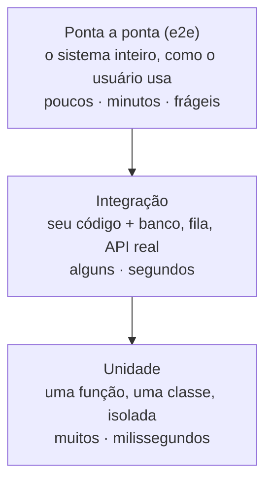
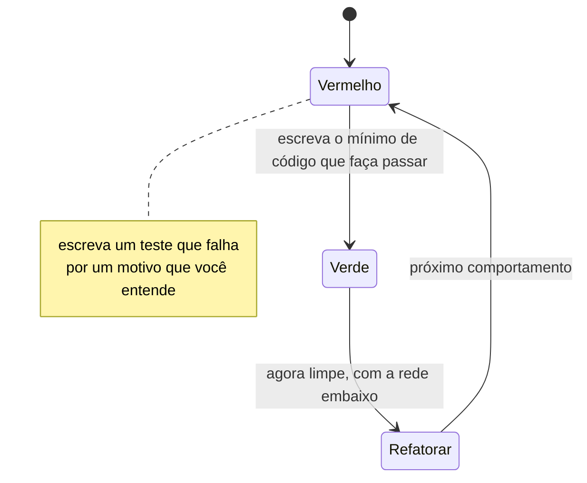

# 12. Testes automatizados

> [!NOTE] Em uma frase
> Um teste não existe para provar que o código funciona hoje; existe para que amanhã alguém consiga mudar esse código sem medo.

## Por que isso importa

A Lojinha cresceu. Agora são seis pessoas programando, o `loja.py` do [módulo 1](01-codigo-que-aguenta-mudanca.md) virou vinte arquivos organizados em camadas, e o dono pediu mais uma regra: cupom de primeira compra não acumula com frete grátis.

A pessoa que pega a tarefa muda o cálculo do carrinho em dez minutos. Aí vem a parte longa: abrir o site, criar um pedido com cupom, conferir. Criar outro sem cupom, conferir. Um acima de R$ 200, outro abaixo. Um com item esgotado. Meia hora depois ela acha que está certo e abre o PR. Duas semanas depois, um cliente reclama que pagou frete num pedido de R$ 300 — um caso que ninguém lembrou de abrir no navegador.

Repare no que aconteceu de verdade: **a conferência existia**, ela só não era automática. Toda vez que alguém mexe no carrinho, alguém refaz aquela meia hora na mão, cansado, pulando casos. E, como a conferência é cara, o time começa a evitá-la: "essa mudança é pequena, não precisa testar". O medo se acumula até virar aquela frase que todo time conhece — *"esse código aqui ninguém mexe"*.

O [módulo 1](01-codigo-que-aguenta-mudanca.md) disse que código bom é código barato de mudar. Teste automatizado é o que torna essa frase verificável: sem ele, refatorar não é melhorar o código, é apostar.

## O que você precisa saber antes

O [módulo 1](01-codigo-que-aguenta-mudanca.md) (acoplamento, coesão, por que mudar fica caro) e o [módulo 2](02-fronteiras-e-dependencias.md) (fronteiras e inversão de dependência). O segundo importa mais do que parece: **código testável e código com boas fronteiras são a mesma coisa**, vista de dois ângulos.

## O que um teste automatizado é

Um teste é um programa que executa o seu programa e afirma alguma coisa sobre o resultado. Nada mais místico do que isso. A forma clássica tem três partes, que em inglês viraram *arrange, act, assert*: prepare a situação, execute, confira.

```python
def test_frete_gratis_acima_de_200():
    carrinho = Carrinho(itens=[Item("caneca", preco=250)])   # prepare
    frete = calcular_frete(carrinho)                          # execute
    assert frete == 0                                         # confira
```

Três coisas que esse exemplo de seis linhas já ensina:

- **O teste é uma segunda descrição do comportamento.** O código diz como o frete é calculado; o teste diz o que se espera dele. Quando os dois discordam, você descobriu algo: ou o código está errado, ou o seu entendimento da regra estava.
- **O nome do teste é documentação.** `test_frete_gratis_acima_de_200` conta a regra de negócio para quem chegar daqui a um ano. `test_frete_2` não conta nada.
- **Teste encontra defeito, nunca prova ausência de defeito.** Essa observação é do cientista da computação Edsger Dijkstra e continua sendo a coisa mais importante a lembrar sobre testes. Passar em mil testes não quer dizer "está correto"; quer dizer "não está errado *daqueles mil jeitos*". É por isso que a pergunta certa nunca é "tem teste?", e sim "esse teste pegaria o erro que me preocupa?".

## A pirâmide: três tamanhos de teste

Nem todo teste custa o mesmo. Quanto mais pedaços do sistema o teste liga, mais confiança ele dá e mais caro ele fica — em tempo, em manutenção e em dor de cabeça. A forma consagrada de pensar nesse trade-off é a **pirâmide de testes**, uma ideia que Mike Cohn popularizou e Martin Fowler divulgou.



- **Teste de unidade**: pega um pedaço pequeno — uma função, uma classe — e testa isolado. `calcular_frete` recebe um carrinho e devolve um número; não precisa de banco nem de rede. Roda em milissegundos, então você pode ter milhares e rodar todos a cada salvamento de arquivo. Quando falha, aponta exatamente onde está o problema.
- **Teste de integração**: testa que as suas peças conversam com o mundo de verdade. O repositório de pedidos realmente grava no PostgreSQL? A consulta devolve o que você acha que devolve? Precisa de um banco de verdade (hoje, normalmente, um container que sobe junto com o teste). Mais lento, mais valioso: é onde moram os erros que o teste de unidade nunca vê, como um `JOIN` errado ou uma coluna que mudou de nome.
- **Teste de ponta a ponta**: abre o site, clica, finaliza uma compra. Testa o que o usuário faz, inclusive as partes que você não escreveu. É o mais convincente e o mais caro: leva minutos, quebra quando o botão muda de lugar e, quando falha, só diz "a compra não funcionou" — sem dizer por quê.

A proporção importa. Um time que inverte a pirâmide — poucos testes de unidade e muitos de ponta a ponta — chega no que se chama **cone de sorvete**: uma suíte que leva quarenta minutos, falha por motivos aleatórios e que o time aprende a ignorar. A regra prática: **escreva o teste no nível mais baixo capaz de pegar o erro que te preocupa**.

> [!TIP] Outra forma de cortar o mesmo bolo
> A engenharia do Google prefere classificar testes por *tamanho* (pequeno, médio, grande) em vez de por camada, definindo tamanho pelo que o teste pode usar: um teste pequeno roda num processo só, sem rede, sem disco, sem `sleep`. É um critério mais objetivo do que discutir se algo "é unidade ou integração" — discussão que consome mais tempo de time do que deveria.

## Dublês: trocar o mundo por uma peça controlável

O carrinho da Lojinha precisa falar com o gateway de pagamento. Você não quer que cada execução da suíte cobre R$ 250 de um cartão de verdade. Então, no teste, você substitui o gateway por uma peça que finge ser ele. Essa peça é um **dublê de teste** (*test double*, no vocabulário de Gerard Meszaros e Martin Fowler) — o nome vem do dublê de cinema: entra no lugar do ator na cena perigosa.

Os tipos que você vai ouvir:

| Dublê | O que faz | Exemplo na Lojinha |
|---|---|---|
| **Dummy** | Só preenche um parâmetro, nunca é usado | Um objeto `Logger` vazio passado para o construtor |
| **Stub** | Devolve respostas prontas | `ConsultaFreteStub` que sempre responde "R$ 18,90" |
| **Fake** | Implementação de verdade, mas simplificada | `RepositorioDePedidosEmMemoria`, um dicionário no lugar do banco |
| **Spy** | Grava o que aconteceu, para você conferir depois | Um e-mail falso que guarda as mensagens "enviadas" |
| **Mock** | Já vem com a expectativa embutida e falha se ela não for cumprida | "o gateway deve ser chamado uma vez com R$ 250" |

A regra que evita 90% dos problemas: **duble o que você não controla, não duble o seu próprio domínio**. Rede, relógio, aleatoriedade, serviço de terceiro, e-mail: duble. A regra de cálculo do frete: nunca. Um teste que dubla a lógica de negócio não testa nada além de si mesmo.

E repare de onde vem a possibilidade de fazer isso. Para trocar o gateway real por um dublê, o carrinho não pode instanciar o gateway por dentro; ele precisa receber de fora quem faz o pagamento. Isso é exatamente a inversão de dependência do [módulo 2](02-fronteiras-e-dependencias.md). **Testabilidade não é uma disciplina separada: é o sintoma de que as fronteiras estão nos lugares certos.** Quando um teste é difícil de escrever, quase sempre o problema não é o teste — é o desenho.

## O que separa um teste bom de um teste ruim

Testes também são código, e código ruim tem custo. Cinco propriedades definem um teste em que vale a pena confiar:

1. **Rápido.** Se a suíte leva quinze minutos, ninguém roda antes de commitar, e ela deixa de proteger.
2. **Determinístico.** Mesmo código, mesmo resultado, sempre. Teste que depende da data de hoje, da ordem de execução ou de um `sleep(2)` esperando algo ficar pronto é uma armadilha com relógio.
3. **Independente.** Cada teste prepara o que precisa e não deixa resíduo. Testes que só passam na ordem certa são um bloco único disfarçado de suíte.
4. **Legível.** Alguém que não escreveu o teste deve entender a regra lendo só ele.
5. **Falha com diagnóstico.** `assert resultado == esperado` numa linha é pior do que uma mensagem dizendo qual pedido, qual campo, qual valor.

O inimigo número um dessa lista tem nome: **teste intermitente** (*flaky*), aquele que passa e falha sem nada mudar. Ele é pior do que nenhum teste, porque destrói a única coisa que torna a suíte útil: a crença de que vermelho significa problema. Depois do terceiro "roda de novo que passa", o time passa a rodar de novo sempre — inclusive nas vezes em que o vermelho era real. Teste intermitente se conserta ou se tira da suíte; não se convive com ele.

E o erro mais comum de todos: **testar implementação em vez de comportamento**. Se renomear um método privado quebra trinta testes, esses testes estão amarrados ao *como*, não ao *o quê*. O sinal é claro: depois de uma refatoração que não mudou nenhum comportamento, a suíte deveria continuar verde. Se ela quebra, ela está atrapalhando justamente a atividade que deveria proteger.

## TDD: escrever o teste antes

*Test-Driven Development* inverte a ordem habitual. Em vez de "escrevo o código e depois testo", são três passos curtos, repetidos muitas vezes por hora:



Por que isso ajuda, concretamente:

- **Você projeta a função pela ótica de quem a usa.** O primeiro código que você escreve é a chamada, não a implementação. Interfaces desenhadas assim tendem a ser mais simples, porque você sente o incômodo antes de pagar por ele.
- **Você só escreve código que alguém pediu.** Cada linha existe porque um teste vermelho exigiu. É o antídoto natural contra a generalização especulativa.
- **A rede chega antes da hora em que você precisa dela.** O passo "refatorar" só é seguro porque o verde acabou de aparecer.
- **O vermelho é verificado.** Ver o teste falhar antes de passar é a única garantia de que ele testa alguma coisa. Teste escrito depois do código, e que nunca foi visto vermelho, às vezes passa com a implementação quebrada.

Aqui cabe uma honestidade que falta em muito material sobre o assunto: **TDD não é obrigatório e não é consenso**. A prática funciona muito bem para lógica de negócio com entrada e saída claras — o cálculo do carrinho é o caso ideal. Funciona mal quando você ainda não sabe o que quer construir: explorar uma API nova, mexer em layout, descobrir o formato de um dado. Nesses casos, o caminho honesto é explorar primeiro, jogar o rascunho fora e escrever a versão definitiva com testes. Tratar TDD como regra moral gera mais discussão do que software.

## Cobertura: um termômetro, nunca uma meta

**Cobertura de testes** é a porcentagem do código que foi executada quando a suíte rodou. Existe cobertura de linha (quais linhas rodaram) e de ramo (quais caminhos do `if` foram percorridos — a mais útil das duas).

A cobertura é excelente para uma pergunta e péssima para outra.

- **Boa para:** "que parte do sistema nenhum teste encosta?". Abrir o relatório e ver que o módulo de cálculo de imposto está em 0% é informação acionável.
- **Péssima para:** "o código testado está bem testado?". Cobertura mede execução, não verificação. Um teste que chama todas as funções e não tem nenhum `assert` dá 100%.

Por isso cobertura vira um problema no instante em que vira meta. Quando o time precisa bater 90%, aparecem testes escritos para cobrir linha, não para pegar erro — e você passa a pagar manutenção de uma suíte que não protege nada. É o fenômeno que o economista Charles Goodhart descreveu: quando uma medida vira alvo, ela deixa de ser uma boa medida.

Uma referência razoável: use a cobertura para achar buracos, combine um piso baixo no CI (para não regredir), e avalie a qualidade dos testes de outro jeito. O jeito mais direto é o **teste de mutação**: uma ferramenta altera o seu código de propósito (troca um `>` por um `>=`, inverte um `if`) e verifica se algum teste reclama. Mutação que sobrevive é um buraco real, do tipo que a cobertura não enxerga.

## Na prática

- **Comece pelo bug.** A melhor hora de escrever o primeiro teste de um sistema sem testes é quando um bug aparece: escreva o teste que reproduz o bug, veja-o vermelho, conserte. Você ganha a correção, a prova de que corrigiu e a proteção contra a volta dele.
- **Teste difícil é diagnóstico de desenho.** Antes de inventar um mock elaborado, pergunte por que a função precisa de sete colaboradores para fazer uma conta.
- **Um motivo de falha por teste.** Se o teste tem cinco `assert` sobre coisas diferentes, ele esconde quatro quando falha no primeiro.
- **O caso de borda é onde está o bug.** Carrinho vazio, quantidade zero, estoque negativo, cupom expirado há um segundo, nome com emoji. A regra de negócio feliz quase nunca é o que quebra.
- **Se o seu sistema conversa com outro serviço**, vale conhecer **teste de contrato**: em vez de subir os dois sistemas, cada lado testa contra um acordo escrito do formato trocado. É a resposta prática para microsserviços sem uma suíte de ponta a ponta gigante.
- **Teste é código de produção.** Ele é lido, revisado e refatorado como o resto. Duplicação e nome ruim custam caro ali também.

## Armadilhas comuns

- **"Escrevo os testes depois."** Depois costuma ser nunca; e, pior, o código escrito sem ninguém chamá-lo de fora já nasce difícil de chamar de fora.
- **"Mockei tudo, está isolado."** Dublar demais produz um teste que verifica que o seu código chama o que você mandou chamar. Ele continua passando quando a lógica está errada.
- **"Temos 92% de cobertura, estamos seguros."** Cobertura diz que a linha rodou, não que alguém conferiu o resultado.
- **"Esse teste falha de vez em quando, mas é falso positivo."** Às vezes é um erro de concorrência de verdade, aparecendo exatamente como ele aparece em produção. Investigue antes de rotular.
- **"Teste de ponta a ponta cobre tudo, não preciso dos outros."** Cobre tudo e explica nada. Quando ele fica vermelho às três da tarde, a investigação começa do zero.
- **"Esse código não dá para testar."** Quase sempre quer dizer "esse código mistura decisão com efeito colateral". Separe a conta (que você testa facilmente) do envio do e-mail (que você dubla).

## Verifique se entendeu

1. Por que um teste que quebra quando você renomeia um método privado é um teste ruim, mesmo que ele passe hoje?
2. A Lojinha quer testar que o pedido é gravado corretamente no banco. Que nível da pirâmide você usa, e o que você perde se tentar fazer isso com um dublê?
3. Qual a diferença prática entre um *stub* e um *mock*? Dê um caso na Lojinha em que usar um no lugar do outro muda o que o teste prova.
4. Um colega propõe meta de 95% de cobertura no CI. Que argumento você usa, e o que você propõe no lugar?
5. Em que situação você *não* usaria TDD, e por quê?
6. Seu time tem um teste que falha em 1 de cada 20 execuções. Qual é o custo real disso, e quais são as duas saídas aceitáveis?

## Quer ir mais fundo?

> [!TIP] Opcional
> Nada aqui é obrigatório. O módulo foi escrito para se bastar.

- [Clean Architecture: detalhes e Humble Objects](../arquitetura/clean-architecture/05b-detalhes-e-humble-objects.md): o padrão que separa a parte difícil de testar (tela, banco) da lógica que você quer testar — a base de quase todo código testável.
- [Fundamentals of Software Architecture: modularidade](../arquitetura/fundamentals-software-architecture/02-modularidade.md): acoplamento e conascência, que explicam por que alguns módulos são impossíveis de testar isoladamente.
- [The Practical Test Pyramid](https://martinfowler.com/articles/practical-test-pyramid.html), de Ham Vocke: o texto de referência sobre as camadas, com exemplos de código em cada uma.
- [Test Double](https://martinfowler.com/bliki/TestDouble.html) e [Unit Test](https://martinfowler.com/bliki/UnitTest.html), de Martin Fowler: o vocabulário dos dublês e por que "unidade" significa coisas diferentes para times diferentes.
- [Software Engineering at Google](https://abseil.io/resources/swe-book), capítulos 11 a 14 (gratuito em HTML): a visão por tamanho de teste, testes unitários, dublês e testes grandes, na escala de um monorepo enorme.
- [Testing on the Toilet / Google Testing Blog](https://testing.googleblog.com/): posts curtos, muito práticos, sobre um problema de teste por vez.

---
Anterior: [11. ML em produção](11-ml-em-producao.md) · Próximo: [13. Entrega e colaboração](13-entrega-e-colaboracao.md) · Voltar ao [início do guia](index.md)
