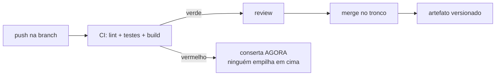
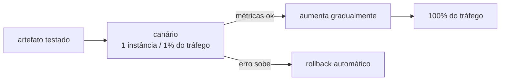

# 13. Entrega e colaboração

> [!NOTE] Em uma frase
> Código que não chegou ao usuário não vale nada; e o jeito mais seguro de fazer chegar é entregar pedaços pequenos muitas vezes, não pedaços grandes de vez em quando.

## Por que isso importa

A Lojinha tem seis pessoas programando e uma regra não escrita: **deploy é na quinta de manhã**. Sexta não, porque ninguém quer passar o fim de semana acordado. Começo de semana também não, porque é quando fecha o relatório.

Na quinta passada, o deploy levou três semanas de trabalho de quatro pessoas: a nova vitrine, a integração com o novo transportador, uma refatoração no cálculo de frete e uns ajustes de layout. Subiu às 9h. Às 9h40 os pedidos pararam de ser criados. Ninguém sabia qual das quatro coisas causou — havia 180 arquivos modificados no mesmo pacote. O time voltou a versão anterior às 10h20 e passou o resto do dia descobrindo (era uma migração de banco que rodou antes do código novo, numa ordem que ninguém tinha testado).

A pergunta óbvia é "como evitar esse bug". A pergunta útil é outra: **por que uma entrega continha três semanas de mudanças?** Porque deploy dava medo. E dava medo porque cada deploy era enorme. E cada deploy era enorme porque eles eram raros. Esse ciclo se alimenta sozinho, e quase todo problema de entrega que você vai encontrar na carreira é uma variação dele.

## O que você precisa saber antes

O [módulo 12](12-testes-automatizados.md) é pré-requisito de verdade: integração contínua sem testes automatizados é só um compilador remoto. Ajuda ter lido o [módulo 5](05-dados-por-dentro.md) (evolução de esquema de dados) para a parte de migrações, e o [módulo 4](04-decisoes-de-arquitetura.md) para entender por que a forma do sistema limita a forma da entrega.

## Tamanho de lote: o conceito por trás de quase tudo

Pegue emprestada uma ideia de fábrica. **Tamanho de lote** é quanta coisa você acumula antes de processar de uma vez. Lote grande parece eficiente — um deploy só, um teste só, uma reunião só — e é exatamente o contrário, por três motivos que valem para software inteiro:

- **O risco não cresce junto com o lote, cresce mais rápido.** Com dez mudanças juntas, não há dez coisas que podem falhar: há dez, mais as interações entre elas.
- **O diagnóstico piora.** Uma mudança quebrou? Você sabe qual é. Quarenta mudaram? Você tem uma investigação pela frente.
- **O feedback atrasa.** Código escrito há três semanas e testado hoje por um usuário te ensina três semanas depois, quando quem escreveu já esqueceu o contexto.

Quase toda prática deste módulo — integração contínua, PR pequeno, canário, feature flag — é a mesma receita aplicada em lugares diferentes: **diminuir o lote**.

## Controle de versão sem virar tutorial de comandos

Você já usa git. O que importa aqui não são os comandos, é a decisão por trás deles: **quanto tempo o seu trabalho fica separado do trabalho dos outros**.

Enquanto a sua branch vive sozinha, ela está envelhecendo em relação ao tronco. No primeiro dia, o conflito é zero. No décimo quinto, outra pessoa já renomeou a classe que você está usando, e o merge vira uma tarde de arqueologia. Isso tem nome: **inferno de merge**, e a causa nunca é o git — é o tempo.

Dois modelos aparecem o tempo todo:

| | **Trunk-based** | **Git-flow e parentes** |
|---|---|---|
| Como é | Branches de horas a 1–2 dias, integradas no tronco direto | Branches de feature longas, branch de release, branch de hotfix |
| Pressupõe | Suíte de testes confiável e deploy barato | Versões com data, release testada em bloco |
| Bom para | Serviço web que entrega várias vezes por dia | Software com versões (um app desktop, uma biblioteca, firmware) |
| Custo | Exige disciplina: a mudança precisa caber em um dia | Merge caro, feedback lento, "o que tem na develop?" |

Não existe escolha universal aqui — existe coerência. Um time que entrega quatro vezes por dia com git-flow está pagando por uma cerimônia que não usa. Um time que publica uma versão por trimestre com trunk-based não tem onde estabilizar a release.

> [!IMPORTANT] A objeção que todo mundo faz
> "Mas a minha feature leva três semanas, não dá para integrar em um dia." Dá — essa é justamente a função das *feature flags*, mais adiante neste módulo. Integrar todo dia não quer dizer entregar a feature pela metade ao usuário; quer dizer que o código já está no tronco, compilando e testado, apenas desligado.

## Integração contínua: o adjetivo é o que importa

**Integração contínua** (CI) não é "ter um GitHub Actions". É uma prática de time: todo mundo integra o próprio trabalho ao tronco pelo menos uma vez por dia, e cada integração dispara uma verificação automática. A ferramenta é consequência; a frequência é a prática.



Duas regras simples fazem o CI funcionar e a ausência delas o torna decorativo:

1. **O tronco está sempre verde.** Build vermelho é parada de linha: quem quebrou conserta ou reverte, antes de qualquer outra coisa. Um tronco que fica vermelho por dois dias ensina o time a ignorar o vermelho — e aí você tem o custo do CI sem o benefício.
2. **A verificação é rápida.** Se o CI leva quarenta minutos, as pessoas abrem o PR e vão fazer outra coisa; o contexto se perde e o lote volta a crescer. Dez minutos é um alvo razoável; acima disso, vale separar o que roda em todo push do que roda antes do deploy.

Três palavras que vivem sendo confundidas, e que descrevem três degraus diferentes:

- **Integração contínua**: o código de todos se junta no tronco o tempo todo, verificado automaticamente.
- **Entrega contínua** (*continuous delivery*): todo commit no tronco gera um artefato **pronto para ir a produção**. A decisão de subir é humana, mas o caminho está automatizado e sempre testado.
- **Deploy contínuo** (*continuous deployment*): todo commit que passa vai sozinho para produção, sem apertar botão.

A maioria dos times quer o segundo. O terceiro exige o segundo mais uma confiança que se constrói com o resto deste módulo.

## Code review: para que ele serve de verdade

Revisar código não é procurar erro de sintaxe — isso é trabalho de linter e de compilador, e qualquer tempo humano gasto nisso é desperdício. Review serve para três coisas que nenhuma ferramenta faz:

- **Pegar o que o teste não pega**: um caso de negócio que ninguém pensou, um nome que vai confundir quem ler daqui a um ano, uma decisão de design que vai cobrar caro depois.
- **Espalhar contexto**: depois do review, duas pessoas conhecem aquele pedaço do sistema. Isso é o que impede o "só o fulano mexe nisso".
- **Registrar o porquê**: a conversa do PR vira a memória da decisão, consultável no dia em que alguém perguntar "por que isso é assim?".

O que mais influencia a qualidade de um review é banal: **o tamanho do diff**. Um PR de 50 linhas recebe perguntas específicas; um de 800 recebe "LGTM". Se a mudança é inevitavelmente grande (uma renomeação em massa, por exemplo), separe o que é mecânico do que é decisão, em PRs diferentes, e diga isso na descrição.

Duas posturas que mudam o clima do review sem custar nada:

- **Pergunte em vez de afirmar.** "Esse caminho cobre o caso de estoque zerado?" convida a pensar; "você esqueceu o estoque zerado" convida a se defender — e às vezes quem esqueceu alguma coisa é quem revisa.
- **Aprove o que melhora o sistema, não o que ficou perfeito.** É o critério que o guia público de code review do Google adota, e ele resolve a maior parte dos PRs travados: a pergunta não é "eu teria escrito assim?", é "isso deixa a base de código melhor do que está?". Preferência de estilo que não muda nada vira comentário opcional, não bloqueio.

## Separar deploy de release: feature flags

Essas duas palavras são tratadas como sinônimo e não são:

- **Deploy**: o código novo está rodando nos servidores.
- **Release**: o usuário passou a ver o comportamento novo.

Juntar as duas é o que obriga a branch a viver três semanas. Separá-las é um `if` cujo valor vem de fora do código:

```python
if flags.ativa("nova-vitrine", cliente):
    return vitrine_recomendada(cliente)
return vitrine_mais_vendidos(cliente)
```

Com isso, a vitrine nova entra no tronco no primeiro dia, desligada. Vai a produção todo dia junto com o resto, sem afetar ninguém. Quando estiver pronta, você liga para 1% dos clientes, depois 10%, depois todos — e, se der errado, desliga em segundos, **sem deploy**.

A conta do outro lado: flag é dívida. Cada uma dobra os caminhos possíveis do código e, portanto, o que precisa ser testado. Flag de lançamento tem vida curta por definição: ligou para todos, remova o `if` e o código velho na semana seguinte. Flag que fica para sempre precisa ser uma decisão consciente (configuração por cliente, *kill switch* de emergência), não um esquecimento.

## Liberar aos poucos e desfazer rápido



- **Canário**: a versão nova recebe uma fatia pequena do tráfego e fica sob observação. O nome vem do canário que os mineiros levavam para dentro da mina: ele sente o gás antes das pessoas. O ponto é que o erro atinge 1% dos clientes, não todos — e você só continua se as métricas do [módulo 14](14-observabilidade-e-operacao.md) disserem que pode.
- **Blue-green**: você mantém dois ambientes completos. O tráfego está no azul; você sobe a versão nova no verde, testa, e vira a chave. Se der errado, vira de volta. Caro (duas vezes a infraestrutura) e muito rápido de reverter.
- **Rollback**: voltar para a versão anterior. A pergunta que define a saúde da sua entrega não é "com que frequência quebra?", é **"quanto tempo leva para desfazer?"**. Um time que reverte em dois minutos pode se dar ao luxo de arriscar; um que leva duas horas precisa de um processo pesado para compensar — e paga por isso em velocidade.

A parte difícil do rollback quase nunca é o código: é o **banco de dados**. Se a versão nova renomeou uma coluna, voltar o código não resolve, porque o dado já mudou de forma. A saída padrão é fazer migrações em dois passos compatíveis dos dois lados — o padrão *expand/contract*:

1. **Expandir**: adicione a coluna nova; o código novo escreve nas duas, o antigo continua lendo a velha. Nada quebra se você voltar atrás.
2. **Migrar**: preencha os dados antigos e passe a leitura para a coluna nova.
3. **Contrair**: só depois que ninguém mais usa a coluna velha, remova — num deploy separado.

É mais lento do que renomear de uma vez. É também a diferença entre um incidente de dois minutos e um de duas horas, como o da quinta-feira da Lojinha.

## Como saber se a entrega está saudável

O programa de pesquisa **DORA** (*DevOps Research and Assessment*) acompanha times de software há anos e popularizou quatro medidas que, juntas, descrevem a entrega:

| Medida | Pergunta | Lojinha hoje |
|---|---|---|
| Frequência de deploy | Com que frequência o código chega a produção? | 1× por semana |
| Lead time para mudança | Quanto tempo do commit até estar em produção? | ~8 dias |
| Taxa de falha de mudança | Que fração das entregas causa problema? | ~1 em 4 |
| Tempo de restauração | Quanto tempo para voltar ao normal? | ~1 hora |

O achado mais útil dessa pesquisa é contraintuitivo: **velocidade e estabilidade andam juntas**. A intuição diz que entregar mais rápido quebra mais; os dados dizem que os times que entregam com mais frequência também são os que quebram menos e se recuperam mais rápido — porque lote pequeno, automação e rollback rápido melhoram as duas coisas ao mesmo tempo. Não é que eles correm risco e dão sorte; é que a forma de entregar deles tem menos risco por entrega.

## Na prática

- **Seu PR deve caber na cabeça de quem revisa.** Se você não consegue descrever a mudança em três linhas, provavelmente são dois PRs.
- **Escreva o porquê na descrição.** O diff mostra o quê; só você sabe qual alternativa foi descartada e por quê.
- **Integre todo dia, mesmo sem terminar.** Código no tronco atrás de flag é mais seguro do que código "quase pronto" na sua máquina.
- **Antes de qualquer feature nova numa base assustadora, meça o rollback.** Se não dá para desfazer, o primeiro trabalho é esse.
- **Nunca combine migração de banco e mudança de código no mesmo deploy** quando a migração for destrutiva. Dois deploys, nesta ordem: compatível primeiro.
- **Build vermelho no tronco é interrupção legítima.** Tratar como "depois eu vejo" é a forma mais barata de perder o CI inteiro.

## Armadilhas comuns

- **"Temos CI porque temos pipeline."** Pipeline rodando em branches que só integram depois de duas semanas não é integração contínua; é verificação atrasada com nome bonito.
- **"A feature é grande, então a branch é longa."** Tamanho da feature e tamanho do lote são coisas diferentes. Flag separa as duas.
- **"Deploy de sexta é perigoso."** O sintoma é real, o diagnóstico é errado. O que é perigoso é deploy grande e irreversível — e isso é perigoso na terça também. Times que entregam dez vezes por dia não olham o calendário.
- **"Rollback é admitir derrota."** Rollback é a ferramenta mais barata de contenção que existe. Investigar com o site fora do ar é a decisão cara.
- **"Essa flag a gente tira depois."** Depois é nunca, e daqui a um ano ninguém sabe o que acontece se ela for ligada. Flag de lançamento nasce com prazo.
- **"Review é controle de qualidade."** Se o review é a sua única rede, ele vai falhar: pessoas lendo diff não executam código. A rede é o [módulo 12](12-testes-automatizados.md); o review cuida do que testes não veem.

## Verifique se entendeu

1. Por que entregas raras tendem a ser arriscadas, mesmo quando o time é cuidadoso? Descreva o ciclo com as suas palavras.
2. Qual é a diferença entre deploy e release, e que problema concreto das branches longas a separação resolve?
3. A Lojinha precisa renomear a coluna `valor_frete` para `frete_centavos`. Descreva os passos para que seja possível voltar atrás em qualquer momento.
4. Em que situação git-flow é a escolha certa e trunk-based seria um estorvo?
5. Seu time tem taxa de falha de mudança alta e tempo de restauração alto. Em qual dos dois você mexeria primeiro, e por quê?
6. Um colega abre um PR de 700 linhas que mistura refatoração e feature nova. O que você pede, e com que argumento?

## Quer ir mais fundo?

> [!TIP] Opcional
> Nada aqui é obrigatório. O módulo foi escrito para se bastar.

- [Fundamentals of Software Architecture: decisões e ADRs](../arquitetura/fundamentals-software-architecture/08-decisoes-e-adrs.md): como registrar decisões de arquitetura — o primo documental da descrição de PR.
- [Continuous Integration](https://martinfowler.com/articles/continuousIntegration.html), de Martin Fowler: o artigo que definiu a prática, com a explicação de por que a frequência é o ponto.
- [Feature Toggles](https://martinfowler.com/articles/feature-toggles.html), de Pete Hodgson: os tipos de flag, o ciclo de vida de cada um e como evitar a dívida.
- [Canary Release](https://martinfowler.com/bliki/CanaryRelease.html) e [Blue-Green Deployment](https://martinfowler.com/bliki/BlueGreenDeployment.html): as duas estratégias em uma página cada.
- [trunkbaseddevelopment.com](https://trunkbaseddevelopment.com/): o modelo de branches explicado em detalhe, inclusive quando ele não serve.
- [Google Engineering Practices: Code Review](https://google.github.io/eng-practices/review/): o guia público do Google, com o padrão do revisor e o do autor, separados.
- [DORA](https://dora.dev/): as quatro medidas, a pesquisa por trás e um questionário para situar o seu time.
- [The Twelve-Factor App](https://12factor.net/): doze regras sobre configuração, build/release/run e processos — curto e ainda relevante.

---
Anterior: [12. Testes automatizados](12-testes-automatizados.md) · Próximo: [14. Observabilidade e operação](14-observabilidade-e-operacao.md) · Voltar ao [início do guia](index.md)
