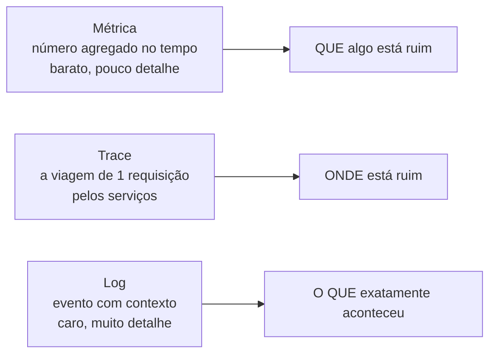
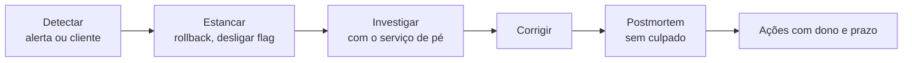

# 14. Observabilidade e operação

> [!NOTE] Em uma frase
> Em produção você não tem depurador nem `print`: você só tem aquilo que o sistema contou sobre si mesmo antes de dar errado — então essa conversa precisa ser planejada antes.

## Por que isso importa

Terça-feira, 15h. Um cliente reclama nas redes sociais que o checkout da Lojinha "está travando". O time olha o painel: CPU normal, memória normal, nenhum erro 500 no gráfico. Alguém responde que "está tudo verde aqui".

Às 15h40, com mais reclamações, descobre-se o seguinte: a chamada ao gateway de pagamento está levando 9 segundos para cerca de 3% dos pedidos. O tempo **médio** de resposta do checkout é 240 ms — porque 97% dos pedidos respondem em 180 ms e a média engole o resto. Os 3% são clientes que desistem.

Para confirmar, o time precisa descobrir *quais* pedidos. O log tem 4 milhões de linhas por hora, nenhuma com o identificador do pedido, e a linha do erro do gateway e a linha do pedido correspondente estão a seiscentas linhas de distância, sem nada que as ligue. A investigação leva mais uma hora.

Nada disso foi azar. Foram três decisões tomadas meses antes, sem que ninguém percebesse que estava decidindo: **olhar média em vez de percentil**, **logar sem contexto** e **alertar em recurso (CPU) em vez de em sintoma (cliente esperando)**. Este módulo é sobre essas decisões.

## O que você precisa saber antes

O [módulo 7](07-sistemas-distribuidos-falham.md) (rede que perde mensagem, falha parcial, relógios) e o [módulo 13](13-entrega-e-colaboracao.md) — porque a causa mais comum de um incidente é a última mudança que entrou. O [módulo 11](11-ml-em-producao.md) ajuda a ver a continuidade: monitorar um modelo é um caso particular de monitorar um sistema.

## Monitorar e observar não são a mesma coisa

- **Monitoramento** responde perguntas que você já sabia fazer. Você decidiu antes que queria ver a taxa de erro e a latência, criou o painel, ele está lá. Ótimo para os problemas que você já conhece — os *known unknowns*: "sei que o banco pode ficar lento, quero ver quando ficar".
- **Observabilidade** é a propriedade de conseguir responder perguntas **novas** sobre o sistema sem precisar alterá-lo e fazer deploy. "Será que o problema só acontece para clientes do plano antigo, no app Android, pagando com Pix?" Se você consegue responder isso com o que já é coletado, o sistema é observável. Se a resposta for "vou adicionar um log e subir de novo", não é.

A diferença prática aparece exatamente nos casos como o da Lojinha, que são os *unknown unknowns*: a falha que ninguém previu, numa combinação que ninguém imaginou. Painel pronto não cobre isso — só dados com contexto suficiente para serem fatiados na hora.

## Os três sinais



**Métrica** é um número agregado ao longo do tempo: requisições por segundo, taxa de erro, tempo de resposta. É barata — você guarda um número a cada 15 segundos, não um registro por requisição —, e por isso dá para manter meses de histórico e comparar hoje com o mesmo dia do mês passado. O preço é não ter detalhe: a métrica diz que a taxa de erro subiu, nunca qual pedido falhou. Os três formatos que você vai encontrar: **contador** (só cresce: total de pedidos), **gauge** (sobe e desce: pedidos na fila agora) e **histograma** (distribuição, de onde saem os percentis).

**Log** é o registro de um evento, com o contexto dele. A decisão que muda tudo é o formato: *log estruturado* (um JSON com campos) em vez de texto livre. A diferença é poder perguntar "todos os eventos de `pagamento_falhou` do cliente X na última hora" em vez de caçar com expressão regular.

```python
# texto livre: legível por humano, inútil para busca
log.info(f"falha ao pagar pedido {pedido.id}")

# estruturado: cada campo é pesquisável e agregável
log.info("pagamento_falhou", extra={
    "pedido_id": pedido.id,
    "cliente_id": pedido.cliente_id,
    "gateway": "stripe",
    "duracao_ms": 9140,
    "trace_id": contexto.trace_id,
})
```

**Trace** (ou rastro distribuído) é a viagem de uma requisição pelo sistema inteiro. Cada etapa vira um **span** com início, fim e atributos, e todos carregam o mesmo `trace_id`. É o que transforma "o checkout está lento" em "o checkout está lento porque o span do gateway leva 9 s, e o resto soma 200 ms". Num monolito, dá para viver sem; a partir do momento em que uma requisição atravessa três serviços — o cenário do [módulo 4](04-decisoes-de-arquitetura.md) —, trace deixa de ser luxo.

A peça que amarra os três é o **identificador de correlação**: um `trace_id` gerado na borda e propagado por toda chamada seguinte, inclusive para dentro dos logs. É a coisa mais barata de implementar e a que mais economiza tempo em investigação. O padrão aberto que define como fazer isso (e como instrumentar os três sinais sem se casar com um fornecedor) é o **OpenTelemetry**.

## Percentis, não médias

Média é a medida errada para latência, e o motivo é simples: a média de um número que tem cauda longa não descreve ninguém. No caso da Lojinha, "240 ms de média" não era a experiência de nenhum cliente — era a mistura de 180 ms com 9 segundos.

**Percentil** responde a pergunta certa. O p95 é o valor abaixo do qual estão 95% das requisições; dito de outro jeito: **5% dos seus clientes esperaram mais do que isso**.

| Medida | O que diz | Checkout da Lojinha |
|---|---|---|
| Média | A soma dividida pela quantidade | 240 ms (não descreve ninguém) |
| p50 (mediana) | O cliente típico | 180 ms |
| p95 | 1 em 20 espera mais que isso | 1,2 s |
| p99 | 1 em 100 espera mais que isso | 9,1 s |

Duas coisas que valem a pena carregar daqui para sempre:

- **A cauda costuma ser o seu melhor cliente.** Quem tem mais pedidos no histórico, mais itens no carrinho, mais dados para processar é, exatamente por isso, quem cai no p99. É uma observação que o [módulo 5](05-dados-por-dentro.md) e a literatura de sistemas de dados fazem bastante, e ela inverte a prioridade: a cauda não é "uns casos esquisitos", é a parte cara da sua base.
- **Não se tira média de percentis.** Se três servidores reportam p99 de 1 s, 2 s e 9 s, o p99 do conjunto não é 4 s — esse número não significa nada. Percentil se calcula sobre a distribuição toda; é por isso que métricas de latência se guardam como histograma.

E ainda falta uma pergunta: 9 segundos são muito? Depende do que você prometeu. É o que a próxima seção resolve.

## SLI, SLO e orçamento de erro

Três siglas que carregam toda a conversa sobre confiabilidade, e que a prática de SRE (*Site Reliability Engineering*, como o Google chamou a disciplina) organizou assim:

- **SLI** (*indicator*) — **a medida**. "Porcentagem de requisições de checkout respondidas com sucesso em menos de 1 segundo." Repare que é uma definição precisa: o que conta como sucesso, qual rota, qual limite.
- **SLO** (*objective*) — **a meta** sobre essa medida. "99,9% ao longo de 30 dias." Já está no [glossário](../glossario.md#slo).
- **SLA** (*agreement*) — **o contrato** com o cliente, com consequência comercial se for descumprido. Normalmente mais frouxo que o SLO interno, de propósito: você quer ser avisado antes de dever dinheiro a alguém.

O SLO é mais útil do que parece, porque ele define o seu **orçamento de erro** (*error budget*): a quantidade de falha que você tem **permissão** para gastar.

| SLO em 30 dias | Tempo de falha permitido |
|---|---|
| 99% | ~7 horas |
| 99,9% | ~43 minutos |
| 99,99% | ~4 minutos |

Esse número transforma uma discussão de opinião ("precisamos de mais estabilidade" × "precisamos entregar mais rápido") em uma regra combinada:

- **Orçamento sobrando** quer dizer que você pode arriscar mais: entregar com mais frequência, experimentar, migrar aquele componente.
- **Orçamento estourado** quer dizer que a prioridade vira confiabilidade, até o mês virar. Não como castigo: como consequência previamente acordada.

E repare na direção contrária, que quase ninguém usa: **orçamento que nunca é consumido é sinal de que você está sendo conservador demais** — gastando engenharia em estabilidade que o cliente não percebe, em vez de gastar em produto.

> [!WARNING] 100% é a meta errada
> Além de caríssimo (cada nove custa muito mais que o anterior), é inútil: entre o seu servidor e o cliente existem o Wi-Fi dele, a operadora, o DNS e o navegador. Um serviço com 99,999% de disponibilidade entrega, para esse cliente, a confiabilidade da pior peça do caminho. Escolha o SLO pelo ponto em que o usuário deixa de notar a diferença.

## Alerta que vale acordar alguém

Alerta é uma interrupção na vida de uma pessoa. Essa frase deveria ser suficiente para filtrar 80% dos alertas que existem por aí.

O critério mais útil é **alertar em sintoma, não em causa**:

- **Causa**: "CPU acima de 90%". Pode ser absolutamente normal — talvez seja um processamento em lote fazendo o trabalho dele. Dispara quando não há problema e não dispara em metade dos problemas reais.
- **Sintoma**: "menos de 99% dos checkouts respondendo em 1 s nos últimos 10 minutos". Isso é o cliente sofrendo. Se está acontecendo, importa, qualquer que seja a causa — inclusive as que ninguém previu.

Antes de criar um alerta, três perguntas. Se alguma resposta for "não", ele não deveria tocar o telefone de ninguém:

1. **É urgente?** Precisa de ação agora, ou pode virar uma tarefa para amanhã? (A segunda opção é legítima e subusada: um alerta que vira ticket, não telefonema.)
2. **É acionável?** Existe algo que a pessoa acordada às 3h pode *fazer*? Alerta sobre o qual não se age é só ansiedade automatizada.
3. **Tem runbook?** Um documento curto dizendo o que esse alerta significa, como confirmar e quais são os primeiros passos. Quem está de plantão não é necessariamente quem escreveu o código.

O inimigo aqui é a **fadiga de alerta**. Um alerta que dispara toda semana sem que ninguém faça nada treina o time a ignorar — e no dia em que ele for real, vai ser ignorado também. Alerta ruidoso é pior que alerta ausente, porque consome atenção e ainda dá sensação de cobertura.

Uma técnica que resolve boa parte do ruído: alertar sobre a **velocidade de consumo do orçamento de erro** (*burn rate*), em vez de sobre um limiar instantâneo. "Nos últimos 10 minutos, o serviço queimou orçamento num ritmo que acabaria com o mês em 2 dias" é urgente. "A taxa de erro passou de 0,1% por 30 segundos" normalmente não é.

## Quando quebra: incidente e postmortem



Duas ideias organizam quase todo incidente bem conduzido:

**Primeiro estancar, depois entender.** A tentação natural é descobrir a causa antes de agir — é o instinto de quem programa. Em produção, a ordem é a contrária: volte a versão anterior, desligue a *feature flag*, tire o nó do balanceador. Diagnóstico com o site no ar é trabalho; diagnóstico com o site fora é trabalho sob pressão, feito pior. Por isso o [módulo 13](13-entrega-e-colaboracao.md) insiste tanto em rollback rápido: ele é a ferramenta de contenção mais barata que existe.

Ajuda também separar papéis explicitamente, mesmo num time pequeno: **quem coordena** (decide e mantém a linha do tempo), **quem investiga** (mexe no sistema) e **quem comunica** (fala com o resto da empresa). Quando uma pessoa faz as três, ela faz as três mal.

**Postmortem sem culpado.** Depois que passa, escreve-se o que aconteceu: linha do tempo, impacto, o que foi feito, o que faltou. A regra é partir do princípio de que todo mundo agiu razoavelmente com a informação que tinha — porque quase sempre é verdade, e porque a alternativa (procurar culpado) garante que, no próximo incidente, as pessoas vão esconder informação em vez de trazê-la.

O teste de qualidade de um postmortem é simples: **se a conclusão é "falta de atenção" ou "erro humano", a investigação parou cedo demais**. A pergunta seguinte é sempre "por que o sistema permitiu que esse erro chegasse a produção?" — e a resposta aponta para teste ausente, alerta inexistente, processo que exigia lembrar de algo, documentação errada. Isso dá ações com dono e prazo; "ter mais cuidado" não dá.

Vale uma cautela sobre a técnica dos "cinco porquês", muito citada: ela sugere uma cadeia única de causas, e incidentes reais quase nunca têm causa única. Normalmente são três ou quatro coisas que, sozinhas, não causariam nada. Procurar *a* causa raiz costuma esconder as outras.

## Na prática

- **Instrumente na borda primeiro.** Taxa de erro e latência por rota, com percentis, cobrem a maior parte do que você vai precisar saber. Comece por aí, não por cem métricas internas.
- **Propague um `trace_id` desde o primeiro dia.** É barato agora e impagável no dia do incidente.
- **Log estruturado, com o identificador do negócio** (pedido, cliente). Log sem o "quem" é prosa.
- **Escreva o SLI antes do painel.** "Sucesso em menos de 1 s na rota de checkout" é uma frase que obriga o time a concordar sobre o que importa.
- **Todo alerta nasce com runbook e com dono.** Sem isso, ele nasce como ruído futuro.
- **Depois de cada incidente, pergunte "o que faria a gente descobrir isso em 2 minutos?"** — a resposta costuma ser uma métrica ou um campo de log, e costuma ser barata.
- **Teste a falha de propósito.** Desligar uma réplica num horário combinado ensina mais sobre o sistema do que qualquer documento. É a ideia por trás da *engenharia do caos*.

## Armadilhas comuns

- **"A média está ótima."** A média esconde exatamente os clientes que estão indo embora. Olhe p95 e p99.
- **"Logamos tudo, então temos observabilidade."** Volume não é contexto. Quatro milhões de linhas sem identificador correlacionável são quatro milhões de linhas inúteis.
- **"O alerta de CPU vai pegar."** Alerta em recurso dispara quando não há problema e silencia quando há. Alerte no que o cliente sente.
- **"Temos painéis lindos."** Painel é para investigar, não para vigiar. Ninguém fica olhando gráfico; o que acorda alguém é alerta, e o que diz se está bom é SLO.
- **"Nosso SLO é 99,99% porque é um número bom."** SLO sem relação com o que o usuário percebe vira ou uma promessa impossível, ou um número decorativo que ninguém respeita.
- **"O postmortem concluiu que faltou atenção."** Isso não é conclusão, é desistência. Procure o que no sistema deixou o erro passar.
- **"Observabilidade é coisa de time grande."** Um identificador de correlação, log estruturado e três métricas na borda cabem em uma tarde e servem para qualquer tamanho.

## Verifique se entendeu

1. O checkout tem média de 240 ms e p99 de 9 s. Explique, sem fórmula, por que essas duas informações não se contradizem e qual delas você levaria para uma conversa com o dono da Lojinha.
2. Qual é a diferença entre monitoramento e observabilidade? Dê uma pergunta sobre a Lojinha que só um sistema observável consegue responder.
3. Para que serve, na prática, saber que o orçamento de erro do mês está pela metade no dia 10?
4. Por que alertar em "CPU acima de 90%" é pior do que alertar em "menos de 99% dos checkouts em 1 s"? Dê um caso em que o primeiro mente nas duas direções.
5. Durante um incidente, você tem uma hipótese sobre a causa mas também tem um rollback disponível. O que você faz primeiro, e por quê?
6. Um postmortem conclui que "a pessoa esqueceu de rodar a migração". Que perguntas você faria para transformar isso em ações úteis?

## Quer ir mais fundo?

> [!TIP] Opcional
> Nada aqui é obrigatório. O módulo foi escrito para se bastar.

- [DDIA: confiável, escalável, sustentável](../system-design/ddia/01-confiavel-escalavel-sustentavel.md): de onde vem a insistência em percentis e em tratar falha como regra, não exceção.
- [Designing ML Systems: mudanças de distribuição e monitoramento](../ia/designing-ml-systems/08-mudancas-de-distribuicao-e-monitoramento.md): o mesmo problema aplicado a modelos, onde a degradação é silenciosa.
- [Site Reliability Engineering](https://sre.google/sre-book/table-of-contents/) (livro do Google, gratuito em HTML): os capítulos de [SLOs](https://sre.google/sre-book/service-level-objectives/), [monitoramento](https://sre.google/sre-book/monitoring-distributed-systems/) e [cultura de postmortem](https://sre.google/sre-book/postmortem-culture/) são os mais diretos para quem está começando.
- [The Site Reliability Workbook](https://sre.google/workbook/table-of-contents/), em especial [alerta baseado em SLO](https://sre.google/workbook/alerting-on-slos/): a parte prática, com fórmulas de *burn rate*.
- [OpenTelemetry — o que é](https://opentelemetry.io/docs/what-is-opentelemetry/) e [os sinais](https://opentelemetry.io/docs/concepts/signals/): o padrão aberto para instrumentar logs, métricas e traces sem depender de fornecedor.
- [Prometheus: boas práticas de alerta](https://prometheus.io/docs/practices/alerting/): página curta e bem direta sobre alertar em sintoma.
- [Princípios da engenharia do caos](https://principlesofchaos.org/): como injetar falha de propósito, com método.

---
Anterior: [13. Entrega e colaboração](13-entrega-e-colaboracao.md) · Próximo: [15. Evals: testando sistemas com IA](15-evals-testando-sistemas-com-ia.md) · Voltar ao [início do guia](index.md)
