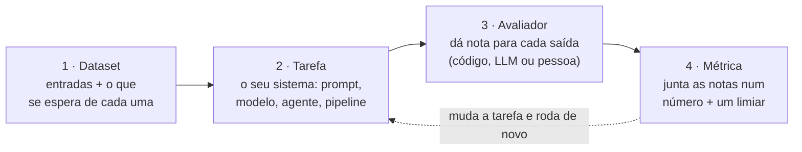
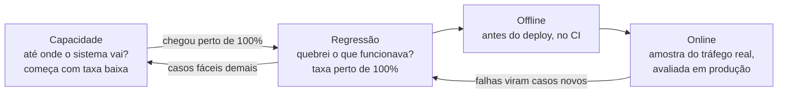

# 15. Evals: testando sistemas com IA

> [!NOTE] Em uma frase
> Quando tem um modelo de linguagem no meio do código, o resultado de um teste deixa de ser "passou ou falhou" e vira uma taxa — e o seu trabalho passa a ser comparar essa taxa entre versões.

## Por que isso importa

A Lojinha colocou um assistente no atendimento. Ele lê a mensagem que o cliente manda ("comprei a caneca semana passada e chegou rachada, queria trocar"), classifica o assunto — `troca`, `cancelamento`, `rastreio` ou `outro` —, puxa o pedido e escreve um rascunho de resposta para a pessoa do atendimento revisar.

Funcionou bem nos testes. Alguém mexe no prompt para as respostas ficarem mais curtas, porque o time de atendimento reclamou. Testa três mensagens na mão, parece ótimo, sobe. Duas semanas depois alguém percebe que pedidos de cancelamento viraram `outro` em metade dos casos — a frase que foi removida do prompt era a que ensinava a diferença entre cancelar e devolver.

Compare com o que você aprendeu no [módulo 12](12-testes-automatizados.md). Lá, uma mudança quebraria um teste, em vermelho, antes do merge. Aqui não quebrou nada, porque **não existia nada para quebrar**: a suíte de testes cobre o código em volta do modelo, não o comportamento dele. E não dá para cobrir do jeito antigo, por dois motivos:

- **A saída muda de uma execução para outra.** O mesmo prompt, com a mesma mensagem, pode gerar textos diferentes. Um caso não "passa para sempre"; ele passa *com uma certa frequência*.
- **Muitas vezes não existe uma resposta certa única.** "Resuma essa conversa para o atendente" tem infinitas respostas boas. Conferir com `==` não funciona.

A resposta para isso tem nome: **eval**.

## O que você precisa saber antes

O [módulo 12](12-testes-automatizados.md) é a base direta — este módulo é aquele, adaptado a um sistema que não responde sempre igual. O [módulo 11](11-ml-em-producao.md) ajuda bastante (avaliação offline, drift, teste com tráfego real) e o [módulo 14](14-observabilidade-e-operacao.md) explica o lado online, que aparece no fim.

## O que é um eval

> [!IMPORTANT] Definição
> Um **eval** é um teste automatizado para software que usa IA: um conjunto de entradas, uma forma de dar nota para cada saída e um número que diz se a versão nova está melhor ou pior que a anterior.

Repare no que mudou em relação a um teste comum. O resultado de um eval quase nunca é verde ou vermelho; é uma **taxa**: "87% dos casos passaram", "a nota média caiu de 4,2 para 3,6". Você compara esse número entre versões para decidir se faz o merge.

Uma analogia que ajuda: teste unitário pergunta *"esse código está correto?"*. Eval pergunta *"esse comportamento está bom o suficiente, e ficou melhor ou pior do que antes?"*. É mais parecido com um teste de carga ou um benchmark do que com um `assert`.

### Por que o teste de sempre não basta

Com um modelo no meio, três coisas que você mexe toda semana mudam o comportamento sem mudar uma linha de lógica:

| O que você mudou | O que acontece |
|---|---|
| **O prompt** | Você adiciona "seja conciso" para corrigir um caso e quebra outros dez que precisavam de detalhe |
| **O modelo** | A versão nova é melhor no geral, mas passou a formatar datas de outro jeito e o parser lá na frente quebra |
| **O contexto** | O formato dos dados que chegam mudou, e o texto que entra no modelo não é mais o que você testou |

Sem eval, o processo vira "testei uns três exemplos na mão e pareceu bom" — o que o mercado apelidou de *vibe check*. Funciona no protótipo e para de funcionar no primeiro mês de produção, porque ninguém lembra quais exemplos testou nem consegue repetir a conferência a cada mudança.

## As quatro peças de um eval

Todo eval, do mais simples ao mais sofisticado, tem as mesmas quatro peças:



Só a peça 2 muda entre execuções. Dataset, avaliador e métrica ficam fixos — é isso que torna duas versões comparáveis.

**1. Dataset: os casos.** Uma lista de entradas, cada uma com o que se espera dela. Pode ser a resposta exata (`"o assunto desta mensagem é cancelamento"`) ou um critério ("o resumo precisa citar o número do pedido"). Um arquivo `.jsonl`, uma linha por caso, já resolve. A melhor fonte de casos é **produção**: mensagens reais, principalmente as que deram problema. Comece com 20 a 50 — dá para tirar conclusão com esse tamanho, e o conjunto cresce sozinho com o tempo.

**2. Tarefa: o que está sendo testado.** A função que recebe a entrada e devolve a saída. Pode ser uma chamada só ao modelo ou um agente inteiro que usa ferramentas por vários passos. Quanto mais parecida com o código de produção, mais o eval vale: o ideal é chamar **a mesma função** que produção chama.

**3. Avaliador: quem dá a nota.** Recebe entrada, saída e o esperado, e devolve uma nota. É a peça mais importante e a mais difícil — a próxima seção é só sobre ela.

**4. Métrica: o número final.** Junta as notas: taxa de acerto, média, porcentagem acima de um limite. E vem com um **limiar** combinado antes ("não fazemos merge abaixo de 90%"). Sem limiar, o número vira enfeite.

## Quem dá a nota

Três tipos de avaliador, e uma regra prática: use **o mais simples que resolver**.

| Tipo | Como funciona | Bom para | Cuidado |
|---|---|---|---|
| **Código** | Comparação exata, expressão regular, validar JSON, rodar os testes do código gerado | Classificação, extração de campos, formato de saída, geração de código | Rígido demais: rejeita resposta certa escrita de outro jeito |
| **LLM como juiz** | Outro modelo lê a saída junto com uma rubrica e dá a nota | Resumo, tom, fidelidade ao documento, se respondeu à pergunta | O juiz também erra; precisa ser conferido contra gente antes de valer |
| **Pessoa** | Alguém lê e dá a nota | Montar o gabarito, calibrar o juiz, casos ambíguos | Lento e caro; não roda a cada commit |

### Avaliador de código: comece por aqui

Muita coisa que parece subjetiva tem uma parte checável por código. Um resumo "bom" é difícil de medir, mas "o resumo menciona o número do pedido" e "a saída é um JSON com os campos `assunto` e `pedido_id`" são `assert` comuns. Quebre o critério em pedaços e automatize os que der — exatamente o raciocínio do [módulo 12](12-testes-automatizados.md) sobre escrever o teste no nível mais baixo que pega o erro.

### LLM como juiz: como fazer direito

Quando o critério exige julgamento, você pede a um modelo que avalie. Três regras deixam o juiz confiável:

1. **Uma pergunta por juiz, com resposta binária.** "A resposta inventa algum fato que não está no pedido? sim/não" é muito mais estável do que "dê uma nota de 1 a 10 para a qualidade".
2. **Peça o raciocínio antes do veredito.** O modelo justifica e só então responde. A nota fica mais consistente e você consegue ler por que ele decidiu.
3. **Calibre contra pessoas.** Pegue uns 30 casos, dê a nota você mesmo e compare com a do juiz. Se discordarem muito, ajuste a rubrica *antes* de usar o juiz para qualquer decisão.

```text
Você avalia rascunhos de resposta ao cliente de uma loja online.

<pedido>{dados_do_pedido}</pedido>
<rascunho>{rascunho}</rascunho>

Pergunta: o rascunho afirma algum fato (valor, data, prazo, status)
que NÃO aparece nos dados do pedido?

Primeiro escreva seu raciocínio dentro de <raciocinio>.
Depois responda só SIM ou NAO dentro de <veredito>.
```

## Um eval completo em Python

Cenário: o classificador de assunto do assistente. É o caso ideal para começar, porque a resposta é única e o avaliador pode ser código.

```python
# casos.jsonl — uma linha por caso, tirados de produção
# {"id": "c01", "texto": "chegou rachada, queria trocar",     "esperado": "troca"}
# {"id": "c02", "texto": "desisti, ainda dá pra cancelar?",   "esperado": "cancelamento"}
# {"id": "c03", "texto": "comprei dia 3 e não chegou nada",   "esperado": "rastreio"}
# ... e os difíceis: mensagem de uma palavra, dois assuntos juntos, erro de digitação
```

```python
import json
from collections import Counter

from lojinha.atendimento import classificar  # a MESMA função de produção

ASSUNTOS = {"troca", "cancelamento", "rastreio", "outro"}
REPETICOES = 5   # cada caso roda 5 vezes: a saída varia
LIMIAR = 0.90    # combinado com o time antes de rodar


def avaliar(saida: str, esperado: str) -> dict:
    assunto = saida.strip().lower()
    return {
        "formato_ok": assunto in ASSUNTOS,   # respondeu algo da lista?
        "correto": assunto == esperado,
    }


def main():
    casos = [json.loads(linha) for linha in open("casos.jsonl")]
    resultados = []
    for caso in casos:
        for _ in range(REPETICOES):
            saida = classificar(caso["texto"])
            resultados.append({"id": caso["id"], "saida": saida,
                               **avaliar(saida, caso["esperado"])})

    taxa = sum(r["correto"] for r in resultados) / len(resultados)
    print(f"acerto: {taxa:.1%} em {len(resultados)} execuções")

    # O número sozinho não diz nada. Mostre ONDE errou.
    erros = Counter(r["id"] for r in resultados if not r["correto"])
    for caso_id, n in erros.most_common():
        print(f"  {caso_id}: errou {n}/{REPETICOES}")

    json.dump(resultados, open("resultado.json", "w"), ensure_ascii=False, indent=2)
    assert taxa >= LIMIAR, f"abaixo do limiar de {LIMIAR:.0%}"


if __name__ == "__main__":
    main()
```

Três detalhes desse script valem mais que o resto dele:

- **Cada caso roda várias vezes.** Se o `c07` acerta 3 de 5, ele é instável — e isso é informação que uma execução só esconde.
- **Ele lista os erros por caso e salva todas as saídas.** Você vai abrir esse arquivo e ler. É lá que aparecem os padrões ("errou todas as mensagens com menos de 50 caracteres").
- **Ele termina com `assert`.** Dá para rodar no CI do [módulo 13](13-entrega-e-colaboracao.md) e bloquear o merge, igual a um teste.

> [!TIP] Por que não usar uma biblioteca?
> Você pode, e vai querer quando o eval crescer: painel para comparar execuções, juiz pronto, paralelismo. Mas escrever essas 40 linhas uma vez ensina o que essas ferramentas fazem por baixo — e o seu primeiro eval não deveria esperar a escolha da ferramenta.

## A aleatoriedade muda a conta

Se a saída varia, uma execução isolada pode mentir para os dois lados: passar por sorte ou falhar por azar. Daí vêm duas métricas que aparecem muito e medem coisas opostas:

- **pass@k**: a chance de **pelo menos uma** de k tentativas dar certo. Serve quando o sistema pode tentar de novo e um acerto basta — gerar código e rodar os testes, por exemplo.
- **pass^k** (lê-se *pass hat k*): a chance de **todas** as k tentativas darem certo. Serve quando o usuário espera o mesmo resultado sempre, como o classificador da Lojinha.

Com a mesma taxa por tentativa, as duas andam em direções opostas conforme k cresce. Pense num atendente que usa o assistente 20 vezes num dia de trabalho:

| Acerto por tentativa | Acertar as 5 (pass^5) | Acertar as 20 (pass^20) | Ao menos 1 em 5 (pass@5) |
|---|---|---|---|
| 80% | 32,8% | 1,2% | 99,97% |
| 95% | 77,4% | 35,8% | > 99,99% |
| 99% | 95,1% | 81,8% | > 99,99% |
| 99,9% | 99,5% | 98,0% | ~100% |

A lição está na segunda coluna: **"funciona 80% das vezes" significa que o atendente vê um erro praticamente todo dia**. Escolha a métrica pela experiência que você promete, não pela que deixa o número mais bonito.

## Tipos de eval e quando cada um roda



- **Regressão**: roda a cada PR que mexe em prompt, modelo ou código ao redor. A taxa esperada é perto de 100%, porque são casos que já funcionavam.
- **Capacidade**: roda quando você explora uma feature nova ou compara modelos. Começa com taxa baixa, de propósito — ele existe para achar o teto.
- **Offline**: a versão nova contra um conjunto fixo, no seu computador ou no CI.
- **Online**: como o sistema se sai com usuários de verdade. Uma amostra das chamadas reais passa pelo juiz, e sinais indiretos entram na conta (quantos rascunhos o atendente reescreveu, quantas conversas voltaram). É o mesmo raciocínio do [módulo 14](14-observabilidade-e-operacao.md): offline mede o que você previu, online pega o que você não previu.

Os dois primeiros conversam: quando um eval de capacidade chega perto de 100%, os casos dele viram eval de regressão e você escreve casos mais difíceis para o de capacidade.

### E agentes?

Um agente executa vários passos e usa ferramentas, então há duas coisas para avaliar: **o resultado final** (o pedido foi cancelado no sistema? o e-mail saiu?) e **o caminho** (chamou a ferramenta certa? fez 40 chamadas para algo que pedia 3?). Prefira avaliar o estado final, que é o que importa para o usuário. Avaliar o caminho exato pune o agente quando ele encontra uma solução diferente e também correta — e o castiga por acertar de um jeito que você não tinha imaginado.

## Na prática

Dá para ter o primeiro eval rodando em uma tarde, sem framework e sem permissão de ninguém:

1. **Escreva o que é "funcionar"** em uma ou duas frases, antes de qualquer código. Se o time não concorda com essa frase, nenhum eval vai resolver.
2. **Junte 20 casos reais**, metade comuns e metade difíceis. Comece pelos problemas que já foram reportados.
3. **Escreva o gabarito** de cada caso, você mesmo. Se você tem dúvida no gabarito, o caso é ambíguo: resolva ou tire.
4. **Faça um avaliador de código** para o que der — formato, campos, valores exatos. Deixe o juiz para depois.
5. **Rode cada caso de 3 a 5 vezes** e anote a taxa de hoje. Esse é o seu ponto de partida; sem ele, "melhorou" é opinião.
6. **Leia todas as falhas.** Anote os padrões. Você provavelmente vai achar um bug comum antes de mudar qualquer prompt.
7. **Coloque no CI** com um limiar um pouco abaixo da taxa atual: pega regressão sem travar o time.
8. **Alimente o dataset**: a cada problema em produção, um caso novo. É o mesmo hábito do teste de regressão do [módulo 12](12-testes-automatizados.md).

## Armadilhas comuns

- **Dataset só com casos fáceis.** Se todos os casos são o "exemplo do README", o eval dá 100% e não protege de nada. O que vale são as bordas: mensagem vazia, texto truncado, dois assuntos na mesma frase, ironia.
- **Não ler as saídas.** Uma taxa que sobe de 85% para 87% pode ter consertado 10 casos e quebrado 8. Leia as saídas que falharam, sempre. É a parte mais chata e a que mais ensina.
- **Avaliador errado que ninguém percebe.** Se um caso falha em 100% das tentativas, desconfie do caso ou do avaliador antes de desconfiar do modelo. Gabarito errado e avaliador exigindo um formato que ninguém pediu são mais comuns do que parece.
- **Ajustar o prompt para os casos do eval.** Se você corrige cada falha colocando a resposta no prompt ("quando aparecer 'desisti', é cancelamento"), o número sobe e a feature não melhora. Separe uma parte dos casos que você não olha enquanto ajusta, e só usa no fim. É o mesmo cuidado com vazamento que o [módulo 11](11-ml-em-producao.md) descreve.
- **Juiz que ninguém calibrou.** Modelos avaliando modelos tendem a preferir respostas longas e respostas parecidas com as que eles mesmos dariam. Sem conferir contra pessoas, você está medindo o gosto do juiz.
- **Eval que não roda.** Um eval que só roda quando alguém lembra é um script esquecido. No CI, com limiar, nos PRs que tocam em prompt, modelo ou no código em volta.

## Verifique se entendeu

1. Por que o resultado de um eval é uma taxa e não "passou/falhou"? O que isso muda no jeito de decidir um merge?
2. O assistente da Lojinha acerta o assunto em 95% das tentativas. Um atendente usa o assistente 20 vezes por dia. Qual é a chance de ele passar o dia sem ver nenhum erro, e o que isso diz sobre a meta?
3. Quando você usaria um avaliador de código e quando um LLM como juiz, para a mesma feature? Dê um exemplo de cada no assistente.
4. Um caso do seu eval falha em todas as 5 tentativas. Quais são as três hipóteses, e em que ordem você as investigaria?
5. Qual é a diferença entre um eval de capacidade e um de regressão, e como um vira o outro com o tempo?
6. Você precisa avaliar um agente que cancela pedidos sozinho. O que você mede: o caminho ou o estado final? Por quê?

## Quer ir mais fundo?

> [!TIP] Opcional
> Nada aqui é obrigatório. O módulo foi escrito para se bastar.

- [Designing ML Systems: desenvolvimento e avaliação offline](../ia/designing-ml-systems/06-desenvolvimento-e-avaliacao-offline.md): baselines, testes de comportamento e por que uma métrica só nunca basta.
- [Designing ML Systems: aprendizado contínuo e testes em produção](../ia/designing-ml-systems/09-aprendizado-continuo-e-testes-em-producao.md): shadow, canário e A/B — o lado online, para modelos.
- [Your AI Product Needs Evals](https://hamel.dev/blog/posts/evals/), de Hamel Husain: o texto mais prático sobre montar o ciclo de eval de um produto com LLM, incluindo como calibrar o juiz.
- [Criar avaliações empíricas](https://docs.claude.com/en/docs/test-and-evaluate/develop-tests) (documentação da Anthropic): como desenhar casos e graders, com exemplos.
- [Guia de evals da OpenAI](https://platform.openai.com/docs/guides/evals) e o repositório [openai/evals](https://github.com/openai/evals): a ferramenta e o formato de dataset mais difundidos.
- [Evaluating Large Language Models Trained on Code](https://arxiv.org/abs/2107.03374): o artigo que popularizou a métrica *pass@k*, com a definição formal.

## E agora?

Você começou este guia com o código do carrinho da Lojinha e terminou com um sistema que aprende com os clientes, é testado, entregue aos poucos, observado em produção e avaliado quando a resposta não é mais determinística.

No caminho, a mesma ideia voltou com roupas diferentes: **separar o que muda do que não muda**. No código, isso eram fronteiras e dependências. Nos dados, separar a fonte da verdade do que é derivado dela. Na escala, aceitar que máquinas e redes falham e desenhar em volta disso. Na entrega, separar deploy de release. E, aqui no fim, separar o dataset e o avaliador — que ficam fixos — do sistema que você muda toda semana.

Nada disso se aprende de uma vez. Volte aos módulos quando um problema real te lembrar deles: o [módulo 1](01-codigo-que-aguenta-mudanca.md) quando o código ficar difícil de mudar, o [módulo 6](06-quando-uma-maquina-nao-basta.md) quando o banco não aguentar, o [módulo 13](13-entrega-e-colaboracao.md) quando o deploy virar um evento temido, o [módulo 14](14-observabilidade-e-operacao.md) no primeiro incidente que ninguém conseguiu explicar. E quando um assunto te prender, os [guias por livro](index.md#os-livros-por-trás-do-guia) estão lá para levar você mais fundo.

---
Anterior: [14. Observabilidade e operação](14-observabilidade-e-operacao.md) · Voltar ao [início do guia](index.md)
