# Fundamentos de Software Engineering

> [!NOTE] Em uma frase
> Escrever código é a parte fácil; o trabalho de um software engineer é fazer esse código continuar funcionando quando ele cresce, quando o time cresce, quando os dados crescem e quando o mundo muda.

## Para quem é este guia

Para quem já programa, mesmo que pouco, e sente que falta a teoria por trás das decisões. Por que aquele projeto ficou impossível de mudar? Por que o sistema que funcionava com mil usuários caiu com cem mil? O que exatamente acontece quando alguém diz "treinamos um modelo"?

Você não precisa ter lido nenhum livro. Cada termo técnico é explicado na primeira vez em que aparece e reunido no [glossário](../glossario.md).

## Como este guia funciona

São 11 módulos, numa ordem pensada para que cada um use o que veio antes. Cada módulo explica as ideias de verdade, com exemplos e diagramas, e fecha com perguntas para você conferir se entendeu.

No fim de cada módulo há uma seção **"Quer ir mais fundo?"**. Ela aponta para os guias por livro deste site e para o livro original. **Nada ali é obrigatório.** O módulo foi escrito para se bastar; os livros são para quando um assunto te prender e você quiser os detalhes.

## O mapa

```mermaid
flowchart TD
  subgraph C["Parte 1 · Código"]
    M1["1 · Código que aguenta mudança"] --> M2["2 · Fronteiras e dependências"]
    M2 --> M3["3 · Modelando o negócio"]
    M3 --> M4["4 · Decisões de arquitetura"]
  end
  subgraph D["Parte 2 · Dados"]
    M5["5 · Dados por dentro"] --> M6["6 · Quando uma máquina não basta"]
    M6 --> M7["7 · Sistemas distribuídos falham"]
    M7 --> M8["8 · Movendo dados: batch e streams"]
    M8 --> M9["9 · Projetando sistemas na prática"]
  end
  subgraph I["Parte 3 · IA"]
    M10["10 · Como uma máquina aprende"] --> M11["11 · ML em produção"]
  end
```

A ordem não é a única possível. Se você trabalha com dados, pode começar pela Parte 2. Se o seu interesse é IA, a Parte 3 funciona sozinha, mas o módulo 11 fica mais claro depois dos módulos 5 a 8.

## Os módulos

### Parte 1 · Código e arquitetura

1. **[Código que aguenta mudança](01-codigo-que-aguenta-mudanca.md)** — por que código bagunçado fica caro, o que são acoplamento e coesão, e os princípios SOLID explicados por problemas reais.
2. **[Fronteiras e dependências](02-fronteiras-e-dependencias.md)** — a regra que organiza um sistema em camadas e por que banco, framework e interface são "detalhes".
3. **[Modelando o negócio](03-modelando-o-negocio.md)** — como fazer o código falar a língua do negócio e como dividir um sistema grande em partes com fronteiras claras.
4. **[Decisões de arquitetura](04-decisoes-de-arquitetura.md)** — características que um sistema precisa ter, os estilos de arquitetura (monolito, microsserviços, eventos) e como registrar o porquê de cada escolha.

### Parte 2 · Dados e escala

5. **[Dados por dentro](05-dados-por-dentro.md)** — modelos de dados, como um banco guarda e encontra as coisas, e como mudar o formato dos dados sem quebrar ninguém.
6. **[Quando uma máquina não basta](06-quando-uma-maquina-nao-basta.md)** — replicação, particionamento e transações: copiar, dividir e manter os dados corretos.
7. **[Sistemas distribuídos falham](07-sistemas-distribuidos-falham.md)** — rede que perde mensagens, relógios que mentem, e como máquinas chegam a um acordo mesmo assim.
8. **[Movendo dados: batch e streams](08-movendo-dados-batch-e-streams.md)** — processar grandes volumes de uma vez ou evento a evento, e manter vários sistemas em sincronia.
9. **[Projetando sistemas na prática](09-projetando-sistemas-na-pratica.md)** — um método para sair de "preciso de um sistema que faz X" até um desenho que aguenta escala.

### Parte 3 · Inteligência artificial

10. **[Como uma máquina aprende](10-como-uma-maquina-aprende.md)** — o que é treinar um modelo, como uma rede neural funciona por dentro e o que mudou desde os Transformers.
11. **[ML em produção](11-ml-em-producao.md)** — dados, features, deploy e monitoramento: tudo o que um modelo precisa para funcionar fora do notebook.

## Os livros por trás do guia

Este guia se apoia em sete livros. Para cada um existe um guia de leitura com resumo por capítulo, caso você queira ir além do módulo:

| Livro | Aparece nos módulos | Guia neste site |
|---|---|---|
| Clean Architecture (Robert C. Martin) | 1, 2 | [Guia do livro](../arquitetura/clean-architecture/index.md) |
| Domain-Driven Design (Eric Evans) | 3 | [Guia do livro](../arquitetura/ddd/index.md) |
| Fundamentals of Software Architecture (Richards & Ford) | 1, 4 | [Guia do livro](../arquitetura/fundamentals-software-architecture/index.md) |
| Designing Data-Intensive Applications (Martin Kleppmann) | 5, 6, 7, 8 | [Guia do livro](../system-design/ddia/index.md) |
| System Design Interview (Alex Xu) | 9 | [Guia do livro](../system-design/system-design-interview/index.md) |
| Deep Learning (Goodfellow, Bengio, Courville) | 10 | [Guia do livro](../ia/deep-learning/index.md) |
| Designing Machine Learning Systems (Chip Huyen) | 11 | [Guia do livro](../ia/designing-ml-systems/index.md) |

---
Próximo: [1. Código que aguenta mudança](01-codigo-que-aguenta-mudanca.md) · Voltar ao [início do site](../index.md)
