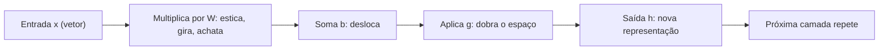

# 2. Álgebra linear

> [!NOTE] Em uma frase
> Uma matriz é uma máquina que estica, gira e achata o espaço, e uma camada de rede neural é exatamente uma dessas máquinas seguida de uma pequena dobra.

## Por que isso importa

Uma foto colorida de 224 por 224 pixels tem 224 × 224 × 3 = 150.528 números. Um modelo de linguagem representa cada palavra como uma lista de centenas ou milhares de números. Uma camada de rede com 1.000 entradas e 500 saídas tem 500.000 pesos. Escrever um laço `for` para cada uma dessas contas seria ilegível e lento. A álgebra linear dá duas coisas: uma **notação** compacta para dizer "faça esta conta com todos esses números de uma vez" e uma **intuição geométrica** do que a conta faz.

Na prática, é por isso que GPUs (placas de vídeo) são o hardware do deep learning: elas foram feitas para multiplicar matrizes muito rápido, porque gráfico 3D também é álgebra linear. O capítulo 2 do livro é um resumo enxuto e direcionado: só o que será usado depois.

## O que você precisa saber antes

A [página 1](01-a-matematica-que-voce-precisa.md) explica onde a álgebra linear entra num passo de treino. Fora isso, basta saber marcar um ponto num plano com coordenadas $(x, y)$.

## As ideias centrais

### Escalares, vetores, matrizes e tensores

- **Escalar**: um número só. A taxa de aprendizado, a loss.
- **Vetor**: uma lista ordenada de números, como $\mathbf{x} = (3, 1)$. Geometricamente, é uma seta que sai da origem e vai até o ponto $(3, 1)$. Um apartamento descrito por (área, quartos, andar) é um vetor de 3 números, um ponto num espaço de 3 dimensões.
- **Matriz**: uma tabela de números com linhas e colunas. Um conjunto de 1.000 apartamentos com 3 features cada é uma matriz 1.000 × 3, uma linha por apartamento.
- **Tensor**: a generalização para mais eixos. Um lote de 32 fotos coloridas é um tensor 32 × 224 × 224 × 3. É o nome que o PyTorch e o TensorFlow usam para qualquer array.

A **transposta** de uma matriz, escrita $A^\top$, troca linhas por colunas. Aparece o tempo todo só para que os tamanhos encaixem numa multiplicação.

### O que uma multiplicação de matriz faz com o espaço

A conta $A\mathbf{x}$ (matriz vezes vetor) parece só uma receita de multiplicar e somar, mas tem uma leitura geométrica muito mais útil: **a matriz transforma o vetor**, levando a seta $\mathbf{x}$ para outra seta.

Exemplo concreto no plano. Tome

$$A = \begin{pmatrix} 2 & 0 \\ 0 & 1 \end{pmatrix}$$

Ela leva o vetor $(1, 0)$ em $(2, 0)$ e deixa $(0, 1)$ como está. Ou seja: estica tudo para o lado, dobrando a largura, e não mexe na altura. Um quadrado vira um retângulo. Outra matriz pode girar o plano 90 graus; outra pode achatar tudo sobre uma reta. Toda matriz é uma combinação de esticar, girar, espelhar e achatar. O que ela *não* consegue fazer é dobrar ou curvar: retas continuam retas e a origem fica no lugar. Por isso essas transformações se chamam **lineares**.

A regra prática para ler qualquer matriz: **as colunas dizem para onde vão os eixos**. A primeira coluna de $A$ é onde o vetor $(1, 0)$ vai parar; a segunda, onde vai parar $(0, 1)$. Todo o resto é consequência.

Multiplicar duas matrizes, $AB$, é aplicar uma transformação depois da outra (primeiro $B$, depois $A$). Daí vem uma regra que confunde iniciantes: a ordem importa. Girar e depois esticar não dá o mesmo resultado que esticar e depois girar.

O livro também apresenta o **produto escalar** (*dot product*) de dois vetores, $\mathbf{x}^\top \mathbf{y}$: multiplique posição a posição e some. Geometricamente, ele mede o quanto as duas setas apontam na mesma direção. Busca por similaridade de textos e imagens é, no fundo, um produto escalar entre vetores.

### Uma camada de rede neural é uma matriz e uma dobra

Aqui a geometria paga a conta. Uma camada de rede faz

$$\mathbf{h} = g(W\mathbf{x} + \mathbf{b})$$

Em palavras: pegue a entrada $\mathbf{x}$, transforme com a matriz de pesos $W$ (esticar, girar, achatar), desloque com o vetor $\mathbf{b}$ (chamado *bias*, um empurrão que tira a origem do lugar) e aplique uma função $g$ a cada número, que dobra o espaço. Essa dobra é o que permite à rede representar coisas que não são retas; o cap. 6 explica por quê.

Quando você processa um lote de 32 exemplos de uma vez, $\mathbf{x}$ vira uma matriz com 32 linhas e a mesma conta vira uma multiplicação matriz por matriz. É exatamente por isso que treinamos em lotes: a GPU faz 32 exemplos quase pelo mesmo custo de um.

### Sistemas de equações, inversa e dependência linear

Resolver $A\mathbf{x} = \mathbf{b}$ é perguntar: "que vetor, depois de transformado por $A$, cai em $\mathbf{b}$?". Se a transformação não achata nada, dá para desfazê-la, e a matriz que desfaz é a **inversa** $A^{-1}$. Se a matriz achata o plano numa reta, informação foi perdida (dois pontos diferentes caíram no mesmo lugar) e não há como desfazer. Isso acontece quando as colunas são **linearmente dependentes**: uma delas pode ser obtida combinando as outras, então ela não acrescenta direção nova.

O livro faz questão de dizer que a inversa é uma ferramenta teórica: em código, calcular $A^{-1}$ explicitamente costuma ser numericamente impreciso. Bibliotecas resolvem o sistema por outros caminhos. Para casos sem inversa, existe a **pseudoinversa de Moore-Penrose**, que dá "a melhor resposta possível" (por exemplo, a de menor erro em mínimos quadrados).

### Normas: o tamanho de um vetor

Uma **norma** é uma função que mede o tamanho de um vetor. As duas que mais aparecem:

- **Norma L2** (euclidiana), $\|\mathbf{x}\|_2$: o comprimento da seta, a distância "em linha reta". Para $(3, 4)$, dá 5.
- **Norma L1**, $\|\mathbf{x}\|_1$: a soma dos valores absolutos. Para $(3, 4)$, dá 7. É a distância de quem anda em quarteirões.

Isso parece detalhe, mas é a base da regularização no cap. 7: penalizar a norma L2 dos pesos empurra todos para valores pequenos; penalizar a norma L1 empurra muitos para exatamente zero.

### Autovetores, SVD e PCA: as direções que importam

Toda matriz tem direções "favoritas". Um **autovetor** de $A$ é uma direção que a matriz só estica ou encolhe, sem girar; o quanto ela estica é o **autovalor**. Na matriz $A$ do exemplo, o eixo horizontal é autovetor com autovalor 2, e o vertical é autovetor com autovalor 1. A **autodecomposição** reescreve a matriz como "gire para os eixos favoritos, estique cada um pelo seu autovalor, gire de volta".

Nem toda matriz tem essa decomposição de forma limpa (matrizes não quadradas, por exemplo). A **decomposição em valores singulares (SVD)** funciona para qualquer matriz e diz algo bonito: toda transformação linear é uma rotação, seguida de um esticamento em eixos perpendiculares, seguida de outra rotação.

O capítulo fecha derivando o **PCA** (análise de componentes principais) só com essas ferramentas. A intuição: numa nuvem de pontos com muitas dimensões, encontre as poucas direções em que os dados mais variam e descreva cada ponto só por essas direções. É compressão com perda mínima, e é usada para visualizar dados de alta dimensão em 2D.

O livro também define **traço** (soma da diagonal) e **determinante**. O determinante tem uma leitura geométrica simples: é o fator pelo qual a matriz multiplica áreas (ou volumes). Determinante zero quer dizer que a matriz achata o espaço, e portanto não tem inversa.

## Onde isso aparece no mundo real

- **Embeddings e busca semântica**: sistemas de recomendação e busca transformam textos e produtos em vetores e procuram vizinhos pelo produto escalar ou pela distância. Bancos de dados vetoriais existem só para fazer essa conta rápido em milhões de vetores.
- **Compressão de modelos**: técnicas como LoRA, usada para ajustar modelos de linguagem grandes com pouco custo, partem da mesma ideia do SVD: uma matriz grande pode ser aproximada pelo produto de duas matrizes finas.
- **Erros de shape no PyTorch**: `mat1 and mat2 shapes cannot be multiplied` é a regra "o número de colunas da primeira tem que ser igual ao número de linhas da segunda", aplicada pela biblioteca.

## Erros comuns de quem está aprendendo

- **Decorar a regra de multiplicar sem a geometria.** A receita "linha vezes coluna" é necessária, mas quem pensa só nela não entende por que uma camada linear sozinha não aprende curvas. Pense em "transformação do espaço".
- **Achar que a ordem da multiplicação não importa.** $AB$ geralmente é diferente de $BA$. Se o resultado mudou ao trocar a ordem, não é bug da biblioteca.
- **Empilhar camadas lineares esperando mais poder.** Duas transformações lineares em sequência são uma transformação linear só (o produto das duas matrizes). Sem a função $g$ entre elas, uma rede de 100 camadas é equivalente a uma de uma camada.
- **Calcular a inversa em código.** Use as funções de resolver sistemas ou mínimos quadrados da biblioteca; elas são mais estáveis.

## Verifique se entendeu

1. Olhando só para as colunas de uma matriz 2 × 2, como você descobre o que ela faz com o plano? (Veja "O que uma multiplicação de matriz faz com o espaço".)
2. Por que uma rede de várias camadas sem a função $g$ não é mais poderosa do que uma rede de uma camada? (Veja "Uma camada de rede neural é uma matriz e uma dobra" e "Erros comuns".)
3. O que acontece geometricamente quando uma matriz não tem inversa? Qual a relação com o determinante? (Veja "Sistemas de equações" e "Autovetores, SVD e PCA".)
4. Qual a diferença entre as normas L1 e L2 para o vetor $(3, 4)$, e onde isso vai ser usado? (Veja "Normas".)

## Para ir além

- [Linear Algebra, capítulo 2 do livro](https://www.deeplearningbook.org/contents/linear_algebra.html): o texto oficial, gratuito; curto e denso, bom para ler depois desta página.
- [hadrienj/deepLearningBook-Notes](https://github.com/hadrienj/deepLearningBook-Notes): notas das 12 seções do capítulo 2, cada uma com notebook em NumPy para você ver as matrizes funcionando.
- [Deep Learning Book Series · 2.7 Eigendecomposition](https://hadrienj.github.io/posts/Deep-Learning-Book-Series-2.7-Eigendecomposition/): tutorial passo a passo de autovetores e autovalores, com gráficos que mostram a transformação acontecendo.
- [dalmia/Deep-Learning-Book-Chapter-Summaries](https://github.com/dalmia/Deep-Learning-Book-Chapter-Summaries): resumo comunitário do capítulo 2 em notebook.

---
Anterior: [1. A matemática que você precisa](01-a-matematica-que-voce-precisa.md) · Próximo: [3. Probabilidade e teoria da informação](03-probabilidade-e-teoria-da-informacao.md) · Voltar ao livro: [Guia de leitura](index.md)
