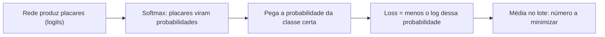

# 3. Probabilidade e teoria da informação

> [!NOTE] Em uma frase
> Um classificador não responde "é um gato", responde "acho que é gato com 70% de chance", e a cross-entropy mede o quanto ele se surpreendeu com a resposta certa.

## Por que isso importa

Um filtro de spam olha um e-mail com a frase "você ganhou um prêmio". Ele não tem certeza de nada: há e-mails legítimos com essa frase e spam sem ela. O jeito honesto de responder é com um grau de confiança: "92% de chance de ser spam". Isso deixa o resto do sistema decidir o que fazer (mover para a pasta de spam só acima de 95%, por exemplo). Probabilidade é a linguagem para falar de incerteza com números.

Em deep learning, ela aparece em dois lugares. Primeiro, na **saída**: um classificador devolve uma distribuição de probabilidade sobre as classes. Segundo, no **treino**: a função que mede o erro, a [loss](../../glossario.md#loss-função-de-perda), vem quase sempre de uma ideia probabilística. A teoria da informação, criada por Claude Shannon para medir quanta informação cabe numa mensagem, fornece a loss mais usada em classificação: a cross-entropy. O capítulo 3 do livro cobre as duas coisas; esta página vai até a cross-entropy como loss, que é o que você precisa para o resto do livro.

## O que você precisa saber antes

A [página 2](02-algebra-linear.md), para entender vetores (a saída de um classificador é um vetor de probabilidades). E a noção cotidiana de probabilidade: uma moeda honesta dá cara com chance 1/2.

## As ideias centrais

### Variáveis aleatórias e distribuições

Uma **variável aleatória** é uma quantidade cujo valor depende do acaso: o resultado de um dado, a classe de uma imagem sorteada do dataset. Uma **distribuição de probabilidade** diz quão provável é cada valor.

- Para valores **discretos** (que dá para contar: as faces de um dado, as classes "gato/cachorro/pássaro"), a distribuição é uma tabela de probabilidades que somam 1. O livro chama de *função de massa de probabilidade*.
- Para valores **contínuos** (altura, preço), a probabilidade de um valor exato é zero, então usamos uma *função de densidade*: a probabilidade de cair num intervalo é a área sob a curva nesse intervalo.

O livro apresenta um pequeno catálogo das distribuições que voltam o tempo todo:

- **Bernoulli**: uma moeda viciada, sim ou não, com chance $p$ de sim. Saída de um classificador binário.
- **Categórica** (o livro chama de *multinoulli*): um dado viciado com $k$ faces. Saída de um classificador com $k$ classes.
- **Gaussiana** (normal): o sino. Aparece por toda parte porque somas de muitas pequenas influências tendem a ela, e porque, entre as distribuições com uma dada variância, é a que menos assume sobre os dados.
- **Mistura de distribuições**: várias distribuições combinadas, cada uma escolhida com certa chance. Útil para dados com grupos.

Duas funções auxiliares merecem destaque porque viram peças de redes. A **sigmoide logística**, $\sigma(x) = 1/(1 + e^{-x})$, espreme qualquer número real para o intervalo entre 0 e 1, transformando um "placar" em probabilidade. A **softplus**, $\log(1 + e^x)$, é uma versão suave de "o maior entre zero e $x$".

### Probabilidade condicional, independência e regra de Bayes

A **probabilidade condicional** $P(y \mid x)$ se lê "probabilidade de $y$ sabendo que $x$ aconteceu". É exatamente o que um classificador estima: $P(\text{spam} \mid \text{texto do e-mail})$.

Duas variáveis são **independentes** quando saber uma não muda nada sobre a outra. Dois lançamentos de moeda são independentes; "está chovendo" e "o chão está molhado" não são.

A **regra de Bayes** permite inverter a condicional:

$$P(x \mid y) = \frac{P(y \mid x)\, P(x)}{P(y)}$$

Em palavras: a chance de $x$ dado $y$ é a chance de ver $y$ quando $x$ é verdade, ponderada pela chance de $x$ antes de qualquer evidência, e normalizada. Exemplo clássico: um exame acerta 99% das vezes, mas a doença afeta 1 em 1.000 pessoas. Quem testa positivo tem chance bem menor que 99% de estar doente, porque a doença é rara e os falsos positivos das 999 pessoas saudáveis pesam muito. Esquecer o $P(x)$ (a taxa de base) é um erro clássico de raciocínio, dentro e fora de ML.

### Esperança, variância e covariância

A **esperança** (ou valor esperado) é a média ponderada pelas probabilidades: o valor "típico" se você repetisse o sorteio infinitas vezes. A **variância** mede o quanto os valores se espalham em torno dessa média. A **covariância** mede se duas variáveis tendem a subir juntas. Essas três ideias aparecem no cap. 5 para falar de viés e variância de estimadores, e no cap. 8 para entender por que o gradiente estimado com um lote pequeno é "barulhento".

### Informação, entropia e KL

Agora a parte de teoria da informação. A pergunta de Shannon: quanta informação traz um evento? A intuição é que **eventos improváveis informam mais**. "O sol nasceu hoje" não informa nada; "nevou em Fortaleza" informa muito.

A **auto-informação** de um evento com probabilidade $p$ é $-\log p$. Com logaritmo na base 2, a unidade é o *bit*. Um evento com chance 1/2 traz 1 bit; com chance 1/8, traz 3 bits. Evento certo ($p = 1$) traz zero.

A **entropia** de uma distribuição é a informação média que você espera receber, ou, de outro ângulo, o quanto ela é imprevisível. Uma moeda honesta tem entropia de 1 bit. Uma moeda que dá cara 90% das vezes tem cerca de 0,47 bit: é mais previsível, então cada lançamento surpreende menos. Uma moeda que sempre dá cara tem entropia zero.

A **divergência de Kullback-Leibler (KL)** mede o quanto uma distribuição $Q$ difere de outra $P$: é a informação extra que você gasta, em média, quando os dados vêm de $P$ mas você os descreve como se viessem de $Q$. Ela é zero só quando as duas são iguais e nunca é negativa. Atenção: não é uma distância de verdade, porque KL de $P$ para $Q$ é diferente de KL de $Q$ para $P$.

### Cross-entropy: da teoria à loss

A **cross-entropy** de $P$ e $Q$ é a entropia de $P$ mais a KL de $P$ para $Q$. Como a entropia de $P$ não depende do modelo, **minimizar a cross-entropy é o mesmo que minimizar a KL**, ou seja, empurrar a distribuição do modelo ($Q$) para perto da distribuição real dos dados ($P$).

No caso de classificação, isso fica muito simples. Para cada exemplo, a distribuição "real" põe probabilidade 1 na classe certa e 0 nas outras. A cross-entropy então se reduz a:

$$\text{loss} = -\log q_{\text{classe certa}}$$

Em palavras: pegue a probabilidade que o modelo deu para a resposta certa, tire o log e troque o sinal. Com logaritmo natural:

| Probabilidade que o modelo deu à classe certa | Loss |
|---|---|
| 0,99 | 0,01 |
| 0,7 | 0,36 |
| 0,1 | 2,30 |
| 0,001 | 6,91 |

Repare no formato: acertar com confiança custa quase nada; errar com confiança custa muito, e o custo cresce sem limite à medida que a probabilidade dada à resposta certa vai a zero. É por isso que essa loss ensina o modelo a não ser arrogante.

O cap. 5 mostra que esta mesma loss sai de outro princípio, a máxima verossimilhança, e o cap. 6 mostra por que ela combina tão bem com a softmax (a função que transforma placares em probabilidades) na hora de calcular gradientes.

## Onde isso aparece no mundo real

- **Classificadores em produção** (spam, fraude, moderação de conteúdo) treinam com cross-entropy e devolvem probabilidades. O limiar de decisão ("bloquear acima de 0,95") é uma escolha de produto separada do modelo.
- **Modelos de linguagem** são treinados com cross-entropy sobre a próxima palavra: a cada posição, o modelo dá uma distribuição sobre o vocabulário e paga $-\log$ da probabilidade da palavra que de fato veio. A métrica *perplexity* que aparece em artigos é só uma transformação dessa loss.
- **Destilação de modelos**: treinar um modelo pequeno para imitar as probabilidades de um grande usa KL ou cross-entropy entre as duas distribuições.

## Erros comuns de quem está aprendendo

- **Ler a saída do modelo como probabilidade calibrada.** "0,9" só significa "acerta 9 em cada 10 vezes nesses casos" se o modelo estiver calibrado, e redes modernas muitas vezes são confiantes demais. Probabilidade de saída não é garantia.
- **Achar que KL é distância simétrica.** A ordem dos argumentos muda o valor e muda o comportamento do treino.
- **Ignorar a taxa de base.** Um detector de fraude com 99% de acurácia num cenário com 0,1% de fraudes pode ser pior que inútil: dizer "não é fraude" para tudo já dá 99,9%.
- **Achar que cross-entropy e acurácia medem a mesma coisa.** A acurácia só olha se acertou; a cross-entropy olha o quão confiante estava. Uma pode melhorar enquanto a outra piora.

## Verifique se entendeu

1. Por que a resposta de um classificador é uma distribuição e não uma classe só? (Veja "Por que isso importa".)
2. No exemplo do exame com 99% de acerto e doença rara, qual termo da regra de Bayes explica o resultado surpreendente? (Veja "Probabilidade condicional, independência e regra de Bayes".)
3. Por que uma moeda viciada tem entropia menor que uma moeda honesta? (Veja "Informação, entropia e KL".)
4. Por que minimizar a cross-entropy é o mesmo que minimizar a divergência KL? (Veja "Cross-entropy: da teoria à loss".)
5. Pela tabela, o que acontece com a loss quando o modelo erra com muita confiança? (Veja "Cross-entropy: da teoria à loss".)

## Para ir além

- [Probability and Information Theory, capítulo 3 do livro](https://www.deeplearningbook.org/contents/prob.html): o texto oficial, gratuito; a seção de teoria da informação está perto do fim.
- [dalmia/Deep-Learning-Book-Chapter-Summaries](https://github.com/dalmia/Deep-Learning-Book-Chapter-Summaries): resumo do capítulo 3 em notebook, com exemplos de código.
- [Deep Learning — Lecture Slides](https://www.deeplearningbook.org/lecture_slides.html): slides oficiais do capítulo 3, úteis como revisão.

---
Anterior: [2. Álgebra linear](02-algebra-linear.md) · Próximo: [4. Computação numérica e fundamentos de ML](04-computacao-numerica-e-fundamentos-de-ml.md) · Voltar ao livro: [Guia de leitura](index.md)
