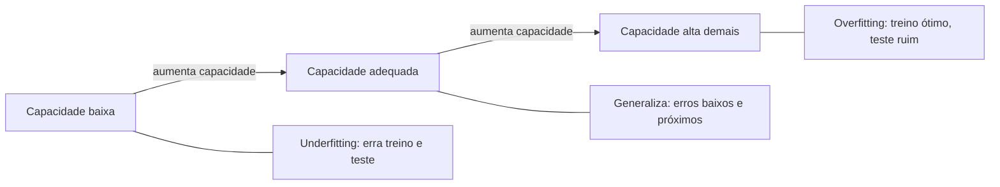

# 4. Computação numérica e fundamentos de ML

> [!NOTE] Em uma frase
> Treinar é descer uma montanha no escuro tateando a inclinação do chão, e aprender de verdade é chegar a um vale que também sirva para montanhas que você nunca visitou.

## Por que isso importa

Você treina seu primeiro classificador, a loss cai bonitinho por algumas épocas e de repente aparece `nan`. Nada no código mudou. Outra situação: o modelo chega a 99% de acerto no treino e 60% em dados novos. As duas cenas são as frustrações mais comuns de quem começa, e cada uma tem um capítulo do livro dedicado a ela. O capítulo 4 trata da primeira: o computador não faz conta com números reais, e o algoritmo de otimização tem armadilhas próprias. O capítulo 5 trata da segunda: o que significa aprender, e por que ir bem no treino não prova nada.

Juntos, os dois capítulos fecham a Parte I e dão o vocabulário que o resto do livro usa sem explicar de novo.

## O que você precisa saber antes

A [página 3](03-probabilidade-e-teoria-da-informacao.md), principalmente a cross-entropy como loss. A ideia de derivada como inclinação: se $f(x)$ sobe quando $x$ aumenta um pouquinho, a derivada é positiva.

## As ideias centrais

### Números de computador estouram e somem (cap. 4)

Um `float32` guarda cerca de 7 dígitos significativos e não representa números maiores que uns $3{,}4 \times 10^{38}$. Daí vêm dois problemas:

- **Overflow**: um número grande demais vira infinito. $e^{1000}$ já não cabe.
- **Underflow**: um número pequeno demais vira zero. E depois alguém divide por ele ou tira o log, e aparece `nan` ou `-inf`.

O exemplo que o livro usa é a **softmax**, a função que transforma placares em probabilidades: ela calcula $e^{x_i}$ para cada placar e divide pela soma. Com placares $(1000, 1001)$, a conta direta estoura. O truque é subtrair o maior placar de todos antes: $(-1, 0)$ dá exatamente as mesmas probabilidades (a subtração se cancela na divisão) e não estoura. Toda biblioteca séria faz isso por você, e é por isso que o PyTorch oferece `cross_entropy` recebendo placares crus em vez de probabilidades: ela junta softmax e log numa conta estável.

O capítulo também fala de **mau condicionamento**: quando uma pequena mudança na entrada causa uma mudança enorme na saída, erros de arredondamento se amplificam. O *número de condição* de uma matriz mede isso.

### Descida do gradiente: descer a montanha tateando (cap. 4)

A [descida do gradiente](../../glossario.md#gradiente-e-descida-do-gradiente) é o motor de todo o livro. A imagem: você está numa montanha no escuro e quer chegar ao vale. Não vê o mapa, mas sente a inclinação do chão sob os pés. Então dá um passo na direção em que o chão desce mais e repete.

Formalmente, o **gradiente** $\nabla f$ é o vetor de derivadas parciais: para cada peso, quanto a loss sobe se aquele peso aumentar um pouquinho. Ele aponta para a subida mais íngreme; andamos na direção oposta:

$$\theta \leftarrow \theta - \epsilon \, \nabla f(\theta)$$

Em palavras: pesos novos = pesos atuais menos um passo pequeno na direção do gradiente. O tamanho do passo, $\epsilon$, é a **taxa de aprendizado** (*learning rate*). Passo pequeno demais: o treino leva uma eternidade. Passo grande demais: você pula o vale, cai do outro lado mais alto, e a loss explode.

Num terreno real há armadilhas:

- **Mínimos locais**: vales que não são o mais fundo.
- **Pontos de sela**: lugares onde o chão é plano, mas desce numa direção e sobe em outra, como a sela de um cavalo. Em muitas dimensões, são muito mais comuns que mínimos locais, e o gradiente perto deles é quase zero, o que faz o treino parecer travado.
- **Vales estreitos e alongados**: o gradiente aponta para a parede do vale, não para o fundo, e o algoritmo fica ziguezagueando. A **Hessiana** (a matriz das segundas derivadas, que descreve a curvatura do terreno) explica esse fenômeno. O cap. 8 mostra técnicas para driblá-lo.

O capítulo termina com otimização com restrições (condições KKT) e o método de Newton, que usa a curvatura para dar passos mais inteligentes. São úteis, mas não essenciais para seguir adiante.

### Aprender é generalizar (cap. 5)

O capítulo 5 abre com uma definição clássica: um programa aprende se seu desempenho numa tarefa melhora com experiência. O que torna ML diferente de otimização pura é que **não queremos só errar pouco nos dados de treino**; queremos errar pouco em dados que o modelo nunca viu. O erro nesses dados novos é o *erro de generalização*.

A ferramenta para pensar nisso é a **capacidade**: a variedade de funções que o modelo consegue representar. Pense em ajustar uma curva a 10 pontos ruidosos:

- Uma reta (capacidade baixa) não consegue seguir a tendência curva dos dados. Erra no treino e no teste. Isso é **underfitting**.
- Um polinômio de grau 9 (capacidade alta) passa exatamente pelos 10 pontos, incluindo o ruído. Erro de treino zero, previsões malucas entre os pontos. Isso é [overfitting](../../glossario.md#overfitting).
- Um polinômio de grau 2 ou 3 captura a tendência sem decorar o ruído.

O livro também apresenta o **teorema do "não existe almoço grátis"**: em média, sobre todos os problemas possíveis, nenhum algoritmo é melhor que outro. A consequência prática é que todo algoritmo funciona porque faz suposições que combinam com o tipo de dado do mundo real. A **regularização** (cap. 7) é o nome para qualquer mudança feita para reduzir o erro de generalização, e não o de treino.

### Validação e hiperparâmetros (cap. 5)

**Hiperparâmetros** são escolhas que o treino não ajusta sozinho: grau do polinômio, taxa de aprendizado, número de camadas. Se você os escolhesse olhando o erro de treino, escolheria sempre a capacidade máxima. Se escolhesse olhando o conjunto de teste, o teste deixaria de medir dados "nunca vistos". Por isso se separa um terceiro pedaço, o conjunto de **validação**: ver [dataset e divisão treino / validação / teste](../../glossario.md#dataset-e-divisão-treino--validação--teste). Com poucos dados, a **validação cruzada** (*k-fold*) reveza qual pedaço faz papel de validação e tira a média.

### Viés, variância e máxima verossimilhança (cap. 5)

Um **estimador** é qualquer regra que calcula um número a partir dos dados (a média de uma amostra, os pesos de um modelo). Seu **viés** é o quanto ele erra sistematicamente; sua **variância** é o quanto ele muda se você trocar a amostra. Modelos simples tendem a ter viés alto; modelos complexos, variância alta. O erro total mistura os dois, e é a mesma história do underfitting e overfitting contada em outra linguagem.

E de onde vêm as losses? O livro responde com a **máxima verossimilhança**: escolha os pesos que tornam os dados observados os mais prováveis possíveis segundo o modelo. Como produto de muitas probabilidades dá underflow, tiramos o log e trocamos o sinal, e o problema vira minimizar a *log-verossimilhança negativa*. Duas consequências fecham o círculo com as páginas anteriores:

- Se o modelo diz que a saída segue uma distribuição categórica, a log-verossimilhança negativa **é a cross-entropy** da página 3.
- Se o modelo diz que a saída segue uma gaussiana em torno da previsão, ela **é o erro quadrático médio**, a loss de regressão.

Ou seja, as losses não são escolhas arbitrárias: cada uma é uma suposição sobre o ruído dos dados.

### SGD e por que deep learning foi necessário (cap. 5)

Calcular o gradiente usando todo o dataset a cada passo é caro: com 10 milhões de exemplos, cada passo leria 10 milhões de exemplos. A **descida do gradiente estocástica (SGD)** usa um **minibatch**, um lote pequeno sorteado (32, 256 exemplos), para estimar o gradiente. A estimativa é barulhenta, mas barata, e o custo de cada passo não cresce com o tamanho do dataset.

O capítulo termina explicando por que métodos clássicos não bastam para dados como imagens e som. A **maldição da dimensionalidade**: em muitas dimensões, o número de regiões possíveis cresce exponencialmente e nenhum dataset as cobre. A **hipótese do manifold**: dados reais (fotos de rostos, frases) ocupam uma superfície fina dentro desse espaço enorme, e é essa estrutura que redes profundas conseguem aprender.

## Onde isso aparece no mundo real

- **Treino com precisão reduzida** (`float16`, `bfloat16`), padrão em GPUs modernas para ganhar velocidade, torna o problema de overflow e underflow do cap. 4 ainda mais presente; técnicas como *loss scaling* existem só para isso.
- **Competições como Kaggle** penalizam quem ajusta hiperparâmetros olhando o placar público: a classificação final usa um conjunto escondido, e quem fez overfitting no placar cai posições.
- **Monitoramento em produção**: o [data drift](../../glossario.md#data-drift) é o mesmo problema de generalização, só que os dados novos mudam com o tempo.

## Erros comuns de quem está aprendendo

- **Aplicar softmax e depois passar para `cross_entropy`.** No PyTorch, essa função já aplica a softmax internamente. Aplicar duas vezes treina pior sem dar erro nenhum.
- **Usar o conjunto de teste para escolher hiperparâmetros.** O número final fica otimista e não vale mais como estimativa honesta.
- **Achar que loss de treino baixa é sucesso.** Sem olhar a validação, não dá para distinguir aprendizado de memorização.
- **Concluir que o treino travou num mínimo local.** Em redes grandes, platôs costumam ser pontos de sela ou taxa de aprendizado mal ajustada.

## Verifique se entendeu

1. Por que subtrair o maior placar antes da softmax não muda o resultado, e que problema isso evita? (Veja "Números de computador estouram e somem".)
2. O que acontece se a taxa de aprendizado for grande demais? E pequena demais? (Veja "Descida do gradiente".)
3. No ajuste de curva a 10 pontos, qual modelo faz underfitting e qual faz overfitting, e por quê? (Veja "Aprender é generalizar".)
4. Por que precisamos de um conjunto de validação separado do teste? (Veja "Validação e hiperparâmetros".)
5. Que suposição sobre o ruído dos dados leva ao erro quadrático médio? (Veja "Viés, variância e máxima verossimilhança".)

## Para ir além

- [Numerical Computation, capítulo 4](https://www.deeplearningbook.org/contents/numerical.html) e [Machine Learning Basics, capítulo 5](https://www.deeplearningbook.org/contents/ml.html): os textos oficiais e gratuitos; o 5 é longo, priorize as seções sobre capacidade, validação e máxima verossimilhança.
- [dalmia/Deep-Learning-Book-Chapter-Summaries](https://github.com/dalmia/Deep-Learning-Book-Chapter-Summaries): resumo do capítulo 4 em notebook, com o exemplo de estabilidade numérica.
- [Deep Learning (Goodfellow) — TheoremPath reading guide](https://theorempath.com/topics/deep-learning-goodfellow-book): indica quais seções do capítulo 5 são essenciais e quais podem ser lidas por cima.

---
Anterior: [3. Probabilidade e teoria da informação](03-probabilidade-e-teoria-da-informacao.md) · Próximo: [5. Redes feedforward](05-redes-feedforward.md) · Voltar ao livro: [Guia de leitura](index.md)
