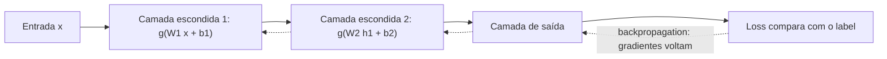

# 5. Redes feedforward

> [!NOTE] Em uma frase
> Uma rede feedforward é uma pilha de camadas "multiplica, soma e dobra", e o backpropagation é a regra da cadeia aplicada de trás para frente para descobrir quanto cada peso tem culpa no erro.

## Por que isso importa

Todo o resto do livro é variação sobre o que está no capítulo 6. Redes convolucionais (visão), recorrentes (sequências) e, depois do livro, Transformers (linguagem) usam as mesmas peças: camadas com pesos, funções de ativação, uma loss, e gradientes calculados por backpropagation. Se você entende uma rede feedforward pequena por inteiro, inclusive fazendo a conta do gradiente à mão, o resto vira "o mesmo motor com outra carroceria".

O exemplo que o livro usa para motivar é o **XOR** ("ou exclusivo"): a saída é 1 quando exatamente uma das duas entradas é 1. Os quatro pontos $(0,0)$, $(1,1)$ (saída 0) e $(0,1)$, $(1,0)$ (saída 1) não podem ser separados por uma reta. Um modelo linear falha nesse problema minúsculo. Uma rede com uma camada escondida e uma função não linear resolve, porque a camada escondida **transforma o espaço** de modo que os pontos fiquem separáveis. Essa é a ideia central do capítulo.

## O que você precisa saber antes

- [Página 2](02-algebra-linear.md): uma camada é $g(W\mathbf{x} + \mathbf{b})$, e empilhar só camadas lineares não ganha poder.
- [Página 3](03-probabilidade-e-teoria-da-informacao.md): cross-entropy e softmax.
- [Página 4](04-computacao-numerica-e-fundamentos-de-ml.md): descida do gradiente e máxima verossimilhança.
- A **regra da cadeia** do cálculo: se $y$ depende de $u$ e $u$ depende de $x$, a sensibilidade de $y$ a $x$ é o produto das sensibilidades: $\frac{dy}{dx} = \frac{dy}{du} \cdot \frac{du}{dx}$. Pense em engrenagens: se a engrenagem A gira 2 vezes por volta de B, e B gira 3 vezes por volta de C, A gira 6 vezes por volta de C.

## As ideias centrais

### A estrutura: camadas, unidades escondidas e saída

Uma rede **feedforward** (também chamada de *perceptron multicamadas*, MLP) é uma composição de funções: a informação vai da entrada para a saída, sem voltar. "Feedforward" é exatamente isso: sem ciclos. As camadas do meio são chamadas **escondidas** porque os dados de treino não dizem o que elas devem produzir; só a saída final tem um alvo, o [label](../../glossario.md#label).

A **profundidade** é o número de camadas; a **largura** é o número de unidades por camada.

### Funções de ativação: a dobra que dá poder

A função $g$ aplicada a cada unidade é a **ativação**. Sem ela, a rede inteira colapsa numa única transformação linear. O livro recomenda como padrão a **ReLU** (*rectified linear unit*): $g(z) = \max(0, z)$. Negativos viram zero, positivos passam iguais. Parece simples demais, e é essa a vantagem: onde está ativa, a derivada é 1, então o gradiente atravessa a camada sem encolher, o que facilita treinar redes profundas.

Ativações antigas, como a sigmoide e a tangente hiperbólica (tanh), **saturam**: para entradas muito grandes ou muito pequenas, a curva fica plana e a derivada vai a quase zero, e o aprendizado para. O livro desaconselha a sigmoide em camadas escondidas por isso.

### A camada de saída casa com a loss

A escolha da saída depende do que você quer prever, e cada uma vem com sua loss natural (que é a log-verossimilhança negativa da página 4):

| Tarefa | Saída | Loss |
|---|---|---|
| Regressão (prever um número) | linear, sem ativação | erro quadrático médio |
| Classificação binária | sigmoide (probabilidade de "sim") | cross-entropy binária |
| Classificação com $k$ classes | softmax ($k$ probabilidades) | cross-entropy |

O livro mostra um detalhe importante: sigmoide e softmax saturam, mas o log da cross-entropy "desfaz" a exponencial dentro delas. O resultado é que o gradiente só fica pequeno quando o modelo já está certo. Com erro quadrático em cima de uma sigmoide, o gradiente pode sumir justamente quando o modelo está muito errado. É um argumento concreto para usar cross-entropy em classificação.

### Por que profundo, e não só largo

O **teorema da aproximação universal** diz que uma rede com uma única camada escondida, larga o suficiente, consegue aproximar qualquer função contínua razoável com a precisão que você quiser. Então por que empilhar camadas? Porque "larga o suficiente" pode significar um número astronômico de unidades, e o teorema não diz nada sobre se o treino vai *encontrar* esses pesos. O livro argumenta que redes profundas representam muitas funções com exponencialmente menos unidades, e que, na prática, generalizam melhor. A intuição: cada camada reaproveita os conceitos da anterior, como funções que chamam funções num programa.

### Backpropagation: o gradiente de trás para frente

Para usar descida do gradiente, precisamos de $\partial L / \partial w$ para cada peso $w$: quanto a loss muda se aquele peso mudar um pouquinho. Calcular isso separadamente para milhões de pesos seria lento demais. O **backpropagation** é o algoritmo que calcula todos de uma vez, aplicando a regra da cadeia da saída para a entrada e **reaproveitando** os resultados intermediários. O custo total fica na mesma ordem de uma passagem para frente.

Importante: backpropagation é só o cálculo do gradiente. Quem usa o gradiente para mudar os pesos é o otimizador (SGD, Adam, etc.).

### Exemplo à mão: uma rede minúscula

Uma rede com uma entrada, uma unidade escondida com ReLU e uma saída linear. Dois pesos, $w_1$ e $w_2$, sem bias para simplificar. A loss é o erro quadrático $L = (\hat{y} - y)^2$.

Valores: entrada $x = 2$, alvo $y = 3$, pesos iniciais $w_1 = 0{,}5$ e $w_2 = 2$.

**Passo 1: passagem para frente.** Calcule e guarde cada valor intermediário.

- $z = w_1 \cdot x = 0{,}5 \cdot 2 = 1$
- $h = \text{ReLU}(z) = \max(0, 1) = 1$
- $\hat{y} = w_2 \cdot h = 2 \cdot 1 = 2$
- $L = (2 - 3)^2 = 1$

**Passo 2: comece pelo fim.** Quanto a loss muda se $\hat{y}$ mudar? A derivada de $(\hat{y} - y)^2$ é $2(\hat{y} - y) = 2 \cdot (2 - 3) = -2$. O sinal negativo diz: aumentar $\hat{y}$ diminui a loss (faz sentido, a previsão está abaixo do alvo).

**Passo 3: gradiente de $w_2$.** Como $\hat{y} = w_2 \cdot h$, mexer em $w_2$ muda $\hat{y}$ na proporção de $h$. Regra da cadeia: $\frac{\partial L}{\partial w_2} = \frac{\partial L}{\partial \hat{y}} \cdot h = -2 \cdot 1 = -2$.

**Passo 4: voltar para $h$.** Mexer em $h$ muda $\hat{y}$ na proporção de $w_2$: $\frac{\partial L}{\partial h} = -2 \cdot w_2 = -2 \cdot 2 = -4$.

**Passo 5: atravessar a ReLU.** Como $z = 1 > 0$, a ReLU deixa passar e sua derivada é 1: $\frac{\partial L}{\partial z} = -4 \cdot 1 = -4$. (Se $z$ fosse negativo, a derivada seria 0 e nenhum gradiente chegaria a $w_1$.)

**Passo 6: gradiente de $w_1$.** Como $z = w_1 \cdot x$: $\frac{\partial L}{\partial w_1} = -4 \cdot x = -4 \cdot 2 = -8$.

**Passo 7: atualizar** com taxa de aprendizado $\epsilon = 0{,}02$ (peso novo = peso velho menos taxa vezes gradiente):

- $w_2 = 2 - 0{,}02 \cdot (-2) = 2{,}04$
- $w_1 = 0{,}5 - 0{,}02 \cdot (-8) = 0{,}66$

**Conferindo:** nova passagem para frente dá $z = 1{,}32$, $h = 1{,}32$, $\hat{y} = 2{,}04 \cdot 1{,}32 \approx 2{,}69$ e $L \approx 0{,}09$. A loss caiu de 1 para menos de 0,1 em um passo.

Repare em três coisas: o passo 4 reaproveitou o resultado do passo 2 (é essa reutilização que torna o backpropagation eficiente); o gradiente de $w_1$ é maior porque ele está "mais atrás" e seu efeito é multiplicado por $w_2$; e a ReLU funcionou como um portão. Numa rede real, os números viram matrizes e o PyTorch faz exatamente essas contas quando você chama `loss.backward()`. O livro formaliza isso como um **grafo computacional**: cada operação é um nó, e o backpropagation percorre o grafo ao contrário.

## Onde isso aparece no mundo real

- **Autograd do PyTorch e do JAX**: diferenciação automática é o backpropagation generalizado. Toda operação registrada no grafo sabe calcular sua própria derivada local.
- **Modelos tabulares e de ranking**: MLPs ainda são a última camada de muitos sistemas de recomendação, combinando embeddings de usuário e item.
- **Transformers**: cada bloco de um modelo de linguagem contém uma rede feedforward de duas camadas aplicada a cada palavra. É literalmente o conteúdo deste capítulo.

## Erros comuns de quem está aprendendo

- **Confundir backpropagation com o treino inteiro.** Backprop calcula gradientes; o otimizador decide o passo.
- **Achar que o teorema da aproximação universal garante que a rede vai aprender.** Ele garante que a função existe, não que o treino a encontra nem que ela generaliza.
- **"ReLU morta":** se $z$ fica negativo para todos os exemplos, a derivada é zero para sempre e a unidade para de aprender (passo 5 do exemplo). Taxa de aprendizado alta demais é a causa típica.
- **Usar sigmoide nas camadas escondidas de uma rede profunda.** A saturação faz o gradiente sumir nas primeiras camadas.

## Verifique se entendeu

1. Por que o XOR não pode ser resolvido por um modelo linear, e o que a camada escondida faz para resolver? (Veja "Por que isso importa".)
2. Qual a vantagem da ReLU sobre a sigmoide em camadas escondidas? (Veja "Funções de ativação".)
3. Por que cross-entropy combina melhor com uma saída softmax do que o erro quadrático? (Veja "A camada de saída casa com a loss".)
4. Refaça o exemplo com $x = -2$. O que acontece com o gradiente de $w_1$ e por quê? (Veja "Exemplo à mão", passo 5.)
5. Qual resultado intermediário o backpropagation reaproveita, e por que isso importa para redes com milhões de pesos? (Veja "Backpropagation".)

## Para ir além

- [Deep Feedforward Networks, capítulo 6](https://www.deeplearningbook.org/contents/mlp.html): o texto oficial e gratuito; a seção sobre backpropagation e grafos computacionais é a mais valiosa.
- [CS 230 — Deep Learning Tips and Tricks](https://stanford.edu/~shervine/teaching/cs-230/cheatsheet-deep-learning-tips-and-tricks): resume backpropagation e a atualização dos pesos em uma página, bom para revisar.
- [Deep Learning — Lecture Slides](https://www.deeplearningbook.org/lecture_slides.html): slides oficiais do capítulo 6.

---
Anterior: [4. Computação numérica e fundamentos de ML](04-computacao-numerica-e-fundamentos-de-ml.md) · Próximo: [6. Regularização](06-regularizacao.md) · Voltar ao livro: [Guia de leitura](index.md)
