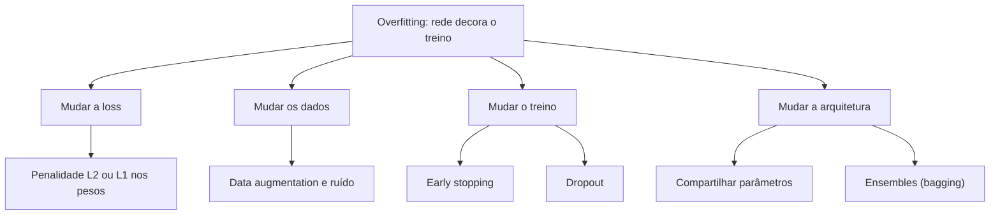

# 6. Regularização

> [!NOTE] Em uma frase
> Regularizar é dificultar de propósito a vida do modelo no treino, para que ele seja obrigado a aprender o padrão geral em vez de decorar os exemplos.

## Por que isso importa

Um aluno que decora as respostas da lista de exercícios tira 10 na lista e vai mal na prova. Um aluno que é obrigado a resolver variações, que estuda com tempo limitado ou que explica a matéria para colegas aprende o método. Redes neurais modernas têm capacidade de sobra para decorar: um estudo famoso de 2017 mostrou que redes comuns de visão conseguem atingir erro zero de treino até em imagens com labels sorteados ao acaso. Ou seja, a rede *pode* decorar qualquer coisa. Se ela generaliza na prática, é em boa parte por causa das técnicas deste capítulo.

O livro define **regularização** como qualquer modificação no algoritmo de aprendizado que tenta reduzir o erro de generalização, e não o erro de treino. O capítulo 7 é um catálogo dessas modificações. Esta página explica as mais usadas e, para cada uma, o problema que ela resolve.

## O que você precisa saber antes

- [Página 4](04-computacao-numerica-e-fundamentos-de-ml.md): capacidade, [overfitting](../../glossario.md#overfitting) e o conjunto de validação.
- [Página 2](02-algebra-linear.md): as normas L1 e L2.
- [Página 5](05-redes-feedforward.md): o que são pesos e camadas escondidas.

## As ideias centrais

### O mapa: onde cada técnica age

As técnicas atacam o overfitting por lados diferentes. Algumas mudam a loss, outras mudam os dados, outras mudam o treino ou a arquitetura.

### Penalidade nos pesos: L2 e L1

A ideia mais antiga: somar à loss um termo que cresce com o tamanho dos pesos.

$$\tilde{L}(w) = L(w) + \alpha \, \Omega(w)$$

Em palavras: a nova loss é a loss original mais uma "multa" $\Omega$ pelo tamanho dos pesos, com $\alpha$ controlando o peso da multa. $\alpha = 0$ é sem regularização; $\alpha$ grande demais faz o modelo ignorar os dados.

- **L2** (*weight decay*, decaimento dos pesos): a multa é a soma dos quadrados dos pesos. O efeito a cada passo de treino é encolher todos os pesos um pouquinho na direção de zero. O livro mostra uma intuição geométrica bonita: o encolhimento é forte nas direções em que a loss quase não muda (direções "pouco importantes") e fraco nas direções em que a loss é sensível. Ou seja, a L2 preserva o que importa e apaga o que é detalhe.
- **L1**: a multa é a soma dos valores absolutos. Ela empurra muitos pesos para **exatamente zero**, produzindo um modelo **esparso** (com muitos zeros), o que funciona como seleção automática de features.

Por que pesos pequenos generalizam melhor? Uma função com pesos pequenos muda devagar quando a entrada muda; ela não consegue fazer as curvas malucas necessárias para passar exatamente por cada ponto ruidoso.

O livro também mostra que penalizar a norma é parecido com **limitar** a norma (os pesos não podem passar de um raio), e que às vezes é melhor impor o limite diretamente, reprojetando os pesos quando eles ultrapassam o raio.

### Mais dados, mesmo que fabricados

O melhor regularizador é ter mais dados. Quando não há, dá para fabricar. **Data augmentation** gera variações dos exemplos que preservam o label: uma foto de gato deslocada, espelhada ou levemente girada continua sendo um gato. A rede é forçada a aprender que essas variações não importam. É padrão em visão e muito eficaz.

Cuidado com transformações que mudam o label: espelhar horizontalmente um "b" faz virar "d"; girar um "6" faz virar "9". A augmentation precisa respeitar o domínio.

Uma variante é **injetar ruído**: na entrada, nas unidades escondidas ou até nos pesos. O livro mostra que, em certos casos, adicionar ruído à entrada equivale matematicamente a uma penalidade nos pesos. Há também ruído nos labels: *label smoothing* troca o alvo "100% gato" por algo como "90% gato, o resto dividido entre as outras classes", para o modelo não ficar confiante demais.

### Early stopping: parar na hora certa

Durante o treino de uma rede grande, a loss de treino desce quase sempre. A loss de validação desce junto por um tempo, depois para e começa a subir: é o momento em que a rede passou a decorar. **Early stopping** (parada antecipada) é observar a validação, guardar os pesos do melhor momento e parar depois de algumas épocas sem melhora (essa tolerância chama-se *patience*).

É talvez a regularização mais usada, porque é quase de graça: não muda o modelo nem a loss. O livro mostra que, para modelos simples, ela tem efeito parecido com a L2: limitar o número de passos limita o quão longe os pesos conseguem ir a partir da inicialização. O custo é precisar de um conjunto de validação e avaliá-lo periodicamente.

### Compartilhar parâmetros

Em vez de penalizar os pesos, dá para obrigar vários deles a serem **iguais**. O exemplo mais importante são as redes convolucionais (cap. 9): o mesmo pequeno filtro detector de bordas é aplicado em todas as posições da imagem. Um gato no canto e um gato no centro ativam os mesmos pesos. Isso reduz drasticamente o número de parâmetros e codifica uma suposição verdadeira sobre imagens.

O capítulo também cita **aprendizado multitarefa**: treinar a mesma base de rede para várias tarefas relacionadas, de modo que a parte compartilhada precise servir para todas e, por isso, aprenda algo mais geral.

### Ensembles e dropout

**Bagging** (de *bootstrap aggregating*) treina vários modelos em versões sorteadas do dataset e tira a média das previsões. Como cada um erra de um jeito diferente, os erros se cancelam parcialmente. Funciona muito bem, mas treinar e servir 10 redes grandes custa 10 vezes mais.

**Dropout** é a resposta barata. A cada passo de treino, cada unidade é desligada ao acaso com certa probabilidade (o livro cita, como ponto de partida, manter 80% das unidades de entrada e 50% das escondidas). Cada passo treina, na prática, uma sub-rede diferente, e todas compartilham pesos. O resultado se comporta como um ensemble de um número enorme de redes, pelo custo de uma.

Na hora de prever, nada é desligado; em vez disso, as ativações são escaladas para compensar o fato de que, no treino, só parte das unidades estava ativa. Bibliotecas modernas fazem a escala inversa durante o treino, e por isso existe o modo `model.eval()` no PyTorch: ele desliga o dropout.

Outra leitura útil: com dropout, uma unidade não pode contar que outra específica estará lá, então cada uma precisa ser útil sozinha, e a rede fica mais robusta.

### Treino adversarial (menção)

O capítulo ainda mostra que redes podem errar feio em **exemplos adversariais**: imagens alteradas de forma imperceptível para humanos que mudam a resposta da rede. Treinar também nesses exemplos melhora a robustez. Esse assunto cresceu muito depois de 2016 e virou área própria de pesquisa em segurança de modelos.

## Onde isso aparece no mundo real

- **AdamW**, o otimizador padrão para treinar Transformers, existe porque a L2 somada à loss não se comporta como *weight decay* puro dentro do Adam; a versão "W" aplica o decaimento separado. É um refinamento direto deste capítulo.
- **Pipelines de visão** (classificação de produtos, leitura de documentos) usam augmentation pesada como etapa obrigatória do treino.
- **Early stopping** é o padrão em bibliotecas de gradient boosting como XGBoost e LightGBM, não só em redes.

## Erros comuns de quem está aprendendo

- **Esquecer `model.eval()` na hora de avaliar.** O dropout continua ativo, as previsões ficam aleatórias e piores, e o número de validação fica errado.
- **Fazer early stopping olhando o conjunto de teste.** Vira escolha de hiperparâmetro com dados de teste; use a validação.
- **Empilhar todas as regularizações de uma vez.** Regularização demais causa underfitting. Comece com pouca e aumente só se a diferença entre treino e validação for grande.
- **Aplicar augmentation que muda o label.** Rodar dígitos, espelhar texto, alterar a cor quando a cor é a resposta.

## Verifique se entendeu

1. Pela definição do livro, o que separa uma técnica de regularização de uma técnica de otimização? (Veja "Por que isso importa".)
2. Qual a diferença de efeito entre penalizar a norma L2 e a norma L1 dos pesos? (Veja "Penalidade nos pesos".)
3. Por que o early stopping se parece com a L2? (Veja "Early stopping".)
4. Como o dropout imita um ensemble sem pagar o custo de treinar vários modelos? (Veja "Ensembles e dropout".)
5. Dê um exemplo de data augmentation que estragaria o dataset. (Veja "Mais dados, mesmo que fabricados".)

## Para ir além

- [Regularization for Deep Learning, capítulo 7](https://www.deeplearningbook.org/contents/regularization.html): o texto oficial e gratuito; as seções de penalidade nos pesos, early stopping e dropout são as essenciais.
- [CS 230 — Deep Learning Tips and Tricks](https://stanford.edu/~shervine/teaching/cs-230/cheatsheet-deep-learning-tips-and-tricks): resumo de uma página de augmentation, dropout, regularização e early stopping.
- [dalmia/Deep-Learning-Book-Chapter-Summaries](https://github.com/dalmia/Deep-Learning-Book-Chapter-Summaries): resumo do capítulo 7 em notebook.

---
Anterior: [5. Redes feedforward](05-redes-feedforward.md) · Próximo: [7. Otimização para treino](07-otimizacao-para-treino.md) · Voltar ao livro: [Guia de leitura](index.md)
