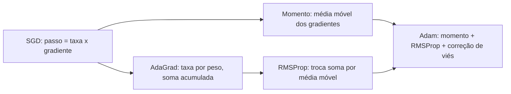

# 7. Otimização para treino

> [!NOTE] Em uma frase
> A descida do gradiente pura é um carro sem suspensão numa estrada esburacada; momento, taxas adaptativas, boa inicialização e batch normalization são a suspensão.

## Por que isso importa

Você monta uma rede de 20 camadas, usa descida do gradiente com a melhor taxa de aprendizado que encontrou e a loss fica parada por horas. Ou oscila. Ou cai e depois explode. Nada disso é bug no código: é o terreno da loss de redes profundas, cheio de platôs, vales estreitos e penhascos, sendo percorrido por um algoritmo que só enxerga a inclinação local. O capítulo 8 do livro é o manual de como andar nesse terreno.

Ele começa com uma distinção importante: em ML, a otimização é um meio, não um fim. Não queremos o mínimo exato da loss de treino (isso seria overfitting); queremos parâmetros que generalizem. Por isso, técnicas que parecem "ruins" para otimização pura, como parar antes (early stopping) ou usar gradientes barulhentos, são boas aqui.

## O que você precisa saber antes

- [Página 4](04-computacao-numerica-e-fundamentos-de-ml.md): descida do gradiente, taxa de aprendizado, pontos de sela, minibatch.
- [Página 5](05-redes-feedforward.md): backpropagation calcula o gradiente; esta página é sobre o que fazer com ele.
- O conceito de **média móvel**: uma média que dá mais peso aos valores recentes e vai "esquecendo" os antigos, como a média de temperatura dos últimos dias.

## As ideias centrais

### Os obstáculos do terreno

O livro lista os problemas que tornam o treino difícil:

- **Mau condicionamento**: o terreno é muito mais íngreme numa direção do que em outra. Com uma taxa de aprendizado única, o passo é grande demais para a direção íngreme (oscila) e pequeno demais para a suave (não anda).
- **Platôs e pontos de sela**: regiões quase planas onde o gradiente é minúsculo.
- **Penhascos e gradientes explosivos**: regiões em que a loss muda bruscamente; um passo de gradiente arremessa os pesos longe. A solução simples é o **gradient clipping**: se a norma do gradiente passar de um limite, encolha-o antes de dar o passo.
- **Gradientes que somem ou explodem com a profundidade**: multiplicar muitos números menores que 1 dá quase zero; maiores que 1, dá infinito. É o mesmo efeito do exemplo da página 5, multiplicado por 20 camadas.

O livro também faz uma observação que envelheceu bem: para redes grandes, mínimos locais ruins parecem ser menos problema do que se temia; a maioria dos mínimos locais tem loss parecida com a do mínimo global.

### SGD com minibatch e taxa de aprendizado

A base continua sendo **SGD com minibatch**: estimar o gradiente com um lote pequeno e dar um passo. O tamanho do lote é um trade-off: lotes maiores dão estimativas menos barulhentas e aproveitam melhor a GPU, mas cada passo custa mais, e o ganho de precisão cresce só com a raiz quadrada do tamanho (lote 4 vezes maior, ruído só 2 vezes menor). Lotes pequenos introduzem ruído, que às vezes ajuda a generalizar.

O livro insiste que a **taxa de aprendizado** é o hiperparâmetro mais importante e que, na prática, ela deve **diminuir ao longo do treino**: no começo, passos grandes para andar rápido; no fim, passos pequenos para não ficar pulando em volta do vale. Isso se chama *learning rate schedule* (cronograma da taxa de aprendizado).

### Momento: a bola que rola

Imagine uma bola rolando pela montanha em vez de uma pessoa dando passos. A bola acumula velocidade: em direções onde o gradiente aponta sempre para o mesmo lado, ela acelera; em direções onde o gradiente fica trocando de sinal (o ziguezague de um vale estreito), as oscilações se cancelam.

**Momento** implementa isso guardando uma "velocidade" $v$, que é uma média móvel dos gradientes:

$$v \leftarrow \alpha v - \epsilon \nabla L, \qquad \theta \leftarrow \theta + v$$

Em palavras: a velocidade nova é um pouco da velocidade anterior ($\alpha$, tipicamente 0,9) mais o empurrão do gradiente atual; os pesos andam pela velocidade. Com $\alpha = 0{,}9$, o passo efetivo em terreno de inclinação constante chega a ser 10 vezes maior que o do SGD puro.

O **momento de Nesterov** é uma variação: calcula o gradiente no ponto para onde a velocidade já vai levar, como olhar a curva antes de chegar nela.

### Taxas adaptativas: AdaGrad, RMSProp e Adam

O momento ainda usa a mesma taxa para todos os pesos. A ideia dos métodos adaptativos é dar a **cada peso sua própria taxa**, baseada no histórico do gradiente daquele peso.

- **AdaGrad**: divide o passo de cada peso pela raiz da soma de todos os gradientes ao quadrado que ele já recebeu. Pesos com gradientes grandes dão passos menores; pesos com gradientes raros e pequenos dão passos maiores. Problema: a soma só cresce, e o passo vai encolhendo até parar cedo demais.
- **RMSProp**: troca a soma por uma **média móvel** dos gradientes ao quadrado. O histórico antigo é esquecido e o passo não morre. Resolve o defeito do AdaGrad.
- **Adam** (de *adaptive moments*): combina as duas ideias. Mantém uma média móvel dos gradientes (como o momento) e uma média móvel dos gradientes ao quadrado (como o RMSProp), e divide uma pela raiz da outra. Também aplica uma **correção de viés**: como as médias começam em zero, nos primeiros passos elas subestimam os valores reais, e a correção compensa isso. Os valores padrão sugeridos ($\beta_1 = 0{,}9$, $\beta_2 = 0{,}999$, taxa $0{,}001$) funcionam razoavelmente em muitos problemas.

O livro é honesto: não há consenso sobre qual é o melhor, e a escolha depende muito de familiaridade com o ajuste dos hiperparâmetros. Isso continua verdade, embora Adam (e sua variante AdamW) tenha virado o padrão de fato para Transformers.

### Inicialização: onde a descida começa

Se todos os pesos começarem iguais, todas as unidades de uma camada recebem o mesmo gradiente e continuam iguais para sempre: a camada se comporta como uma unidade só. Por isso os pesos começam **aleatórios**, para "quebrar a simetria". Os bias, em geral, podem começar em zero.

A escala dos números sorteados importa muito. Pesos grandes demais fazem os sinais crescerem de camada em camada (ativações saturam, gradientes explodem); pequenos demais fazem os sinais sumirem. A **inicialização normalizada** (conhecida como Glorot ou Xavier) escolhe a escala com base no número de entradas e saídas da camada, para que a variância dos sinais fique mais ou menos constante ao atravessar a rede. Para ReLU, existe a variante de He, que o livro não detalha mas que segue a mesma lógica.

O livro admite que a teoria de inicialização é incompleta: um bom começo para otimização nem sempre é o melhor para generalização.

### Batch normalization

Mesmo com boa inicialização, há um problema de coordenação: o gradiente diz como mudar cada camada supondo que as outras ficam paradas, mas todas mudam ao mesmo tempo. Uma camada se ajusta à distribuição de saída da anterior, e essa distribuição muda a cada passo.

**Batch normalization** normaliza as ativações de cada camada usando o lote atual: subtrai a média do lote e divide pelo desvio padrão, de modo que cada unidade tenha média 0 e variância 1. Depois, multiplica e soma por dois parâmetros aprendidos, para a rede poder recuperar outra escala se precisar. O efeito prático é que o treino fica muito mais estável, aceita taxas de aprendizado maiores e é menos sensível à inicialização.

Na hora de prever, não há lote (pode ser um exemplo só), então usa-se a média e a variância acumuladas durante o treino. É mais um motivo para `model.eval()` existir. Por que exatamente o batch norm funciona ainda é debatido; a explicação original (reduzir a mudança de distribuição entre camadas) foi contestada por trabalhos posteriores.

### Outras estratégias do capítulo

O capítulo fecha com técnicas de apoio: **pré-treinar** partes da rede em tarefas mais simples antes da tarefa final, treinar primeiro com exemplos fáceis (*curriculum learning*), média dos pesos ao longo do treino (*Polyak averaging*) e a observação de que, muitas vezes, mudar a arquitetura para facilitar a otimização vale mais do que trocar de otimizador.

## Onde isso aparece no mundo real

- **Treino de modelos de linguagem** usa AdamW, gradient clipping, aquecimento da taxa de aprendizado (*warmup*, começar com taxa pequena e subir) seguido de decaimento, e inicialização cuidadosa. Tudo isso é descendente direto deste capítulo.
- **Visão computacional**: SGD com momento e cronograma de taxa ainda é muito usado em redes convolucionais, às vezes generalizando melhor que Adam.
- **Debug de treino**: o procedimento "tente fazer overfit num lote só" (ver o cheat sheet no fim) checa se a otimização funciona antes de pensar em generalização.

## Erros comuns de quem está aprendendo

- **Trocar de otimizador antes de ajustar a taxa de aprendizado.** Na maioria dos casos, o problema é a taxa, não o algoritmo.
- **Esquecer que o batch norm se comporta diferente em treino e em avaliação.** Avaliar em modo de treino com lotes pequenos gera números instáveis.
- **Inicializar tudo com zero.** A simetria nunca se quebra e a rede não aprende.
- **Achar que Adam dispensa ajuste.** Os padrões são um bom começo, não uma garantia.

## Verifique se entendeu

1. Por que, em ML, encontrar o mínimo exato da loss de treino não é o objetivo? (Veja "Por que isso importa".)
2. Como o momento reduz o ziguezague num vale estreito? (Veja "Momento".)
3. Qual defeito do AdaGrad o RMSProp corrige, e o que o Adam acrescenta? (Veja "Taxas adaptativas".)
4. O que acontece se todos os pesos começarem iguais? E se começarem grandes demais? (Veja "Inicialização".)
5. Por que o batch norm precisa de estatísticas acumuladas na hora de prever? (Veja "Batch normalization".)

## Para ir além

- [Optimization for Training Deep Models, capítulo 8](https://www.deeplearningbook.org/contents/optimization.html): o texto oficial e gratuito; as seções de algoritmos básicos, taxas adaptativas e batch normalization são as essenciais.
- [Deep Learning — Lecture Slides](https://www.deeplearningbook.org/lecture_slides.html): o capítulo 8 tem vários decks de slides oficiais, o que mostra o peso dele no livro.
- [CS 230 — Deep Learning Tips and Tricks](https://stanford.edu/~shervine/teaching/cs-230/cheatsheet-deep-learning-tips-and-tricks): Adam, inicialização Xavier, batch norm e o roteiro de debug (overfit de um lote, gradient checking).
- [dalmia/Deep-Learning-Book-Chapter-Summaries](https://github.com/dalmia/Deep-Learning-Book-Chapter-Summaries): resumo do capítulo 8 em notebook.

---
Anterior: [6. Regularização](06-regularizacao.md) · Próximo: [8. Parte III e o que envelheceu](08-parte-iii-e-o-que-envelheceu.md) · Voltar ao livro: [Guia de leitura](index.md)
