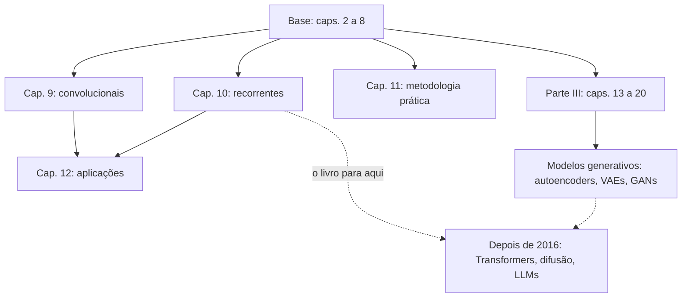

# 8. Capítulos 9 a 20 e o que envelheceu

> [!NOTE] Em uma frase
> Os fundamentos do livro continuam valendo, mas ele foi escrito um ano antes do Transformer, então a arquitetura que move os modelos de linguagem de hoje está fora dele.

## Por que isso importa

Este guia cobriu em detalhe os capítulos 2 a 8 porque são eles que sustentam tudo o resto: o que é uma rede, como se calcula o gradiente, como se evita overfitting e como se faz a loss cair. O livro tem mais 12 capítulos. Quatro deles (9 a 12) fecham a Parte II com arquiteturas especializadas e conselhos práticos; oito (13 a 20) formam a Parte III, sobre a pesquisa da época, principalmente modelos probabilísticos e generativos.

O livro saiu em 2016. Em 2017 veio o artigo "Attention Is All You Need", que apresentou o Transformer; em 2020, os modelos de difusão viraram a técnica dominante para gerar imagens; em 2022, o ChatGPT popularizou os grandes modelos de linguagem. Nada disso está no livro. Saber exatamente o que ele cobre e o que não cobre evita dois erros opostos: descartar o livro por ser "velho" e achar que ele basta para entender a IA de hoje.

## O que você precisa saber antes

As páginas [5](05-redes-feedforward.md), [6](06-regularizacao.md) e [7](07-otimizacao-para-treino.md). Para a Parte III, também a [página 3](03-probabilidade-e-teoria-da-informacao.md), porque ela é quase toda sobre distribuições de probabilidade.

## As ideias centrais

### O mapa do resto do livro

### Capítulo 9: redes convolucionais

Uma **rede convolucional** (CNN) aplica o mesmo pequeno filtro (por exemplo, 3 por 3 pixels) em todas as posições da imagem. Isso é o compartilhamento de parâmetros da página 6 levado ao extremo: um detector de bordas aprendido num canto funciona na imagem inteira, e a rede precisa de muito menos pesos do que uma feedforward comum. O **pooling** resume regiões vizinhas (por exemplo, pegando o máximo), tornando a rede tolerante a pequenos deslocamentos. O capítulo continua sólido como introdução. O que falta são as arquiteturas que vieram logo depois, como as redes residuais (com conexões que "pulam" camadas, permitindo treinar centenas delas), e o fato de que, desde 2020, Transformers aplicados a imagens competem com CNNs.

### Capítulo 10: redes recorrentes

Uma **rede recorrente** (RNN) processa uma sequência um elemento por vez, carregando um **estado** que resume o que viu até ali, como alguém lendo uma frase e guardando o sentido na cabeça. O capítulo explica o treino por backpropagation ao longo do tempo, o problema dos gradientes que somem em sequências longas e a solução da época: células com portões (**LSTM** e **GRU**) que decidem o que guardar e o que esquecer. Também apresenta as arquiteturas *encoder-decoder* (um módulo lê a sequência inteira, outro gera a saída), usadas em tradução.

Este é o capítulo que mais envelheceu: para texto, Transformers substituíram as RNNs quase completamente, porque processam a sequência inteira em paralelo em vez de um passo por vez. As ideias de estado e de gradiente ao longo do tempo continuam úteis, inclusive para entender arquiteturas recentes que voltaram a usar recorrência.

### Capítulo 11: metodologia prática

Talvez o capítulo mais útil para quem trabalha com ML no dia a dia, e o que menos envelheceu. Ele propõe um processo: definir a métrica e a meta antes de começar; montar rápido um sistema de ponta a ponta simples; medir onde está o gargalo (underfitting, overfitting, bug, dado ruim); decidir se vale mais coletar dados ou ajustar o modelo; ajustar hiperparâmetros com busca aleatória em vez de grade; e técnicas de debug, como visualizar o modelo em ação e checar gradientes. Se você vai ler só um capítulo depois do 8, leia este.

### Capítulo 12: aplicações

Um retrato de 2016: visão computacional, reconhecimento de voz, processamento de linguagem natural, recomendação. É interessante historicamente, e é aqui que aparece o **mecanismo de atenção**, numa seção curta sobre tradução automática: em vez de comprimir a frase inteira num único vetor, o tradutor "olha" para as partes relevantes da frase original a cada palavra gerada. Essa é a semente do Transformer, mas o livro a trata como um detalhe, não como a ideia central que ela viria a ser.

### Parte III (capítulos 13 a 20): pesquisa da época

A Parte III é a mais densa matematicamente e a mais datada no foco. Em resumo:

- **13. Modelos de fatores lineares**: PCA probabilístico, análise de componentes independentes. Representar dados como combinação de poucos fatores escondidos.
- **14. Autoencoders**: redes que aprendem a comprimir a entrada e reconstruí-la; a compressão força a rede a aprender o que importa. A ideia continua viva em muitos lugares, inclusive na compressão de imagens dentro de geradores modernos.
- **15. Aprendizado de representações**: por que pré-treinar, transferir conhecimento entre tarefas e aprender representações "desembaraçadas". O tema ficou ainda mais central com modelos pré-treinados.
- **16 a 19. Modelos probabilísticos estruturados, Monte Carlo, função de partição e inferência aproximada**: a maquinaria para trabalhar com distribuições complexas que não dá para calcular diretamente. Fundamental para pesquisa em modelos probabilísticos, pouco necessária para a maioria dos praticantes.
- **20. Modelos generativos profundos**: máquinas de Boltzmann (hoje pouco usadas), **autoencoders variacionais** (VAEs) e **redes adversariais generativas** (GANs), em que um gerador e um discriminador competem. VAEs e GANs foram o estado da arte em gerar imagens até por volta de 2020.

Se o seu objetivo é usar e entender modelos atuais, a Parte III pode ficar para depois, com exceção do cap. 14 e do trecho de VAEs e GANs do cap. 20.

### O que o livro não cobre

Seja direto com você mesmo sobre estas lacunas:

- **Transformers e autoatenção**: a arquitetura em que cada elemento da sequência calcula, por produtos escalares (página 2), o quanto deve prestar atenção em cada outro elemento. É a base de praticamente todos os modelos de linguagem atuais. O livro só tem a versão inicial da atenção, acoplada a RNNs.
- **Normalizações e truques de treino posteriores**: *layer normalization* (a variante do batch norm usada em Transformers), conexões residuais como padrão, *warmup* da taxa de aprendizado e AdamW.
- **Modelos de difusão**: geradores que aprendem a remover ruído de uma imagem passo a passo; partindo de ruído puro, criam imagens novas. Substituíram as GANs como técnica dominante em geração de imagens.
- **LLMs e o que vem com eles**: pré-treino autossupervisionado em escala gigante, leis de escala (como o desempenho melhora previsivelmente com mais dados, parâmetros e computação), *fine-tuning*, aprendizado por reforço com feedback humano, *prompting*.
- **Engenharia em escala**: treino distribuído em milhares de GPUs, precisão mista, quantização para servir modelos. E a parte de colocar modelos em produção, que este guia cobre em [Designing Machine Learning Systems](../designing-ml-systems/index.md).

### Para onde ir depois

Não há um único substituto, mas um caminho razoável (estes títulos não estão na lista de fontes verificadas deste guia, então confira as edições e os links por conta própria):

1. **Consolide com prática**: implemente uma MLP e o treino com PyTorch, aplicando as páginas 5 a 7. O livro *Dive into Deep Learning*, gratuito e com código, cobre isso e também Transformers.
2. **Transformers**: leia o artigo original "Attention Is All You Need" (2017) com um tutorial ilustrado ao lado.
3. **Visão moderna de todo o campo**: *Understanding Deep Learning*, de Simon Prince (2023), gratuito em PDF, é na prática uma versão atualizada deste livro, com capítulos sobre Transformers e difusão.
4. **LLMs na prática**: os materiais de cursos universitários recentes sobre modelos de linguagem.

## Onde isso aparece no mundo real

- **Um modelo como o GPT** é feito de blocos com autoatenção (ausente do livro) e redes feedforward (página 5), treinados com cross-entropy (página 3), AdamW e clipping (página 7) e regularização (página 6). O livro explica mais da metade do motor.
- **Geradores de imagem** atuais combinam difusão (fora do livro) com autoencoders (cap. 14) e redes com convoluções (cap. 9).
- **Times de ML em empresas** seguem, sem saber, o processo do cap. 11: métrica primeiro, baseline simples, diagnóstico antes de complexidade.

## Erros comuns de quem está aprendendo

- **Descartar o livro por ser de 2016.** As páginas 2 a 7 deste guia são a base de qualquer modelo atual; o que envelheceu são as arquiteturas no topo.
- **Achar que o livro ensina como funcionam os LLMs.** Ele ensina os fundamentos; a arquitetura e o regime de treino dos LLMs vêm depois.
- **Ler a Parte III de ponta a ponta antes de praticar.** É a parte mais pesada e menos necessária para quem está começando.
- **Pular o capítulo 11.** É curto, prático e ainda atual.

## Verifique se entendeu

1. Que ideia da página 6 é o coração das redes convolucionais? (Veja "Capítulo 9".)
2. Por que Transformers substituíram RNNs para texto? (Veja "Capítulo 10".)
3. Onde a atenção aparece no livro, e por que isso não basta para entender um Transformer? (Veja "Capítulo 12" e "O que o livro não cobre".)
4. Quais capítulos da Parte III valem a leitura para quem quer entender geração de imagens? (Veja "Parte III".)
5. Em um modelo de linguagem atual, que partes o livro explica e quais ficam de fora? (Veja "Onde isso aparece no mundo real".)

## Para ir além

- [Deep Learning (Goodfellow) — TheoremPath reading guide](https://theorempath.com/topics/deep-learning-goodfellow-book): classifica cada capítulo de 9 a 20 como essencial, seletivo ou dispensável e discute o que envelheceu, com leituras complementares.
- [Deep Learning — deeplearningbook.org](https://www.deeplearningbook.org/): os capítulos 9 a 20 completos, gratuitos e oficiais (por exemplo, `contents/guidelines.html` para o capítulo 11).
- [dalmia/Deep-Learning-Book-Chapter-Summaries](https://github.com/dalmia/Deep-Learning-Book-Chapter-Summaries): resumos em notebook dos capítulos 9, 11 e 13.
- [Deep Learning — Lecture Slides](https://www.deeplearningbook.org/lecture_slides.html): slides oficiais até o capítulo 18 e vídeos de grupos de leitura.

---
Anterior: [7. Otimização para treino](07-otimizacao-para-treino.md) · Voltar ao livro: [Guia de leitura](index.md)
