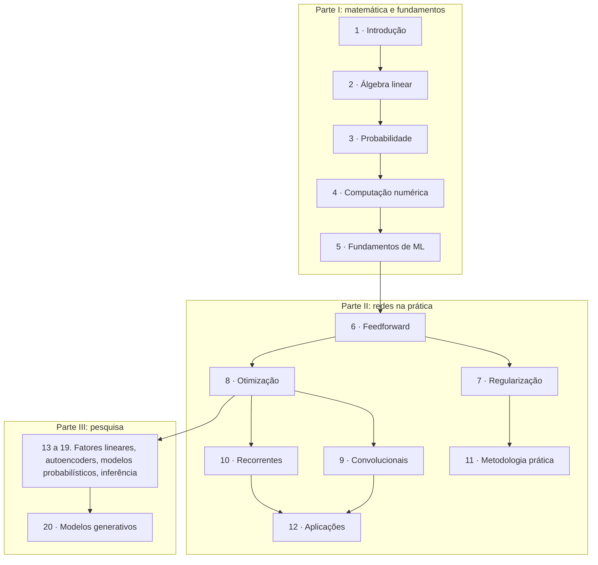

# Deep Learning — guia de leitura

> [!NOTE] Em uma frase
> Uma rede neural é uma função com milhões de parâmetros ajustados por gradiente; o livro constrói, da álgebra linear até a otimização, tudo o que é preciso para entender essa frase.

> [!TIP] O livro é gratuito e oficial
> O texto completo de *Deep Learning* (Ian Goodfellow, Yoshua Bengio e Aaron Courville, MIT Press, 2016) está em [deeplearningbook.org](https://www.deeplearningbook.org/), publicado pelos próprios autores, com um HTML por capítulo. Não é cópia pirata nem resumo: é o livro. Cada página deste guia linka o capítulo correspondente.

## Para quem é e quando ler

Para quem já programa, quer entender o que acontece *dentro* de uma rede neural e aceita encarar um pouco de matemática. É o livro certo quando "chamar `model.fit()`" deixou de bastar: a loss não cai, aparece `NaN`, o modelo decora o treino, e você quer saber por quê.

A matemática pode estar enferrujada: os capítulos 2 a 4 revisam o necessário, e este guia explica cada fórmula em palavras antes de usá-la. Se você ainda não sabe o que é treino, validação e teste, ou nunca viu um modelo em produção, o módulo [10. Como uma máquina aprende](../../fundamentos/10-como-uma-maquina-aprende.md) do guia principal cobre esse básico.

## O que o livro NÃO é

- **Não é um tutorial de código.** Não há PyTorch nem TensorFlow; há notação matemática e argumentos.
- **Não é atual sobre arquiteturas.** Foi escrito antes do Transformer, dos modelos de difusão e dos LLMs. Os fundamentos valem; o topo da pilha mudou. A [página 8](08-parte-iii-e-o-que-envelheceu.md) detalha as lacunas.
- **Não é sobre ML em produção.** Dados mudando, deploy, monitoramento: isso está em [Designing Machine Learning Systems](../designing-ml-systems/index.md).

## Como o livro está organizado

Três partes. A Parte I é a matemática e os fundamentos de ML; a Parte II, as redes usadas na prática; a Parte III, a pesquisa da época, sobretudo modelos probabilísticos e generativos.

## Como ler

1. **Capítulos 2 a 5 de forma seletiva.** Leia até entender as ideias essenciais (a [página 1](01-a-matematica-que-voce-precisa.md) diz quais são) e siga em frente; volte quando uma conta travar.
2. **Capítulos 6 a 8 com cuidado.** São o coração do livro. Faça o exemplo de backpropagation da [página 5](05-redes-feedforward.md) à mão, com lápis.
3. **Capítulo 11 logo em seguida.** É curto, prático e não envelheceu.
4. **Capítulos 9, 10 e 12 conforme o interesse** (imagens, sequências).
5. **Parte III depois de praticar**, e só o que interessar.

Ritmo: uma página deste guia mais o capítulo correspondente por semana é sustentável com emprego em tempo integral. Os capítulos 5 e 8 pedem mais tempo.

## O que você leva ao terminar

- Ler uma camada de rede como uma transformação geométrica do espaço, e saber por que a função de ativação é indispensável.
- Explicar de onde vêm as losses (cross-entropy, erro quadrático) e por que elas fazem sentido.
- Calcular gradientes por backpropagation num exemplo pequeno e entender o que o `loss.backward()` faz.
- Diagnosticar underfitting, overfitting e problemas numéricos, e saber qual técnica de regularização ou otimização aplicar.
- Saber com precisão o que o livro não cobre e onde aprender Transformers, difusão e LLMs.

## Capítulos

1. [A matemática que você precisa](01-a-matematica-que-voce-precisa.md): o mapa da Parte I e por que treinar uma rede é minimizar um número.
2. [Álgebra linear](02-algebra-linear.md): vetores, matrizes, normas e decomposições pela geometria, até a camada de rede como transformação.
3. [Probabilidade e teoria da informação](03-probabilidade-e-teoria-da-informacao.md): distribuições, regra de Bayes, entropia e a cross-entropy como loss.
4. [Computação numérica e fundamentos de ML](04-computacao-numerica-e-fundamentos-de-ml.md): overflow, descida do gradiente, capacidade, validação e máxima verossimilhança.
5. [Redes feedforward](05-redes-feedforward.md): camadas, ReLU, saídas e backpropagation passo a passo com números.
6. [Regularização](06-regularizacao.md): L2, L1, augmentation, early stopping, compartilhamento de parâmetros e dropout.
7. [Otimização para treino](07-otimizacao-para-treino.md): SGD, momento, RMSProp, Adam, inicialização e batch normalization.
8. [Capítulos 9 a 20 e o que envelheceu](08-parte-iii-e-o-que-envelheceu.md): convolucionais, recorrentes, metodologia, Parte III, e as lacunas (Transformers, difusão, LLMs).

## Fontes públicas para acompanhar

As [fontes públicas verificadas](fontes.md) reúnem o livro oficial, os slides dos autores, notas de estudo com código e um guia que classifica cada capítulo.
