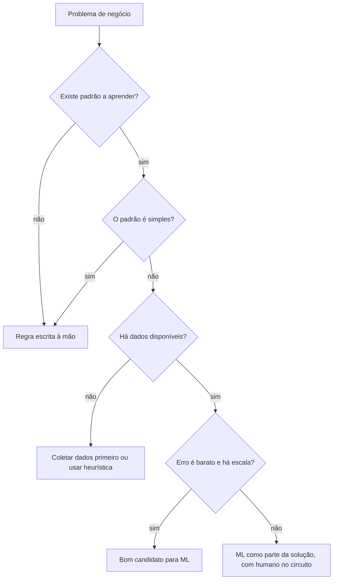
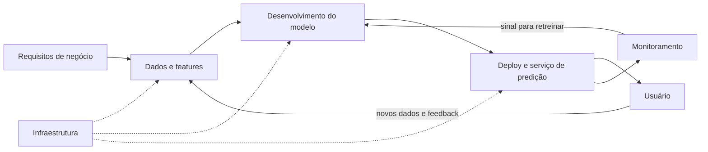

# 1. Visão geral de sistemas de ML

> [!NOTE] Em uma frase
> Um sistema de machine learning é muito mais que um modelo: é dados, código, infraestrutura e pessoas, e antes de construí-lo é preciso perguntar se ML é mesmo a ferramenta certa para o problema.

## Por que isso importa

Imagine que você trabalha em um aplicativo de delivery e alguém sugere: "vamos usar machine learning para estimar o tempo de entrega". Parece óbvio. Mas a mesma reunião pode trazer outra sugestão: "vamos usar ML para calcular o frete". Aqui a resposta provavelmente é não: o frete é uma regra de negócio (distância vezes tarifa, mais taxa mínima), e uma regra escrita à mão é mais barata, mais previsível e mais fácil de explicar ao cliente do que um modelo. Saber separar esses dois casos economiza meses de trabalho.

O segundo motivo é que quase todo curso de ML ensina a parte mais visível: escolher um algoritmo e treinar. Quem chega a uma empresa descobre que o modelo é uma fração pequena do esforço. A maior parte do trabalho está em conseguir os dados, colocar o modelo no ar, perceber quando ele começa a errar e mantê-lo funcionando. Este capítulo é o mapa desse território, e o resto do livro é a viagem.

## O que você precisa saber antes

- Machine learning (ML), aqui, é a técnica de fazer um programa aprender um comportamento a partir de exemplos, em vez de alguém escrever as regras. Se a ideia for nova, o guia de [Deep Learning](../deep-learning/index.md) traz a base matemática, mas ela não é necessária para este livro.
- [Feature](../../glossario.md#feature): uma variável de entrada do modelo (idade, valor da compra).
- [Label](../../glossario.md#label): a resposta certa associada a um exemplo de treino.

## As ideias centrais

### Quando usar ML (e quando não usar)

A autora propõe uma definição prática: ML é uma abordagem para **aprender padrões complexos a partir de dados existentes e usá-los para fazer previsões sobre dados que ainda não foram vistos**. Cada pedaço dessa frase é um filtro:

- **Aprender**: o sistema precisa ter capacidade de aprender. Se não há nada a aprender (o frete do exemplo acima), não é ML.
- **Padrões complexos**: se o padrão é simples o bastante para caber em um `if`, escreva o `if`. ML brilha quando o padrão é difícil de descrever, como reconhecer um rosto ou estimar o preço de um imóvel considerando dezenas de fatores.
- **Dados existentes**: sem dados, ou sem acesso a eles, não há o que aprender. Uma startup sem usuários ainda não tem dados de comportamento de usuários.
- **Previsões**: o problema precisa poder ser reformulado como "dado isto, qual a resposta mais provável?".
- **Dados não vistos**: os dados novos precisam se parecer com os antigos. Se o futuro não tem nada a ver com o passado, aprender com o passado não ajuda.

Além desses filtros, ML compensa mais quando a tarefa é **repetitiva** (o modelo vê muitos exemplos do mesmo tipo), quando **errar sai barato** (uma recomendação ruim de filme custa pouco; um diagnóstico errado custa muito), quando há **escala** (milhões de previsões diluem o custo de construir o sistema) e quando **os padrões mudam com frequência** (spam muda toda semana, e regras escritas à mão envelhecem mais rápido que um modelo retreinado).

Há também problemas em que ML não é a solução inteira, mas uma parte dela. Um chatbot de atendimento pode usar ML só para classificar a intenção da mensagem e deixar regras fixas decidirem o que fazer depois.

### ML em pesquisa versus ML em produção

Quem aprende ML em cursos ou na academia vê um mundo bem diferente do que encontra em uma empresa. A autora destaca cinco diferenças:

1. **Requisitos de quem tem interesse no sistema.** Na pesquisa, o objetivo é um só: bater o estado da arte em um benchmark (um conjunto de dados público usado para comparar modelos). Em produção há vários interessados com desejos que brigam entre si. Pense em um app que recomenda restaurantes: a equipe de ML quer o modelo mais preciso, a equipe de vendas quer que restaurantes que pagam anúncio apareçam mais, a de produto quer respostas rápidas, a de plataforma quer um sistema que não caia, e a gestão quer margem. Nenhum modelo agrada todos ao mesmo tempo.
2. **Prioridade computacional.** Na pesquisa, o gargalo é o treino: quanto mais experimentos por dia, melhor. Em produção, o que importa é a **inferência** (o momento em que o modelo responde a um pedido real), e principalmente a [latência](../../glossario.md#latência-e-throughput), o tempo de resposta. Pesquisa otimiza throughput (volume processado); produção, quase sempre, latência. Um modelo um pouco mais preciso e muito mais lento costuma perder.
3. **Dados.** Na pesquisa, o dataset é limpo, estático e bem formatado. Em produção, os dados chegam sujos, mudam com o tempo, têm vieses e às vezes nem chegam.
4. **Justiça (fairness).** Um modelo que erra sistematicamente para um grupo de pessoas pode negar crédito ou emprego em escala. Na pesquisa isso é um tópico; em produção é responsabilidade concreta.
5. **Interpretabilidade.** Em produção, usuários, reguladores e a própria equipe precisam entender por que o modelo decidiu algo, seja para confiar, seja para depurar.

### ML versus software tradicional

Se ML é software, por que não aplicar o que já sabemos de engenharia de software? Em boa parte, deve-se aplicar. Mas há uma diferença de fundo: em software tradicional, o comportamento está no código, e dados são algo que o código manipula. Em ML, **o comportamento vem da combinação de código e dados**. O mesmo código treinado com dados diferentes produz modelos diferentes.

Consequências práticas:

- Não basta versionar o código; é preciso versionar os dados e saber qual dataset gerou qual modelo.
- Testar fica mais difícil: não há uma saída "certa" para comparar, só uma taxa de acerto.
- Um dado malicioso ou errado no treino muda o comportamento do sistema sem nenhuma linha de código mudar.
- Modelos grandes ocupam memória e exigem hardware que um serviço web comum não precisa.

### O sistema inteiro, não só o algoritmo

A tese que atravessa o livro é a **abordagem sistêmica**: considerar todos os componentes juntos. Um sistema de ML inclui requisitos de negócio, a interface com o usuário, a pilha de dados, a lógica de desenvolvimento do modelo, o deploy (colocar o modelo no ar), o monitoramento e a infraestrutura que sustenta tudo.

Repare que o modelo é uma caixa entre várias. O livro dedica um capítulo a cada uma das outras.

## Onde isso aparece no mundo real

- **Uso corporativo é a maioria.** Quando se fala de ML pensa-se em assistentes de voz ou filtros de foto, mas a maior parte dos usos está dentro de empresas: detecção de fraude, previsão de demanda, precificação, triagem de suporte, detecção de churn (prever quais clientes vão cancelar). Ninguém vê, mas é onde está o dinheiro.
- **Detecção de fraude em cartão** cumpre todos os filtros: padrão complexo, muitos dados, escala enorme, padrões que mudam porque fraudadores se adaptam. Mesmo assim, o erro não é barato, então os bancos combinam o modelo com regras e revisão humana.
- **Recomendação em lojas online** é o caso clássico de requisitos em conflito: relevância para o cliente, margem para a loja, estoque disponível e latência baixa, tudo ao mesmo tempo.

## Erros comuns de quem está aprendendo

- **Achar que todo problema com dados pede ML.** Muitos pedem uma consulta SQL ou uma regra. Comece pela solução mais simples e só use ML se ela não bastar.
- **Achar que o trabalho termina quando o modelo atinge boa acurácia.** Esse é o começo. O modelo ainda precisa ser servido, monitorado e retreinado, e é aí que a maioria dos projetos tropeça.
- **Otimizar só a métrica do modelo.** Em produção, um modelo 1% mais preciso e duas vezes mais lento pode piorar o produto. Pergunte qual métrica o negócio sente.
- **Tratar dados como estáticos.** O dataset do treino é uma foto; o mundo continua mudando depois dela. O [capítulo 8](08-mudancas-de-distribuicao-e-monitoramento.md) trata disso.

## Verifique se entendeu

1. Dê um exemplo de problema da sua área em que ML não é a melhor solução, e explique qual dos filtros ele não passa. (Quando usar ML)
2. Por que a pesquisa prioriza velocidade de treino e a produção prioriza latência de inferência? (ML em pesquisa versus ML em produção)
3. O que significa dizer que o comportamento de um sistema de ML vem de código e dados? Que prática isso exige? (ML versus software tradicional)
4. Cite três interessados em um sistema de recomendação e um conflito entre eles. (ML em pesquisa versus ML em produção)
5. No diagrama do sistema inteiro, de onde vêm os dados que alimentam um novo treino? (O sistema inteiro)

## Para ir além

- [summary.md oficial](https://github.com/chiphuyen/dmls-book/blob/main/summary.md): o resumo da própria autora para este capítulo, útil para conferir o que ela considera essencial.
- [resources.md oficial](https://github.com/chiphuyen/dmls-book/blob/main/resources.md): a seção do capítulo 1 lista estudos de caso de empresas como Airbnb, Netflix, Booking, Lyft e Spotify, ótimos para ver ML corporativo de verdade.
- [Resumo de Andrew Clark](https://andrewclark.co.uk/product-book-summaries/designing-machine-learning-systems): resumo detalhado que cobre bem a discussão de quando usar ML.

---
Próximo: [2. Introdução ao design de sistemas de ML](02-introducao-ao-design-de-sistemas-de-ml.md) · Voltar ao livro: [Guia de leitura](index.md)
