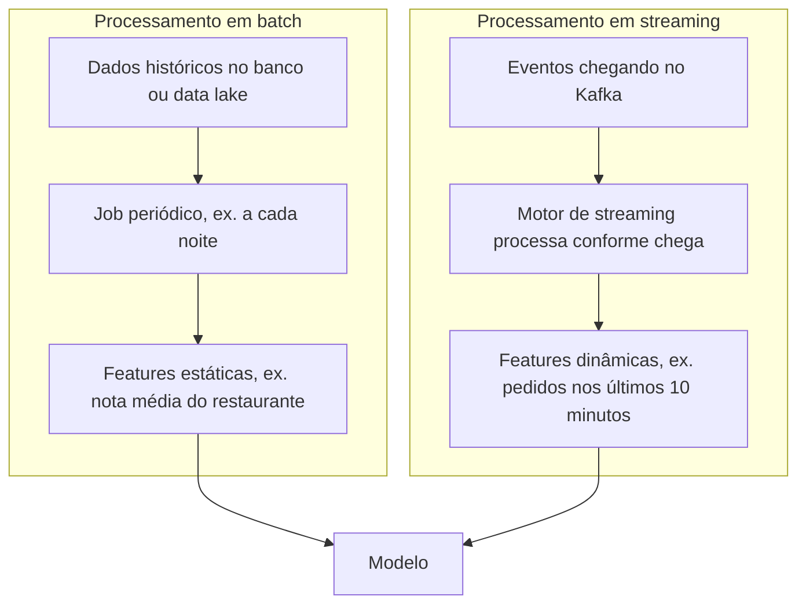

# 3. Fundamentos de engenharia de dados

> [!NOTE] Em uma frase
> Antes de treinar qualquer modelo, é preciso saber onde os dados estão, em que formato, como chegam de um lugar a outro e se são processados de tempos em tempos ou conforme acontecem.

## Por que isso importa

Um cientista de dados recebe um arquivo CSV de 50 GB com o histórico de compras e quer calcular a média de uma única coluna, o valor da compra. O script leva 40 minutos. Um colega converte o mesmo arquivo para Parquet e a conta cai para segundos. Nada mudou no algoritmo; mudou o formato em que os dados estão guardados.

Esse é o tipo de decisão que este capítulo ensina a tomar. Sistemas de ML vivem de dados, e a maior parte dos problemas práticos (lentidão, custo, previsões desatualizadas, features diferentes no treino e em produção) nasce em escolhas de engenharia de dados feitas sem pensar em ML. Quem conhece os fundamentos conversa melhor com a equipe de dados e evita retrabalho.

## O que você precisa saber antes

- [Capítulo 2](02-introducao-ao-design-de-sistemas-de-ml.md): o ciclo de desenvolvimento, em que a engenharia de dados é a segunda etapa.
- [Pipeline](../../glossario.md#pipeline): sequência de etapas em que a saída de uma alimenta a próxima.
- [Fila e mensageria](../../glossario.md#fila-e-mensageria): componente que entrega mensagens de um produtor a um consumidor sem que um espere o outro.

## As ideias centrais

### Fontes de dados

Os dados de um sistema de ML vêm de quatro lugares típicos:

- **Entrada do usuário**: textos, imagens, formulários, cliques. É o dado mais sujo: as pessoas digitam errado, mandam arquivos no formato errado, deixam campos em branco. E precisa ser processado rápido, porque o usuário espera resposta.
- **Dados gerados pelo sistema**: logs (registros do que o sistema fez), previsões do próprio modelo, métricas. O volume é enorme e quase ninguém olha, mas são essenciais para depurar e monitorar.
- **Bancos internos**: estoque, cadastro de clientes, pedidos. São os dados que a empresa usa para operar e que muitas vezes viram features.
- **Dados de terceiros**: comprados de empresas que coletam informações de muitas fontes. Úteis, mas cada vez mais limitados por regras de privacidade.

### Formatos: linha versus coluna, texto versus binário

Guardar dados é **serializar**: converter uma estrutura em memória em algo que cabe em disco ou na rede. A escolha do formato afeta velocidade, espaço e facilidade de leitura.

- **Orientado a linha** (CSV, por exemplo): os valores de um mesmo registro ficam juntos no disco. É ótimo para escrever e ler registros inteiros ("me dê a compra 1234 completa").
- **Orientado a coluna** (Parquet, por exemplo): os valores de uma mesma coluna ficam juntos. É ótimo para ler uma coluna de muitos registros ("me dê o valor de todas as compras"), que é exatamente o que se faz ao calcular estatísticas ou montar features.

É por isso que o exemplo do início acelera tanto. Um detalhe que pega muita gente: o DataFrame do pandas (a biblioteca de tabelas mais usada em Python) é organizado por coluna, então percorrer linha por linha é bem mais lento que operar coluna inteira.

A outra dimensão é **texto versus binário**. JSON e CSV são texto: qualquer pessoa abre e lê, mas ocupam mais espaço. Parquet é binário: compacto e rápido, mas precisa de um programa para ler. Um número como 1000000 ocupa 7 caracteres em texto e cabe em 4 bytes em binário.

### Modelos de dados e o que é "estruturado"

Um modelo de dados é a forma como os dados são representados. Três são comuns:

- **Relacional**: tabelas com linhas e colunas, consultadas com SQL. Usa normalização (evitar repetir a mesma informação em vários lugares) e é declarativo: você diz o que quer, o banco decide como buscar.
- **Documento**: cada registro é um documento autocontido, como um JSON. Bom quando os registros raramente se relacionam entre si.
- **Grafo**: os relacionamentos são o centro (quem segue quem em uma rede social). Bom quando as perguntas são sobre conexões.

A distinção entre **estruturado** e **não estruturado** é menos rígida do que parece. A pergunta útil é: quem assume a responsabilidade pela estrutura? Em dados estruturados, quem **escreve** precisa obedecer a um esquema. Em dados não estruturados, quem **lê** precisa descobrir a estrutura. Um **data warehouse** guarda dados já estruturados e prontos para análise; um **data lake** guarda dados brutos, de qualquer formato, para processar depois.

### Armazenamento e processamento: transacional versus analítico

Bancos de dados costumam ser otimizados para um de dois tipos de trabalho:

- **Transacional (OLTP)**: muitas operações pequenas e rápidas, como "registrar este pedido". Precisa de baixa latência e alta disponibilidade, e em geral oferece as garantias [ACID](../../glossario.md#acid) (tudo ou nada, regras respeitadas, transações isoladas, nada se perde).
- **Analítico (OLAP)**: poucas consultas grandes que varrem muitos registros, como "receita média por região no último ano".

Por muito tempo, cada tipo de banco servia só ao seu trabalho. Hoje há bancos que fazem os dois e, principalmente, sistemas que **separam armazenamento de processamento**: os dados ficam em um lugar barato e vários motores de consulta leem deles.

Uma decisão relacionada é **ETL versus ELT**. ETL (extrair, transformar, carregar) limpa e estrutura os dados antes de guardá-los. ELT (extrair, carregar, transformar) guarda tudo bruto e transforma quando alguém precisar. ELT é mais flexível no começo, mas um lago enorme de dados brutos fica difícil de consultar.

### Como os dados passam entre processos

Em produção, raramente tudo roda em um processo só. O livro descreve três modos de passar dados:

1. **Via banco de dados**: um processo escreve, outro lê. Simples, mas ambos precisam acessar o mesmo banco, e ler e escrever em banco pode ser lento demais para aplicações que exigem resposta rápida.
2. **Via serviços**: um processo expõe uma API (uma interface de requisição e resposta, como REST ou RPC) e outro faz pedidos a ela. É a base da arquitetura de microsserviços. Exemplo: o serviço de preços pergunta ao serviço de estoque quantas unidades restam.
3. **Via transporte em tempo real**: um processo publica eventos em um sistema como Apache Kafka ou RabbitMQ, e outros processos consomem esses eventos quando puderem. Fica no meio do caminho: assíncrono (ninguém espera ninguém) e com latência razoavelmente baixa. Útil quando muitos serviços precisam dos mesmos dados.

### Batch versus streaming

Dados em bancos e em transportes em tempo real têm propriedades diferentes, então são processados de modos diferentes. [Batch vs streaming](../../glossario.md#batch-vs-streaming) resume: batch trabalha sobre um conjunto fechado, de tempos em tempos; streaming trabalha sobre eventos conforme chegam.

Pense em um app de delivery. A nota média de um restaurante muda devagar: calcular uma vez por dia, em batch, basta. Já o número de pedidos pendentes na cozinha nos últimos 10 minutos muda o tempo todo e afeta muito o tempo de entrega: precisa ser calculado em streaming. Features do primeiro tipo são **estáticas**; do segundo, **dinâmicas**.

Streaming é mais difícil: os dados não têm fim, chegam fora de ordem, e o cálculo precisa manter estado (lembrar o que já viu). Ferramentas como Apache Flink foram feitas para isso. Há quem argumente que batch é só um caso especial de streaming (um stream que termina), e que um único motor poderia servir aos dois. Essa unificação importa para ML porque usar dois pipelines diferentes, um para treino em batch e outro para produção em streaming, é uma fonte clássica de [train-serving skew](../../glossario.md#train-serving-skew): a feature é calculada de um jeito no treino e de outro em produção.

## Onde isso aparece no mundo real

- **Data lakes em Parquet**: é comum guardar eventos brutos em armazenamento de objetos (como S3) em formato colunar, justamente porque as consultas de análise e de feature leem poucas colunas de muitos registros.
- **Kafka como espinha dorsal de eventos**: empresas de transporte e de comércio usam um barramento de eventos para que pagamentos, logística e modelos de ML consumam os mesmos acontecimentos sem depender uns dos outros.
- **Features em tempo real para fraude**: "quantas compras este cartão fez na última hora" só tem valor se for calculado em streaming; em batch, chega tarde demais.

## Erros comuns de quem está aprendendo

- **Achar que formato é detalhe.** A diferença entre CSV e Parquet pode ser de minutos para segundos e de terabytes para gigabytes.
- **Achar que "não estruturado" significa "sem estrutura".** A estrutura existe; só que quem lê precisa descobri-la.
- **Escolher streaming por ser moderno.** Se a feature muda uma vez por dia, batch é mais simples e barato.
- **Ter um pipeline de treino e outro de produção escritos de forma independente.** Pequenas diferenças entre eles viram erros silenciosos no modelo.

## Verifique se entendeu

1. Por que calcular a média de uma coluna é mais rápido em Parquet do que em CSV? (Formatos)
2. Em dados estruturados, quem assume a estrutura: quem escreve ou quem lê? (Modelos de dados)
3. Dê um exemplo de quando passar dados via serviço é melhor que via banco, e de quando transporte em tempo real é melhor que via serviço. (Como os dados passam entre processos)
4. No app de delivery, classifique três features como estáticas ou dinâmicas e diga como cada uma seria calculada. (Batch versus streaming)
5. Por que ter pipelines separados de batch e streaming é um risco para modelos? (Batch versus streaming)

## Para ir além

- [summary.md oficial](https://github.com/chiphuyen/dmls-book/blob/main/summary.md): o resumo da autora deste capítulo destaca a ideia de que estruturado e não estruturado dependem de quem assume a estrutura.
- [resources.md oficial](https://github.com/chiphuyen/dmls-book/blob/main/resources.md): tem uma subseção dedicada a streaming, com leituras para aprofundar processamento de eventos.
- [Resumo de Andrew Clark](https://andrewclark.co.uk/product-book-summaries/designing-machine-learning-systems): cobre a engenharia de dados com tabelas comparando formatos e modelos.

---
Anterior: [2. Introdução ao design de sistemas de ML](02-introducao-ao-design-de-sistemas-de-ml.md) · Próximo: [4. Dados de treino](04-dados-de-treino.md) · Voltar ao livro: [Guia de leitura](index.md)
