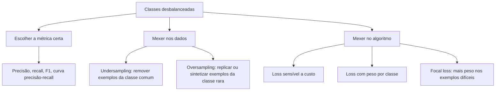

# 4. Dados de treino

> [!NOTE] Em uma frase
> Um algoritmo brilhante treinado com dados ruins produz um modelo ruim; montar bons dados de treino exige decidir o que amostrar, como rotular, como lidar com casos raros e como aumentar o que se tem.

## Por que isso importa

Um banco quer um modelo que detecte fraude em cartão. Tem 10 milhões de transações históricas, das quais 2 mil são fraudes. Um estagiário treina um modelo, mede a acurácia e comemora: 99,98%. Só que o modelo aprendeu a dizer "não é fraude" para tudo. Como 99,98% das transações são legítimas, ele acerta quase sempre e não detecta fraude nenhuma.

Esse exemplo reúne vários temas do capítulo: a classe que importa é rara (desbalanceamento), saber quais transações são fraude exige investigação (labels caros), e escolher quais exemplos usar no treino (amostragem) muda o resultado. Dados de treino são a fundação; se ela está torta, nada em cima fica de pé.

## O que você precisa saber antes

- [Capítulo 3](03-fundamentos-de-engenharia-de-dados.md): de onde vêm os dados e como são guardados.
- [Label](../../glossario.md#label): a resposta certa de cada exemplo.
- [Dataset e divisão treino / validação / teste](../../glossario.md#dataset-e-divisão-treino--validação--teste): por que separar os dados em três partes.
- [Loss](../../glossario.md#loss-função-de-perda): o número que o treino minimiza.

## As ideias centrais

### Amostragem

Quase nunca se usa todos os dados que existem, seja porque são demais, seja porque nem todos são acessíveis. Amostrar é escolher um subconjunto, e o jeito de escolher pode introduzir vieses.

**Amostragem não probabilística** escolhe por critérios que não são sorteio: os dados mais fáceis de obter (conveniência), os indicados por quem já está na amostra (bola de neve), os escolhidos por especialistas (julgamento), ou cotas fixas por grupo. É rápida, mas quase sempre enviesada. Muitos datasets famosos foram montados assim, por exemplo com textos de fontes fáceis de baixar.

**Amostragem aleatória** usa sorteio e tem variações úteis:

- **Simples**: cada exemplo tem a mesma chance. Problema: uma classe rara (0,02% de fraudes) pode simplesmente não aparecer.
- **Estratificada**: divide a população em grupos (estratos) e sorteia dentro de cada um, garantindo que todos apareçam.
- **Ponderada**: cada exemplo tem um peso que define sua chance. Útil para dar mais espaço a dados recentes, que se parecem mais com o que o modelo verá em produção.
- **Reservatório (reservoir sampling)**: resolve um problema de streaming. Se os dados chegam sem parar e você quer manter uma amostra de tamanho fixo em que cada item visto tem a mesma chance de estar presente, o algoritmo de reservatório faz isso sem saber de antemão quantos itens virão.
- **Por importância**: permite estimar algo sobre uma distribuição usando amostras de outra, mais fácil de obter, corrigindo com pesos.

### Labels: naturais, manuais e alternativas

A maioria dos modelos em produção é **supervisionada**: aprende a partir de exemplos com label. Conseguir labels é muitas vezes a parte mais difícil.

**Labels naturais** surgem sozinhos do uso do sistema. Um app de mapas prevê que a viagem levará 20 minutos; quando ela termina, você sabe quanto levou. Um sistema de recomendação mostra um produto; se o usuário clicou, há um label positivo. O tempo entre a previsão e a chegada do label chama-se **comprimento do ciclo de feedback**. Em recomendação são minutos; em fraude, pode levar meses até um cliente contestar a cobrança. Há ainda uma sutileza: a ausência de clique não é um "não" claro; talvez o usuário nem tenha visto o item.

**Labels manuais** são feitos por anotadores humanos. Problemas: caros (especialmente quando exigem especialistas, como radiologistas), lentos, às vezes impossíveis por privacidade (não se manda prontuário para qualquer anotador), e inconsistentes. Essa inconsistência tem nome no livro, **multiplicidade de labels**: anotadores diferentes marcam o mesmo exemplo de formas diferentes. A solução passa por definições claras e por rastrear a **linhagem dos dados** (de onde veio cada exemplo e quem o rotulou), para descobrir, por exemplo, que um lote de um certo anotador está piorando o modelo.

Quando labels manuais são escassos, o livro apresenta quatro alternativas:

| Técnica | Ideia | Exemplo |
|---|---|---|
| Supervisão fraca | Regras heurísticas (funções de rotulagem) escritas por especialistas rotulam muitos exemplos de forma barata e imprecisa | "Se o laudo menciona pneumonia, marque como positivo" |
| Semissupervisão | Parte de poucos exemplos rotulados e propaga labels para os não rotulados | Treina com 1 mil exemplos, rotula outros 100 mil com o próprio modelo, retreina com os mais confiáveis |
| Transfer learning | Reaproveita um modelo treinado em outra tarefa com muitos dados | Um modelo de linguagem genérico ajustado para classificar reclamações |
| Aprendizado ativo | O modelo escolhe quais exemplos valem a pena mandar para anotação humana | Rotular só os casos em que o modelo está mais em dúvida |

### Desbalanceamento de classes

Desbalanceamento é quando uma classe é muito mais frequente que outra, como no exemplo da fraude. É a regra no mundo real: doenças raras, defeitos de fábrica, fraudes, cliques em anúncios. Ele atrapalha por três motivos: há pouco sinal para aprender a classe rara, o modelo encontra um atalho fácil (prever sempre a classe comum), e o custo de errar costuma ser assimétrico (deixar passar uma fraude custa muito mais que barrar uma compra legítima).

O livro organiza as soluções em três frentes:

**Métricas.** Acurácia engana. **Precisão** responde "dos que o modelo marcou como fraude, quantos eram?"; **recall** responde "das fraudes que existiam, quantas o modelo pegou?". O F1 combina as duas. Para classes muito raras, a curva de precisão-recall é mais informativa que a curva ROC, que pode parecer ótima mesmo quando o modelo é ruim na classe rara.

**Dados.** Undersampling remove exemplos da classe comum; oversampling replica ou sintetiza exemplos da rara (SMOTE é uma técnica clássica que cria exemplos novos interpolando vizinhos). Cuidado: reamostrar muda a distribuição que o modelo vê, então **nunca avalie em dados reamostrados**; o teste precisa refletir a realidade.

**Algoritmo.** Em vez de mudar os dados, muda-se a loss para que errar a classe rara custe mais. A focal loss vai além e dá mais peso aos exemplos em que o modelo ainda erra, seja qual for a classe.

### Aumento de dados (data augmentation)

Aumentar dados é criar exemplos novos a partir dos existentes. Três famílias:

- **Transformações que preservam o label**: girar, cortar ou mudar o brilho de uma foto de gato continua sendo uma foto de gato. Em texto, trocar uma palavra por um sinônimo.
- **Perturbação**: adicionar ruído pequeno aos exemplos. Isso torna o modelo mais robusto, inclusive contra exemplos adversariais (entradas alteradas de propósito para enganar o modelo).
- **Síntese de dados**: gerar exemplos do zero, por exemplo com templates ("Encontre um restaurante [CULINÁRIA] a [DISTÂNCIA] de [LUGAR]") ou misturando exemplos e seus labels (técnica chamada mixup).

## Onde isso aparece no mundo real

- **Recomendação usa labels naturais**: cliques, compras e tempo assistido viram labels de graça, o que explica por que empresas começam por esses problemas.
- **Anotação médica** é o caso típico de labels caros: horas de especialista por exemplo, regras de privacidade, discordância entre médicos. Supervisão fraca e aprendizado ativo nasceram em boa parte desse tipo de situação.
- **Visão computacional** usa aumento de dados em praticamente todo treino; cortar, espelhar e variar cor são passos padrão nas bibliotecas.

## Erros comuns de quem está aprendendo

- **Usar acurácia em problema desbalanceado.** Olhe precisão e recall da classe que importa.
- **Avaliar em dados reamostrados.** O resultado parece ótimo e não diz nada sobre produção.
- **Tratar falta de clique como label negativo certo.** Pode ser só falta de exposição.
- **Ignorar de onde vêm os labels.** Sem linhagem, um lote ruim de anotação contamina o modelo e ninguém descobre qual.

## Verifique se entendeu

1. Por que a amostragem aleatória simples pode falhar em problemas com classes raras, e qual variação resolve? (Amostragem)
2. O que é o comprimento do ciclo de feedback e por que ele é longo em detecção de fraude? (Labels)
3. Qual a diferença entre supervisão fraca e aprendizado ativo? (Labels, tabela)
4. Explique, com o exemplo da fraude, por que precisão e recall dizem mais que acurácia. (Desbalanceamento)
5. Dê um exemplo de transformação que preserva o label em imagens e um que não preserva. (Aumento de dados)

## Para ir além

- [summary.md oficial](https://github.com/chiphuyen/dmls-book/blob/main/summary.md): resumo da autora com a lista das alternativas a labels manuais e das técnicas de desbalanceamento.
- [Resumo de Andrew Clark](https://andrewclark.co.uk/product-book-summaries/designing-machine-learning-systems): aprofunda o capítulo de dados de treino, com tabelas sobre amostragem e desbalanceamento.
- [Resumo de Cedric Chee](https://cedricchee.com/blog/ml-sys-design-book-summary/): versão em bullets do capítulo, boa para revisar a terminologia.

---
Anterior: [3. Fundamentos de engenharia de dados](03-fundamentos-de-engenharia-de-dados.md) · Próximo: [5. Engenharia de features](05-engenharia-de-features.md) · Voltar ao livro: [Guia de leitura](index.md)
