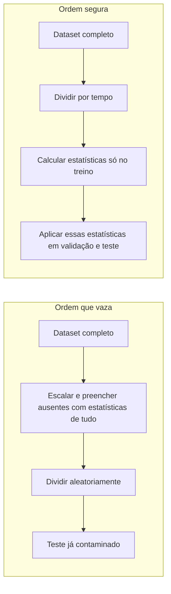

# 5. Engenharia de features

> [!NOTE] Em uma frase
> Boas features costumam valer mais que um modelo sofisticado, e o maior perigo ao criá-las é deixar escapar, sem querer, informação que o modelo não terá em produção.

## Por que isso importa

Um hospital treina um modelo para detectar câncer de pulmão em tomografias e obtém resultados excelentes. Em outro hospital, o modelo fracassa. A investigação mostra o motivo: no hospital original, pacientes com suspeita forte eram examinados em um aparelho específico, que gerava imagens com uma marca ligeiramente diferente. O modelo aprendeu a reconhecer o aparelho, não o câncer.

Esse é um caso de **vazamento de dados** (data leakage), o tema mais importante deste capítulo. O resto do capítulo trata da parte criativa: transformar dados brutos em [features](../../glossario.md#feature) que ajudem o modelo. Mesmo com deep learning aprendendo features sozinho, em produção a maior parte do ganho ainda vem de features bem pensadas.

## O que você precisa saber antes

- [Capítulo 4](04-dados-de-treino.md): como montar o dataset de treino.
- [Feature](../../glossario.md#feature): variável de entrada do modelo.
- [Dataset e divisão treino / validação / teste](../../glossario.md#dataset-e-divisão-treino--validação--teste): a separação que o vazamento quebra.
- [Overfitting](../../glossario.md#overfitting): quando o modelo decora o treino e vai mal em dados novos.

## As ideias centrais

### Features aprendidas versus features construídas

Em deep learning, parte das features é **aprendida**: você entrega o texto bruto e a rede descobre representações úteis. Isso reduziu muito o trabalho manual em texto e imagem. Mas sistemas reais quase nunca recebem só texto. Um classificador de comentários tóxicos também pode usar a idade da conta, o número de denúncias anteriores e o horário. Essas features são **construídas** por pessoas, e escolhê-las exige conhecer o domínio.

### Operações comuns

**Valores ausentes.** O livro distingue três tipos, e a diferença importa:

- *Ausente de forma não aleatória*: o motivo da ausência está ligado ao próprio valor. Pessoas com renda alta deixam o campo de renda em branco com mais frequência.
- *Ausente de forma aleatória condicionada*: a ausência depende de outra variável observada. Um grupo de usuários, por algum motivo, não preenche a idade.
- *Completamente aleatório*: não há padrão nenhum. É raro.

As duas soluções são **remover** (a linha ou a coluna inteira, perdendo informação) ou **imputar** (preencher com um valor, como a média ou zero). Imputar pode inserir viés; zero, por exemplo, pode ser um valor real. Às vezes a própria ausência é informativa e vira uma feature ("renda não informada").

**Escala.** Modelos sofrem quando features têm escalas muito diferentes: idade vai de 0 a 100, renda de 0 a milhões. Opções: colocar tudo entre 0 e 1 (min-max), centralizar em média zero e desvio um (padronização), ou aplicar logaritmo quando a distribuição é muito assimétrica, como renda. As estatísticas usadas para escalar (mínimo, média) vêm dos dados de treino e podem envelhecer.

**Discretização.** Transformar um número contínuo em faixas (renda baixa, média, alta). Pode ajudar com poucos dados, mas cria fronteiras artificiais: R$ 34.999 e R$ 35.000 caem em faixas diferentes.

**Variáveis categóricas.** Categorias como "marca do produto" são um problema porque novas aparecem o tempo todo em produção. Se o modelo só conhece as marcas do treino, o que fazer com uma marca nova? O **truque do hashing** aplica uma função de hash ao nome e usa o resultado como índice em um espaço de tamanho fixo. Marcas novas ganham um índice automaticamente; o custo é que duas marcas às vezes colidem no mesmo índice, o que na prática afeta pouco.

**Cruzamento de features.** Combinar duas features em uma nova, como "estado civil × número de filhos". Ajuda modelos simples a capturar interações, mas multiplica o número de valores possíveis e o risco de overfitting.

**Embeddings de posição.** Em modelos que leem sequências inteiras de uma vez, como os transformers, a ordem das palavras precisa ser informada explicitamente por uma feature de posição.

### Vazamento de dados

Vazamento é quando uma informação sobre o label "vaza" para as features durante o treino, mas não estará disponível no momento da previsão real. O modelo parece ótimo na avaliação e falha em produção. É traiçoeiro justamente porque os números ficam bons.

Causas comuns:

- **Dividir dados com dependência temporal de forma aleatória.** Se o preço de ações de hoje está no treino e o de ontem no teste, o modelo "vê o futuro". Divida por tempo: treina no passado, testa no que vem depois.
- **Escalar ou imputar antes de dividir.** A média calculada com o teste incluído carrega informação do teste para o treino.
- **Oversampling antes de dividir.** Cópias do mesmo exemplo acabam no treino e no teste.
- **Duplicatas.** O mesmo exemplo aparece nas duas partes; o modelo só precisa lembrar.
- **Vazamento de grupo.** Duas tomografias do mesmo paciente, uma em cada parte.
- **Vazamento pelo processo de geração.** O caso do hospital: algo na forma como o dado foi coletado entrega a resposta.

Para detectar, olhe com desconfiança para features com poder preditivo alto demais, e meça o quanto cada feature, sozinha ou em grupo, explica o label. Uma feature que sozinha prevê quase perfeitamente merece investigação antes de comemoração.

### Mais features não é sempre melhor

Cada feature a mais é mais chance de vazamento, mais risco de overfitting, mais memória e latência em produção, e mais dívida técnica: alguém precisa manter o pipeline que a calcula. Duas perguntas ajudam a decidir:

- **Importância**: quanto o modelo piora se eu tirar esta feature? Técnicas como SHAP estimam a contribuição de cada feature para as previsões. Muitas vezes, poucas features respondem pela maior parte do resultado.
- **Generalização**: a feature vale para dados que o modelo ainda não viu? Duas métricas ajudam: **cobertura** (em quantos exemplos ela tem valor) e **distribuição** (se os valores no treino e no teste se parecem). Uma feature presente em 1% dos exemplos ou com distribuição muito diferente entre treino e teste é suspeita.

### As práticas recomendadas

O livro fecha com uma lista de práticas, que vale ter à mão:

1. Dividir os dados por tempo, não aleatoriamente.
2. Fazer oversampling só depois de dividir.
3. Escalar e normalizar só depois de dividir.
4. Usar estatísticas só do treino para escalar e preencher ausentes.
5. Entender como os dados são gerados, coletados e processados, envolvendo especialistas do domínio.
6. Rastrear a linhagem dos dados.
7. Medir a importância das features.
8. Preferir features que generalizam.
9. Remover features que deixaram de ser úteis.

Um ponto de processo: especialistas do domínio (o médico, o analista de crédito) muitas vezes não programam. Vale desenhar o fluxo para que eles possam propor e testar features sem depender de um engenheiro a cada passo.

## Onde isso aparece no mundo real

- **Competições de ML** são famosas por vazamentos: já houve casos em que o identificador do exemplo ou a ordem dos arquivos revelava o label, e equipes venceram explorando isso. É um bom lembrete de que número bom não prova modelo bom.
- **Modelos de crédito** convivem com valores ausentes não aleatórios o tempo todo: quem omite informação muitas vezes é diferente de quem informa.
- **Feature stores** (sistemas que guardam e servem features, assunto do [capítulo 10](10-infraestrutura-e-ferramentas.md)) existem em boa parte para garantir que a mesma feature seja calculada igual no treino e em produção, evitando [train-serving skew](../../glossario.md#train-serving-skew).

## Erros comuns de quem está aprendendo

- **Calcular estatísticas com o dataset inteiro antes de dividir.** É a forma mais comum de vazamento e quase ninguém percebe.
- **Dividir séries temporais aleatoriamente.** Use o tempo como critério.
- **Adicionar features "porque não custa nada".** Custa: manutenção, latência e risco.
- **Preencher ausentes sem perguntar por que estão ausentes.** O motivo pode ser a informação mais útil.

## Verifique se entendeu

1. Por que o truque do hashing ajuda com categorias que aparecem só em produção? (Operações comuns)
2. Explique, com o exemplo do hospital, o que é vazamento pelo processo de geração. (Vazamento de dados)
3. Por que escalar os dados antes de dividir causa vazamento? (Vazamento de dados, diagrama)
4. Que duas métricas ajudam a julgar se uma feature generaliza? (Mais features não é sempre melhor)
5. Dê um exemplo em que a ausência de um valor é, ela própria, uma boa feature. (Operações comuns)

## Para ir além

- [summary.md oficial](https://github.com/chiphuyen/dmls-book/blob/main/summary.md): para este capítulo a autora resume tudo na lista de nove práticas, útil como checklist.
- [Resumo de Andrew Clark](https://andrewclark.co.uk/product-book-summaries/designing-machine-learning-systems): aprofunda vazamento de dados com exemplos e tabelas.
- [resources.md oficial](https://github.com/chiphuyen/dmls-book/blob/main/resources.md): leituras complementares sobre engenharia de features e vazamento.

---
Anterior: [4. Dados de treino](04-dados-de-treino.md) · Próximo: [6. Desenvolvimento e avaliação offline](06-desenvolvimento-e-avaliacao-offline.md) · Voltar ao livro: [Guia de leitura](index.md)
